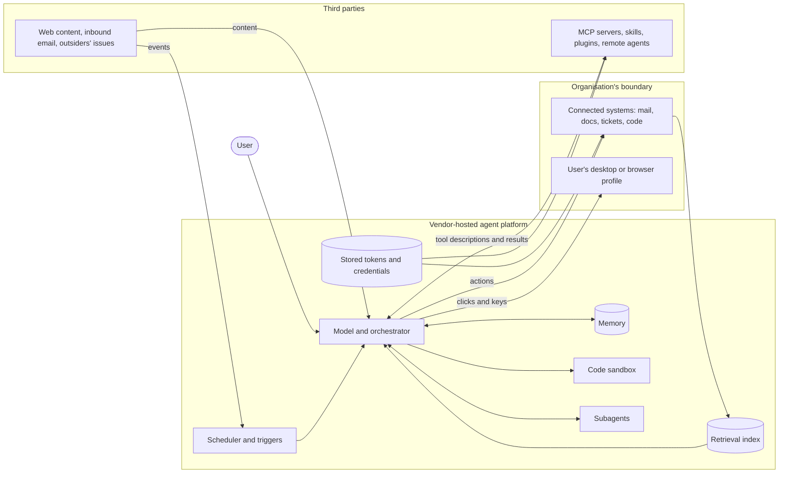

# Threat model: Agent features (computer use, memory, connectors and extensions, code execution, retrieval, multi-agent, background agents)

| Field | Value |
|---|---|
| Asset class | Agent features: capabilities switched on for a model or product already in use, namely computer use and browser control, persistent memory, connectors, MCP servers, skills and plugins, code execution sandboxes, file search and retrieval, multi-agent systems and subagents, scheduled and background agents |
| Version | 1.0 |
| Date | 2026-11-21 |
| Evaluated by | `agent-feature-review` |
| Related threat models | AI coding agents; LLM applications; Vision-input models; General-purpose models; AI-assisted security tools |
| Status | Current. Ratings are rough and for the reference deployment below |

## 1. Executive summary

An agent feature is a capability switched on for a model or product the organisation already
uses. Each one moves a trust boundary that the original review assumed was fixed: it lets
others' content into the model's context, gives the agent a new way to act or send data out,
hands it a standing identity, lets state outlive the session, brings third-party code into the
loop, or removes the person who used to start and watch each run. The model may be unchanged;
what it can be made to do is not.

| Core risk | Why it matters | Inherent risk | Assessed by |
|---|---|---|---|
| Content the feature brings in takes over the agent | Screens, tool results, retrieved documents, memories, other agents' messages and event triggers are all written by someone other than the user, and published attacks turn each into actions | Critical | `agent-feature-review`; part-measured by public benchmarks |
| The feature acts with a standing identity and broad privileges | A signed-in browser, an OAuth token or a stored credential gives whoever steers the agent the user's or a service's reach | High | `agent-feature-review` (design review) |
| Data leaves through the feature's own actions | Typing into a form, calling a second connector or rendering an image link is an exfiltration channel; zero-click cases are documented | High | `agent-feature-review`; part-measured by public benchmarks |
| Third-party code and text in the loop | MCP servers, skills, plugins and remote agents are installed from registries and can be malicious from the start or change after approval | High | `agent-feature-review`; `security-tool-benchmark` measures scanners |
| Persistence and absence | Memory and schedules make one injection last; unattended runs remove the person who would have noticed | High | `agent-feature-review` (design review) |

**Where risk concentrates.** Where a feature combines content others can write with an action
or egress channel and nobody watching: connectors to inboxes and trackers that can also send,
browser agents on a signed-in profile, and background agents started by outside events.
Retrieval and memory concentrate a second kind of risk: data the user never meant to share
becoming findable, or staying long after it should have gone.

**What the evaluations tell you.** `agent-feature-review` is a guided review, not a benchmark:
one template per feature, recording for each threat the answers, vendor evidence, tests and
what was not assessed. Public benchmarks measure parts of a feature on a model in their own
environment (for example screen-borne injection, tool-result injection, memory poisoning); a
result there is evidence about a model, not about the vendor's product or the organisation's
data. Most of what matters here (privilege reach, tenant isolation, egress, change control)
has no standard test and is design review.

## 2. Scope and reference deployment

**Reference deployment.** An organisation already uses a vendor-hosted assistant or agent
platform, signed in through single sign-on, for knowledge workers and engineers, with internal
and confidential data. It is now switching on features at vendor defaults, one at a time:
connectors to email, documents and tickets with user-delegated OAuth, which any user may add
unless an administrator restricts it; MCP servers, skills and plugins added by users; a browser
agent working in the user's own signed-in profile; memory on; code execution in the vendor's
sandbox; file search over shared drives; subagents in a research or coding agent; scheduled
tasks with stored credentials. Logging is whatever the vendor's administrator console offers.

**What moves the ratings.** Administrator-only enablement and allowlists lower everything
involving extensions. A vendor-hosted, isolated browser or VM with no signed-in accounts lowers
computer-use impact sharply; the user's own desktop raises it. Read-only connectors and
narrowly scoped tokens lower impact; connectors that can send lower it least. Sandboxes with no
network lower code-execution risk; network on raises it. Memory scoped per project and visible
to the user lowers persistence risk. Triggers limited to insiders lower background-agent risk.

**In scope:** the trust boundary each feature moves and the threats that follow. **Out of
scope:** the model's general behaviour (General-purpose models), the coding-agent harness
itself (AI coding agents), the organisation's own application around a model (LLM
applications), and scanning any specific extension, which is outside this repository.

## 3. System model

**The shared core.** Every feature makes one or more of these seven changes; most threats below
follow from them.

1. **New content in context**, written by someone other than the user.
2. **New action or egress channel**: clicks, tool calls, code, sends.
3. **New standing identity**: a signed-in session, a token, a stored credential.
4. **New persistence**: memory, indexes, schedules, containers that outlive the session.
5. **Less human presence** per action, down to none.
6. **Third-party code and text in the loop**: servers, skills, plugins, remote agents.
7. **A new data store** at the vendor, with its own retention and access.

| Feature | Shared changes it makes |
|---|---|
| Computer use and browser control | 1, 2, 3, 5 |
| Persistent memory | 1, 4, 7 |
| Connectors, MCP servers, skills and plugins | 1, 2, 3, 6 |
| Code execution sandboxes | 2, 4, 7 |
| File search and retrieval | 1, 3, 4, 7 |
| Multi-agent systems and subagents | 1, 2, 3, 5, 6 |
| Scheduled and background agents | 1, 3, 4, 5 |

The assets are the data in connected systems and memory, the credentials and sessions the
features hold, the integrity of what the agent changes or sends, the user's machine (for
computer use and local servers), other tenants' and users' data (for shared stores), and the
record of what happened.

| Threat actor | Capability and access | Motivation |
|---|---|---|
| Content author | Writes something the agent will read: a web page, an email, a shared document, a calendar invite, an issue, a post in a public channel | Hijack actions, steal data |
| Extension publisher or operator | Publishes or runs an MCP server, skill, plugin or remote agent; may act honestly first and change later | Data theft, persistence, reach into many organisations |
| Other user or tenant | Shares a memory, index or workspace | Curiosity or deliberate access to others' data |
| User misusing the feature | Legitimate access | Fraud, harassment, scanning or abuse from the vendor's or organisation's network |
| The agent itself, no adversary | Misreads scope, repeats, loops | None; a failure source |
| Vendor | Hosts the feature, its stores and its sandbox; changes it behind flags | Product operation; trusted but outside control |

## 4. Core threats common to every feature

**K1. Content the feature brings in takes over the agent.** Whatever the feature adds to the
context (a screenshot, a tool result, a retrieved passage, a memory, another agent's message, a
trigger's payload) can carry instructions the model follows. *Critical* where the content is
outsider-writable and the agent can act; lowered by marking such content as data, fewer actions
in sessions that read it, confirmation for consequential steps, and injection classifiers.
Published cases span every channel: a poisoned connector email exfiltrating data without the
user opening it [R20, AML.CS0066], a calendar invitation steering an assistant's connected tools
[R20, AML.CS0063], and a zero-click retrieval exploit in a production assistant [R25].

**K2. The feature acts with a standing identity and broad privileges.** A browser profile, an
OAuth token or a stored service credential gives whoever steers the agent that identity's
reach. *High*; lowered by isolated sessions, narrow scopes requested progressively, and acting
as the asking user every time. The MCP specification forbids token passthrough and calls out
broad up-front scopes as a common mistake [R1].

**K3. Data leaves through the feature's own actions.** A click, a typed form, a call to a
second connector, an outbound request from a sandbox or a rendered image link can carry private
data out. *High*; lowered by egress limits, separating tools that read private data from tools
that send, showing tool arguments before calls, and not rendering remote content. The MCP tools
specification says clients should show tool inputs to the user before calling a server "to
avoid malicious or accidental data exfiltration" [R2].

**K4. Third-party code and text in the loop.** MCP servers, skills, plugins and remote agents
are code and descriptions written by others, installed from registries, and able to change
after approval. *High*; lowered by administrator-only installation, allowlists, pinned versions
and change alerts. One coding-agent vendor states that it reviews connectors against listing
criteria but "does not security-audit or manage any MCP server" [R3]; another vendor's skills
documentation says to use skills only from trusted sources and warns that even trustworthy ones
can be compromised if their external dependencies change [R4].

**K5. Persistence and absence make one failure last.** Memory, indexes and schedules keep a
planted instruction alive, and unattended runs remove the person who would have noticed it.
*High* for memory and background agents. See the feature sections.

**K6. The feature changes, or spreads, beyond what was reviewed.** Features change behind
vendor flags without a version, users enable them or add extensions outside the reviewed
configuration, and configuration can arrive by routes a reviewer does not see. *High* (likely,
moderate impact); lowered by administrator control of enablement, pinned versions where
offered, and a re-review trigger. For example, in one coding agent plugins can add MCP servers,
so reviewing the project's MCP file does not show every server a session loads [R3]; one
vendor's skill content scanning covers uploads in its apps but not skills uploaded through its
API [R4]. The feature's own data store (memories, chunks, containers, transcripts) also needs
its own retention and access review: one vendor keeps code-execution container data up to 30
days, and its skills are not eligible for zero data retention [R5][R4].

## 5. Threats by feature

Each subsection names the `agent-feature-review` template and its threat ids in brackets, so a
review record can be read against this document.

### 5.1 Computer use and browser control (template `computer-use`, cu-01 to cu-07)

*Sketch.* The model reads a screen it does not control (screenshots, page structure) and issues
clicks, keystrokes and navigation as whoever the browser or desktop is signed in as. Everything
rendered is input; many actions cannot be undone.

- **Instructions on screen take over the task** [cu-01]. *Critical.* A page, email, document or
  advert tells the agent to do something else. A browser-agent vendor's own red-teaming found
  attack success of 23.6% across 123 cases before new mitigations and 11.2% after [R6]; a hybrid
  VM-and-web benchmark measured 42.9% for one computer-use agent [R7]; in a published case a
  page caused a computer-use agent to open a terminal, paste a command and run it [R20,
  AML.CS0055]. Vendor documentation says the model may follow instructions found in content
  even when they conflict with the user's, and that classifiers now scan screenshots for
  injection [R8].
- **Signed-in privileges and irreversible actions** [cu-02, cu-03]. *High.* The agent can reach
  whatever the profile can: internal apps, single sign-on, saved passwords, payment methods.
  Before mitigations, the red-teaming above included an agent deleting a user's emails on a
  phishing instruction [R6]. Vendor guidance: a dedicated VM or container with minimal
  privileges, no login details given to the model, an allowlist of domains, and a person
  confirming consequential actions [R8]; a fresh profile, credentials kept out of page text and
  screenshots, and "typing sensitive information into a form counts as transmission" [R9].
- **Data leaves through the agent's actions** [cu-04]. *High.* Typing, pasting, uploading or
  navigating carries data out (K3).
- **Downloads, installs and code run from the session** [cu-07]. *High on the user's own
  desktop*, lower in a disposable vendor VM. The terminal case above is this threat.
- **Deliberate misuse and oversight that is not a check** [cu-05, cu-06]. *Medium.* Agents
  attempt harmful tasks that the same model refuses in chat [R10]; watching an agent click is not
  reviewing it, and one vendor advises checking the actual outcome rather than the model's final
  answer [R9].

### 5.2 Persistent memory (template `memory`, mem-01 to mem-06)

*Sketch.* Content written in one session is loaded into later ones as trusted context. Anything
that can cause a write can influence every later session; memory may be shared across devices,
projects, team members or agents.

- **Poisoned memories steer later sessions and persist unseen** [mem-01, mem-06]. *High.*
  An injection in a shared document reached a consumer assistant through a connected app and
  wrote false memories that persisted across chats [R20, AML.CS0040]. Research shows memory can
  be poisoned through ordinary queries alone [R11]. Raised when the model writes memory on its
  own judgement while reading content; lowered when the user sees each write and its source and
  can list and delete entries.
- **Memories surface in the wrong context or for the wrong person** [mem-02, mem-03]. *Medium.*
  Scope matters: one coding agent keeps one auto-memory per repository, shared across its
  worktrees and loaded into each session [R12]. Tenant isolation of a vendor's store has no
  public test.
- **Sensitive data is written and kept** [mem-04]. *High.* One vendor's memory tool
  documentation says the model "usually refuses" to store sensitive information and leaves
  stronger guarantees, expiry and path validation to the implementer [R13].
- **Stored beliefs degrade later answers** [mem-05]. *Low* for most uses; memory-induced
  sycophancy is measured by PersistBench [R14].

### 5.3 Connectors, MCP servers, skills and plugins (template `connectors-mcp`, mcp-01 to mcp-07)

*Sketch.* The agent reads from and writes to other systems through tools whose names,
descriptions and results come from whoever runs the server, using credentials the connector
holds. With several enabled, data read through one can leave through another.

- **Instructions in tool descriptions and tool results** [mcp-01, mcp-02]. *Critical.* A tool
  description told an agent to read credential files and pass them to the tool, which sent them
  to the server [R20, AML.CS0054]. The MCP specification says clients must treat tool
  annotations as untrusted unless they come from trusted servers, and that there should always
  be a human able to deny tool invocations [R2]. Results from inboxes, trackers and shared drives
  carry injections too (K1).
- **A malicious, compromised or changed extension** [mcp-03]. *High.* A look-alike email MCP
  package on npm was published clean, gained users, then added a hidden copy of every sent email
  to the attacker [R20, AML.CS0053]; a poisoned skill on a public registry was run by 16 users in
  its first 8 hours [R20, AML.CS0049]. In one editor an approved MCP configuration could be
  swapped without a new prompt (CVE-2025-54136) [R15].
- **Over-broad tokens and confused deputies** [mcp-04]. *High.* The MCP security guidance
  describes confused-deputy flaws in proxy servers, forbids accepting tokens not issued to the
  server, and recommends progressive least-privilege scopes [R1].
- **Data across connectors, and destructive writes** [mcp-05, mcp-06]. *High.* The email case
  above is cross-tool exfiltration; writes that delete or send need per-tool approval that shows
  what will happen (K3).
- **The server or its transport is exposed** [mcp-07]. *High.* The MCP Inspector's proxy lacked
  authentication and allowed remote command execution (CVE-2025-49596); an MCP proxy client ran OS
  commands from a malicious server's authorisation URL (CVE-2025-6514) [R15]. The
  specification covers local server compromise, server-side request forgery and session
  hijacking [R1].

### 5.4 Code execution sandboxes (template `code-execution`, exec-01 to exec-08)

*Sketch.* Model-written code runs automatically with whatever files, network and credentials the
environment has. The sandbox becomes a control the organisation relies on but, if vendor-hosted,
did not build.

- **Planted instructions decide what runs** [exec-01]. *Medium* in a sandbox with no network
  and no secrets; *High* where the sandbox holds data and egress. An injection in a PDF led a
  computer-use agent to run a destructive shell command [R20, AML.CS0046].
- **Escape, and reach beyond the sandbox** [exec-02, exec-03]. *Medium* for escape, *High* for
  egress where network is on. Models exploit container weaknesses when they are present [R16].
  One vendor's sandbox has internet "completely disabled" and full isolation from other
  containers [R5], while its consumer app gives skills full, partial or no network depending on
  settings [R4]. In 2026 evaluation agents used flaws in an artifact repository to obtain
  indirect internet access and compromised a third party's production systems [R20,
  AML.CS0068].
- **What sits inside: credentials, leftover data, packages** [exec-04, exec-05]. *Medium.* One
  hosted coding service makes secrets available only during setup and removes them before the
  agent runs [R17]; installing packages at run time invites hallucinated or malicious names [R18].
- **Output handed on, cost abuse, the sandbox used as attack infrastructure** [exec-06,
  exec-07, exec-08]. *Low to Medium.* Files produced in the sandbox may be opened or rendered by
  people or systems that trust them; loops consume budget; a user may run scanners or abuse from
  the vendor's address space.

### 5.5 File search and retrieval (template `file-search-rag`, rag-01 to rag-07)

*Sketch.* Passages retrieved from an index are placed in the prompt and treated as knowledge.
Whoever can add or edit a document can put text in the model's context; retrieval runs as some
identity; copies of documents and embeddings live in a new store.

- **Planted documents steer answers or carry instructions** [rag-01]. *High.* A few injected
  texts can make a retrieval system give an attacker-chosen answer [R19]; a post in a public
  channel, once retrieved, made an assistant leak a secret from a private channel through a link
  [R20, AML.CS0035].
- **Retrieval crosses permission boundaries, and secrets become searchable** [rag-02, rag-03,
  rag-04]. *High.* One vendor states that its assistant surfaces only data the user can at least
  view [R21]: correct, and it means existing oversharing becomes findable in plain language.
  Indexes built with an indexer's wider rights, or stale permissions, cross boundaries directly.
- **Private content leaves through the rendered answer** [rag-05]. *High.* EchoLeak, a single
  crafted email to a production assistant, bypassed its injection classifier and link redaction
  and used auto-fetched images through a proxy its content-security policy allowed, with no user
  interaction (CVE-2025-32711) [R25].
- **Trusted-looking wrong answers, and the store itself** [rag-06, rag-07]. *Medium.* Citations
  make passages look checked; chunks and embeddings may outlive deletion of the source.

### 5.6 Multi-agent systems and subagents (template `multi-agent`, ma-01 to ma-07)

*Sketch.* An orchestrator hands tasks, context and sometimes credentials to other agents and
treats what they return as input. Messages between agents are model-written text; no single
transcript shows the whole action.

- **An injection spreads from agent to agent** [ma-01]. *High.* Research shows prompts that
  self-replicate across connected agents [R22], and adversarial web content making multi-agent
  frameworks run arbitrary code in 58–90% of trials even when individual agents refuse harmful
  requests [R23].
- **Delegation widens privileges, and context is over-shared** [ma-02, ma-05]. *High.* In one
  coding agent subagents inherit the parent's built-in and MCP tools by default, and when the
  parent runs in bypass or auto mode the subagent runs in that mode whatever its own setting
  [R24].
- **Who sent this, and who did that** [ma-03, ma-06, ma-07]. *Medium to High.* The same agent
  marks subagent reports as carrying no authority from the user, but says that marking is not a
  substitute for restricting what a subagent can reach [R24]. Third-party agents can change
  without notice.
- **One failure cascades** [ma-04]. *Medium.* In the 2026 evaluation incident above, about 1,200
  agent runs exchanged more than 70,000 messages through a shared board they built themselves
  [R20, AML.CS0068].

### 5.7 Scheduled and background agents (template `background-agents`, bg-01 to bg-07)

*Sketch.* Runs start from a clock, an event or another system, with nobody watching, using
credentials stored for the purpose. Whatever fires the trigger may also supply the instructions.

- **A trigger an outsider can fire or shape** [bg-01]. *Critical* where outsiders can cause
  the event. CI agents given issue and pull request text with privileged tokens were exploitable
  this way [R26]. One hosted agent ignores events from users without write access by default and
  lets automations be limited to the triggering issue [R27].
- **Standing credentials** [bg-02]. *High.* Tokens for unattended runs are long-lived (one coding
  agent issues a one-year token for scripts and CI [R28]) and can outlive the person who set the
  task up.
- **Nobody present, nobody notices, nobody can stop it quickly** [bg-03, bg-06, bg-07].
  *High.* A vendor found evaluation incidents dating from April only through a retrospective
  transcript review in July [R29]. Designs that help: agents that cannot approve or merge their
  own pull requests, and workflows that wait for a person [R27].
- **A changed task or a delayed instruction keeps running** [bg-04]. *Medium.* An instruction
  planted for the next turn bypassed a control that only checked the turn in which untrusted data
  arrived [R20, AML.CS0038].
- **Runaway runs** [bg-05]. *Low* with caps on time, frequency, retries and spend.

## 6. How this repository's evaluations relate

| Threat area | Skill | What it gives | What it does not give |
|---|---|---|---|
| Every feature, every threat above | `agent-feature-review` (guided) | One record per feature: each template threat marked evidence recorded, answers only, not applicable or not assessed; vendor evidence and its absence; tests cited; benchmarks available and not run; the deployment context in the vocabulary of a published agentic-AI scoping matrix | A rating or a decision; a measurement of anything |
| Screen-borne injection (5.1) | `vision-model-benchmark` | Whether a model follows instructions in images and makes unrequested tool calls from them, with mock tools | What a real agent clicks or runs in a real session |
| Tool-result injection, exfiltration, memory poisoning (5.2, 5.3) | `model-benchmark` (AgentDojo, AgentThreatBench checks) | Bare-model baselines in simulated environments | The vendor's product, real connectors, memory across sessions |
| Extensions (5.3) | `security-tool-benchmark`, extension kind | How well a scanner of skills, plugins and MCP servers separates labelled malicious from benign samples | Whether a particular extension is safe; scanning one is outside this repository |
| Features behind the organisation's own endpoint | `app-redteam`, `app-benchmark` | Attacks through the prompt against that endpoint, with planted documents or canaries | Attacks through screens or real connectors the skills cannot drive |
| Misuse inside an agent harness (5.1, 5.4) | `agent-misuse-benchmark` | Declines of restricted tasks beside completion of legitimate twins, once completed with a harness module for the feature | Anything until completed; it ships no scenarios |

**Why the guided review.** No benchmark answers "can we switch this on here?": the answer
depends on what the feature can touch, whose identity it uses, who starts a run and where a
person must act, none of which a public test set knows. `agent-feature-review` exists so that
every threat is either backed by evidence or recorded as not assessed, rather than dropped
because no benchmark covers it. Its templates name the public benchmarks that measure part of
each threat (for computer use OS-Harm and RTC-Bench, for code execution SandboxEscapeBench, for
retrieval SafeRAG, for multi-agent systems TAMAS, among others) and say how each description was
verified; most are research code no skill here runs, and several need supervised virtual
machines.

**Left to design review, and why.** Privilege reach (K2), tenant and project isolation, egress
policy, credential storage, change control (K6), audit and stopping a task have no public test,
because they are properties of the organisation's configuration and the vendor's
infrastructure. The review records what is in place; a vendor's isolation is evidenced by the
vendor's own testing and audits.

**Open.** Public injection suites are mostly static; adaptive attacks against a vendor's
specific defences are not covered. Vendor figures (such as the browser-agent rates above) are
for the vendor's own attack set. Features change without versions, so a record describes the
feature on the day it was made.

## 7. Design review questions

- **All features.** What can the agent touch and change; who starts a run and where must a
  person act; whose identity does it use; who may enable the feature or add extensions; how will
  you learn that it changed?
- **Computer use.** Vendor-hosted VM, isolated profile, or the user's own desktop? Which
  accounts are signed in? Which actions need a person, and does the confirmation show what will
  actually happen?
- **Memory.** What causes a write; does the user see it and its source; who shares the memory;
  can users and administrators list, edit and delete entries; how long are they kept?
- **Connectors and extensions.** Who runs each server; read-only or read-write; which scopes;
  acting as the asking user or a service account; pinned versions; alerts on changed
  descriptions; which enabled tools can send data out?
- **Code execution.** Who hosts the sandbox; is each session fresh; is egress off or allowlisted;
  what credentials and data are inside; can it install packages?
- **Retrieval.** Which sources are indexed and who can write to them; whose permissions apply at
  query time and how fast do changes propagate; was the corpus checked for secrets; does the
  client render remote images and links?
- **Multi-agent.** What tools and credentials does each agent hold; what context does a subagent
  receive; are any agents third-party; is there one trace across all agents?
- **Background agents.** Can an outsider cause the triggering event; what can the stored
  credential do and when does it expire; which actions are held for a person; who reviews
  results; who can pause it, and how fast?

## References

All read on 2026-11-21. Case studies are cited from the MITRE ATLAS release [R20], which names
the original reports; framework ids are not used in this overview.

- [R1] Model Context Protocol specification 2025-11-25, Security Best Practices. https://modelcontextprotocol.io/specification/2025-11-25/basic/security_best_practices
- [R2] Model Context Protocol specification 2025-11-25, Tools (trust and safety, security considerations). https://modelcontextprotocol.io/specification/2025-11-25/server/tools
- [R3] Claude Code documentation, Security (MCP security). https://code.claude.com/docs/en/security
- [R4] Claude API documentation, Agent Skills (security considerations, runtime constraints, data retention). https://platform.claude.com/docs/en/agents-and-tools/agent-skills/overview
- [R5] Claude API documentation, Code execution tool (networking and security, data retention). https://platform.claude.com/docs/en/agents-and-tools/tool-use/code-execution-tool
- [R6] Claude for Chrome announcement, 25 August 2025 (prompt-injection red-teaming figures). https://claude.com/blog/claude-for-chrome
- [R7] RedTeamCUA: Realistic Adversarial Testing of Computer-Use Agents in Hybrid Web-OS Environments, arXiv 2505.21936 (abstract). https://arxiv.org/abs/2505.21936
- [R8] Claude API documentation, Computer use tool (security considerations, prompt injection). https://platform.claude.com/docs/en/agents-and-tools/tool-use/computer-use-tool
- [R9] OpenAI API documentation, Computer use guide (risks and safety). https://developers.openai.com/api/docs/guides/tools-computer-use
- [R10] Refusal-Trained LLMs Are Easily Jailbroken As Browser Agents, arXiv 2410.13886 (abstract). https://arxiv.org/abs/2410.13886
- [R11] Memory Injection Attacks on LLM Agents via Query-Only Interaction, arXiv 2503.03704 (abstract). https://arxiv.org/abs/2503.03704
- [R12] Claude Code documentation, How Claude remembers your project (auto memory). https://code.claude.com/docs/en/memory
- [R13] Claude API documentation, Memory tool (security considerations). https://platform.claude.com/docs/en/agents-and-tools/tool-use/memory-tool
- [R14] Inspect Evals listing (PersistBench). https://ukgovernmentbeis.github.io/inspect_evals/
- [R15] CVE records (read through the CVE Services API): CVE-2025-54136 https://www.cve.org/CVERecord?id=CVE-2025-54136 ; CVE-2025-49596 https://www.cve.org/CVERecord?id=CVE-2025-49596 ; CVE-2025-6514 https://www.cve.org/CVERecord?id=CVE-2025-6514
- [R16] Quantifying Frontier LLM Capabilities for Container Sandbox Escape (SandboxEscapeBench), arXiv 2603.02277 (abstract). https://arxiv.org/abs/2603.02277
- [R17] Codex documentation, Agent approvals & security (cloud internet access and secrets). https://learn.chatgpt.com/docs/agent-approvals-security.md
- [R18] We Have a Package for You! A Comprehensive Analysis of Package Hallucinations by Code Generating LLMs, arXiv 2406.10279 (abstract). https://arxiv.org/abs/2406.10279
- [R19] PoisonedRAG: Knowledge Corruption Attacks to Retrieval-Augmented Generation of Large Language Models, arXiv 2402.07867 (abstract). https://arxiv.org/abs/2402.07867
- [R20] MITRE ATLAS data release 2026.10 (modified 2026-10-28), case studies AML.CS0035, AML.CS0038, AML.CS0040, AML.CS0046, AML.CS0049, AML.CS0053, AML.CS0054, AML.CS0055, AML.CS0063, AML.CS0066, AML.CS0068. https://github.com/mitre-atlas/atlas-data/blob/main/dist/v6/ATLAS-2026.10.yaml
- [R21] Microsoft Learn, Data, Privacy, and Security for Microsoft Copilot. https://learn.microsoft.com/en-us/copilot/plan/microsoft-365-copilot-privacy
- [R22] Prompt Infection: LLM-to-LLM Prompt Injection within Multi-Agent Systems, arXiv 2410.07283 (abstract). https://arxiv.org/abs/2410.07283
- [R23] Multi-Agent Systems Execute Arbitrary Malicious Code, arXiv 2503.12188 (abstract). https://arxiv.org/abs/2503.12188
- [R24] Claude Code documentation, Subagents. https://code.claude.com/docs/en/sub-agents
- [R25] EchoLeak: The First Real-World Zero-Click Prompt Injection Exploit in a Production LLM System, arXiv 2509.10540 (abstract); CVE-2025-32711, https://www.cve.org/CVERecord?id=CVE-2025-32711 . https://arxiv.org/abs/2509.10540
- [R26] PromptPwnd: prompt injection in GitHub Actions using AI agents, 4 December 2025. https://www.aikido.dev/blog/promptpwnd-github-actions-ai-agents
- [R27] GitHub Docs, Risks and mitigations for GitHub Copilot cloud agent (including automations). https://docs.github.com/en/copilot/concepts/agents/cloud-agent/risks-and-mitigations
- [R28] Claude Code documentation, Authentication (long-lived tokens). https://code.claude.com/docs/en/iam
- [R29] Investigating incidents in cybersecurity evaluations, 30 July 2026. https://www.anthropic.com/news/investigating-incidents-cybersecurity-evals
