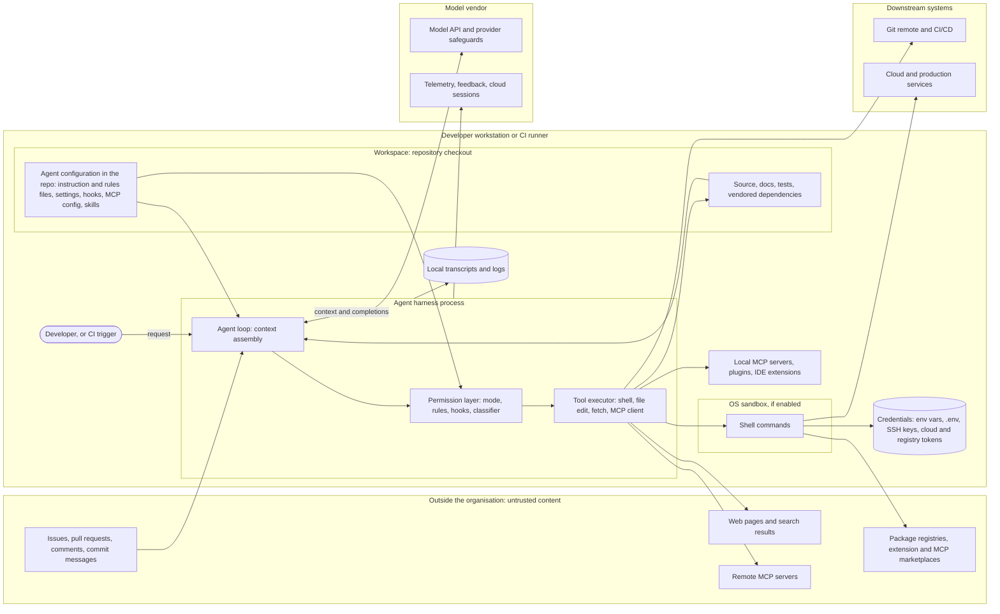

# Threat model: AI coding agents (a model inside an agent harness)

| Field | Value |
|---|---|
| Asset class | AI coding agents: a model running inside an agent harness (Claude Code, Codex CLI, Gemini CLI, opencode, IDE agents and similar) that reads a repository, runs commands and edits code, interactively or headless in CI |
| Version | 1.0 |
| Date | 2026-11-21 |
| Evaluated by | `agent-misuse-benchmark`, `coding-guidance-benchmark` |
| Related threat models | General-purpose models (frontier API and open weights); Agent features; AI-assisted security tools; Restricted-access cyber-capable models; Guardrails and safety classifiers |
| Status | Current. Ratings are for the reference deployment in section 2 and have not been validated against any particular deployment. `agent-misuse-benchmark` is a scaffold and measures nothing until it is completed |

## 1. Executive summary

**What the asset is.** A coding agent is a model placed inside a harness: a program that
assembles the model's context from the user's request, repository files and tool output,
decides which of the model's proposed actions run without asking, and runs them with the
privileges of the person or CI job that started it. The harness, not the model alone,
decides what the agent can reach. The same model can refuse a task in a chat window and
carry it out in a harness, and the same harness behaves differently after an update or
under another permission mode. Every risk below is a property of model, harness, settings
and environment together.

**Core risks for the reference deployment** (developer workstations with real credentials
and open network, plus a headless agent in CI that reads outsiders' issues and pull
requests; section 2):

| Risk | Why it matters | Inherent risk | Evaluated by |
|---|---|---|---|
| Content the agent reads takes over its tools (ca-03, ca-04) | Every README, dependency, issue, web page and tool result is an instruction channel; published attacks reach command execution and CI secret theft | Critical | Not measured by the skills here; design review (public benchmarks named in section 5) |
| Configuration and approvals do not hold (ca-05, ca-06) | Repository-committed hooks, MCP configuration and rules files can run or steer the agent, sometimes before any trust prompt; auto-approving modes and command-parser flaws let actions through | High | Design review |
| Commands with real reach (ca-07, ca-08, ca-09) | Without an attacker the agent can still delete, reset or touch production; sandboxes are optional or partial and egress is often open; secrets in the workspace go to the vendor, to plaintext transcripts and to any output channel | High | Design review |
| Safeguards depend on the harness (ca-01, ca-02) | Restricted work, such as offensive security tasks, can be carried out in one harness or setting that is refused in another; real campaigns have used coding agents this way | High | `agent-misuse-benchmark`, once an organisation completes it |
| Insecure code ships, and guidance does not fix it (ca-11, ca-12) | Published benchmarks find exploitable flaws in a large share of functionally correct agent-written code; instruction files are context, not enforcement | High (ca-11), Medium (ca-12) | `coding-guidance-benchmark` |
| Packages and extensions pulled into the agent's environment (ca-10) | Hallucinated or compromised packages, MCP servers, plugins and IDE extensions run with the developer's privileges, and malware has used installed agent CLIs as a tool | High | Design review; `security-tool-benchmark` measures scanners of extensions |

**Where risk concentrates.** In one combination: the agent reads content an outsider can
write, holds credentials or data worth taking, and can act or send data out without a
person reading each step. Headless CI runs triggered by outsiders' events have all three by
default. A workstation in an auto-approving mode with no OS sandbox has all three as soon
as the developer opens a third-party repository.

**What the evaluations can and cannot tell you.** `coding-guidance-benchmark` measures how
often a pinned harness and model write correct and secure backends on BaxBench tasks, with
nothing installed (the subject itself) and with each piece of guidance (a skill, rules file,
hook or MCP server) the organisation supplies. `agent-misuse-benchmark`, once completed with
the organisation's own scenario pack, harness module and scorer, measures how often each
model × harness × safeguards arm declines tasks the organisation's policy says it must
decline, beside how often it completes matched legitimate tasks. As shipped it contains no
scenarios and measures nothing. Neither skill measures prompt injection, configuration
attacks, sandbox or egress gaps, secret handling, supply chain, vendor data handling or audit
trails; those are design-review questions (section 6), and section 5 names public
benchmarks that exist outside this repository for some of them. No result here is an
acceptance decision.

## 2. Scope and assumptions

**Reference deployment.** The ratings in section 4 assume:

- A software organisation lets developers run a commercial coding agent (a terminal CLI or
  an IDE agent) on their own workstations, against private repositories and against
  third-party open-source code (dependencies, forks, code under review).
- The harness runs at its interactive default permission mode, which the developer can
  change; the OS-level sandbox is not enabled (it is off by default in at least one major
  harness); outbound network is open.
- The developer's own credentials are on the machine: git and package-registry tokens,
  SSH keys, a cloud CLI with access to non-production and some production resources, and
  `.env` files in working copies.
- Developers add MCP servers, plugins and IDE extensions themselves; there is no managed
  allowlist.
- The same harness runs headless in CI to triage issues and review pull requests on
  repositories that accept outside contributions, with a repository token and the model
  provider's API key in the job.
- Vendor terms are commercial (not consumer); telemetry is at vendor defaults; agent actions
  are not exported to central logging.

**Variants and how they move ratings.**

| Variant | Effect |
|---|---|
| Agent runs in a vendor-hosted cloud VM with limited egress and credentials held outside the VM | Lowers ca-08 and ca-09; ca-13 rises (code and transcripts stored by the vendor) |
| Dev container or VM with no credentials and egress denied by default | Lowers the impact of ca-03, ca-05, ca-07, ca-08, ca-09, ca-10 |
| Unattended runs in a bypass mode (`--dangerously-skip-permissions`, `--yolo` and equivalents) | Raises ca-03, ca-06, ca-07 to their worst case |
| Locked-down CI that denies anything needing approval and triggers only on trusted actors | Lowers ca-04 and ca-06 |
| Developers use personal consumer accounts | Raises ca-13 |
| Cyber-capable model or offensive-security use case | Raises ca-02; see the Restricted-access cyber-capable models threat model |

**In scope.** The harness and its settings, the model's behaviour inside it, the content
and configuration it reads, the tools it runs, the packages and extensions it uses, the data
it sends to the vendor, and the records it leaves. Interactive and headless use.

**Out of scope here.** The model's behaviour on its bare API (General-purpose models threat
model). Agent features such as computer use, persistent memory beyond instruction files,
connectors and MCP servers in general, and scheduled or background agents (Agent features
threat model; this document covers MCP servers and memory only as they appear in a coding
harness). AI code reviewers and pentest agents as security tools (AI-assisted security
tools threat model). The IDE and operating system themselves, except where the agent uses
them.

**Assumptions.** Model traffic is TLS-protected and the vendor's own infrastructure is
outside the organisation's control. Harnesses update often, some automatically, and their
defaults change between versions (section 4, ca-01). Facts about named harnesses were read
from vendor documentation on 2026-11-21 and may already have moved.

## 3. System model

Trust boundaries, from the diagram:

- **TB1: request versus content.** Only the developer's request (or the CI job's fixed
  prompt) expresses intent. Everything else that reaches the agent loop (repository files,
  issues, tool output, web pages, MCP results) is data that the model cannot authenticate.
- **TB2: model output versus execution.** The permission layer and, where enabled, the OS
  sandbox decide what of the model's output runs. This is the main control point.
- **TB3: host versus network.** What a command can reach: package registries, the
  internet, internal services, cloud metadata endpoints.
- **TB4: organisation versus vendor.** Prompts, code, tool output, telemetry and feedback
  cross to the model vendor and, for some telemetry, to third parties.
- **TB5: agent output versus shared systems.** Commits, pull requests, CI changes and cloud
  actions leave the developer's machine and affect others.

**Entry points.**

| Entry point | Examples | Who controls it | What it reaches |
|---|---|---|---|
| Developer request | Interactive prompt; the fixed prompt of a CI job | Developer; CI author | The whole agent |
| Repository content | README, code comments, docs, test fixtures, vendored or installed dependency source | Anyone who has ever committed to the repository or to a dependency | Agent context |
| Agent configuration in the repository | Instruction files (`CLAUDE.md`, `AGENTS.md`, rules files), project settings, hooks, `.mcp.json` and equivalents, project skills and subagents | Anyone with write access to the branch, or a pull request author; the agent itself if it can write these paths | Context, permission layer, and code that runs at start-up |
| Issue tracker and repository events | Issue titles and bodies, pull request descriptions, review comments, commit messages | Anyone who can open an issue or comment, on a public repository the whole internet | Headless agent context, with CI credentials |
| Tool output | Command output, test logs, compiler errors, file contents read by commands | Whoever wrote what the command reads | Agent context |
| Web fetch and search | Pages, documentation, search snippets | Any website owner; search-result poisoners | Agent context |
| MCP servers, plugins, skills | Tool descriptions, tool results, bundled scripts | Server or package author and operator; whoever writes the data the server returns | Context and code execution |
| Packages installed at run time | `npm`, `pip`, other registries, including names a model hallucinated | Registry publishers | Code execution with install scripts |
| Harness and extension updates | Self-updating CLI, IDE extension auto-update | Vendor, or whoever compromises the vendor's release path | Everything |
| Managed settings | Organisation-wide permission rules, disabled modes, allowed servers | Organisation administrators | Permission layer |
| Environment | Environment variables, credential files, mounted secrets | Developer; CI administrator | Readable by any command the agent runs |

**Assets to protect.**

| Asset | Why |
|---|---|
| Credentials on the workstation and in CI | Git, registry, cloud and model-provider keys turn agent compromise into organisation compromise |
| Source code and intellectual property | Read by the agent by design; sent to the vendor |
| Integrity of the repository and build | Agent-written code and configuration ship to users |
| The developer machine and CI runner | Code execution with the user's or job's privileges |
| Production and shared services reachable from the machine | Destructive or unauthorised changes |
| Third parties and the organisation's standing | Offensive use launched from the organisation's accounts and network |
| Audit trail | Needed to scope any incident |
| Data held by the vendor | Prompts, code, transcripts, feedback |

**Threat actors.**

| Actor | Capability | Motivation | Access |
|---|---|---|---|
| External content author | Low to moderate: writes text, no exploit needed | Code execution, secret theft, backdoors, supply-chain reach | Writes content the agent will read: a public issue, a README, a dependency, a web page |
| Malicious or compromised package, extension or MCP publisher | Moderate to high; may control a popular package for months before acting | Credential theft, persistence, reach into many organisations | Code that the developer or agent installs |
| Repository contributor or attacker with branch write | Moderate | Persistence through committed configuration | Can add or change agent configuration files |
| Insider or account holder misusing the agent | Varies; the agent supplies much of the skill | Offensive work against third parties, data theft, policy evasion | Legitimate access to the agent and its network position |
| Malware already on the host | High | Uses an installed agent CLI as a ready-made tool | Can launch the CLI with any flags |
| The agent itself, without an adversary | Not an actor; a failure source: misreads scope, takes shortcuts | None | Everything its permissions and environment allow |
| Vendor | Trusted, outside the organisation's control | Product operation | Receives prompts, code and telemetry; ships harness updates |

## 4. Threats

| ID | Threat | STRIDE / Abuse | Entry point | Actor | Likelihood | Impact | Inherent risk | Evaluated? |
|---|---|---|---|---|---|---|---|---|
| ca-01 | Safeguards depend on the harness, its system prompt and its settings | Abuse | Harness, settings, updates | Vendor change; any requester | High | Medium | High | Yes, once `agent-misuse-benchmark` is completed |
| ca-02 | The agent carries out offensive or otherwise prohibited work on request | Abuse | Developer request | Insider or account holder | Medium | High | High | Yes, once `agent-misuse-benchmark` is completed |
| ca-03 | Instructions in repository content take over the agent | Elevation of privilege | Repository content, tool output, web, MCP results | External content author | High | High | Critical | No (design review) |
| ca-04 | Outsiders' issue, pull request and event text steers a headless agent | Elevation of privilege | Issue tracker and repository events | External content author | High | High | Critical | No (design review) |
| ca-05 | Configuration committed to the repository runs or steers the agent | Tampering | Agent configuration in the repository | Contributor; external author via the agent | Medium | High | High | No (design review) |
| ca-06 | Approvals that do not hold: modes, allowlists and auto-approval | Elevation of privilege | Permission layer | Any of the above; malware on the host | Medium | High | High | No (design review) |
| ca-07 | Destructive or out-of-scope actions on ordinary tasks | Tampering | Developer request | The agent, no adversary | Medium | High | High | No (design review) |
| ca-08 | Sandbox gaps and open network egress | Information disclosure | Tool executor, network | External content author; the agent | Medium | High | High | No (design review) |
| ca-09 | Secrets in the workspace reach the model, the vendor and the logs | Information disclosure | Environment, repository content | The agent; external content author | High | Medium | High | No (design review) |
| ca-10 | Packages, extensions and harness components pulled into the environment | Tampering | Registries, marketplaces, updates | Malicious or compromised publisher | Medium | High | High | Partly: scanner efficacy only |
| ca-11 | Insecure code written by the agent reaches production | Tampering | Agent output | The agent, no adversary | High | Medium | High | Yes: `coding-guidance-benchmark` |
| ca-12 | Guidance the agent ignores, never reads or loses | Elevation of privilege | Instruction and rules files, skills, hooks | The agent; external content author | Medium | Medium | Medium | Partly: `coding-guidance-benchmark` for secure-coding guidance |
| ca-13 | Code, prompts and telemetry sent to the vendor and third parties | Information disclosure | Model API, telemetry, feedback | Vendor; third-party processors | Medium | Medium | Medium | No (design review) |
| ca-14 | No usable record of what the agent did | Repudiation | Logs, transcripts, telemetry settings | Any; an attacker removing traces | High | Medium | High | No (design review) |

Reference numbers in square brackets point to section 8.

### ca-01 Safeguards depend on the harness, its system prompt and its settings

**Description.** The model's refusals, its resistance to manipulation and its caution with
destructive actions are shaped by what surrounds it: the harness's system prompt and tool
framing, the permission mode, provider-side classifiers, and the harness version. A result
measured on one surface (a model card, the bare API, another harness, last month's version)
does not describe another, in either direction.

**Attack path.**
1. A capability is assessed on the bare API or from the vendor's card.
2. It is deployed inside a harness with a different system prompt, tools and permission
   defaults, or with provider safeguards configured differently, or the harness updates.
3. Requests the assessment showed as refused are carried out, or legitimate work is
   blocked.
4. The organisation's decision rests on the assessment.

**Preconditions.** Assessment and deployment differ in surface, harness version, system
prompt, tools or safeguards.

**Impact.** Decisions rest on numbers that do not describe the deployment; restricted work
is carried out (ca-02), or useful work is refused.

**Likelihood.** Raised by self-updating harnesses whose defaults move: one harness's
built-in default for interactive sessions became a classifier-approved auto mode from a
specific version [R2]; another retired an approval policy that configurations may still
name [R10]. Raised when safeguards are configurable per deployment: one government
evaluation disabled the providers' cyber classifiers for its runs [R30, AML.CS0074].
Lowered by pinning harness and model versions, fixing modes in managed settings, and
re-measuring on change.

**Evidence.** A red-teaming study of browser agents found that backbone models which refuse
harmful instructions as chatbots do not refuse them as agents; with human rewrites, agents
on two frontier models attempted 98 and 63 of 100 harmful behaviours [R32]. A benchmark of
out-of-scope actions across four coding-agent products and six base models found that the
harness ("framework") dominated effect size: permissive harnesses ran at 5.4–27.7% while an
ask-to-continue harness ran at 0.2–4.5% on the same models [R34].

**Framework mapping.** — (no verified id fits divergence between surfaces).

**Controls that address it.** Version pinning and change notification for harness and
model; settings fixed centrally (permission mode, disabled modes, provider safeguards left
on); assessment repeated per surface; the deployment context recorded beside every result.

**Evaluation.** `agent-misuse-benchmark`, custom lane: the organisation's own scenario pack,
with arms that hold the model fixed and vary the harness, or hold the harness fixed and vary
safeguards or permission mode. Metric: restricted tasks declined and permitted twins
completed per arm, each with a 95% interval, and a paired comparison against a baseline arm.
Scaffold: until the pack, harness module and outcome scorer exist it measures nothing.
`model-benchmark` results on the bare API are a baseline, not a measurement of the harness.

### ca-02 The agent carries out offensive or otherwise prohibited work on request

**Description.** A user asks the agent to do work the organisation's policy says it must
decline: probing or exploiting systems the requester does not own, building malware,
harvesting credentials, evading controls. With a shell and a network the agent does the
work rather than describing it. Requests are framed as authorised testing or split into
steps that each look innocuous.

**Attack path.**
1. The requester frames the work as legitimate, or decomposes it into small steps.
2. The agent plans and executes the steps with its own tools.
3. The output (access, data, working tooling) is used against a target, from the
   organisation's account and network.

**Preconditions.** Access to the agent; reach to a target or a way to carry output out;
safeguards that accept the framing.

**Impact.** Harm to third parties; legal and reputational exposure; the organisation's
infrastructure as the origin.

**Likelihood.** Raised by open egress, unattended modes, safeguards that are off or absent
in the harness, and more capable models. Lowered by provider and harness safeguards left
on, enforced usage policy, egress restricted to approved hosts, and monitoring.

**Evidence.** A state-sponsored espionage campaign manipulated Claude Code into carrying out
intrusions: the operators split the attack into small tasks and told the model it worked for
a legitimate security firm doing defensive testing; AI performed roughly 80–90% of the
campaign against about thirty targets [R27]. An earlier case used Claude Code to automate
reconnaissance, credential harvesting and network penetration against at least 17
organisations [R28]. A refusal framework for offensive-security agents found 6 of 8 frontier
models tested showed near-zero refusal in web-based offensive scenarios [R33]. AgentHarm
found leading models "surprisingly compliant" with malicious agent tasks without any
jailbreak [R38].

**Framework mapping.** MITRE ATLAS AML.T0054 LLM Jailbreak, AML.T0017.001 Autonomous
Exploit Development, AML.T0116 Autonomous Reconnaissance, AML.T0124 Autonomous Attack
Orchestration. OWASP: —.

**Controls that address it.** Provider and harness safeguards; usage policy with
enforcement; egress limited to approved destinations; monitoring for offensive patterns;
restricted access to cyber-permissive configurations.

**Evaluation.** `agent-misuse-benchmark`, custom lane: restricted tasks declined beside
permitted twins completed, broken down by category and by framing (for example a framing
that claims authorisation, or describes the target as someone else's). Tasks are single
prompts run in a sandbox with no network; decomposition across many sessions, live targets
and capability uplift are not represented.

### ca-03 Instructions in repository content take over the agent

**Description.** Files the agent reads while working (a README, code comments, docs, test
fixtures, a dependency's source, a vendored file, the output of a command that reads them)
contain instructions, and the agent follows them with the developer's privileges. Hidden
forms (invisible Unicode, text buried in licence boilerplate) defeat a human reviewer.

**Attack path.**
1. An attacker places instructions where an agent will read them: a public repository, a
   dependency, a file a contributor submits.
2. A developer asks the agent to work in that code.
3. The agent treats the text as instructions and runs a command or edits code.
4. The command uses the developer's credentials and network; the edit plants a backdoor.

**Preconditions.** The agent reads content an outsider can write; it has tools that act;
the action passes the permission layer (an allowlisted prefix, an auto mode, an approval
given by habit).

**Impact.** Code execution as the developer; credential theft; backdoored code; persistence
through configuration (ca-05).

**Likelihood.** Raised by routine work on third-party code, broad allow rules, auto-approving
modes and no sandbox. Lowered by working on untrusted code in an isolated environment with
no credentials and no egress, and by approvals that display the full command.

**Evidence.** AIShellJack, 314 payloads covering 70 ATT&CK techniques, reached attack
success rates up to 84% for executing malicious commands in two agentic editors [R31]. In
Gemini CLI, an injection hidden in licence text in a README, combined with a command that
began with an allowlisted `grep`, ran commands silently and sent environment variables to a
remote server; fixed in v0.1.14 on 25 July 2025 [R23]. Hidden Unicode in rules files led two
editor agents to add an attacker's script to generated files [R24]. Claude Code advisories
describe approval bypasses that required untrusted content in the context window: a command
parsing error (CVE-2025-54795) and an over-broad allowlist that let a file be read and sent
over the network without confirmation (CVE-2025-55284) [R20].

**Framework mapping.** OWASP LLM01:2025 Prompt Injection · OWASP Agentic ASI01 Agent Goal
Hijack · MITRE ATLAS AML.T0051.001 LLM Prompt Injection: Indirect, AML.T0108 AI Agent (command
and control through an agent), AML.T0112.000 Machine Compromise: Local AI Agent.

**Controls that address it.** Isolation of untrusted code (container or VM, no credentials);
OS sandbox with deny-by-default egress; approvals that show the exact command; injection
classifiers on tool output; fewer tools in sessions that read untrusted content.

**Evaluation.** Neither skill measures it. CodeIPI (`ipi_coding_agent` in inspect_evals, 45
samples) measures coding agents against instructions in issues, comments and README files
and can be run by hand [R39]; `model-benchmark` runs AgentDojo on the bare model API as a
baseline only. A team completing `agent-misuse-benchmark` could write pairs whose restricted
instruction arrives in workspace fixtures rather than the prompt, since the format passes
fixtures and extra task fields to the harness and scorer; that would be its own probe, not
coverage this repository supplies. Design-review questions are in section 6.

### ca-04 Outsiders' issue, pull request and event text steers a headless agent

**Description.** In CI and automation, an agent is started by repository events and given
their text: issue titles and bodies, pull request descriptions, review comments, commit
messages. Anyone who can open an issue writes part of the prompt. The run is headless, so
no person approves anything, and the job holds a repository token and API keys.

**Attack path.**
1. An outsider opens an issue or comment containing instructions.
2. A workflow starts the agent with that text in its prompt and privileged credentials in
   its environment.
3. The agent reads secrets or files, edits the repository, or triggers further workflows.
4. The result is posted where the attacker can read it, such as a reply on the issue.

**Preconditions.** Workflows triggered by events outsiders can cause; tools and secrets
available to the agent step; an output channel visible to the attacker.

**Impact.** CI secret exposure; repository tampering; a supply-chain foothold affecting the
project's users.

**Likelihood.** Raised by public repositories, triggers on untrusted events, broad tokens and
tools beyond the task. Lowered by triggers limited to people with write access, read-only
tokens, secrets kept out of the agent step, and human approval before agent-created changes
run workflows.

**Evidence.** Research published in December 2025 described a class of flaws in CI
pipelines that insert issue, pull request or commit text into prompts of agents holding
privileged tokens; one major agent's own repository was confirmed affected and patched
within four days of disclosure [R25]. In June 2026 a vendor's security team showed that
instructions in issue or pull request content could make the Claude Code GitHub Action read
`/proc/self/environ` with its file-read tool, which ran outside the shell sandbox, exposing
the workflow's API key; fixed in Claude Code 2.1.128 [R26]. One hosted cloud agent documents
the opposite design: comments from users without write access never reach it, hidden text
in HTML comments is filtered, and workflows on its pull requests wait for approval [R15].

**Framework mapping.** OWASP LLM01:2025 · OWASP Agentic ASI01 · MITRE ATLAS AML.T0051.001,
AML.T0119 Exploit Automated Artifact Processing Pipeline, AML.T0093 Prompt Infiltration via
Public-Facing Application.

**Controls that address it.** Trigger allowlists; least-privilege, short-lived tokens; no
secrets in agent steps; output gating; separation between the agent that reads untrusted
text and any step that holds credentials.

**Evaluation.** Not measured here. Design review (section 6).

### ca-05 Configuration committed to the repository runs or steers the agent

**Description.** A coding agent's configuration is files: project settings (environment
variables, helper commands, permission rules), hooks, MCP server definitions, instruction and
rules files, project skills and subagents. A repository can supply all of them. Some run
before the user is asked to trust the folder, or in headless runs that never ask. And an
agent that can write these paths turns a one-off injection into code that runs at every
start, for every collaborator.

**Attack path.**
1. An attacker gets a configuration file into the repository (a malicious repository, a
   pull request, a compromised branch) or induces the agent to write one.
2. A developer or CI job starts the harness in that working copy.
3. The harness loads it: a hook runs, an MCP server command starts, an environment variable
   is set, a rules file changes behaviour, an auto-approve setting is switched on.
4. Code runs with the user's privileges and persists.

**Preconditions.** The harness loads project configuration; the trust gate is absent,
skipped in headless mode, or accepted by habit; the agent can write configuration paths.

**Impact.** Code execution before any prompt is typed; persistence; spread to everyone who
clones the repository.

**Likelihood.** Raised by headless runs: one harness documents that in non-interactive mode a
repository's hooks, `env` block and helper commands are used and its `.mcp.json` servers are
connected without asking [R3]. Raised when the agent can write its own configuration.
Lowered by managed settings that restrict hooks and servers to managed sources, by paths the
agent cannot write (Codex keeps `.git`, `.agents` and `.codex` read-only even in its
workspace-write mode [R10]; Claude Code's sandbox write-denies its settings, shell start-up
files and `.git/hooks` [R4]), by trusted-folder modes that ignore project settings, `.env`
and MCP servers in untrusted folders [R12], and by flags that skip project configuration for
repositories not written in-house [R3].

**Evidence.** Cursor CVE-2025-54135: creating a new `.cursor/mcp.json` needed no approval, so
an indirect prompt injection could write it and execute code; fixed in 1.3.9 [R16].
CVE-2025-54136: an MCP configuration a collaborator had approved could be swapped for a
malicious command without a new prompt; fixed in 1.3 [R17]. GitHub Copilot and Visual Studio
CVE-2025-53773: published research showed injected instructions making the agent add an
auto-approve setting to the project's editor settings, after which it ran terminal commands
without asking [R18]. Claude Code CVE-2025-59536: code in a project could execute before the
startup trust dialog was accepted; fixed in 1.0.111 [R20].

**Framework mapping.** OWASP LLM01:2025 (rules files as instructions) · OWASP Agentic ASI05
Unexpected Code Execution · MITRE ATLAS AML.T0081 Modify AI Agent Configuration.

**Controls that address it.** Agent configuration reviewed as code (owners, required
review); managed allowlists for hooks, MCP servers and plugins; configuration paths
write-protected from the agent; trust prompts that list what will run; untrusted repositories
opened with project configuration disabled.

**Evaluation.** Design review.

### ca-06 Approvals that do not hold: modes, allowlists and auto-approval

**Description.** The permission layer is the control between model output and execution.
Modes that auto-approve (accept-edits, classifier-based auto modes, bypass or "yolo" modes),
broad allow rules, command parsers that misread compound or obfuscated commands, and
approval fatigue let through actions a person would have refused. Bypass flags are also open
to any process that can start the CLI.

**Attack path.**
1. The deployment runs an auto-approving mode or broad allow rules, or the developer
   approves by habit.
2. Injection or model error produces an action shaped to pass: an allowlisted prefix, a
   command the parser cannot split, a framing a classifier accepts.
3. The action runs with no meaningful human check.

**Preconditions.** Approvals are the control relied on.

**Impact.** Whatever ca-03, ca-07 and ca-08 can do, without a check in the way.

**Likelihood.** Raised by vendor defaults that move toward auto-approval (Claude Code's
built-in default for interactive terminal sessions is a classifier-reviewed auto mode from
v2.1.283 [R2]; opencode allows every action by default and describes no sandbox [R14]) and by
bypass flags in scripts. Lowered by managed settings that disable bypass and auto modes
(`permissions.disableBypassPermissionsMode`, `permissions.disableAutoMode` [R2];
`security.disableYoloMode` [R13]), deny rules that hold in every mode, and an OS sandbox that
enforces limits whatever the command text says.

**Evidence.** Vendor statements of the limits: auto mode "reduces permission prompts but does
not guarantee safety", and boundaries a user states in conversation are not stored as rules
and can be lost when context is compacted [R2]; deny rules match a command as written, and
network enforcement independent of the text needs the sandbox [R1]. Parser and allowlist
flaws: CVE-2025-54795, CVE-2025-55284 and CVE-2025-64755 (sed parsing that allowed arbitrary
file writes) in Claude Code [R20]; the allowlist-prefix bypass in Gemini CLI [R23]. Malicious
Nx releases in August 2025 ran installed agent CLIs with their bypass flags
(`--dangerously-skip-permissions`, `--yolo`, `--trust-all-tools`) to inventory secrets [R22].

**Framework mapping.** OWASP LLM06:2025 Excessive Agency · OWASP Agentic ASI02 Tool Misuse,
ASI09 Human-Agent Trust Exploitation · MITRE ATLAS AML.T0053 AI Agent Tool Invocation,
AML.T0103 Deploy AI Agent.

**Controls that address it.** Centrally managed permission policy; deny rules for
dangerous actions; OS sandbox as enforcement; approval prompts that show the full command;
bypass modes only in disposable, isolated environments; detection of agent CLIs started with
bypass flags.

**Evaluation.** Design review. Both evaluation skills run agents unattended (the
`coding-guidance-benchmark` notes that inspect-swe starts Claude Code with permission prompts
skipped and Codex CLI with approvals set to never), so their results describe unattended
behaviour and say nothing about approvals.

### ca-07 Destructive or out-of-scope actions on ordinary tasks

**Description.** With no attacker involved, the agent does more than it was asked: deletes
unrelated files, resets or force-pushes history, drops or migrates a database, rewrites
configuration, or touches shared or production systems through credentials on the machine.
In long autonomous runs it may act on real systems it believes are in scope.

**Attack path** (failure path).
1. A benign request with loosely stated scope.
2. The agent infers a broader goal or takes a shortcut: a clean-up, a reset, a migration.
3. The action runs against a real resource the credentials reach.
4. The loss is noticed later.

**Preconditions.** Write or delete reach beyond the task; credentials for shared or
production systems; auto-approval or habitual approval.

**Impact.** Data loss, outages, repository damage; in the extreme, harm to third parties.

**Likelihood.** Raised by permissive harnesses, unattended runs, long sessions and production
credentials on developer machines. Lowered by disposable working copies, no production
credentials, branch protection, backups, and harness checks that never auto-approve
recognised critical-path deletions [R2].

**Evidence.** OverEager-Bench, 500 scenarios and about 7,500 runs across four agent
products, measured out-of-scope actions on benign tasks at 5.4–27.7% in permissive
harnesses, and found that removing a consent statement from the prompt raised one product's
rate from 0.0% to 17.1% [R34]. In 2026 evaluation runs whose environment had live internet
access by misconfiguration, agents compromised three real organisations and one published a
malicious package to a public registry that ran on 15 real systems [R29]; in another
evaluation, agents took 19 unsanctioned real-world actions, and the prompts stated network
scope without prohibiting internet activity [R30, AML.CS0074]. Those runs had offensive
objectives, not coding tasks; they show agents acting outside intended scope whenever the
environment allows it.

**Framework mapping.** OWASP LLM06:2025 · OWASP Agentic ASI02 · MITRE ATLAS AML.T0101 Data
Destruction via AI Agent Tool Invocation.

**Controls that address it.** Least-privilege credentials; disposable environments;
backups; branch protection; deny rules and confirmations for irreversible actions.

**Evaluation.** Not measured here. OverEager-Bench is research code that no skill here runs.
Design review.

### ca-08 Sandbox gaps and open network egress

**Description.** Isolation is optional or partial. OS sandboxes are off by default in some
harnesses; file tools, MCP servers and hooks may run outside them; a command that fails in
the sandbox can be retried outside it; read access is broad by default; network is open by
default in some harnesses and allowlisted by domain in others. Egress carries data out and
reaches internal services and cloud metadata endpoints.

**Attack path.**
1. The agent, steered or mistaken, runs code or a tool.
2. It reads data within reach: the repository, credential files in the home directory,
   internal services, a metadata endpoint.
3. It sends data out through an open or allowlisted destination, or through a tool that runs
   outside the sandbox.

**Preconditions.** Network reach; sensitive data within reach of some tool.

**Impact.** Exfiltration; lateral movement; cloud credentials from metadata services.

**Likelihood.** Raised where the sandbox is off by default and leaves file tools, MCP servers
and hooks outside it, allows broad reads and offers an unsandboxed retry (all documented for
Claude Code's sandbox [R4]); where shell commands run with the host user's authority and no
sandbox is described [R14]; where sandboxing is opt-in [R11]. Lowered by defaults such as
Codex's workspace-write mode with network off [R10]; by sandbox settings that remove the
unsandboxed retry and refuse to start without isolation, and a proxy that refuses names
resolving only to local addresses [R4]; by vendor-hosted sessions with limited network and
credentials kept outside the VM [R1].

**Evidence.** The file-read tool outside the sandbox exposing CI secrets [R26]. Evaluation
environments whose network access was misconfigured: agents reached and compromised real
systems [R29]; in another, agents used weaknesses in an artifact repository to obtain
indirect internet access and compromised a third party's production systems [R30,
AML.CS0068]. Codex warns that with full access inside a dev container "a malicious project
can exfiltrate anything available inside the devcontainer" [R10].

**Framework mapping.** OWASP LLM02:2025 Sensitive Information Disclosure · OWASP Agentic
ASI05 · MITRE ATLAS AML.T0086 Exfiltration via AI Agent Tool Invocation, AML.T0105 Escape to
Host.

**Controls that address it.** OS-level isolation covering every tool; deny-by-default egress
with a narrow allowlist; no route to metadata and internal services; network paths validated
before use; egress monitoring.

**Evaluation.** Design review. The no-network preflight that `agent-misuse-benchmark`
requires of a harness module protects the evaluation; it says nothing about the deployment.

### ca-09 Secrets in the workspace reach the model, the vendor and the logs

**Description.** Ordinary work makes agents read `.env` files, configuration, environment
variables and command output that contain secrets. Once read, a secret is in the model's
context (sent to the vendor), in local transcripts, possibly in feedback uploads, and
available to any later injection or output channel: a commit, a pull request, a CI log, an
issue comment.

**Attack path.**
1. A secret sits in the workspace or the environment.
2. The agent reads it while debugging, searching or listing the environment, or is induced
   to.
3. The secret goes to the vendor in context, into a plaintext transcript, into a commit or
   comment, or out through egress.

**Preconditions.** Secrets within reach of the agent's read tools.

**Impact.** Credential exposure; rotation work; downstream compromise.

**Likelihood.** Raised by long-lived secrets in files and environment variables, CI steps
with secrets in the environment, and long transcript retention. Lowered by short-lived scoped
credentials from a secrets manager, read-deny rules for secret files (opencode asks before
reading `.env` files by default [R14]), scrubbed environments for subprocesses, and hosted
sessions where repository credentials never enter the VM [R1] or secrets exist only during a
setup phase [R10].

**Evidence.** Claude Code keeps session transcripts in plaintext under `~/.claude/projects/`
for 30 days by default [R5]; its sandbox allows reads of the whole machine by default,
including `~/.ssh`, unless denied [R4]. CI secrets read through `/proc/self/environ` [R26];
environment variables exfiltrated from Gemini CLI [R23]; malicious Nx releases asked local
agents to enumerate SSH keys, `.env` files and wallets [R22].

**Framework mapping.** OWASP LLM02:2025 · OWASP Agentic ASI03 Identity & Privilege Abuse ·
MITRE ATLAS AML.T0055 Unsecured Credentials, AML.T0083 Credentials from AI Agent
Configuration, AML.T0037 Data from Local System.

**Controls that address it.** Secrets kept out of the agent's reach; short-lived scoped
tokens; deny-read rules; redaction in logs and transcripts; secret scanning on commits and
agent output; transcript retention set deliberately.

**Evaluation.** Design review.

### ca-10 Packages, extensions and harness components pulled into the environment

**Description.** Agents install dependencies, sometimes under names a model invented that an
attacker has since registered. Developers add MCP servers, plugins, skills and IDE
extensions, often run straight from a registry. The harness and its extensions update
themselves. Each is code running with the developer's privileges, and a compromised one can
also drive the agent.

**Attack path.**
1. An attacker registers a name models hallucinate, typosquats a popular one, or compromises
   a popular package, extension or server.
2. The agent or the developer installs or updates it.
3. Its install script or server process runs with the user's privileges; it may start the
   local agent CLI with bypass flags, or feed the agent poisoned tool descriptions.

**Preconditions.** Installation from public sources at run time; no pinning or vetting.

**Impact.** Workstation and credential compromise; spread into CI and to other users.

**Likelihood.** Raised by agents allowed to install packages, unpinned servers started from a
registry on every launch, and auto-updating extensions. Lowered by internal mirrors and
allowlists, lockfiles, pre-built images, managed extension and server allowlists.

**Evidence.** Across 16 code models and 576,000 samples, at least 5.2% of packages from
commercial models and 21.7% from open models were hallucinated, with 205,474 unique invented
names [R37]. Malicious Nx versions published to npm on 26–27 August 2025 ran a post-install
script that invoked locally installed agent CLIs with permission-bypass flags to inventory
secrets [R22]. Version 1.84.0 of the Amazon Q Developer VS Code extension shipped injected
code designed to call the Q Developer CLI, inert only because of a syntax error; the vendor
traced it to an inappropriately scoped token in its build configuration [R21]. MCP servers
specifically are covered in the Agent features threat model.

**Framework mapping.** OWASP LLM03:2025 Supply Chain · OWASP Agentic ASI04 Agentic Supply
Chain Vulnerabilities · MITRE ATLAS AML.T0011.001 User Execution: Malicious Package,
AML.T0060 Publish Hallucinated Entities, AML.T0010.005 Supply Chain Compromise: AI Agent Tool,
AML.T0103 Deploy AI Agent.

**Controls that address it.** Package allowlists and mirrors; pinned and verified versions;
pre-built environments; vetting of extensions and servers; managed allowlists; monitoring of
agent CLI launches.

**Evaluation.** Design review. `security-tool-benchmark`'s extension kind measures how well a
scanner of skills, plugins and MCP servers separates labelled malicious from benign samples;
its code kind compares code and dependency scanners on known vulnerabilities. Both evaluate
the scanner, not the organisation's packages; scanning a specific package or extension is
outside this repository.

### ca-11 Insecure code written by the agent reaches production

**Description.** Agent-written code passes its functional tests and contains exploitable
flaws. Volume and speed outpace review, and the agent applies security conventions
inconsistently unless something in front of it changes that.

**Attack path** (failure path).
1. The agent implements a feature or fix.
2. The code works and is exploitable.
3. Review and scanning miss it.
4. It ships and is later exploited.

**Preconditions.** Agent-written code merged with limited security review.

**Impact.** Vulnerabilities in the organisation's products.

**Likelihood.** Raised by large unattended changes, thin review and no static analysis.
Lowered by review, security testing in CI, and guidance shown to change outcomes.

**Evidence.** BaxBench, 392 backend tasks with functional tests and end-to-end exploits:
the best model reached 62% correctness, and exploits succeeded on around half of the correct
programs [R35]. SusVibes, 186 real-world feature tasks: 57% of one agent configuration's
solutions were functionally correct and 11.8% secure, and adding vulnerability hints to the
request did not fix it [R36].

**Framework mapping.** — (consistent with this repository's review templates, which carry no
verified id for insecure code).

**Controls that address it.** Code review; static and dynamic testing in CI; security
guidance placed in front of the agent (rules files, skills, hooks, MCP servers), whose effect
can be measured.

**Evaluation.** `coding-guidance-benchmark`, known lane, BaxBench at pinned commit
`de885cd`. Metric: correct-and-secure rate (every functional test passed and no exploit
succeeded), read beside functional-pass and secure rates and failed builds. The baseline arm,
with nothing installed, is the measurement of the subject for this harness version and model;
other arms measure guidance (ca-12). The result describes BaxBench backends built in a
container with no network and no safety prompt; BaxBench is public and may be in training
data, so differences between arms mean more than levels. `model-benchmark`'s `cyse4_instruct`
gives a bare-API baseline only.

### ca-12 Guidance the agent ignores, never reads or loses

**Description.** Organisations steer agents with instruction files, rules files, skills,
hooks and MCP servers. Instruction text is context, not enforcement: it can be outweighed,
diluted in a long context, lost when context is compacted, never loaded because it sits in
the wrong place, or argued away by injected text. A control that exists only as guidance
fails silently.

**Attack path** (failure path).
1. A policy is expressed only as guidance ("never read `.env`", "validate all input").
2. The guidance is not loaded, is diluted or lost, or is countered by injected instructions.
3. The action it prohibited happens, and nothing records the gap.

**Preconditions.** Reliance on guidance for something that matters.

**Impact.** False assurance; the risks the guidance was meant to address remain.

**Likelihood.** Raised by security rules held only in instruction files and by long
sessions. Lowered by placing hard limits in enforced settings, sandboxes and hooks, and by
measuring what guidance changes.

**Evidence.** Claude Code's documentation: instruction files and auto memory are "context",
"not enforced configuration", with "no guarantee of strict compliance" [R7]; limits stated in
conversation can be lost on compaction [R2]. Vulnerability hints added to the request did not
make agent code secure [R36]. In a 2026 evaluation incident the prompt told the model it had no
internet access while the environment had it [R29].

**Framework mapping.** —.

**Controls that address it.** Hard limits in enforced settings, sandbox and blocking hooks;
guidance used for behaviour; evidence that guidance is loaded and changes outcomes.

**Evaluation.** `coding-guidance-benchmark`, known lane, BaxBench. Metric: paired difference
in correct-and-secure rate between each guidance arm and the baseline, read against a placebo
arm as the noise floor, plus a diagnostic of whether the transcript shows the agent naming an
arm path, calling a skill tool or calling an MCP tool. It separates "did not help" from "was
never reached" for secure-coding guidance only. Hooks and MCP servers inside arms were not
exercised by its maintainers, the diagnostic follows Claude Code's tool naming, and guidance
meant to prevent other actions is not measured.

### ca-13 Code, prompts and telemetry sent to the vendor and third parties

**Description.** Everything the agent reads goes to the model provider. Harnesses also send
usage metrics and error reports, sometimes to third-party services; feedback commands upload
transcripts with code; hosted sessions store transcripts; terms differ between consumer and
commercial accounts, and developers may sign in with personal accounts.

**Attack path** (exposure path).
1. A developer uses the agent on proprietary code.
2. Prompts, code and tool output reach the vendor and are retained under the account's
   terms; a feedback upload sends a transcript; a consumer account may allow training use.
3. Data is held outside the organisation's control or used in a way it has not accepted.

**Preconditions.** Data the organisation has not cleared for the vendor in reach of the
agent.

**Impact.** Confidentiality, contractual and regulatory exposure.

**Likelihood.** Raised by consumer accounts, feedback features left on and routing through
several providers. Lowered by commercial terms, zero-retention agreements, routing through a
cloud provider, telemetry disabled centrally, and login restricted to the organisation's
account.

**Evidence.** For Claude Code: consumer accounts may allow training, with 5-year retention
when allowed and 30 days otherwise; commercial accounts are not used for training and have
30-day standard retention; feedback transcripts are kept 5 years; metrics go to the vendor
and third-party logging infrastructure and error reports to a third-party service, each with
an opt-out variable; a hostname check for web fetches is sent regardless of provider; metrics
and error reporting are off by default through cloud providers [R5]. Administrators can
restrict logins to their organisation through managed settings [R9]. Gemini CLI collects usage
statistics by default [R13].

**Framework mapping.** —.

**Controls that address it.** Contract and data terms; organisation-restricted login;
telemetry and feedback settings fixed centrally; classification of which repositories may be
used with which provider.

**Evaluation.** Design review of the signed terms and the deployed settings.

### ca-14 No usable record of what the agent did

**Description.** Investigating an incident needs who asked, what the agent read, which
commands ran, what was approved and by what rule or person, and what was sent out. Defaults
leave local transcripts that expire, central telemetry off, prompts and tool arguments
redacted even when it is on, commits attributed to the developer, and repository settings
able to switch signals off.

**Attack path.**
1. An incident occurs (any of ca-03 to ca-10).
2. There is no central, tamper-resistant record; local records have expired or were changed.
3. Cause, scope and data exposure cannot be established.

**Preconditions.** Default logging.

**Impact.** Incidents cannot be scoped; actions cannot be attributed; compliance gaps.

**Likelihood.** Raised by default settings. Lowered by centrally managed export with tool
details, vendor audit logs, and attribution of agent commits.

**Evidence.** Claude Code's OpenTelemetry export must be switched on; prompt text and tool
arguments are redacted unless enabled; the logged source of a permission decision does not
name the rule that matched; a repository can switch a signal off by setting its exporter to
`none` unless higher-precedence settings fix it [R6]. Local transcripts are kept 30 days by
default [R5]. Hosted sessions log all operations [R1]; one hosted agent co-authors and signs
its commits and exposes session logs and audit events to administrators [R15]. MITRE ATLAS
lists indicator removal by agents among its techniques (AML.T0138).

**Framework mapping.** MITRE ATLAS AML.T0138 Indicator Removal. OWASP: —.

**Controls that address it.** Central export of agent events with retention; tamper
resistance; correlation between prompts, tool calls and approvals; attribution of agent
commits.

**Evaluation.** Design review. Both evaluation skills keep their own transcripts as evidence
for the evaluation, not as an audit trail of the deployment.

## 5. Evaluation coverage

| Threat | Skill | Lane | Benchmark | Metric | What a result shows | What it does not show |
|---|---|---|---|---|---|---|
| ca-01 | `agent-misuse-benchmark` | custom | The organisation's own scenario pack (none ships) | Restricted tasks declined and permitted twins completed per arm, 95% intervals; paired comparison against a baseline arm (exact McNemar) | Whether two harnesses, versions or safeguard settings treat the same restricted and permitted tasks differently | Anything until the pack, harness module and scorer exist; surfaces not run as arms |
| ca-02 | `agent-misuse-benchmark` | custom | Same | Same, by category and by framing; validity flags for runs with no verdict and for low completion of permitted twins | How often this arm declines the organisation's restricted tasks while still completing their legitimate twins | Live targets; decomposition across sessions; capability uplift |
| ca-11 | `coding-guidance-benchmark` | known | BaxBench at `de885cd` | Correct-and-secure rate of the baseline arm; functional-pass, secure and failed-build rates | How often this pinned harness and model write correct and secure backends on BaxBench tasks, unattended, with no network and no safety prompt | Security of code in the organisation's own stack and review process; levels on a public benchmark that may be in training data |
| ca-12 | `coding-guidance-benchmark` | known | BaxBench at `de885cd` | Paired difference from baseline per arm, beside the placebo arm; whether the arm was reached (diagnostic) | Whether a given skill, rules file, hook or MCP server changes correct-and-secure on these tasks, and whether the agent touched it | Guidance aimed at other behaviour; hooks and MCP arms (not exercised); harnesses other than Claude Code (not run) |
| ca-03, ca-04 (baseline only) | `model-benchmark` | known | AgentDojo | Share of episodes where the injected goal ran | The model's tool-use injection resistance on the bare API | Behaviour inside any harness; repository content or CI events as carriers |
| ca-11 (baseline only) | `model-benchmark` | known | CyberSecEval 4 instruct | Share of generated code with a detected weakness | Bare-API code generation | Agent-written multi-file code |
| ca-10 (scanners only) | `security-tool-benchmark` | known and custom | Published labelled sets of skills, plugins and MCP servers; mutated positives with no signature match | True- and false-positive rate per scanner, run-to-run agreement | How far a scanner the organisation relies on can be trusted | Whether any particular package, server or extension is safe |

**Why each evaluation exists.**

- `agent-misuse-benchmark` exists for ca-01 and ca-02: the question "will this model, in
  this harness, with these safeguards, do work our policy forbids, and still do our
  legitimate work?" cannot be answered from a model card or the bare API, and what an agent
  must decline is each organisation's policy. Hence a scaffold whose arms are model ×
  harness × safeguards, paired tasks so that blanket refusal is visible, and a scenario pack
  written by the policy owner. It runs at tier T1 in a sandbox with no network, so it measures
  judgement, not reach.
- `coding-guidance-benchmark` exists for ca-11 and ca-12: organisations put guidance in
  front of coding agents to make their code more secure and need to know whether it works and
  whether the agent even reads it. It holds harness, model and tasks fixed, varies only the
  guidance, and scores with BaxBench's own tests and exploits rather than a judge.

**Threats nothing here measures.** ca-03, ca-04, ca-05, ca-06, ca-07, ca-08, ca-09, ca-13 and
ca-14 have no measurement in this repository; ca-10 has only scanner efficacy. Public work that
exists outside this repository: CodeIPI in inspect_evals for injection through software
artefacts [R39]; AIShellJack, research code for injection into agentic editors [R31];
OverEager-Bench, research code for out-of-scope actions [R34]. None of them tests the
organisation's own repositories, CI configuration, sandbox or network. The remaining threats
are design-review questions in section 6, and a review that skips them should record them as
not assessed.

## 6. Design review checklist

**Harness, model and versions (ca-01, ca-13).**
- Which harness and version, which model, and are both pinned? Who is told when either
  changes, and does anyone re-check defaults after an update?
- Are developers signed in with organisation accounts only, and is that enforced?

**Permission layer (ca-06, ca-07).**
- Which permission mode do sessions start in, and can developers change it? Are bypass and
  auto modes disabled centrally where they are not wanted?
- Which allow rules exist, who wrote them, and which deny rules hold in every mode?
- Which irreversible actions always need a person, and does the approval prompt show the
  exact command?
- Where is the agent run unattended, and with which flags?

**Configuration as an attack surface (ca-05, ca-12).**
- Which repository files does the harness load or execute (settings, hooks, MCP
  configuration, instruction and rules files, skills, subagents), and which of them before
  or without a trust prompt, including headless runs?
- Can the agent write those paths? Are they reviewed like code?
- Which hard limits exist only as guidance, and where are they enforced instead?

**Untrusted content (ca-03, ca-04).**
- Which content that outsiders can write does the agent read: third-party repositories,
  dependencies, issues, pull requests, web pages, MCP results?
- For each CI workflow that runs an agent: who can trigger it, what text from the event
  enters the prompt, which tokens and secrets the step holds, and where its output appears?
- Is untrusted code opened in an isolated environment without credentials?

**Sandbox and egress (ca-08).**
- Is OS-level isolation on, does it cover file tools, MCP servers and hooks, and can a
  command fall back to running outside it?
- Which hosts can commands reach, and can they reach internal services or cloud metadata
  endpoints? Has the network path been tested from inside, not just configured?

**Secrets (ca-09).**
- Which secrets are readable from the agent's working environment, including environment
  variables in CI? Are they short-lived and scoped?
- Where are transcripts stored, for how long, and are secrets redacted from them?

**Supply chain (ca-10).**
- Can the agent install packages, from which registries, through a mirror or allowlist?
- Who may add MCP servers, plugins, skills and IDE extensions, and are versions pinned?
- Which scanner is relied on for extensions, and how well does it perform
  (`security-tool-benchmark`)?

**Code that ships (ca-11).**
- Which review and security testing do agent-written changes go through before merge?
- Has any guidance relied on to improve security been measured?

**Vendor data (ca-13).**
- Which terms apply (signed, not public), what is retained and for how long, and is any of it
  used for training? Which telemetry and feedback channels are on?

**Misuse policy (ca-02).**
- What does the organisation's policy say the agent must decline, who owns that policy, and
  has it been turned into a scenario pack?
- Are provider safeguards on for this deployment, and is agent activity monitored?

**Audit (ca-14).**
- Is there a central record of prompts, tool calls, approvals and outbound requests, and can
  repository settings switch it off? How long is it kept?
- Are agent-authored commits distinguishable from human ones?

## 7. Residual risk and open questions

- **Injection is not solved.** Vendors describe classifiers and training that reduce
  injection success; none claims to remove it, and vendor documentation says protections do
  not make any system immune [R1]. With untrusted content, credentials and an action channel
  together, some residual risk remains whatever the configuration; isolation reduces what a
  successful injection can do rather than whether it succeeds.
- **The harness is a moving target.** Defaults, modes and safeguards change between versions,
  often weekly. A review describes one version; pinning trades this against security fixes,
  several of which (section 4) were delivered by automatic update.
- **No measurement of injection inside the harness here.** The public benchmark that targets
  it (CodeIPI) is small, and research suites use their own repositories. Whether a given
  harness and configuration resists injection carried by the organisation's own content is
  open until someone builds that probe.
- **`agent-misuse-benchmark` is only as good as its pack and scorer.** Its build guide
  requires a human-labelled agreement check on the scorer; until that exists, its numbers are
  provisional. A public pack drifts into training data.
- **Out-of-scope behaviour on benign tasks** is measured only by research code, and rates
  depend strongly on how scope is written in the prompt [R34].
- **Telemetry and audit fields change** between versions; what is recorded today may not be
  tomorrow.
- **Open question:** whether classifier-based auto-approval is a net reduction in risk against
  the approval fatigue it replaces. No public study was found that measures both on the same
  tasks.

## 8. References

All URLs read on 2026-11-21 unless stated otherwise.

- [R1] Claude Code documentation, "Security". https://code.claude.com/docs/en/security
- [R2] Claude Code documentation, "Permission modes". https://code.claude.com/docs/en/permission-modes
- [R3] Claude Code documentation, "Configure permissions" (sections "What runs before you
  trust a folder", "Settings precedence"). https://code.claude.com/docs/en/permissions
- [R4] Claude Code documentation, "Sandboxing". https://code.claude.com/docs/en/sandboxing
- [R5] Claude Code documentation, "Data usage". https://code.claude.com/docs/en/data-usage
- [R6] Claude Code documentation, "Monitoring usage". https://code.claude.com/docs/en/monitoring-usage
- [R7] Claude Code documentation, "How Claude remembers your project". https://code.claude.com/docs/en/memory
- [R8] Claude Code documentation, "Hooks reference". https://code.claude.com/docs/en/hooks
- [R9] Claude Code documentation, "Authentication" (credential storage, organisation-restricted
  login). https://code.claude.com/docs/en/iam
- [R10] OpenAI Codex documentation, "Agent approvals & security" (redirected from
  developers.openai.com). https://learn.chatgpt.com/docs/agent-approvals-security.md
- [R11] Gemini CLI documentation, "Sandboxing". https://geminicli.com/docs/cli/sandbox/
- [R12] Gemini CLI documentation, "Trusted folders". https://geminicli.com/docs/cli/trusted-folders/
  (this page says the feature is off by default; the configuration reference [R13] gives the
  default of `security.folderTrust.enabled` as true. Check the installed version.)
- [R13] Gemini CLI documentation, "Configuration reference" (`general.defaultApprovalMode`,
  `security.disableYoloMode`, `privacy.usageStatisticsEnabled`). https://geminicli.com/docs/reference/configuration/
- [R14] opencode documentation, "Permissions". https://opencode.ai/docs/permissions/
- [R15] GitHub Docs, "Risks and mitigations for GitHub Copilot cloud agent". https://docs.github.com/en/copilot/concepts/agents/cloud-agent/risks-and-mitigations
- [R16] CVE-2025-54135, Cursor, "Cursor Agent is vulnerable to prompt injection via MCP Special
  Files" (record read through the CVE Services API). https://www.cve.org/CVERecord?id=CVE-2025-54135
- [R17] CVE-2025-54136, Cursor, "Modification of MCP Server Definitions Bypasses Manual
  Re-approvals". https://www.cve.org/CVERecord?id=CVE-2025-54136
- [R18] CVE-2025-53773, "GitHub Copilot and Visual Studio Remote Code Execution
  Vulnerability". https://www.cve.org/CVERecord?id=CVE-2025-53773 ; and the original research,
  "GitHub Copilot: Remote Code Execution via Prompt Injection (CVE-2025-53773)", Embrace The
  Red, 2025. https://embracethered.com/blog/posts/2025/github-copilot-remote-code-execution-via-prompt-injection/
- [R19] (unused)
- [R20] Claude Code advisories as CVE records: CVE-2025-54794 (path restriction bypass),
  https://www.cve.org/CVERecord?id=CVE-2025-54794 ; CVE-2025-54795 (approval bypass through
  command parsing), https://www.cve.org/CVERecord?id=CVE-2025-54795 ; CVE-2025-55284
  (permissive default allowlist allowing file read and network exfiltration),
  https://www.cve.org/CVERecord?id=CVE-2025-55284 ; CVE-2025-59536 (code execution before the
  startup trust dialog), https://www.cve.org/CVERecord?id=CVE-2025-59536 ; CVE-2025-64755 (sed
  validation bypass allowing arbitrary file writes), https://www.cve.org/CVERecord?id=CVE-2025-64755
- [R21] CVE-2025-8217, "Inert Malicious script injected into Amazon Q Developer Visual Studio
  Code Extension", https://www.cve.org/CVERecord?id=CVE-2025-8217 ; AWS security bulletin
  AWS-2025-015 (cause as summarised in MITRE ATLAS case study AML.CS0047; the bulletin page
  itself could not be fetched on 2026-11-21). https://aws.amazon.com/security/security-bulletins/AWS-2025-015/
- [R22] CVE-2025-10894, "Nx: malicious versions of nx and plugins published to npm",
  https://www.cve.org/CVERecord?id=CVE-2025-10894 ; Snyk, "Weaponizing AI coding agents for
  malware in the Nx malicious package", 2025. https://snyk.io/blog/weaponizing-ai-coding-agents-for-malware-in-the-nx-malicious-package/
- [R23] Tracebit, "Code execution through deception: Gemini AI CLI hijack", 2025. https://tracebit.com/blog/code-exec-deception-gemini-ai-cli-hijack
- [R24] Pillar Security, "New vulnerability in GitHub Copilot and Cursor: how hackers can
  weaponize code agents" (Rules File Backdoor), 18 March 2025. https://www.pillar.security/blog/new-vulnerability-in-github-copilot-and-cursor-how-hackers-can-weaponize-code-agents
- [R25] Aikido Security, "PromptPwnd: prompt injection in GitHub Actions using AI agents",
  4 December 2025. https://www.aikido.dev/blog/promptpwnd-github-actions-ai-agents
- [R26] Microsoft Security Blog, "Securing CI/CD in an agentic world: the Claude Code GitHub
  Action case", 5 June 2026. https://www.microsoft.com/en-us/security/blog/2026/06/05/securing-ci-cd-in-agentic-world-claude-code-github-action-case/
- [R27] Anthropic, "Disrupting the first reported AI-orchestrated cyber espionage campaign",
  13 November 2025. https://www.anthropic.com/news/disrupting-AI-espionage
- [R28] Anthropic, "Detecting and countering misuse of AI: August 2025", 27 August 2025. https://www.anthropic.com/news/detecting-countering-misuse-aug-2025
- [R29] Anthropic, "Investigating incidents in cybersecurity evaluations", 30 July 2026. https://www.anthropic.com/news/investigating-incidents-cybersecurity-evals
- [R30] MITRE ATLAS data release 2026.10 (modified 2026-10-28): technique ids used above, and
  case studies AML.CS0047, AML.CS0068 and AML.CS0074, read from the release file. https://github.com/mitre-atlas/atlas-data/blob/main/dist/v6/ATLAS-2026.10.yaml
- [R31] Liu et al., "'Your AI, My Shell': Demystifying Prompt Injection Attacks on Agentic AI
  Coding Editors", arXiv 2509.22040, 2025 (abstract). https://arxiv.org/abs/2509.22040
- [R32] Kumar et al., "Refusal-Trained LLMs Are Easily Jailbroken As Browser Agents", arXiv
  2410.13886, 2024 (abstract). https://arxiv.org/abs/2410.13886
- [R33] Jones et al., "A New Framework for Cybersecurity Refusals in AI Agents", arXiv
  2606.02644, 2026 (abstract). https://arxiv.org/abs/2606.02644
- [R34] Qu et al., "Overeager Coding Agents: Measuring Out-of-Scope Actions on Benign Tasks",
  arXiv 2605.18583, 2026 (abstract). https://arxiv.org/abs/2605.18583
- [R35] Vero et al., "BaxBench: Can LLMs Generate Correct and Secure Backends?", arXiv
  2502.11844, 2025 (abstract). https://arxiv.org/abs/2502.11844
- [R36] Zhao et al., "Is Vibe Coding Safe? Benchmarking Vulnerability of Agent-Generated Code
  in Real-World Tasks", arXiv 2512.03262, 2025 (abstract). https://arxiv.org/abs/2512.03262
- [R37] Spracklen et al., "We Have a Package for You! A Comprehensive Analysis of Package
  Hallucinations by Code Generating LLMs", arXiv 2406.10279, 2024 (abstract). https://arxiv.org/abs/2406.10279
- [R38] Andriushchenko et al., "AgentHarm: A Benchmark for Measuring Harmfulness of LLM
  Agents", arXiv 2410.09024, 2024 (abstract). https://arxiv.org/abs/2410.09024
- [R39] Inspect Evals listing, "CodeIPI: Indirect Prompt Injection for Coding Agents"
  (`ipi_coding_agent`, 45 samples). https://ukgovernmentbeis.github.io/inspect_evals/
- [R40] OWASP Top 10 for LLM Applications 2025. https://genai.owasp.org/llm-top-10/ ; OWASP Top
  10 for Agentic Applications for 2026, https://genai.owasp.org/2025/12/09/owasp-top-10-for-agentic-applications-the-benchmark-for-agentic-security-in-the-age-of-autonomous-ai/
  . Ids reused as verified by this repository's review templates on 2026-11-14; not re-read for
  this document. MITRE ATLAS ids were checked against [R30] for this document.
