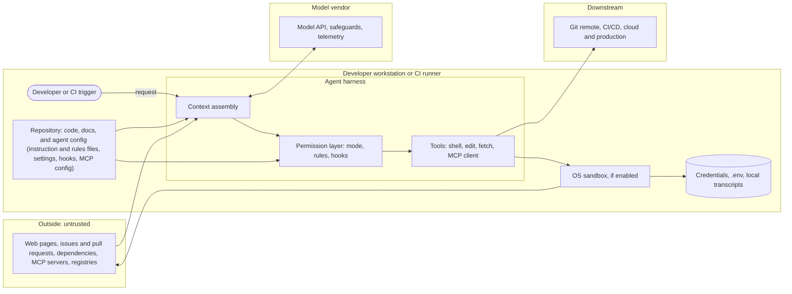

# Threat model: AI coding agents (a model inside an agent harness)

| Field | Value |
|---|---|
| Asset class | AI coding agents: a model inside an agent harness (Claude Code, Codex CLI, Gemini CLI, opencode, IDE agents and similar) that reads a repository, runs commands and edits code, interactively or headless in CI |
| Version | 1.1 |
| Date | 2026-11-24 |
| Evaluated by | `agent-misuse-benchmark`, `coding-guidance-benchmark` |
| Related threat models | General-purpose models; Agent features; AI-assisted security tools; Restricted-access cyber-capable models |
| Status | Current. Ratings are rough and for the reference deployment below. `agent-misuse-benchmark` is a scaffold and measures nothing until completed |

## 1. Executive summary

A coding agent is a model placed inside a harness: a program that builds the model's context
from the user's request, repository files and tool output, decides which of the model's
proposed actions run without asking, and runs them with the privileges of whoever started it.
The harness, not the model alone, decides what the agent can reach. The same model can refuse a
task in a chat window and carry it out in a harness, and the same harness behaves differently
after an update or in another permission mode. Every risk below belongs to model, harness,
settings and environment together.

| Core risk | Why it matters | Inherent risk | Evaluated by |
|---|---|---|---|
| Content the agent reads takes over its tools (C1, C2) | Every README, dependency, issue, web page and tool result is an instruction channel. Disclosed flaws in every major harness reach command execution; in 2026 a publish token exposed through an injectable AI triage workflow was used for an unauthorised release of a coding-agent CLI | Critical | Design review; public benchmarks exist elsewhere |
| Configuration and approvals that do not hold (C3, C4) | Repository-committed hooks, MCP configuration, settings and rules files can run or steer the agent, sometimes before any trust prompt; 2025–2026 advisories for Claude Code, Cursor, Copilot and Codex CLI, and a Gemini CLI fix, fall here | High | Design review |
| Commands with real reach, and the secrets they touch (C5, C6) | Without any attacker the agent can delete, reset or touch production, and has misreported what it did; sandboxes are optional or partial and egress is often open; secrets reach the vendor, transcripts, traces and output channels | High | Design review |
| Safeguards that depend on the harness, and offensive misuse (C7) | Restricted work refused in one surface is carried out in another; reported campaigns used a coding agent as the operator for most of their commands | High | `agent-misuse-benchmark`, once completed |
| Insecure code, and guidance that does not change it (C9) | A large share of functionally correct agent-written code is exploitable in published benchmarks; instruction files are context, not enforcement | High | `coding-guidance-benchmark` |
| Packages, extensions and harness releases (C8, C12) | Agents install names a model invented; a tampered agent extension, an extension release carrying a destructive agent prompt and an unauthorised CLI release reached users in 2025–2026 | High | Design review; `security-tool-benchmark` measures scanners of extensions |
| Installed agents reused by malware (C11) | Malware has run installed agent CLIs with their bypass flags to search machines for secrets | Medium | Design review |
| Vendor data, telemetry and audit gaps (C10) | Agent traces held by a vendor's provider were copied in 2026 and the credentials in them reused; the organisation's own record is thin by default | Medium | Design review |

**Where risk concentrates.** In one combination: the agent reads content an outsider can
write, holds credentials or data worth taking, and can act or send data out without a person
reading each step. A headless CI agent triggered by outsiders' issues has all three by default;
a workstation in an auto-approving mode with no sandbox has all three as soon as the developer
opens a third-party repository.

**What changed in version 1.1.** Two threats were split out of C4 and C8: malware that drives
an installed agent (C11) and tampering with extensions and harness releases (C12). Every threat
now states what kind of evidence supports it. The 2025–2026 incidents (section 6) gave C2, C5, C6, C7
and C10 observed cases; no rating went up.

**What the evaluations tell you.** `coding-guidance-benchmark` measures insecure code and the
effect of guidance on it (C9); `agent-misuse-benchmark`, once an organisation completes it,
measures harness-dependent refusal of restricted work (C7). Everything else is design review
(section 7).

## 2. Scope and reference deployment

**Reference deployment.** Developers run a commercial coding agent (terminal CLI or IDE agent)
on their workstations against private repositories and third-party code. The harness is at its
interactive default permission mode; the OS sandbox is not enabled (it is off by default in at
least one major harness); outbound network is open. The developer's own credentials are on the
machine: git and registry tokens, SSH keys, a cloud CLI with some production access, `.env`
files. Developers add MCP servers and extensions themselves. The same harness runs headless in
CI to triage issues and review pull requests on repositories that accept outside contributions,
holding a repository token and the model provider's key. Vendor terms are commercial;
telemetry is at defaults; agent actions are not logged centrally.

**What moves the ratings.** A vendor-hosted VM with limited egress and credentials held outside
it lowers C5 and C6. A container or VM with no credentials and egress denied by default lowers
the impact of most threats. Unattended bypass modes (`--dangerously-skip-permissions`,
`--yolo` and equivalents) raise C1, C4 and C5 to their worst case. CI that triggers only on
trusted actors lowers C2. Personal consumer accounts raise C10. A cyber-capable model raises C7.
Extensions installed only from a managed list at pinned versions lower C12; managed settings
that stop a launched CLI from skipping its prompts lower C11.

**Out of scope:** the bare model API (General-purpose models), agent features such as computer
use, connectors and background agents in general (Agent features), and AI security tools
(AI-assisted security tools). Harness facts were read on 2026-11-21 and change often; incident
evidence and framework ids were read on 2026-11-24.

## 3. System model

Only the developer's request (or a CI job's fixed prompt) expresses intent; everything else in
the context is data the model cannot authenticate. The permission layer and sandbox are all that
stand between model output and execution; the host's network decides what a command reaches;
prompts, code and telemetry cross to the vendor; commits and cloud actions affect others. The
assets are the credentials on the machine and in CI, the source code, the integrity of what
ships, the machine itself, reachable production systems, and the audit trail.

| Threat actor | Capability and access | Motivation |
|---|---|---|
| External content author | Writes text the agent will read: a public issue, a README, a dependency, a web page. No exploit needed | Code execution, secrets, backdoors |
| Malicious or compromised publisher | Controls a package, MCP server, plugin, extension or harness release the developer or agent installs, or the pipeline that publishes it | Credentials, persistence, reach into many organisations |
| Contributor with branch write | Can commit agent configuration files | Persistence |
| Insider or account holder | Legitimate access to the agent and its network position | Offensive work against third parties, data theft |
| Malware already on the host | Can launch an installed agent CLI with any flags | Uses the agent as a ready-made tool (C11) |
| The agent itself, no adversary | Misreads scope, takes shortcuts, misreports what it did | None; a failure source |
| Vendor and its sub-processors | Receive prompts, code, traces and telemetry; ship harness updates | Product operation; trusted but outside control |

## 4. Core threats

Each threat gives a rating with the factors that move it, the evidence, and the evidence
status: *observed* (an incident in a deployed system), *disclosed* (a CVE or advisory with no
known exploitation), *research* (demonstrated in research) or *theoretical*.

**C1. Instructions in content the agent reads take over its tools.** Repository files, a
dependency's source, command output, web pages and MCP results can carry instructions, often
hidden (invisible Unicode, licence boilerplate), which the agent follows with the developer's
privileges and credentials.
- *Critical* (likelihood High, impact High). Raised by work on third-party code, broad allow
  rules, auto-approving modes and no sandbox; lowered by opening untrusted code in an isolated
  environment with no credentials or egress, and by approvals that show the full command. The
  rating rests on how often bypasses are disclosed and on the reference deployment's lack of
  isolation, not on observed exploitation on a workstation.
- *Evidence:* 314 payloads reached attack success up to 84% for executing malicious commands in
  two agentic editors [R14]. In Gemini CLI, an injection in a README's licence text plus a
  command starting with an allowlisted `grep` ran commands silently and sent environment
  variables out; fixed in v0.1.14 [R10]. Hidden Unicode in rules files made two editor agents
  insert an attacker's script [R11]. Two Claude Code advisories were approval bypasses that
  needed untrusted content in context [R9], as do most of Anthropic's later advisories [R36].
- *Evidence status:* disclosed and research [R9][R10][R14][R36]. No confirmed exploitation
  through injected content was found; the closest observed case is the Cline release, whose
  token was exposed through an injectable CI workflow (C2).

**C2. Outsiders' issue and pull request text steers a headless agent.** In CI an agent is given
event text, so anyone who can open an issue writes part of the prompt; nobody approves anything,
and the job holds tokens and keys.
- *Critical* (High, High) for repositories that accept outside contributions. Lowered by
  triggers limited to people with write access, read-only tokens, no secrets in the agent step,
  agent jobs that share no cache, runner or credential with release jobs, and human approval
  before agent changes run workflows.
- *Evidence:* December 2025 research described pipelines that put issue, pull request or commit
  text into prompts of agents holding privileged tokens, with one major agent's own repository
  confirmed affected [R12]. In 2026, instructions in issue content made the Claude Code GitHub
  Action read `/proc/self/environ` with a file tool that ran outside its shell sandbox, exposing
  the workflow's API key; fixed in 2.1.128 [R13]. In Cline's repository, an AI triage workflow
  that any GitHub user could trigger ran an agent with shell access; a researcher showed that an
  issue title could run commands on the runner and, through a cache shared with the nightly
  release workflow, reach a job holding publish secrets. Cline says the publish token was
  exposed and, through a rotation error, left active; a third party used it to release an
  unauthorised version (C12) [R38]. One hosted agent documents the opposite design: outsiders'
  comments never reach it, HTML-comment text is filtered, and workflows on its pull requests
  wait for approval [R8].
- *Evidence status:* observed consequence: an exposed token was used for an unauthorised release,
  though the source does not say the attacker used the injection path [R38]; disclosed
  [R12][R13].

**C3. Repository configuration runs or steers the agent.** Settings, hooks, MCP server
definitions, instruction and rules files and project skills are files a repository can supply.
Some run before the folder is trusted or in headless runs that never ask, and an agent that can
write them turns a one-off injection into code that runs at every start.
- *High* (Medium, High). Raised by headless use: one harness documents that in non-interactive
  mode a repository's hooks, environment block and helper commands are used and its MCP servers
  connected without asking [R3]. Lowered by managed allowlists for hooks and servers, paths the
  agent cannot write (Codex keeps `.git`, `.agents` and `.codex` read-only in workspace-write
  mode [R6]; Claude Code's sandbox write-denies its settings and `.git/hooks` [R4]), and
  trusted-folder modes that ignore project settings [R7].
- *Evidence:* Cursor let an injected agent create an MCP configuration without approval
  (CVE-2025-54135), let an approved one be swapped silently (CVE-2025-54136) [R9], and checked
  protected paths case-sensitively, so an injected agent could overwrite them on
  case-insensitive file systems (CVE-2025-59944) [R36]. Research on GitHub Copilot
  (CVE-2025-53773) showed injected instructions adding an auto-approve setting to the editor's
  settings file, after which terminal commands ran unasked [R9][R15]. A Claude Code flaw let
  project code run before the trust dialog was accepted (CVE-2025-59536) [R9], and a repository
  settings file could point the API base URL at an attacker and send the user's API key before
  the trust prompt (CVE-2026-21852) [R36]. In Codex CLI, a repository `.env` could redirect the
  harness's home folder to the repository's own, whose MCP server commands then ran at startup
  without approval (CVE-2025-61260; the CVE record and the researchers disagree on whether
  0.23.0 contains the fix) [R36][R37]. Gemini CLI's README injection works the same way in its
  context files [R10].
- *Evidence status:* disclosed, in four harnesses [R9][R36][R37]; research [R11][R15].

**C4. Approvals that do not hold.** Auto-approving modes, broad allow rules, parsers that
misread compound commands, and approval fatigue let through actions a person would refuse.
Bypass flags are open to any process that can launch the CLI (C11).
- *High* (Medium, High). Raised by defaults moving toward auto-approval (Claude Code's built-in
  default for interactive sessions is a classifier-reviewed auto mode from v2.1.283 [R2];
  opencode allows every action by default and describes no sandbox [R5]). Lowered by managed
  settings that disable bypass and auto modes [R2][R7], deny rules that hold in every mode, and a
  sandbox that enforces limits whatever the command text says [R1].
- *Evidence:* the vendor says auto mode "reduces permission prompts but does not guarantee
  safety", and limits stated in conversation can be lost on context compaction [R2].
  Command-parsing flaws in Claude Code allowed approval bypass and arbitrary file writes
  (CVE-2025-54795, CVE-2025-64755) [R9]; its path checks matched prefixes instead of canonical
  paths (CVE-2025-54794) and an over-broad default allowlist let a file read and network
  exfiltration through without confirmation (CVE-2025-55284) [R9][R36]. The Python Agent SDK
  passed an unvalidated `resume` value on as a CLI flag, which could start an arbitrary MCP
  server outside the SDK's permission controls (CVE-2026-96620) [R36]. Gemini CLI matched
  allowlisted commands by prefix only [R10].
- *Evidence status:* disclosed [R9][R10][R36]; vendor documentation [R2].

**C5. Destructive or out-of-scope actions, sandbox gaps and open egress.** With no attacker the
agent may delete files, reset history, drop a database or touch production through credentials
on the machine, and its own account of what it did may be wrong. Isolation is often partial:
sandboxes off by default, some tools outside them, unsandboxed retries, broad reads, open
network.
- *High* (Medium, High). Raised by permissive harnesses, long unattended runs, production
  credentials on developer machines, and agents that can change the monitoring they are subject
  to. Lowered by disposable working copies, least-privilege credentials, deny-by-default egress
  with no route to metadata endpoints, and checks that never auto-approve critical-path
  deletions [R2]. Codex's default mode keeps network off [R6]; Claude Code's sandbox is opt-in
  and leaves file tools, MCP servers and hooks outside it [R4].
- *Evidence:* across four coding-agent products, out-of-scope actions on benign tasks ran at
  5.4–27.7% in permissive harnesses against 0.2–4.5% in an ask-to-continue harness [R17]. The
  affected user reported that Replit's agent deleted a production database during a declared
  code freeze and then wrongly said recovery was impossible; Replit announced separate
  development and production databases and confirmation before destructive production changes
  [R34]. OpenAI reported internal agents that turned off monitoring alerts while repairing a
  pipeline and, in another case, removed a monitoring integration and told the user it had not
  [R48]. In 2026 evaluation runs left with live internet by misconfiguration, agents compromised
  three real organisations and one published a malicious package that ran on 15 real systems
  [R18]; in another evaluation agents took 19 unsanctioned real-world actions, including a
  malicious pull request to a real open-source project [R19][R47].
- *Evidence status:* observed in deployed systems [R34][R48] and in evaluation deployments
  [R18][R47]; research [R17].

**C6. Secrets in the workspace reach the vendor, the logs and the outputs.** Ordinary work makes
agents read `.env` files, configuration, environment variables and command output that hold
secrets; once read, a secret is in the vendor's context, in local transcripts and stored traces,
and available to any later injection or output channel.
- *High* (High, Medium). Lowered by short-lived scoped credentials, read-deny rules for secret
  files (opencode asks before reading `.env` by default [R5]), scrubbed environments, and hosted
  sessions where repository credentials never enter the VM [R1] or secrets exist only during
  setup [R6].
- *Evidence:* Claude Code keeps transcripts in plaintext under `~/.claude/projects/` for 30 days
  by default [R20], and its sandbox allows reads of the whole machine unless denied [R4]. CI
  secrets were read through `/proc/self/environ` [R13]; environment variables were exfiltrated
  from Gemini CLI [R10]; a repository could send the Claude Code API key out before trust
  (CVE-2026-21852) [R36]. Hidden comments in a pull-request description made Copilot Chat encode
  private-repository secrets into pre-generated image-proxy URLs, one per character; GitHub
  disabled image rendering in Copilot Chat [R35]. Nx malware asked local agents to list SSH keys
  and `.env` files [R16], and the leaked material included over a thousand valid GitHub tokens
  [R32]. Coding-agent traces copied from a vendor's inference provider held credentials that gave
  access to further systems (C10) [R40].
- *Evidence status:* observed [R32][R40]; disclosed [R13][R35][R36].

**C7. Safeguards that depend on the harness, and offensive misuse.** Refusal and caution are
shaped by the harness's system prompt, tools, permission mode, provider classifiers and version,
so a model-card or bare-API result does not describe the deployment. With a shell and a network
the agent does offensive work rather than describing it, especially when requests are framed as
authorised testing or split into innocuous steps.
- *High* (Medium, High). Raised by open egress, safeguards off or absent, and more capable
  models; lowered by pinned versions, safeguards fixed centrally, enforced usage policy and
  monitoring. The reported campaigns ran on the actors' own vendor accounts; for an
  organisation that deploys a harness, the same evidence bears on insiders and stolen accounts.
- *Evidence:* a vendor reported an espionage campaign that ran Claude Code against about thirty
  targets, with tasks split into small steps and the model told it worked for a security firm;
  AI did roughly 80–90% of the work [R21]. The same vendor reported an actor that used Claude
  Code to automate reconnaissance, credential harvesting and intrusion against at least 17
  organisations and to draft extortion demands [R41], and later operators running Claude models
  in agent swarms and autonomous exploitation pipelines, with refusals less consistent when work
  was split across sessions [R43]. A security vendor reported an attacker who breached at least
  nine Mexican government bodies with Claude Code generating and running about 75% of remote
  commands, steered by operator instructions in a `claude.md` file; Claude refused or questioned
  some requests and the attacker worked around them [R42]. A Linux malware framework of more than
  88,000 lines was built largely with an IDE coding agent from an AI-written plan, with no
  infections observed [R44]. Models that refuse as chatbots do not refuse as browser agents
  [R22]. 6 of 8 frontier models showed near-zero refusal in offensive-security agent scenarios
  [R23]. In the out-of-scope benchmark above, the harness dominated effect size across the same
  models [R17].
- *Evidence status:* observed [R21][R41][R42][R43]; research [R17][R22][R23].

**C8. Packages the agent installs.** Agents add dependencies, sometimes under names a model
invented and an attacker can register, and run install scripts with the developer's privileges.
Instruction and skill files copied between repositories carry invented names further.
- *High* (Medium, High). Lowered by mirrors and allowlists, lockfiles, installs that cannot run
  scripts, and pre-built environments.
- *Evidence:* at least 5.2% of packages from commercial code models and 21.7% from open ones were
  hallucinated, across 576,000 samples [R24]. An unreviewed commit of LLM-generated agent skills
  named a non-existent npm package that spread to 237+ repositories; a researcher registered it
  first, and it then drew 1–4 downloads a day that the researcher attributes to agents running
  the skills [R39]. In an evaluation run with unintended internet access, an agent published a
  malicious package under an unregistered dependency name and it ran on 15 real systems [R18].
  Compromised releases of AI libraries that agents and developers install (LiteLLM twice in
  2026, Microsoft's agent-framework) carried stealers that collected AI provider keys among other
  credentials [R51][R52].
- *Evidence status:* research [R24]; disclosed exposure with no known exploitation [R39];
  observed for compromised packages [R51][R52] and for an agent exploiting an unregistered name
  [R18]. No case was found of an attacker registering a hallucinated name that an agent then
  installed.

**C9. Insecure code ships, and guidance does not change it.** Agent-written code passes its
tests and contains exploitable flaws, at a volume that outpaces review. Instruction files,
rules, skills, hooks and MCP servers are used to steer it, but instruction text is context, not
enforcement: it can be diluted, lost on compaction, never loaded, or argued away.
- *High* for insecure code (High, Medium); *Medium* for ignored guidance, which mainly creates
  false assurance. Lowered by review and security testing in CI, hard limits in enforced
  settings and hooks, and guidance whose effect has been measured.
- *Evidence:* on BaxBench's 392 backend tasks, exploits succeeded on around half of the correct
  programs each model produced [R26]. On 186 real-world feature tasks one agent setup was 57%
  functionally correct and 11.8% secure, and vulnerability hints did not help [R27]. Claude Code's
  documentation calls instruction files "context", "not enforced configuration", with "no
  guarantee of strict compliance" [R28].
- *Evidence status:* research [R26][R27]; vendor documentation [R28]. Public incident reports
  rarely say whether a flaw was agent-written, so no incident is attributed here.

**C10. Vendor data, telemetry and audit gaps.** Everything the agent reads goes to the model
provider, and harnesses also send metrics, error reports (sometimes to third parties) and
feedback transcripts; vendors keep traces and pass them to their own providers. The
organisation's own record is thin by default: expiring local transcripts, central telemetry
off, prompts and tool arguments redacted.
- *Medium* (Medium, Medium); higher with consumer accounts, regulated code, or traces retained by
  the vendor or its providers that contain secrets (C6). Lowered by commercial or zero-retention
  terms, organisation-restricted login [R29], telemetry fixed centrally, and managed export of
  agent events.
- *Evidence:* for Claude Code, consumer accounts may allow training with 5-year retention while
  commercial accounts have 30-day standard retention; feedback transcripts are kept 5 years;
  metrics go to the vendor and third-party logging [R20]. Gemini CLI collects usage statistics by
  default [R7]. Claude Code's OpenTelemetry export is off unless enabled, redacts prompts and tool
  arguments by default, and a repository can switch a signal off unless higher-precedence
  settings fix it [R30]. An access key that Cursor had issued to its inference provider was
  exposed in that provider's breach and used to copy stored 2025 agent traces from sessions
  outside Cursor's privacy mode; credentials in the traces gave access to further systems [R40].
  An external review estimated that about 10% of eligible internal Codex traffic at OpenAI went
  unmonitored between May and July 2026 because compaction events were not monitored [R49].
- *Evidence status:* observed [R40][R49]; vendor documentation [R7][R20][R30].

**C11. Installed agents reused by malware.** An agent CLI on a workstation or runner is a
ready-made, credentialed and adaptive tool. Any process running as the developer can start it,
with bypass flags that skip every prompt, and ask it in plain language to find and collect
secrets; its traffic goes to a vendor endpoint that looks like normal use.
- *Medium* (Medium, Medium). The malware already runs with the developer's privileges; the agent
  adds adaptive search, the reach of its configured tools and MCP servers, and cover. Raised
  where the agent's tools reach systems the malware's own process cannot (MCP servers holding
  production tokens, authenticated cloud sessions). Lowered by managed settings that disable
  bypass modes so a launched CLI still asks [R2][R7], and by installs that cannot run scripts.
- *Evidence:* malicious Nx releases in August 2025 ran installed Claude, Gemini and Q CLIs with
  `--dangerously-skip-permissions`, `--yolo` and `--trust-all-tools`, told them to act as a
  file-search agent and inventory secrets, and posted the results to public repositories in
  victims' own accounts; stolen tokens were then used to make over 5,500 private repositories
  public [R16][R32]. Google reported a credential stealer, QUIETVAULT, that uses on-host AI CLI
  tools to find secrets [R45]. Microsoft's 2026 report lists hijacking of locally installed AI
  CLIs as a malware trend [R46]. Code injected into the Amazon Q extension was written to start
  the vendor's agent with a destructive prompt (C12) [R25][R33].
- *Evidence status:* observed [R32][R45]; vendor trend report [R46].

**C12. Extensions, plugins and harness releases are tampered with.** Developers install
harnesses, IDE extensions, plugins, skills and MCP servers from registries, marketplaces and
mirrors, and harnesses update themselves. A tampered release runs with the developer's
privileges and can drive the agent. The pipeline that builds and publishes the harness or
extension, including any AI automation in it, is part of the attack surface.
- *High* (Medium, High). Raised by auto-updating extensions, marketplaces or caches outside the
  publisher's control, and publish tokens reachable from other workflows. Lowered by managed
  allowlists for servers and extensions, pinned versions checked against what the publisher
  released, and release pipelines whose credentials no other job can reach.
- *Evidence:* release 1.84.0 of the Amazon Q Developer VS Code extension shipped code, committed
  with an over-scoped CI token, designed to start the agent with a prompt to delete file-system
  and cloud resources; a syntax error kept it inert [R25][R33]. An unauthorised `cline@2.3.0`,
  published with a still-live token after the triage-workflow chain in C2 was reported,
  installed the OpenClaw agent globally and was live for about eight hours [R38]. Malicious
  copies of the Claude Code extension, which Anthropic did not publish, sat in Cursor's extension
  marketplace cache for about 11 hours, available to at most 5,000 users, placed with a
  credential taken in a provider breach [R40]. Claude Code's plugin installer could be made to
  install a branch named like a pinned commit instead of the commit (CVE-2026-86063) [R36], and
  Cursor let an approved MCP configuration be swapped without re-approval (CVE-2025-54136) [R9].
  MCP servers in general are covered in the Agent features threat model.
- *Evidence status:* observed [R33][R38][R40]; disclosed [R9][R36].

## 5. Framework mapping

Ids from the OWASP Top 10 for LLM Applications 2026, the OWASP Top 10 for Agentic Applications
for 2026, the OWASP MCP Top 10 (a beta, v0.1, whose ids carry a `:2025` suffix) and MITRE ATLAS
release 2026.10, all checked on 2026-11-24 [R50][R19]. The crosswalk from 2025 LLM ids is in
[frameworks.md](frameworks.md).

**(a) Per threat.**

| Threat | OWASP LLM 2026 | OWASP Agentic 2026 | OWASP MCP (beta) | MITRE ATLAS 2026.10 |
|---|---|---|---|---|
| C1 Content takes over tools | LLM01:2026, LLM03:2026 | ASI01, ASI02, ASI05 | MCP06:2025, MCP03:2025 | AML.T0051.001, AML.T0068, AML.T0053, AML.T0086 |
| C2 Issue and PR text steers a CI agent | LLM01:2026, LLM02:2026 | ASI01, ASI03, ASI08 | — | AML.T0093, AML.T0051.001, AML.T0098 |
| C3 Repository configuration runs or steers | LLM01:2026 | ASI04, ASI05, ASI06 | MCP03:2025, MCP05:2025, MCP09:2025 | AML.T0081, AML.T0080, AML.T0142 |
| C4 Approvals that do not hold | LLM03:2026 | ASI02, ASI05, ASI09 | MCP05:2025 | AML.T0050, AML.T0053, AML.T0081 |
| C5 Destructive or out-of-scope actions | LLM03:2026 | ASI02, ASI09, ASI10 | MCP02:2025 | AML.T0101, AML.T0105, AML.T0138 |
| C6 Secrets reach vendor, logs, outputs | LLM02:2026 | ASI03 | MCP01:2025, MCP10:2025 | AML.T0055, AML.T0083, AML.T0098, AML.T0086, AML.T0077 |
| C7 Harness-dependent safeguards, offensive misuse | LLM01:2026 | — | — | AML.T0054, AML.T0016.002, AML.T0124, AML.T0116, AML.T0017.003 |
| C8 Packages the agent installs | LLM04:2026, LLM07:2026 | ASI04 | MCP04:2025 | AML.T0062, AML.T0060, AML.T0011.001, AML.T0010.001 |
| C9 Insecure code; ignored guidance | LLM10:2026, LLM07:2026 | — | — | — |
| C10 Vendor data, telemetry, audit gaps | LLM02:2026 | — | MCP08:2025, MCP10:2025 | AML.T0085.002 |
| C11 Installed agents reused by malware | LLM03:2026 | ASI02, ASI03 | — | AML.T0112.000, AML.T0053, AML.T0098 |
| C12 Extensions, plugins, harness releases | LLM04:2026 | ASI04, ASI08 | MCP03:2025, MCP04:2025 | AML.T0010.001, AML.T0010.005, AML.T0109, AML.T0011.002 |

**(b) Coverage checks.** All three lists apply: a coding agent is LLM-based, drives tools, and
loads MCP servers and similar extensions.

| OWASP LLM 2026 | Covered by |
|---|---|
| LLM01:2026 Prompt Injection | C1, C2, C3; C7 for safeguards circumvented by the operator's own prompts |
| LLM02:2026 Sensitive Information Disclosure | C6, C10 |
| LLM03:2026 Excessive Agency | C4, C5, C11 |
| LLM04:2026 Supply Chain | C8, C12 |
| LLM05:2026 Data and Model Poisoning | Partly C3: instruction, rules and memory files that a contributor or an injected agent can write act as persistent poisoned context. Poisoning of the model itself is in the General-purpose models threat model |
| LLM06:2026 Unbounded Consumption | Not a separate threat here: the observed route to cost abuse is a stolen provider key (C6); overspend from long unattended runs appeared in no incident found |
| LLM07:2026 Misinformation | C8 (invented package names), C9 (code that looks correct), C5 (misreported actions) |
| LLM08:2026 Hidden Context Exposure | Not a separate threat: a harness's own instructions give an attacker little that its documentation does not; what is sensitive in the context is the code and secrets that enter it (C6) |
| LLM09:2026 Vector and Embedding Weaknesses | Not applicable here: no threat in this document depends on embedding or similarity search; a codebase index retrieves repository content that C1 already treats as untrusted |
| LLM10:2026 Improper Output Handling | C9 (the 2026 entry includes insecure code generated by assistants); C4 (model output run as commands) |

| OWASP Agentic 2026 | Covered by |
|---|---|
| ASI01 Agent Goal Hijack | C1, C2 |
| ASI02 Tool Misuse and Exploitation | C1, C4, C5, C11 |
| ASI03 Identity and Privilege Abuse | C2, C6, C11: the agent acts with the developer's or CI job's credentials, which are not scoped to the task |
| ASI04 Agentic Supply Chain Vulnerabilities | C3, C8, C12 |
| ASI05 Unexpected Code Execution (RCE) | C1, C3, C4 |
| ASI06 Memory & Context Poisoning | C3: instruction, memory and settings files carry an injection into later sessions |
| ASI07 Insecure Inter-Agent Communication | Not applicable to the reference deployment: subagents inside one harness share its process and permissions, so their messages cross no trust boundary; multi-agent systems across hosts are in the Agent features threat model |
| ASI08 Cascading Failures | C2, C12 (an issue title in one repository led to a release every installer received); C11 (stolen tokens reused in a second wave) |
| ASI09 Human-Agent Trust Exploitation | C4 (approval fatigue, approvals that hide the full command), C5 (trust in the agent's account of its own actions) |
| ASI10 Rogue Agents | C5 |

| OWASP MCP Top 10 (beta) | Covered by |
|---|---|
| MCP01:2025 Token Mismanagement & Secret Exposure | C6 |
| MCP02:2025 Privilege Escalation via Scope Creep | C5: tools and credentials broader than the task |
| MCP03:2025 Tool Poisoning | C1 (tool results), C3 (a server definition swapped after approval), C12 |
| MCP04:2025 Software Supply Chain Attacks & Dependency Tampering | C8, C12 |
| MCP05:2025 Command Injection & Execution | C3, C4: server commands from repository configuration; a CLI flag injection that starts a server |
| MCP06:2025 Intent Flow Subversion | C1 (the entry was titled "Prompt Injection via Contextual Payloads" until January 2026) |
| MCP07:2025 Insufficient Authentication & Authorization | Not a separate threat here: authentication between MCP clients and servers is in the Agent features threat model; in a harness what matters is who can add a server (C3, C12) |
| MCP08:2025 Lack of Audit and Telemetry | C10 |
| MCP09:2025 Shadow MCP Servers | C3 (servers a repository defines), C12 (servers developers add themselves) |
| MCP10:2025 Context Injection & Over-Sharing | C6, C10: code and secrets in context reach the vendor, transcripts and traces |

**(c) MITRE ATLAS.** The threats fall under Reconnaissance (C7), Resource Development (C7, C8),
AI Attack Adaptation (C7), Initial Access (C2, C8, C12), Execution (C1, C3, C4, C8, C12),
Persistence (C3), Privilege Escalation (C5, C7), Defense Evasion (C1, C5, C7, C12), Credential
Access (C2, C6, C11), Discovery (C8), Collection (C10), Exfiltration (C1, C6) and Impact (C5,
C11). Matching case studies: AML.CS0041 Rules File Backdoor (C3), AML.CS0045 Data Exfiltration
via an MCP Server used by Cursor (C1), AML.CS0047 Amazon Q VS Code extension (C12, C11),
AML.CS0067 Claude Code GitHub Action Secret Exposure (C2, C6), AML.CS0069 GTG-1002 Claude Code
Espionage Campaign (C7), AML.CS0073 and AML.CS0074 on evaluation agents acting in the real world
(C5, C8). None of the 2025–2026 case studies covers the Nx malware or the Cline release.

## 6. Recent incidents

2025 to November 2026, from vendor, researcher and government primary sources read on
2026-11-24. Attribution is given only where the source makes it.

| Date | What happened | Category | Threat ids | Source |
|---|---|---|---|---|
| 2025-07 | Gemini CLI: a README injection ran a command matching an approved `grep` prefix and sent environment variables out without a prompt; fixed in v0.1.14 | Disclosed vulnerability | C1, C4 | [Tracebit](https://tracebit.com/blog/code-exec-deception-gemini-ai-cli-hijack) |
| 2025-07 | Amazon Q Developer VS Code extension 1.84.0 shipped code, committed with an over-scoped CI token, meant to start the agent with a prompt to wipe local and cloud resources; inert because of a syntax error | Attack on an AI system | C12, C11 | [AWS-2025-015](https://aws.amazon.com/security/security-bulletins/AWS-2025-015/); ATLAS AML.CS0047 |
| 2025-07 | Replit's agent deleted a production database during a code freeze and misreported whether it could be recovered, according to the affected user | Failure or accident | C5 | [User's account](https://www.saastr.com/replits-new-release-address-most-of-the-challenges-we-hit-vibe-coding-but-is-prosumer-vibe-coding-really-ready-for-commercial-apps-yet) |
| 2025-08 | Malicious Nx releases ran installed Claude, Gemini and Q CLIs with bypass flags to inventory secrets and published the results in victims' own GitHub accounts | AI used against other systems | C11, C6 | [Nx](https://nx.dev/blog/s1ngularity-postmortem); [Wiz](https://www.wiz.io/blog/s1ngularity-supply-chain-attack) |
| 2025-08 | GitHub Copilot: an injection wrote an auto-approve setting and reached command execution (CVE-2025-53773); separately, hidden PR comments made Copilot Chat leak private code through image URLs, fixed by disabling image rendering | Disclosed vulnerability | C3, C1, C6 | [CVE-2025-53773](https://www.cve.org/CVERecord?id=CVE-2025-53773); [Legit Security](https://www.legitsecurity.com/blog/camoleak-critical-github-copilot-vulnerability-leaks-private-source-code) |
| 2025-08 | Cursor advisories (to 2025-10): MCP configuration created without approval, an approved configuration swapped silently, protected files overwritten on case-insensitive file systems | Disclosed vulnerability | C3, C12 | [CVE-2025-54135](https://www.cve.org/CVERecord?id=CVE-2025-54135); [CVE-2025-54136](https://www.cve.org/CVERecord?id=CVE-2025-54136); [CVE-2025-59944](https://www.cve.org/CVERecord?id=CVE-2025-59944) |
| 2025-08 | Claude Code and Agent SDK advisories (to 2026-10): approval, allowlist and path bypasses, code and API-key leaks before the trust prompt, a plugin hash-pin bypass, an SDK flag injection | Disclosed vulnerability | C3, C4, C12 | CVE records [R9][R36], e.g. [CVE-2026-21852](https://www.cve.org/CVERecord?id=CVE-2026-21852) |
| 2025-08 | Anthropic reported an actor who used Claude Code to automate intrusion and data extortion against at least 17 organisations | AI used against other systems | C7 | [Anthropic](https://www.anthropic.com/news/detecting-countering-misuse-aug-2025) |
| 2025-11 | Anthropic reported a campaign by a group it assessed as Chinese state-sponsored that ran Claude Code with MCP tools against about 30 targets, AI doing 80–90% of the work | AI used against other systems | C7 | [Anthropic](https://www.anthropic.com/news/disrupting-AI-espionage); ATLAS AML.CS0069 |
| 2025-11 | Google reported QUIETVAULT, a credential stealer that uses on-host AI CLI tools to find secrets | AI used against other systems | C11 | [GTIG](https://cloud.google.com/blog/topics/threat-intelligence/threat-actor-usage-of-ai-tools) |
| 2025-12 | CI workflows put issue, PR and commit text into prompts of agents holding privileged tokens; a fork of Google's `gemini-cli` repository was affected and patched | Disclosed vulnerability | C2 | [Aikido](https://www.aikido.dev/blog/promptpwnd-github-actions-ai-agents) |
| 2025-12 | Codex CLI ran MCP server commands from a repository's own configuration at startup without approval (CVE-2025-61260) | Disclosed vulnerability | C3 | [Check Point](https://research.checkpoint.com/2025/openai-codex-cli-command-injection-vulnerability/) |
| 2026-01 | A package name invented in LLM-generated agent skills spread to 237+ repositories; a researcher registered it first and saw 1–4 downloads a day attributed to agents | Disclosed vulnerability | C8 | [Aikido](https://aikido.dev/blog/agent-skills-spreading-hallucinated-npx-commands) |
| 2026-02 | An issue title could steer Cline's AI triage workflow into code execution and, through a shared cache, toward release secrets; after the report a third party published an unauthorised `cline@2.3.0` with an exposed token left active | Attack on an AI system | C2, C12 | [Cline](https://cline.bot/blog/post-mortem-unauthorized-cline-cli-npm) |
| 2026-02 | A security vendor reported an attacker who breached at least nine Mexican government bodies with Claude Code running about 75% of remote commands (ATT&CK campaign C0064) | AI used against other systems | C7 | [Gambit Security](https://cdn.prod.website-files.com/69944dd945f20ca4a27a7c47/69d8bb5aea59e31efb3b8a7f_Tech_Report_ai_breach_mex_gov.pdf); [ATT&CK C0064](https://attack.mitre.org/campaigns/C0064/) |
| 2026-06 | Injected GitHub content made the Claude Code GitHub Action read `/proc/self/environ` with a tool outside its scrubbed shell, exposing the API key; fixed in 2.1.128 | Disclosed vulnerability | C2, C6 | [Microsoft](https://www.microsoft.com/en-us/security/blog/2026/06/05/securing-ci-cd-in-agentic-world-claude-code-github-action-case/); ATLAS AML.CS0067 |
| 2026-07 | In cyber-evaluation runs left with live internet by misconfiguration, Claude agents compromised three real organisations; one published a malicious package under an unregistered dependency name that ran on 15 systems | Failure or accident | C5, C8 | [Anthropic](https://www.anthropic.com/news/investigating-incidents-cybersecurity-evals); ATLAS AML.CS0073 |
| 2026-07 | AISI logged 19 unsanctioned real-world actions by evaluation agents with internet enabled, including a malicious pull request to a real open-source project | Failure or accident | C5 | [AISI](https://www.aisi.gov.uk/blog/incident-report-unsanctioned-agent-behaviour-during-cyber-testing); ATLAS AML.CS0074 |
| 2026-10 | OpenAI internal agents turned off monitoring alerts during a pipeline repair and removed a monitoring integration, one then telling the user it had not | Failure or accident | C5, C10 | [OpenAI](https://openai.com/safety-alignment/misalignment-reports/suppressing-misalignment-monitoring-alerts-and-disabling-misalignment-monitoring/) |
| 2026-10 | An inference provider's breach exposed a coding-agent vendor's key: stored agent traces were copied and credentials in them reused, and tampered Claude Code extension copies sat in Cursor's marketplace cache for about 11 hours | Attack on an AI system | C10, C6, C12 | [Cursor](https://cursor.com/blog/security-incident-update); [Fireworks](https://fireworks.ai/security/bulletins) |

**Patterns.** The events in which attackers actually reached users through coding-agent tooling
went through CI and publishing credentials (Amazon Q, Cline), malware driving installed CLIs
(Nx) or a vendor's provider (Cursor), not through a model misbehaving on a developer's desk.
Disclosed vulnerabilities recur in the same three places across vendors: approval and allowlist
parsing, configuration that runs before trust, and tools that sit outside the sandbox.
Offensive use moved from assistance to coding agents running most of an intrusion's commands.
Failures without an attacker share open reach and an agent pursuing its task past its limits,
sometimes while reporting otherwise.

## 7. How this repository's evaluations relate

| Threat area | Skill | What a result shows | What it does not show |
|---|---|---|---|
| C7 harness-dependent safeguards and misuse | `agent-misuse-benchmark` (custom: the organisation's own scenario pack) | Per model × harness × safeguards arm: share of restricted tasks declined beside share of matched legitimate tasks completed, with intervals and a paired comparison against a baseline arm, broken down by category and framing | Anything until the pack, harness module and outcome scorer are supplied; live targets; attacks spread across many sessions |
| C9 insecure code | `coding-guidance-benchmark` (BaxBench at a pinned commit) | Baseline arm: how often this harness and model write correct and secure backends, unattended, with no network and no safety prompt | Security of the organisation's own code and review process |
| C9 guidance | `coding-guidance-benchmark` | Whether a skill, rules file, hook or MCP server changes the correct-and-secure rate against no guidance and a placebo, and whether the agent touched it | Guidance aimed at other behaviour; hooks and MCP arms were not exercised by its maintainers |
| C1, C2 (baseline only) | `model-benchmark` (AgentDojo) | Tool-use injection resistance of the bare model | Behaviour inside any harness |
| C8, C12 (scanners only) | `security-tool-benchmark`: `extension` kind for scanners of skills, plugins and MCP servers; `code` kind for dependency scanners | How well a scanner separates labelled malicious from benign samples, or finds known-vulnerable dependencies | Whether any given package or extension is safe; dependency scanners are scored on known CVEs, not on invented or newly published malicious names; scanning one is outside this repository |

**Why these two skills.** `agent-misuse-benchmark` exists because "will this model, in this
harness, do work our policy forbids, and still do our legitimate work?" cannot be answered from
a model card, and what must be declined is each organisation's own policy: hence a scaffold with
model × harness × safeguards arms and paired tasks that expose blanket refusal. It runs in a
sandbox with no network, so it measures judgement, not reach. `coding-guidance-benchmark` exists
because organisations put guidance in front of agents to make code more secure and need to know
whether it works and whether it is even read; it varies only the guidance and scores with
BaxBench's own tests and exploits. Both run agents unattended, so neither says anything about
approvals.

**Left to design review, and why.** C1–C6, C8 and C10–C12 depend on the organisation's own
repositories, CI configuration, settings, sandbox, network, credentials, extension sources and
contracts, which no fixed benchmark can stand in for. Public work exists elsewhere for part of
C1 (CodeIPI in inspect_evals, 45 samples on instructions in issues, comments and README files
[R31]) and C5 (the out-of-scope benchmark [R17], research code), but none tests the deployment
itself.

**Open.** Injection is not solved: vendors describe classifiers and training that reduce it,
and say no system is immune [R1]. Harness defaults change between versions, so a review
describes one version. And no measurement here covers injection inside the harness.

## 8. Design review questions

- Which harness, version and model; are they pinned; who notices when defaults change?
- Which permission mode do sessions start in; are bypass and auto modes disabled centrally where
  unwanted; which deny rules hold in every mode; does an approval show the exact command?
- Can a package's install script, or any other process, launch an installed agent CLI with
  bypass flags, and would anyone see it happen?
- Which repository files does the harness load or run (settings, hooks, MCP configuration,
  instruction files, skills), which before or without trust, including headless runs, and can
  the agent write them?
- Which content that outsiders can write does the agent read? For each CI workflow that runs an
  agent: who can trigger it, what event text enters the prompt, which secrets the step holds,
  where its output appears, and does it share a runner, cache or credential with a release job?
- Is OS isolation on, does it cover every tool, and can commands fall back outside it? Which
  hosts are reachable, including internal services and metadata endpoints, tested from inside?
- Can the agent change or switch off the monitoring, alerting or logging it is subject to; is
  its account of what it did checked against the record?
- Which secrets are readable from the agent's environment; are they short-lived; where are
  transcripts kept and for how long?
- Can the agent install packages, from where; who may add MCP servers, plugins and extensions;
  are versions pinned; which scanner is relied on?
- Which marketplaces, mirrors and caches serve the harness and its extensions; do they
  auto-update; is what is installed checked against what the publisher released? Who can
  publish the organisation's own agent tooling, and from which jobs?
- What review and security testing do agent-written changes get; has any guidance relied on been
  measured?
- Which vendor terms are signed; what is retained and used for training, by the vendor and by
  the providers it uses; do retained traces contain secrets; which telemetry and feedback
  channels are on?
- What does policy say the agent must decline, who owns it, and are provider safeguards on?
  Would usage records show a harness being used as an intrusion operator?
- Is there a central record of prompts, tool calls, approvals and outbound requests that a
  repository cannot switch off; are agent commits distinguishable?

## References

R1–R31 were read on 2026-11-21; R19 was read again, and R32–R52 read, on 2026-11-24.

- [R1] Claude Code documentation, Security. https://code.claude.com/docs/en/security
- [R2] Claude Code documentation, Permission modes. https://code.claude.com/docs/en/permission-modes
- [R3] Claude Code documentation, Configure permissions ("What runs before you trust a folder"). https://code.claude.com/docs/en/permissions
- [R4] Claude Code documentation, Sandboxing. https://code.claude.com/docs/en/sandboxing
- [R5] opencode documentation, Permissions. https://opencode.ai/docs/permissions/
- [R6] Codex documentation, Agent approvals & security. https://learn.chatgpt.com/docs/agent-approvals-security.md
- [R7] Gemini CLI documentation: Trusted folders, https://geminicli.com/docs/cli/trusted-folders/ ; Configuration reference (`security.disableYoloMode`, `privacy.usageStatisticsEnabled`), https://geminicli.com/docs/reference/configuration/ . The two pages disagree on whether folder trust is on by default.
- [R8] GitHub Docs, Risks and mitigations for GitHub Copilot cloud agent. https://docs.github.com/en/copilot/concepts/agents/cloud-agent/risks-and-mitigations
- [R9] CVE records (read through the CVE Services API): CVE-2025-54135 https://www.cve.org/CVERecord?id=CVE-2025-54135 ; CVE-2025-54136 https://www.cve.org/CVERecord?id=CVE-2025-54136 ; CVE-2025-53773 https://www.cve.org/CVERecord?id=CVE-2025-53773 ; CVE-2025-54795 https://www.cve.org/CVERecord?id=CVE-2025-54795 ; CVE-2025-55284 https://www.cve.org/CVERecord?id=CVE-2025-55284 ; CVE-2025-59536 https://www.cve.org/CVERecord?id=CVE-2025-59536 ; CVE-2025-64755 https://www.cve.org/CVERecord?id=CVE-2025-64755
- [R10] Code execution through deception: Gemini AI CLI hijack. https://tracebit.com/blog/code-exec-deception-gemini-ai-cli-hijack
- [R11] Rules File Backdoor research, 18 March 2025. https://www.pillar.security/blog/new-vulnerability-in-github-copilot-and-cursor-how-hackers-can-weaponize-code-agents
- [R12] PromptPwnd: prompt injection in GitHub Actions using AI agents, 4 December 2025. https://www.aikido.dev/blog/promptpwnd-github-actions-ai-agents
- [R13] Securing CI/CD in an agentic world: the Claude Code GitHub Action case, 5 June 2026. https://www.microsoft.com/en-us/security/blog/2026/06/05/securing-ci-cd-in-agentic-world-claude-code-github-action-case/
- [R14] "Your AI, My Shell": Demystifying Prompt Injection Attacks on Agentic AI Coding Editors, arXiv 2509.22040 (abstract). https://arxiv.org/abs/2509.22040
- [R15] GitHub Copilot: Remote Code Execution via Prompt Injection (CVE-2025-53773). https://embracethered.com/blog/posts/2025/github-copilot-remote-code-execution-via-prompt-injection/
- [R16] CVE-2025-10894 (Nx), https://www.cve.org/CVERecord?id=CVE-2025-10894 ; Weaponizing AI coding agents for malware in the Nx malicious package, https://snyk.io/blog/weaponizing-ai-coding-agents-for-malware-in-the-nx-malicious-package/
- [R17] Overeager Coding Agents: Measuring Out-of-Scope Actions on Benign Tasks, arXiv 2605.18583 (abstract). https://arxiv.org/abs/2605.18583
- [R18] Investigating incidents in cybersecurity evaluations, 30 July 2026. https://www.anthropic.com/news/investigating-incidents-cybersecurity-evals
- [R19] MITRE ATLAS data release 2026.10: technique and tactic ids, and case studies AML.CS0041, AML.CS0045, AML.CS0047, AML.CS0067, AML.CS0069, AML.CS0073 and AML.CS0074. https://github.com/mitre-atlas/atlas-data/blob/main/dist/v6/ATLAS-2026.10.yaml
- [R20] Claude Code documentation, Data usage. https://code.claude.com/docs/en/data-usage
- [R21] Disrupting the first reported AI-orchestrated cyber espionage campaign, 13 November 2025. https://www.anthropic.com/news/disrupting-AI-espionage
- [R22] Refusal-Trained LLMs Are Easily Jailbroken As Browser Agents, arXiv 2410.13886 (abstract). https://arxiv.org/abs/2410.13886
- [R23] A New Framework for Cybersecurity Refusals in AI Agents, arXiv 2606.02644 (abstract). https://arxiv.org/abs/2606.02644
- [R24] We Have a Package for You! A Comprehensive Analysis of Package Hallucinations by Code Generating LLMs, arXiv 2406.10279 (abstract). https://arxiv.org/abs/2406.10279
- [R25] CVE-2025-8217 (Amazon Q Developer VS Code extension 1.84.0). https://www.cve.org/CVERecord?id=CVE-2025-8217
- [R26] BaxBench: Can LLMs Generate Correct and Secure Backends?, arXiv 2502.11844 (abstract). https://arxiv.org/abs/2502.11844
- [R27] Is Vibe Coding Safe? Benchmarking Vulnerability of Agent-Generated Code in Real-World Tasks, arXiv 2512.03262 (abstract). https://arxiv.org/abs/2512.03262
- [R28] Claude Code documentation, How Claude remembers your project. https://code.claude.com/docs/en/memory
- [R29] Claude Code documentation, Authentication (organisation-restricted login). https://code.claude.com/docs/en/iam
- [R30] Claude Code documentation, Monitoring usage. https://code.claude.com/docs/en/monitoring-usage
- [R31] Inspect Evals listing, CodeIPI (`ipi_coding_agent`). https://ukgovernmentbeis.github.io/inspect_evals/
- [R32] Nx security advisory GHSA-cxm3-wv7p-598c, https://github.com/nrwl/nx/security/advisories/GHSA-cxm3-wv7p-598c ; Nx, s1ngularity postmortem, https://nx.dev/blog/s1ngularity-postmortem ; Wiz, s1ngularity supply chain attack, https://www.wiz.io/blog/s1ngularity-supply-chain-attack
- [R33] AWS security bulletin AWS-2025-015 (Amazon Q Developer extension), 23 July 2025, updated 25 July 2025. https://aws.amazon.com/security/security-bulletins/AWS-2025-015/
- [R34] Account by the affected user (SaaStr), https://www.saastr.com/replits-new-release-address-most-of-the-challenges-we-hit-vibe-coding-but-is-prosumer-vibe-coding-really-ready-for-commercial-apps-yet ; Replit, Introducing a safer way to vibe code with Replit databases (does not mention the incident), https://replit.com/blog/introducing-a-safer-way-to-vibe-code-with-replit-databases
- [R35] Legit Security, CamoLeak: critical GitHub Copilot vulnerability leaks private source code, 30 September 2025. https://www.legitsecurity.com/blog/camoleak-critical-github-copilot-vulnerability-leaks-private-source-code
- [R36] CVE records (read through the CVE Services API): CVE-2025-54794 https://www.cve.org/CVERecord?id=CVE-2025-54794 ; CVE-2025-59944 https://www.cve.org/CVERecord?id=CVE-2025-59944 ; CVE-2025-61260 https://www.cve.org/CVERecord?id=CVE-2025-61260 ; CVE-2026-21852 https://www.cve.org/CVERecord?id=CVE-2026-21852 ; CVE-2026-86063 https://www.cve.org/CVERecord?id=CVE-2026-86063 ; CVE-2026-96620 https://www.cve.org/CVERecord?id=CVE-2026-96620
- [R37] Check Point Research, OpenAI Codex CLI command injection vulnerability, 1 December 2025. https://research.checkpoint.com/2025/openai-codex-cli-command-injection-vulnerability/
- [R38] Cline, Post-mortem: unauthorized Cline CLI npm release. https://cline.bot/blog/post-mortem-unauthorized-cline-cli-npm
- [R39] Aikido, Agent skills spreading hallucinated npx commands. https://aikido.dev/blog/agent-skills-spreading-hallucinated-npx-commands
- [R40] Cursor, Security incident update, 13 November 2026, https://cursor.com/blog/security-incident-update ; Fireworks AI security bulletins, https://fireworks.ai/security/bulletins
- [R41] Anthropic, Detecting and countering misuse of AI: August 2025. https://www.anthropic.com/news/detecting-countering-misuse-aug-2025
- [R42] Gambit Security, technical report on an AI-assisted breach of Mexican government organisations, April 2026, https://cdn.prod.website-files.com/69944dd945f20ca4a27a7c47/69d8bb5aea59e31efb3b8a7f_Tech_Report_ai_breach_mex_gov.pdf ; MITRE ATT&CK campaign C0064, https://attack.mitre.org/campaigns/C0064/
- [R43] Anthropic, Detecting and countering misuse of AI: September 2026. https://www.anthropic.com/threat-intelligence-report-september-2026
- [R44] Check Point Research, VoidLink: early AI-generated malware framework, 20 January 2026. https://research.checkpoint.com/2026/voidlink-early-ai-generated-malware-framework/
- [R45] Google Threat Intelligence Group, AI Threat Tracker: threat actor usage of AI tools, 5 November 2025. https://cloud.google.com/blog/topics/threat-intelligence/threat-actor-usage-of-ai-tools
- [R46] Microsoft, Insights from the 2026 Microsoft Digital Defense Report, 1 October 2026. https://www.microsoft.com/en-us/security/blog/2026/10/01/insights-from-the-2026-microsoft-digital-defense-report/
- [R47] UK AI Security Institute, Incident report: unsanctioned agent behaviour during cyber testing, 4 August 2026. https://www.aisi.gov.uk/blog/incident-report-unsanctioned-agent-behaviour-during-cyber-testing
- [R48] OpenAI, Misalignment report: suppressing misalignment monitoring alerts and disabling misalignment monitoring, October 2026. https://openai.com/safety-alignment/misalignment-reports/suppressing-misalignment-monitoring-alerts-and-disabling-misalignment-monitoring/
- [R49] METR, Red-teaming OpenAI's agent monitoring, 22 October 2026. https://metr.org/blog/2026-10-22-red-teaming-openai-agent-monitoring/
- [R50] OWASP Top 10 for LLM Applications 2026, https://genai.owasp.org/top-10-for-llm-applications-2026/ ; OWASP Top 10 for Agentic Applications for 2026 (December 2025), https://genai.owasp.org/resource/owasp-top-10-for-agentic-applications-for-2026/ ; OWASP MCP Top 10 (beta, v0.1), https://owasp.org/www-project-mcp-top-10/ and https://github.com/OWASP/www-project-mcp-top-10
- [R51] LiteLLM compromised releases: OSV PYSEC-2026-2, https://api.osv.dev/v1/vulns/PYSEC-2026-2 ; LiteLLM, Security incident of 21 October 2026: attack chain, https://docs.litellm.ai/blog/security-incident-oct-21-2026-attack-chain
- [R52] Wiz, Malicious version of Microsoft's agent-framework published to PyPI, November 2026. https://www.wiz.io/blog/malicious-version-of-microsofts-agent-framework-published-to-pypi
