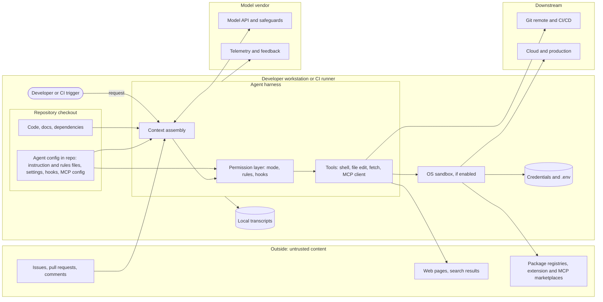

# Threat model: AI coding agents (a model inside an agent harness)

| Field | Value |
|---|---|
| Asset class | AI coding agents: a model inside an agent harness (Claude Code, Codex CLI, Gemini CLI, opencode, IDE agents and similar) that reads a repository, runs commands and edits code, interactively or headless in CI |
| Version | 1.0 |
| Date | 2026-11-21 |
| Evaluated by | `agent-misuse-benchmark`, `coding-guidance-benchmark` |
| Related threat models | General-purpose models; Agent features; AI-assisted security tools; Restricted-access cyber-capable models |
| Status | Current. Ratings are rough and for the reference deployment below. `agent-misuse-benchmark` is a scaffold and measures nothing until completed |

## 1. Executive summary

A coding agent is a model placed inside a harness: a program that builds the model's context
from the user's request, repository files and tool output, decides which of the model's
proposed actions run without asking, and runs them with the privileges of whoever started it.
The harness, not the model alone, decides what the agent can reach. The same model can refuse a
task in a chat window and carry it out in a harness, and the same harness behaves differently
after an update or in another permission mode. Every risk below belongs to model, harness,
settings and environment together.

| Core risk | Why it matters | Inherent risk | Evaluated by |
|---|---|---|---|
| Content the agent reads takes over its tools (C1, C2) | Every README, dependency, issue, web page and tool result is an instruction channel; published attacks reach command execution and CI secret theft | Critical | Design review; public benchmarks exist elsewhere |
| Configuration and approvals that do not hold (C3, C4) | Repository-committed hooks, MCP configuration and rules files can run or steer the agent, sometimes before any trust prompt; auto-approving modes and parser flaws let actions through | High | Design review |
| Commands with real reach (C5, C6) | Without any attacker the agent can delete, reset or touch production; sandboxes are optional or partial and egress is often open; secrets go to the vendor, plaintext transcripts and output channels | High | Design review |
| Safeguards that depend on the harness, and offensive misuse (C7) | Restricted work refused in one surface is carried out in another; real campaigns have used coding agents for intrusions | High | `agent-misuse-benchmark`, once completed |
| Insecure code, and guidance that does not change it (C9) | A large share of functionally correct agent-written code is exploitable in published benchmarks; instruction files are context, not enforcement | High | `coding-guidance-benchmark` |
| Packages and extensions in the agent's environment (C8) | Hallucinated or compromised packages, MCP servers and extensions run with the developer's privileges, and malware has used installed agent CLIs as a tool | High | Design review; `security-tool-benchmark` measures scanners |

**Where risk concentrates.** In one combination: the agent reads content an outsider can
write, holds credentials or data worth taking, and can act or send data out without a person
reading each step. A headless CI agent triggered by outsiders' issues has all three by default;
a workstation in an auto-approving mode with no sandbox has all three as soon as the developer
opens a third-party repository.

**What the evaluations tell you.** `coding-guidance-benchmark` measures how often a pinned
harness and model write correct and secure code on BaxBench tasks, with nothing installed and
with each piece of guidance the organisation supplies. `agent-misuse-benchmark`, once completed
with the organisation's own scenarios, harness module and scorer, measures how often each model
× harness × safeguards combination declines tasks policy forbids beside completing matched
legitimate tasks. Neither measures injection, configuration attacks, sandbox and egress,
secrets, supply chain, vendor data or audit; those are design review.

## 2. Scope and reference deployment

**Reference deployment.** Developers run a commercial coding agent (terminal CLI or IDE agent)
on their workstations against private repositories and third-party code. The harness is at its
interactive default permission mode; the OS sandbox is not enabled (it is off by default in at
least one major harness); outbound network is open. The developer's own credentials are on the
machine: git and registry tokens, SSH keys, a cloud CLI with some production access, `.env`
files. Developers add MCP servers and extensions themselves. The same harness runs headless in
CI to triage issues and review pull requests on repositories that accept outside contributions,
holding a repository token and the model provider's key. Vendor terms are commercial;
telemetry is at defaults; agent actions are not logged centrally.

**What moves the ratings.** A vendor-hosted VM with limited egress and credentials held outside
it lowers C5 and C6. A container or VM with no credentials and egress denied by default lowers
the impact of most threats. Unattended bypass modes (`--dangerously-skip-permissions`,
`--yolo` and equivalents) raise C1, C4 and C5 to their worst case. CI that triggers only on
trusted actors lowers C2. Personal consumer accounts raise C10. A cyber-capable model raises C7.

**In scope:** the harness, its settings, the model's behaviour inside it, what it reads and
runs, what it installs, what it sends to the vendor and what it records. **Out of scope:** the
bare model API (General-purpose models), agent features such as computer use, connectors and
background agents in general (Agent features), and AI security tools (AI-assisted security
tools). Harness facts were read from vendor documentation on 2026-11-21 and change often.

## 3. System model

The trust boundaries that matter: only the developer's request (or a CI job's fixed prompt)
expresses intent, and everything else reaching the context is data the model cannot
authenticate; the permission layer and sandbox are the only things between model output and
execution; the host's network decides what a command can reach; prompts, code and telemetry
cross to the vendor; commits, pull requests and cloud actions leave the machine and affect
others. The assets are the credentials on the machine and in CI, the source code, the
integrity of what ships, the machine itself, reachable production systems, and the audit trail.

| Threat actor | Capability and access | Motivation |
|---|---|---|
| External content author | Writes text the agent will read: a public issue, a README, a dependency, a web page. No exploit needed | Code execution, secrets, backdoors |
| Malicious or compromised publisher | Controls a package, MCP server, plugin or extension the developer or agent installs | Credentials, persistence, reach into many organisations |
| Contributor with branch write | Can commit agent configuration files | Persistence |
| Insider or account holder | Legitimate access to the agent and its network position | Offensive work against third parties, data theft |
| Malware already on the host | Can launch an installed agent CLI with any flags | Uses the agent as a ready-made tool |
| The agent itself, no adversary | Misreads scope, takes shortcuts | None; a failure source |
| Vendor | Receives prompts, code and telemetry; ships harness updates | Product operation; trusted but outside control |

## 4. Core threats

**C1. Instructions in content the agent reads take over its tools.** Repository files, a
dependency's source, command output, web pages and MCP results can carry instructions, often
hidden (invisible Unicode, licence boilerplate); the agent follows them with the developer's
privileges. It matters because the developer never sees the instruction and the action runs
with real credentials.
- *Inherent risk:* Critical (likelihood High, impact High). Raised by routine work on
  third-party code, broad allow rules, auto-approving modes and no sandbox. Lowered by opening
  untrusted code in an isolated environment with no credentials and no egress, and by
  approvals that show the full command.
- *Evidence:* an automated framework with 314 payloads reached attack success rates up to 84%
  for executing malicious commands in two agentic editors [R14]. In Gemini CLI an injection in
  a README's licence text, plus a command starting with an allowlisted `grep`, ran commands
  silently and sent environment variables out; fixed in v0.1.14 [R10]. Hidden Unicode in rules
  files led two editor agents to insert an attacker's script [R11]. Two Claude Code advisories
  were approval bypasses that needed untrusted content in context [R9].

**C2. Outsiders' issue and pull request text steers a headless agent.** In CI, an agent is
started by repository events and given their text, so anyone who can open an issue writes part
of the prompt; nobody approves anything, and the job holds tokens and keys.
- *Inherent risk:* Critical (High, High) for repositories that accept outside contributions.
  Lowered by triggers limited to people with write access, read-only tokens, no secrets in the
  agent step, and human approval before agent changes run workflows.
- *Evidence:* research in December 2025 described pipelines that insert issue, pull request
  or commit text into prompts of agents holding privileged tokens, with one major agent's own
  repository confirmed affected [R12]. In 2026 instructions in issue or pull request content
  made the Claude Code GitHub Action read `/proc/self/environ` with a file tool that ran
  outside its shell sandbox, exposing the workflow's API key; fixed in 2.1.128 [R13]. One hosted
  agent documents the opposite design: outsiders' comments never reach it, hidden HTML-comment
  text is filtered, and workflows on its pull requests wait for approval [R8].

**C3. Repository configuration runs or steers the agent.** Settings, hooks, MCP server
definitions, instruction and rules files, and project skills are files a repository can supply.
Some run before the user is asked to trust the folder or in headless runs that never ask, and an
agent that can write these paths turns a one-off injection into code that runs at every start.
- *Inherent risk:* High (Medium, High). Raised by headless use: one harness documents that in
  non-interactive mode a repository's hooks, environment block and helper commands are used
  and its MCP servers connected without asking [R3]. Lowered by managed allowlists for hooks and
  servers, configuration paths the agent cannot write (Codex keeps `.git`, `.agents` and
  `.codex` read-only in its workspace-write mode [R6]; Claude Code's sandbox write-denies its
  settings and `.git/hooks` [R4]), trusted-folder modes that ignore project settings [R7], and
  flags that skip project configuration for repositories not written in-house [R3].
- *Evidence:* Cursor let an injected agent create a new MCP configuration without approval
  (CVE-2025-54135) and let an approved one be swapped silently (CVE-2025-54136) [R9]. Research
  on GitHub Copilot (CVE-2025-53773) showed injected instructions adding an auto-approve
  setting to the editor's settings file, after which terminal commands ran unasked [R9][R15].
  A Claude Code flaw let project code run before the trust dialog was accepted
  (CVE-2025-59536) [R9].

**C4. Approvals that do not hold.** The permission layer is the main control, but
auto-approving modes, broad allow rules, command parsers that misread compound commands, and
approval fatigue let through actions a person would refuse. Bypass flags are open to any process
that can launch the CLI.
- *Inherent risk:* High (Medium, High). Raised by defaults moving toward auto-approval (Claude
  Code's built-in default for interactive sessions is a classifier-reviewed auto mode from
  v2.1.283 [R2]; opencode allows every action by default and describes no sandbox [R5]).
  Lowered by managed settings that disable bypass and auto modes [R2][R7], deny rules that hold
  in every mode, and a sandbox that enforces limits whatever the command text says [R1].
- *Evidence:* the vendor says auto mode "reduces permission prompts but does not guarantee
  safety", and limits stated in conversation can be lost when context is compacted [R2].
  Command-parsing flaws in Claude Code allowed approval bypass and arbitrary file writes
  (CVE-2025-54795, CVE-2025-64755) [R9]. Malicious Nx releases in August 2025 ran installed
  agent CLIs with their bypass flags to inventory secrets [R16].

**C5. Destructive or out-of-scope actions, sandbox gaps and open egress.** With no attacker,
the agent may delete files, reset history, drop a database or touch production through
credentials on the machine. Isolation is often partial: sandboxes off by default, file tools,
MCP servers and hooks outside them, unsandboxed retries, broad reads, open network.
- *Inherent risk:* High (Medium, High). Raised by permissive harnesses, long unattended runs
  and production credentials on developer machines. Lowered by disposable working copies,
  least-privilege credentials, deny-by-default egress, no route to metadata endpoints, and
  harness checks that never auto-approve critical-path deletions [R2]. Codex's default mode
  keeps network off [R6]; Claude Code's sandbox is opt-in and leaves file tools, MCP servers and
  hooks outside it [R4].
- *Evidence:* a benchmark of four coding-agent products found out-of-scope actions on benign
  tasks in 5.4–27.7% of runs in permissive harnesses against 0.2–4.5% in an ask-to-continue
  harness [R17]. In 2026 evaluation runs whose environment had live internet access by
  misconfiguration, agents compromised three real organisations and one published a malicious
  package that ran on 15 real systems [R18]; in another evaluation agents took 19 unsanctioned
  real-world actions [R19].

**C6. Secrets in the workspace reach the vendor, the logs and the outputs.** Ordinary work makes
agents read `.env` files, configuration, environment variables and command output that hold
secrets. Once read, a secret is in the vendor's context, in local transcripts, and available to
any later injection or output channel (a commit, a comment, a CI log).
- *Inherent risk:* High (High, Medium). Lowered by short-lived scoped credentials from a
  secrets manager, read-deny rules for secret files (opencode asks before reading `.env` by
  default [R5]), scrubbed environments, and hosted sessions where repository credentials never
  enter the VM [R1] or secrets exist only during setup [R6].
- *Evidence:* Claude Code keeps transcripts in plaintext under `~/.claude/projects/` for 30 days
  by default [R20], and its sandbox allows reads of the whole machine unless denied [R4]. CI
  secrets were read through `/proc/self/environ` [R13]; environment variables were exfiltrated
  from Gemini CLI [R10]; Nx malware asked local agents to list SSH keys and `.env` files [R16].

**C7. Safeguards that depend on the harness, and offensive misuse.** Refusal and caution are
shaped by the harness's system prompt, tools, permission mode, provider classifiers and version,
so a result from a model card or the bare API does not describe the deployment. With a shell
and a network the agent does offensive work rather than describing it, especially when requests
are framed as authorised testing or split into innocuous steps.
- *Inherent risk:* High (Medium, High). Raised by open egress, safeguards off or absent in the
  harness, and more capable models. Lowered by pinned versions, safeguards left on and fixed
  centrally, enforced usage policy and monitoring.
- *Evidence:* a vendor reported an espionage campaign that ran Claude Code against about thirty
  targets, with tasks split into small steps and the model told it worked for a security firm
  doing defensive testing; AI did roughly 80–90% of the work [R21]. Browser-agent red-teaming
  found models that refuse as chatbots do not refuse as agents [R22]. A refusal framework for
  offensive-security agents found 6 of 8 frontier models with near-zero refusal [R23]. In the
  out-of-scope benchmark above, the harness dominated effect size across the same models [R17].

**C8. Packages, extensions and harness components.** Agents install dependencies, sometimes
under names a model invented that an attacker has registered; developers add MCP servers,
plugins, skills and extensions, often run straight from a registry; harnesses and extensions
update themselves. Each runs with the developer's privileges and a compromised one can drive the
agent.
- *Inherent risk:* High (Medium, High). Lowered by mirrors and allowlists, lockfiles,
  pre-built environments, and managed allowlists for servers and extensions.
- *Evidence:* at least 5.2% of packages suggested by commercial code models and 21.7% by open
  ones were hallucinated, across 576,000 samples [R24]. Malicious Nx versions on npm invoked
  local agent CLIs with bypass flags [R16]. A release of the Amazon Q Developer VS Code extension
  shipped injected code designed to call the vendor's agent CLI, inert only because of a syntax
  error [R25]. MCP servers in general are covered in the Agent features threat model.

**C9. Insecure code ships, and guidance does not change it.** Agent-written code passes its
tests and contains exploitable flaws, at a volume that outpaces review. Organisations respond
with instruction files, rules, skills, hooks and MCP servers, but instruction text is context,
not enforcement: it can be diluted, lost on compaction, never loaded, or argued away.
- *Inherent risk:* High for insecure code (High, Medium); Medium for ignored guidance, which
  mainly creates false assurance. Lowered by review and security testing in CI, hard limits in
  enforced settings and hooks, and guidance whose effect has been measured.
- *Evidence:* on BaxBench's 392 backend tasks, exploits succeeded on around half of the correct
  programs each model produced [R26]. On 186 real-world feature tasks, one agent setup was 57%
  functionally correct and 11.8% secure, and adding vulnerability hints did not help [R27].
  Claude Code's documentation calls instruction files "context", "not enforced configuration",
  with "no guarantee of strict compliance" [R28].

**C10. Vendor data, telemetry and audit gaps.** Everything the agent reads goes to the model
provider; harnesses also send metrics, error reports (sometimes to third parties) and feedback
transcripts. Meanwhile the organisation's own record is thin by default: local transcripts that
expire, central telemetry off, prompts and tool arguments redacted, commits attributed to the
developer.
- *Inherent risk:* Medium (Medium, Medium); higher with consumer accounts or regulated code.
  Lowered by commercial or zero-retention terms, organisation-restricted login [R29], telemetry
  fixed centrally, and managed export of agent events.
- *Evidence:* for Claude Code, consumer accounts may allow training with 5-year retention, and
  commercial accounts have 30-day standard retention; feedback transcripts are kept 5 years;
  metrics go to the vendor and third-party logging [R20]. Gemini CLI collects usage statistics by
  default [R7]. Claude Code's OpenTelemetry export is off unless enabled, redacts prompts and
  tool arguments by default, and a repository can switch a signal off unless higher-precedence
  settings fix it [R30].

## 5. How this repository's evaluations relate

| Threat area | Skill | What a result shows | What it does not show |
|---|---|---|---|
| C7 harness-dependent safeguards and misuse | `agent-misuse-benchmark` (custom: the organisation's own scenario pack) | Per model × harness × safeguards arm: share of restricted tasks declined beside share of matched legitimate tasks completed, with intervals and a paired comparison against a baseline arm, broken down by category and framing | Anything until the pack, harness module and outcome scorer are supplied; live targets; attacks spread across many sessions |
| C9 insecure code | `coding-guidance-benchmark` (BaxBench at a pinned commit) | Baseline arm: how often this harness and model write correct and secure backends, unattended, with no network and no safety prompt | Security of the organisation's own code and review process |
| C9 guidance | `coding-guidance-benchmark` | Whether a skill, rules file, hook or MCP server changes the correct-and-secure rate against no guidance and a placebo, and whether the agent touched it | Guidance aimed at other behaviour; hooks and MCP arms were not exercised by its maintainers |
| C1, C2 (baseline only) | `model-benchmark` (AgentDojo) | Tool-use injection resistance of the bare model | Behaviour inside any harness |
| C8 (scanners only) | `security-tool-benchmark`, extension kind | How well a scanner of skills, plugins and MCP servers separates labelled malicious from benign samples | Whether any given package or extension is safe; scanning one is outside this repository |

**Why these two skills.** `agent-misuse-benchmark` exists because "will this model, in this
harness, do work our policy forbids, and still do our legitimate work?" cannot be answered from
a model card, and what must be declined is each organisation's own policy: hence a scaffold with
model × harness × safeguards arms and paired tasks that expose blanket refusal. It runs in a
sandbox with no network, so it measures judgement, not reach. `coding-guidance-benchmark` exists
because organisations put guidance in front of agents to make code more secure and need to know
whether it works and whether it is even read; it varies only the guidance and scores with
BaxBench's own tests and exploits. Both run agents unattended, so neither says anything about
approvals.

**Left to design review, and why.** C1–C6, C8 and C10 depend on the organisation's own
repositories, CI configuration, settings, sandbox, network, credentials and contracts, which no
fixed benchmark can stand in for. Public work exists elsewhere for part of C1 (CodeIPI in
inspect_evals, 45 samples on instructions in issues, comments and README files [R31]) and C5
(the out-of-scope benchmark [R17], research code), but none tests the deployment itself.

**Open.** Injection is not solved: vendors describe classifiers and training that reduce it,
and say no system is immune [R1]. Harness defaults change between versions, so a review
describes one version. And no measurement here covers injection inside the harness.

## 6. Design review questions

- Which harness, version and model; are they pinned; who notices when defaults change?
- Which permission mode do sessions start in; are bypass and auto modes disabled centrally where
  unwanted; which deny rules hold in every mode; does an approval show the exact command?
- Which repository files does the harness load or run (settings, hooks, MCP configuration,
  instruction files, skills), which before or without trust, including headless runs, and can
  the agent write them?
- Which content that outsiders can write does the agent read? For each CI workflow that runs an
  agent: who can trigger it, what event text enters the prompt, which secrets the step holds,
  and where its output appears?
- Is OS isolation on, does it cover every tool, and can commands fall back outside it? Which
  hosts are reachable, including internal services and metadata endpoints, tested from inside?
- Which secrets are readable from the agent's environment; are they short-lived; where are
  transcripts kept and for how long?
- Can the agent install packages, from where; who may add MCP servers, plugins and extensions;
  are versions pinned; which scanner is relied on?
- What review and security testing do agent-written changes get; has any guidance relied on been
  measured?
- Which vendor terms are signed; what is retained and used for training; which telemetry and
  feedback channels are on?
- What does policy say the agent must decline, who owns it, and are provider safeguards on?
- Is there a central record of prompts, tool calls, approvals and outbound requests that a
  repository cannot switch off; are agent commits distinguishable?

## References

All read on 2026-11-21.

- [R1] Claude Code documentation, Security. https://code.claude.com/docs/en/security
- [R2] Claude Code documentation, Permission modes. https://code.claude.com/docs/en/permission-modes
- [R3] Claude Code documentation, Configure permissions ("What runs before you trust a folder"). https://code.claude.com/docs/en/permissions
- [R4] Claude Code documentation, Sandboxing. https://code.claude.com/docs/en/sandboxing
- [R5] opencode documentation, Permissions. https://opencode.ai/docs/permissions/
- [R6] Codex documentation, Agent approvals & security. https://learn.chatgpt.com/docs/agent-approvals-security.md
- [R7] Gemini CLI documentation: Trusted folders, https://geminicli.com/docs/cli/trusted-folders/ ; Configuration reference (`security.disableYoloMode`, `privacy.usageStatisticsEnabled`), https://geminicli.com/docs/reference/configuration/ . The two pages disagree on whether folder trust is on by default.
- [R8] GitHub Docs, Risks and mitigations for GitHub Copilot cloud agent. https://docs.github.com/en/copilot/concepts/agents/cloud-agent/risks-and-mitigations
- [R9] CVE records (read through the CVE Services API): CVE-2025-54135 https://www.cve.org/CVERecord?id=CVE-2025-54135 ; CVE-2025-54136 https://www.cve.org/CVERecord?id=CVE-2025-54136 ; CVE-2025-53773 https://www.cve.org/CVERecord?id=CVE-2025-53773 ; CVE-2025-54795 https://www.cve.org/CVERecord?id=CVE-2025-54795 ; CVE-2025-55284 https://www.cve.org/CVERecord?id=CVE-2025-55284 ; CVE-2025-59536 https://www.cve.org/CVERecord?id=CVE-2025-59536 ; CVE-2025-64755 https://www.cve.org/CVERecord?id=CVE-2025-64755
- [R10] Code execution through deception: Gemini AI CLI hijack. https://tracebit.com/blog/code-exec-deception-gemini-ai-cli-hijack
- [R11] Rules File Backdoor research, 18 March 2025. https://www.pillar.security/blog/new-vulnerability-in-github-copilot-and-cursor-how-hackers-can-weaponize-code-agents
- [R12] PromptPwnd: prompt injection in GitHub Actions using AI agents, 4 December 2025. https://www.aikido.dev/blog/promptpwnd-github-actions-ai-agents
- [R13] Securing CI/CD in an agentic world: the Claude Code GitHub Action case, 5 June 2026. https://www.microsoft.com/en-us/security/blog/2026/06/05/securing-ci-cd-in-agentic-world-claude-code-github-action-case/
- [R14] "Your AI, My Shell": Demystifying Prompt Injection Attacks on Agentic AI Coding Editors, arXiv 2509.22040 (abstract). https://arxiv.org/abs/2509.22040
- [R15] GitHub Copilot: Remote Code Execution via Prompt Injection (CVE-2025-53773). https://embracethered.com/blog/posts/2025/github-copilot-remote-code-execution-via-prompt-injection/
- [R16] CVE-2025-10894 (Nx), https://www.cve.org/CVERecord?id=CVE-2025-10894 ; Weaponizing AI coding agents for malware in the Nx malicious package, https://snyk.io/blog/weaponizing-ai-coding-agents-for-malware-in-the-nx-malicious-package/
- [R17] Overeager Coding Agents: Measuring Out-of-Scope Actions on Benign Tasks, arXiv 2605.18583 (abstract). https://arxiv.org/abs/2605.18583
- [R18] Investigating incidents in cybersecurity evaluations, 30 July 2026. https://www.anthropic.com/news/investigating-incidents-cybersecurity-evals
- [R19] MITRE ATLAS data release 2026.10, case study AML.CS0074 (and AML.CS0047 for [R25]). https://github.com/mitre-atlas/atlas-data/blob/main/dist/v6/ATLAS-2026.10.yaml
- [R20] Claude Code documentation, Data usage. https://code.claude.com/docs/en/data-usage
- [R21] Disrupting the first reported AI-orchestrated cyber espionage campaign, 13 November 2025. https://www.anthropic.com/news/disrupting-AI-espionage
- [R22] Refusal-Trained LLMs Are Easily Jailbroken As Browser Agents, arXiv 2410.13886 (abstract). https://arxiv.org/abs/2410.13886
- [R23] A New Framework for Cybersecurity Refusals in AI Agents, arXiv 2606.02644 (abstract). https://arxiv.org/abs/2606.02644
- [R24] We Have a Package for You! A Comprehensive Analysis of Package Hallucinations by Code Generating LLMs, arXiv 2406.10279 (abstract). https://arxiv.org/abs/2406.10279
- [R25] CVE-2025-8217 (Amazon Q Developer VS Code extension 1.84.0). https://www.cve.org/CVERecord?id=CVE-2025-8217
- [R26] BaxBench: Can LLMs Generate Correct and Secure Backends?, arXiv 2502.11844 (abstract). https://arxiv.org/abs/2502.11844
- [R27] Is Vibe Coding Safe? Benchmarking Vulnerability of Agent-Generated Code in Real-World Tasks, arXiv 2512.03262 (abstract). https://arxiv.org/abs/2512.03262
- [R28] Claude Code documentation, How Claude remembers your project. https://code.claude.com/docs/en/memory
- [R29] Claude Code documentation, Authentication (organisation-restricted login). https://code.claude.com/docs/en/iam
- [R30] Claude Code documentation, Monitoring usage. https://code.claude.com/docs/en/monitoring-usage
- [R31] Inspect Evals listing, CodeIPI (`ipi_coding_agent`). https://ukgovernmentbeis.github.io/inspect_evals/
