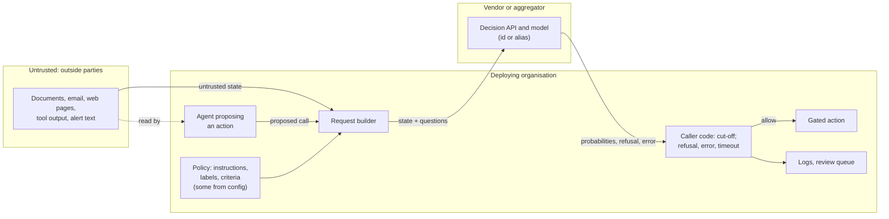

# Threat model: Decision and classification models

| | |
|---|---|
| Asset class | Models that take a state and typed questions with a closed answer set and return a probability per option, with no generated text (for example TypeSafe Jev, OpenAI Decisions, Microsoft-Decision-1.1, Gemini Decision 1, Cloudflare Clef) |
| Version | 1.0 |
| Date | 2026-11-21 |
| Evaluated by | `decision-model-benchmark` |
| Related threat models | Guardrails and safety classifiers; LLM applications; Agent features; AI coding agents |

## Executive summary

A decision model answers typed questions about a `state` (text or JSON, and for some vendors
images, PDF, audio or video): yes/no, one choice among labelled options, or a score on an ordered
scale. It returns a probability for every option and writes no text and no reason. The policy is
not trained in: it arrives in every request as the question's instructions and each option's label
and criteria. These models are cheap (a few US cents per million input tokens) and fast, so they are
being placed directly in the path of automated actions: approving an agent's tool calls, screening
documents for prompt injection, routing alerts, grading model output.

| Core risk | Why it matters | Inherent risk* |
|---|---|---|
| The judged content argues its way to "allow" | The state is one input. Text an outside party wrote, including plain arguments with no command in them, moves the decision | Critical |
| The gate is a confused deputy for an agent | A gate approving an agent's tool call reads context the attacker wrote; in the one published study a simple deterministic rule beat every model | Critical |
| Wrong on plain cases, in the direction that hurts | With no attack at all, the gate allows what the policy blocks; one accuracy figure hides which way it fails | Critical |
| The policy text is attackable | Labels and criteria are prompt. A reassuring name on the permissive option pushed published gates close to total fail-open | High |
| Confidence and refusals are not a safety net | Flipped decisions are as confident as kept ones, and a refusal, error or forced choice treated as allow is a bypass | High |
| The model you reviewed is not the one answering | Aliases move by design, no vendor offers a seed, and a vendor's model version changed in the week this was written | High |

\*For the reference deployment below, using the Likelihood × Impact matrix in this folder's
README. Ratings order attention; they are not acceptance thresholds.

**Where risk concentrates.** Wherever an outside party writes part of the state while the decisive
facts are judged by the model instead of checked by code; wherever the model's "allow" is the only
thing between an automated system and a consequential action; and in the caller's code, which
decides what a refusal, an error, a forced choice or a borderline probability means. The vendors'
own guidance points the same way: keep deterministic rules and side effects in code and treat the
state as untrusted [1][5][9].

**What the evaluations can and cannot tell you.** `decision-model-benchmark` ranks candidate models
on the same seeded cases: errors on clean labelled cases in each direction, decisions flipped by
fixed public injections and edits (against the flip rate of identical re-sends), calibration, and
refusals. That finds models that fail cheaply. It cannot show resistance to an attacker who adapts
to the model or uses its returned probabilities, and it does not test agents in the loop, images,
most languages, drift between runs or bias.

## Scope and reference deployment

**Reference deployment (what the ratings assume).** A hosted, closed-weight decision model used as
an automated gate in two places: approving or blocking an internal operations agent's proposed tool
calls, and screening retrieved documents and inbound messages for prompt injection before they reach
an LLM assistant. The deploying team writes the policy in code; some option lists are filled from
configuration. The state mixes trusted fields (call arguments, environment, ticket status) with
text an outside party can write (documents, tool output, email, alert descriptions). The caller acts
on the top answer or a probability cut-off with no person in the loop for allowed decisions; low
confidence goes to a review queue. Allowed actions can change production data or send data out.
Anyone can open an account with the same vendor and query the same public model.

**Variants that move the ratings.**
- *Routing and triage*: a wrong answer delays handling rather than running an action, so impact
  falls; reviewer flooding matters more.
- *Grading model output*: the graded model writes the state, so injection stays likely.
- *Decisions about people* (applicants, customers, claims): bias and auditability become High.
- *Self-hosted open weights* (Clef, Strands Decider) [14]: vendor data handling drops away; anyone
  can run the same weights offline, so tuned attacks get easier; artefact provenance matters.
- *Aggregators* (OpenRouter): another party in the data path, and routing decides who answers [13].
- *Probabilities shown to requesters* (a screening API offered to tenants): search and leakage rise.

**Out of scope here:** the agent being gated and the assistant behind a screen (covered by the Agent
features, AI coding agents and LLM applications threat models), the vendor's infrastructure, and
training-data poisoning.

## System model and threat actors

Four trust boundaries matter. Inside the state, attacker-written fields sit beside trusted ones, and
only OpenAI's format separates user, developer and tool-output positions [9]. The question is the
policy, so whoever writes labels or criteria (directly or through a template) writes the policy. The
model behind an id belongs to the vendor and can change without notice. The caller's code turns
probabilities into an action and decides what an unanswered request means.

| Threat actor | Capability and access | Motivation |
|---|---|---|
| External content author | Writes text that reaches the state; can test variants offline against the same public model with a guessed policy | Get a harmful call approved, slip injected content to an assistant, hide an incident |
| Controller of a hijacked agent | Shapes both the proposed action and the context the gate reads | Approval of the hijacked agent's action |
| Requester who can query the gate | Many queries; sees allow/block, or full probabilities where exposed | Find an input that passes; learn the policy boundary |
| Insider or integration author | Edits labels, criteria, templates, cut-offs, error handling | Weaken the policy, by intent or by mistake |
| Vendor or aggregator (not malicious) | Changes the model behind an alias, routes requests, retains data | Product change, abuse monitoring |

## Core threats

Ratings are Likelihood / Impact → inherent risk for the reference deployment. Ids in backticks
are the ones `decision-model-benchmark` uses where it measures the threat. In framework terms,
threats 1, 2 and 4 are prompt injection (OWASP LLM01:2025, ATLAS AML.T0051.001), threat 5 is
black-box optimisation through inference API access (ATLAS AML.T0043.001, AML.T0040), and threat 9
is unbounded consumption (OWASP LLM10:2025, ATLAS AML.T0034) [23][26].

**1. Injection in the judged content** (`dm-injection`). Commands, claimed approvals, fake
validation results, unverified opinions or flawed arguments in an untrusted field change the
decision. TypeSafe: "State is data, and Jev does not treat it as hostile by default" [1]; Google:
"Treat input as untrusted. User-supplied text can argue for its own classification" [11].
- *Evidence*: black-box attacks flipped 46.3% of Jev's correct decisions against 0.17% for
  identical re-runs, and an argument with no command flipped 77.2% [16]; as a prompt-injection
  detector Jev reached AUROC 0.871 against 0.897 for an LLM judge [18]. Rates are on
  attack-selected hard sets, not everyday traffic.
- *Rating*: High / High → **Critical**. Lower when the decisive facts sit in typed trusted fields
  that code checks, and when the state carries only the fields a question needs.

**2. The gate as a confused deputy for an agent.** A model approving an agent's tool calls reads the
proposed call and the context the agent worked from. If the agent was hijacked, the attacker wrote
both the action and its justification. Vendors promote this use: Microsoft's example yes/no is
"whether a tool call touches production data" [8], and Google says Search uses its API as a safety
layer for MCP tools [12].
- *Evidence*: as agent guardrails, allow/block accuracy was 36–72% against a 50% chance level,
  while a deterministic rule over parsed typed values "reaches 100% accuracy on all six policies";
  the authors conclude these models "should not be the component that decides" [15]. A
  decision-model guardrail rejected a jailbreak and accepted it with an inserted argument [16].
- *Rating*: High / High → **Critical**. Falls sharply when authorisation is a deterministic rule
  over call fields and the model only reduces review load.

**3. Fail-open on clean cases** (`dm-fail-open`). With no attack, the gate allows what the policy
blocks. Fail-open and fail-closed cost different things, and a model that defaults to "allow" can
look accurate. TypeSafe documents weak spots: arithmetic, counting, dates, double negatives, literal
reading, and accuracy that "falls as the state grows with content unrelated to the decision" [1].
Microsoft: as a safety filter it "might miss subtle harmful content or flag benign content" [8].
- *Rating*: High / High → **Critical**. Moves with how much of the policy needs arithmetic or dates,
  and with whether the cut-off was set from the organisation's own labelled cases.

**4. Attackable policy text** (`dm-option-channel`). Labels and criteria are part of the prompt. A
reassuring label on the permissive option (`compliant`, `already_contained`) pulls decisions toward
it even with its criteria unchanged; if option text is templated from data or edited outside the
policy owners, the policy itself is attacker-reachable.
- *Evidence*: renaming the permissive option raised fail-open to 93–100% on four models [15];
  Microsoft: "Scores can change based on how you phrase or order questions and options" [8].
- *Rating*: Medium / High → **High**. Low when policy text is reviewed code with no data-derived
  labels.

**5. Searchable brittleness** (`dm-perturbation`, `dm-nondeterminism`). Padding, rewording, option
order, encodings and extra fields move decisions without changing the right answer, and every
response returns a fine-grained score. Score-based and label-only black-box attacks optimise against
exactly that, often in under 1,000 queries against classifiers [22]; for a public API the attacker
can search offline against the same model for a few cents per thousand trials [3][9]. Identical
requests can also get different answers, which gives free retries near the boundary.
- *Evidence*: six lines of irrelevant log text raised fail-open from 0% to 63% [15]; "Jev leans
  toward the option that comes first" [1]; one open model scored 21% instead of 72% with yes/no
  options reversed [20]; score feedback doubled the attacker-target probability found during
  optimisation, though success on fresh calls rose only from 1.8% to 3.5% [17]; perturbation
  robustness did not predict injection robustness [19].
- *Rating*: Medium / High → **High**; High likelihood for open weights or exposed probabilities.

**6. Confidence and unanswered requests are not a safety net.** "Send low-confidence decisions to a
person" works only if wrong decisions are less confident. Vendor `confidence` also means different
things: TypeSafe's "measures how concentrated the answer's probabilities are, which is different
from the probability that the selected answer is correct" [2], while Gemini defines it as the
estimated probability the top answer is right [11]. A choice question always picks an option, even
when none applies [4]. When the model does not answer (a per-question refusal at OpenAI and
OpenRouter, an HTTP 400 safety block at Gemini, a context or overload error at TypeSafe [6][9][11]
[13]) the caller decides, and a fall-through to allow is a bypass an attacker can provoke.
- *Evidence*: "a decision an attack has reversed is no less confident than the one it replaced"
  [15]; at a 0.8 threshold 23.5% of executed decisions were wrong [16]; a 1% false-negative target
  needed over 91.8% escalation [18].
- *Rating*: High / Medium → **High** (for misleading confidence); unanswered handling is High impact
  wherever it defaults to allow.

**7. The model reviewed is not the model answering** (`dm-nondeterminism` covers the within-run
part). TypeSafe: "An alias moves when a new release ships, so its answers can change without any
change to your code" [3]. Microsoft's request names a deployment, not a model; its page described
Microsoft-Decision-1 in preview when `decision-model-benchmark` was written on 2026-11-14 and
Microsoft-Decision-1.1, generally available, on 2026-11-21 [8]. No seed or determinism setting
appears in the vendor pages read [3][8][9][11].
- *Rating*: High / Medium → **High**. Lower with pinned versioned ids, a per-response check of the
  reported model id, and labelled cases re-run on every change.

**8. Data handling and leakage through the API.** The judged content is usually the sensitive part
and goes to the vendor on every request. OpenAI's Decisions API supports zero data retention for
eligible customers, with 30-day abuse-monitoring logs by default across the API [9][10]; TypeSafe
offers a DPA, no training on user data, and zero retention for enterprise customers [7];
Microsoft's `DataZoneStandard` keeps processing in a data zone while `GlobalStandard` may use any
region [8]; Google's launch post says nothing on storage [12]. Separately, probabilities let a prober
map the policy boundary (the limit, what counts as internal), and prompt caching (on by default for
OpenAI Decisions [9]) makes timing data-dependent; an audit found caches shared across users at
seven providers in 2025 [25]. No study of policy extraction from decision models was found.
- *Rating*: Medium / Medium → **Medium**; Low for retention with self-hosted weights.

**9. Cost and context abuse.** Billing is per input token and limits are large: 64k tokens by
default at TypeSafe and 262k with a long-context switch that is slower and less accurate [3], up to
400 questions per request at OpenAI [9], up to 1,000 within 262,144 tokens at Gemini [11]. An
attacker who writes to the state can inflate it to spend money, add latency, dilute decisive facts,
or push the request past a limit so it errors (which joins threat 6).
- *Rating*: Medium / Medium → **Medium**.

**10. Decisions about people: bias and no rationale.** Microsoft: the model "might reflect biases
from its base model and training data. Don't use its scores as the sole basis for decisions about
individuals", and it "doesn't generate a free-form response or written rationale" [8]. LLM judges
show position and verbosity biases [24]. Without a rationale, a disputed or harmful decision can be
reconstructed only from what the caller logged (state, distribution, model id, policy version).
- *Rating*: Low / High → **Medium** in the reference deployment, which decides about calls and
  documents; **High** for any deployment that decides about people.

## How this repository's evaluations relate

`decision-model-benchmark` (T0, pure API, no judge) measures five threats in two lanes and builds a
per-threat scorecard with intervals and an ordering of models:

| Threat area | Known lane (published, pinned) | Custom lane (`dmb-seed`, 54 synthetic cases, five gate policies) |
|---|---|---|
| Injection (1) | none imported: DecisionRobust's data states no licence; JevAdvBench's is non-commercial | five fixed injection templates in the untrusted field, with benign twins |
| Attackable policy text (4) | none published | one misleading rename of the permissive label, with twins |
| Fail-open on clean cases (3) | `deepset-prompt-injections` [21], recast as a yes/no screen | clean seed cases; fail-open and fail-closed reported separately |
| Brittleness (5) | `jevbench-original` paraphrase pairs | padding, option order, paraphrase, three encodings, extra fields |
| Re-run variation (5, 7) | re-sends of known cases | re-sends of clean cases; the noise floor for every flip rate |

It also reports, outside the scorecard: calibration and whether flipped decisions are less confident
(threat 6), refusals and errors clean and under attack (threat 6), input tokens and cost (threat 9),
and validity flags when the reported model id moves, is never reported or looks like an alias
(threat 7). The `tool_gate` seed policy judges static tool-call records with attacker text in their
context, which covers the gate's judgement in threat 2 but not an agent in the loop.
`review-evidence` harvests vendors' published data terms for threat 8.

**Why these, and what is left to design review.** The measured threats are the ones a fixed,
labelled test can answer comparably across models: does the model flip under cheap, public attacks,
and is it right on plain cases. A low flip rate is a floor, not resistance. Left to design review:
adaptive attacks that use the returned probabilities (the largest gap; a red-team method, per
release, on shortlisted models), the end-to-end agent gate, what the caller does with non-answers,
drift between runs, data terms, leakage, bias, images and other languages. For these, "no
standardised benchmark exists" is the state to report. Numbers compare models; the synthetic corpus
does not predict a deployment's failure rate, and the skill sets no threshold.

## Design-review questions

- Which conditions in each policy could be deterministic rules over typed fields instead of model
  judgements? Is the model's allow ever the only approval for a consequential action?
- Which state fields can an outside party write? Does the gate read content an agent read or
  justification an agent wrote? Is the state trimmed, size-capped and normalised before the call?
- Who writes instructions, labels and criteria? Is any of it built from data or configuration?
- What happens on a refusal, an HTTP error, a timeout, or an option none of which fits? Is there an
  abstain option?
- How was the cut-off chosen, from which labelled cases, for which action? Is vendor `confidence`
  compared across vendors anywhere? Is the review queue's size monitored?
- Can requesters see probabilities or resubmit near-boundary inputs freely?
- Is a versioned model id pinned and checked per response? Who is told when the vendor ships a new
  version, and are labelled cases re-run?
- Which signed terms govern retention, training use and region? Is each decision logged with state,
  distribution, model id and policy version, and who can read those logs?
- Does any decision concern people? If so, where is the human review and outcome monitoring?

## References

All read 2026-11-21.

1. TypeSafe, "Model jaggedness". https://docs.typesafe.ai/model-jaggedness.md
2. TypeSafe, "Confidence". https://docs.typesafe.ai/confidence.md
3. TypeSafe, "Models" (aliases, context limits, price). https://docs.typesafe.ai/models.md
4. TypeSafe, "Companion Noul". https://docs.typesafe.ai/patterns/companion-noul.md
5. TypeSafe, "How to build with TypeSafe". https://docs.typesafe.ai/concepts/how-to-build-with-system-one.md
6. TypeSafe, "Request rules and errors". https://docs.typesafe.ai/api/errors.md
7. TypeSafe, "Legal" (DPA, training, zero retention). https://docs.typesafe.ai/legal.md
8. Microsoft Learn, "Deploy and use Microsoft-Decision-1.1 in Microsoft Foundry" (updated 2026-11-17). https://learn.microsoft.com/en-us/azure/foundry/foundry-models/how-to/use-foundry-models-microsoft-decision
9. OpenAI, "Decisions" guide. https://developers.openai.com/api/docs/guides/decisions
10. OpenAI, "Data controls in the OpenAI platform". https://developers.openai.com/api/docs/guides/your-data
11. Google AI Studio, "Decisions API". https://aistudio.google.com/docs/decisions-api
12. Google, Gemini Decisions API launch post, 11 Nov 2026. https://blog.google/innovation-and-ai/technology/developers-tools/gemini-decisions-api/
13. OpenRouter, "Decisions". https://openrouter.ai/docs/guides/features/decisions
14. Cloudflare, "Clef" decision models (Apache-2.0 open weights). https://blog.cloudflare.com/clef-decision-models
15. Azizi, Baghaei Potraghloo, Pedram, "One Word Opens the Gate: The Option-Channel Attack on Typed Decision Models as Agent Guardrails", arXiv 2610.12292. https://arxiv.org/abs/2610.12292
16. Hu et al., "JevAdvBench: A Benchmark and Black-Box Attacks for Reinforcement Learning for Calibrated Decisions Models", arXiv 2609.31142 v2. https://arxiv.org/abs/2609.31142
17. Wu, Lim, "Decision Hijacking: Prompt Injection Attacks on Jev's Typed Probabilistic Decisions", arXiv 2609.28613. https://arxiv.org/abs/2609.28613
18. Lan, Kaul, Pandurangan, Sanyal, "From Detection to Decision: Calibration and Deferral for Prompt-Injection Detection", arXiv 2610.20907. https://arxiv.org/abs/2610.20907
19. Lan et al., "DecisionRobust: Benchmarking Robustness for JEV Style Decision Models Across Text and Vision", arXiv 2610.19118. https://arxiv.org/abs/2610.19118
20. JevBench README (option-order result). https://github.com/fstandhartinger/jevbench
21. deepset/prompt-injections dataset (revision 4f61ecb, apache-2.0). https://huggingface.co/datasets/deepset/prompt-injections
22. NIST AI 100-2 E2025, "Adversarial Machine Learning: A Taxonomy and Terminology of Attacks and Mitigations", section 2.2.2. https://csrc.nist.gov/pubs/ai/100/2/e2025/final
23. MITRE ATLAS data release 2026.10 (for example AML.T0051.001 Indirect prompt injection, AML.T0043.001 Black-Box Optimization, AML.T0040 AI Model Inference API Access). https://github.com/mitre-atlas/atlas-data/blob/main/dist/v6/ATLAS-2026.10.yaml
24. Zheng et al., "Judging LLM-as-a-Judge with MT-Bench and Chatbot Arena", arXiv 2306.05685. https://arxiv.org/abs/2306.05685
25. Gu et al., "Auditing Prompt Caching in Language Model APIs", arXiv 2502.07776. https://arxiv.org/abs/2502.07776
26. OWASP, "Top 10 for LLM Applications 2025" (LLM01 Prompt Injection, LLM10 Unbounded Consumption). https://genai.owasp.org/llm-top-10/
