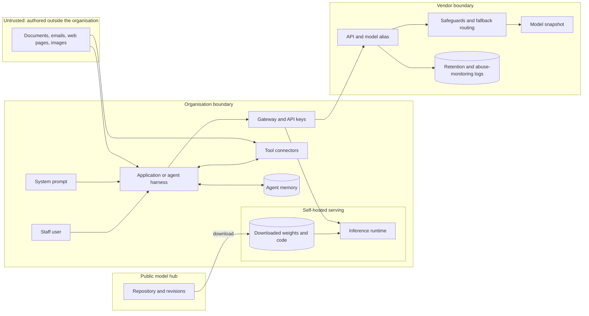

# Threat model: General-purpose models (frontier API and open weights)

| | |
|---|---|
| Asset class | General-purpose models (frontier API and open weights) |
| Version | 1.0 |
| Date | 2026-11-21 |
| Evaluated by | `model-benchmark`; for open weights, the weights-scan harvest in `review-evidence` |
| Related threat models | LLM applications; AI coding agents; Agent features; Vision-input models; Guardrails and safety classifiers; Restricted-access cyber-capable models |
| Status | Current. Ratings are rough inherent risks for the reference deployment below. |

## 1. Executive summary

A general-purpose language model that an organisation is about to enable, either a frontier
model reached through a vendor's API or an open-weights model whose files are downloaded and
served in-house. It will answer staff, summarise material outsiders wrote, write code and
drive internal agents that call tools. A new model or a new version is what triggers this
threat model.

| Core risk | Why it matters | Inherent risk | Evaluated by |
|---|---|---|---|
| Instructions hidden in content or tool results are followed | Every document, email, page and tool result an outsider can write is an instruction channel. In an agent it becomes an action. | High | `model-benchmark` |
| Generated code carries vulnerabilities | Generated code reaches production, often with less review. | High | `model-benchmark` |
| Downloaded weights attack the host that loads them | Open weights only. Pickle-based files can run code on load, on a host that holds credentials. | High | `review-evidence` (published scan verdicts) |
| Results do not describe what actually runs | System prompts, provider safeguards, fallback routing and alias changes alter behaviour between the model that was measured and the one that is deployed. | High | Design review |
| Misuse and jailbreaks, against the cost of over-refusal | The model helps with harmful work when asked plainly or with a known trick. Refusing everything has its own cost. | Medium | `model-benchmark` |
| Data kept by the vendor | By default, prompts and outputs are retained for abuse monitoring and may be reviewed. | Medium | Design review |

**Where risk concentrates.** The main exposure comes from what the model reads, not from what
users type. Agents carry more of it than chat does, because a model with tools turns an
injected instruction into an action. Open weights add a second exposure before any prompt is
sent: the files themselves, and the host that loads them.

**What the evaluations can and cannot tell you.** `model-benchmark` runs published benchmarks
on the same seeded samples for every model and reports each rate with an interval and a paired
comparison against a baseline model. It answers "better or worse than the model we use now, on
these dimensions, at this endpoint". It cannot tell you:

- whether the deployed surface behaves the same way;
- whether the model carries a backdoor;
- whether the vendor's data terms are acceptable;
- whether the identifier will still point at the same model next month;
- how much the model helps with offensive operations.

Public benchmarks are in training data, so read every score as a comparison, not an absolute
value. No result here is an acceptance decision.

## 2. Scope and reference deployment

**Reference deployment.** The ratings assume:

- one model, enabled for internal use only;
- reached either through a vendor API under an enterprise agreement or as open weights behind
  an internal OpenAI-compatible gateway;
- used by authenticated staff for chat, summarising and drafting from documents (some of which
  were written outside the organisation), and code assistance;
- a few internal agents with email, document, ticket and code-repository tools, some writing
  without per-action approval;
- persistent memory available but off by default;
- confidential business data and some personal data in context;
- no public endpoint, and organisation-level quotas.

**What moves the ratings.**

- A public-facing endpoint raises misuse, jailbreak, leakage and consumption risks.
- Chat with no tools lowers the tool and memory threats.
- Regulated data raises the leakage and vendor-data threats.
- Fine-tuning on the organisation's own data adds extraction of memorised data.
- Open weights remove vendor-data risk but add artefact risk, and leave no provider safeguards
  between the model and its users.

**Out of scope.** Covered by other threat models:

- the application built on the model (LLM applications);
- the agent harness and its features (AI coding agents; Agent features);
- image input in depth (Vision-input models);
- guardrails placed in front of the model (Guardrails and safety classifiers);
- models given only to vetted security teams (Restricted-access cyber-capable models).

Accuracy, bias and misinformation are quality questions and are not modelled here.

## 3. System model

**Who controls each input.**

| Input | Controlled by |
|---|---|
| User prompts | Staff, any of whom can be the attacker |
| Pasted, uploaded and tool-returned content | Whoever wrote it |
| Agent memory | Earlier sessions, and anyone whose content was written into it |
| System prompt | The deployer |
| Which model and which safeguards answer | The vendor or the gateway operator |
| Downloaded files | The repository publisher, or anyone able to push to that repository or impersonate it |

**Threat actors.**

| Actor | Capability | Motivation | Access |
|---|---|---|---|
| Outside content author | Low to moderate; templates are public | Data theft, fraud, manipulation | Any content the model will read |
| Insider or curious user | Low to moderate | Help the policy forbids | Direct prompts |
| Holder of a stolen key | Moderate | Free compute, cover for misuse | The endpoint, billed to the organisation |
| Model supply-chain attacker | Moderate to high | Code execution on ML hosts | Anyone who downloads their files |
| The vendor (not an adversary) | Full control of its side | Product changes, its own policy | The model behind an alias, safeguards, retention |

## 4. Core threats

| Id | Threat | Rough inherent risk | Measured here? |
|---|---|---|---|
| `gm-misuse` | Misuse and jailbreaks, read against over-refusal | Medium | Yes |
| `gm-content-injection` | Injection through processed content | High | Yes |
| `gm-tool-injection` | Agent hijack through tool results | High | Yes |
| `gm-insecure-code` | Insecure generated code | High | Yes |
| `gm-leakage` | System prompt or context data disclosed | Medium | Partly |
| `gm-memory-poisoning` | Memory poisoning | Medium | Yes (small set) |
| `gm-weights` | Unsafe, tampered or backdoored weights | High (open weights) | Harvest only |
| `gm-surface-drift` | Bare model unlike the deployed surface; silent version change | High | No |
| `gm-vendor-data` | Vendor retention and processing of submitted data | Medium | No |
| `gm-consumption` | Unbounded cost or load | Low | No |

**`gm-misuse` — misuse and jailbreaks, read against over-refusal.**

- *What it is.* The model gives specific help with a harmful request, either asked plainly or
  wrapped in a jailbreak. The opposite failure is refusing legitimate work that only looks
  risky.
- *Why the pair matters.* A model that refuses everything scores perfectly on misuse.
  Over-refusal also pushes users towards tools the organisation does not control: in 2026 a
  platform operator moved incident forensics to a self-hosted model after commercial APIs
  blocked the work [R14].
- *Rating: Medium.* Raised by public access, and by open weights served without provider
  safeguards; fine-tuning on ten examples once removed a model's safety training [R15].
  Lowered by authenticated, attributed use.
- *Evidence.* Published jailbreak success rates are often overstated [R3].
- *Not covered.* How much the model's capability helps with offensive operations is a
  different, capability question; it is deliberately not measured here (section 5).

**`gm-content-injection` — injection through processed content.**

- *What it is.* Text in a document, email, page, pasted text or image overrides the system
  prompt or the user's request.
- *Who causes it.* The author of the content, who is usually not the user.
- *Rating: High,* because any external content reaches the model. Raised by multilingual and
  image input, and by clients that render model output as links or images.
- *Evidence.* Indirect injection was shown against real applications in 2023 [R1]. A 2026 system
  card reports its newest model "more likely than previous models to follow malicious
  instructions in text that a user pastes into their own prompt" [R18].

**`gm-tool-injection` — agent hijack through tool results.**

- *What it is.* Content that an agent reads while working redirects it to an attacker's goal.
  The agent then carries that goal out with its own tools and the organisation's credentials.
- *Rating: High.* Raised when one agent both reads outsider-writable data and can send or
  write without approval. Lowered by separating those tools and by approving sensitive calls.
- *Evidence.* In AgentDojo's 97 tasks and 629 security cases, attacks broke some security
  properties but not all [R2]. A vendor reports an adaptive attacker succeeding on 54.61% of
  attempts in coding environments without safeguards, and 11.13% with injection probes on [R18].

**`gm-insecure-code` — insecure generated code.**

- *What it is.* Code the model writes carries known weakness patterns into production.
- *Rating: High.* Raised by high volumes of generated code and weak review. Lowered by static
  analysis in the pipeline.
- *Evidence.* An early study found about 40% of 1,689 assistant-generated programs vulnerable
  [R7].

**`gm-leakage` — system prompt or context data disclosed.**

- *What it is.* Secrets, rules or confidential data in context or memory, or within reach of a
  tool, appear in a reply, in a rendered link, or in a tool call to an outside destination.
- *Rating: Medium.* Raised by secrets placed in system prompts and by tools with outbound reach.
- *Evidence.* OWASP's position is that "the system prompt should not be considered a secret, nor
  should it be used as a security control" [R5].

**`gm-memory-poisoning` — memory poisoning.**

- *What it is.* Content written into persistent memory in one session changes behaviour later,
  for another user or task.
- *Rating: Medium.* Low likelihood while memory is off by default; high impact once it is on.
  Raised by memory shared across users.
- *Evidence.* Published attacks poisoned agent memory with very little injected material [R8],
  and through queries alone [R9].

**`gm-weights` — unsafe, tampered or backdoored weights (open weights only).**

- *What it is.* A downloaded file runs code when loaded, comes from a look-alike repository, or
  changes between the revision reviewed and the revision served. A separate case: the model
  was trained to misbehave on a trigger.
- *Rating: High* for the load-time risk. Raised by pickle-only repositories, custom model code
  and unpinned revisions. Lowered by safetensors or GGUF files, pinned commits, and loading on
  hosts without credentials. A backdoor is low likelihood but invisible to scanners.
- *Evidence.* Loading pickle can execute arbitrary code, and the Hub's pickle scan "is not 100%
  foolproof" [R10]. Malicious models have been found on the Hub [R11], including some that
  evaded its scanner [R12]. Transformers prefers safetensors and advises pinning a revision when
  loading custom code [R13]. A 2026 intrusion into a hub operator began with a dataset that
  abused a remote-code loader [R14]. Backdoors trained into models survived safety training [R16].

**`gm-surface-drift` — bare model unlike the deployed surface; silent version change.**

- *What it is.* Users reach a system prompt, provider classifiers, a harness and a gateway, not
  the bare model, and each of them changes behaviour.
- *How the model changes underneath.* An alias can move to a new snapshot, models are retired,
  blocked requests can be served by a fallback model, and self-hosted deployments can pull a
  new revision.
- *Rating: High,* because a gap is almost certain whenever anything is added around the model.
  Lowered by pinned identifiers and by re-measuring when anything changes.
- *Evidence.* One 2026 system card states:
  - some results are run "with its production safeguards disabled";
  - requests blocked by its cyber classifiers fall back to an older model, and on the API the
    developer must opt in to that fallback;
  - traffic through other platforms "may experience different behavior";
  - in one injection test, every successful attack came from a request that had been routed
    to the fallback model [R18].

  The same vendor documents pinned snapshot identifiers and retirement dates [R17]. An earlier
  study measured substantial behaviour change in one model service over three months [R19].

**`gm-vendor-data` — vendor retention and processing of submitted data.**

- *What it is.* Prompts, outputs and files are kept, reviewed by people, used for training, or
  processed in places or by parties the organisation has not accepted.
- *Rating: Medium.* Raised by default terms, and by content that safety classifiers flag, which
  is kept longer. Lowered by zero-retention or regional terms, or by serving open weights
  in-house.
- *Evidence.* One vendor keeps abuse-monitoring logs for up to 30 days and offers zero retention
  only with approval [R20]. Another deletes API data within 30 days but may keep flagged content
  for up to two years [R21].

**`gm-consumption` — unbounded cost or load.**

- *What it is.* A stolen key, an agent loop or very large contexts drive cost or load with no
  cap.
- *Rating: Low* for an internal deployment. A public endpoint raises it.
- *Evidence.* OWASP LLM10:2025 describes this as denial of wallet and also names model
  extraction [R6].

**Framework ids** (verified in this repository; `—` means none verified):

| Threat | OWASP LLM 2025 | OWASP Agentic 2026 | MITRE ATLAS |
|---|---|---|---|
| Misuse and jailbreaks | LLM01:2025 (jailbreak) | — | AML.T0054, AML.T0068 |
| Content injection | LLM01:2025 | — | AML.T0051.000, AML.T0051.001, AML.T0129 |
| Tool injection | LLM01:2025, LLM06:2025 | ASI01, ASI02 | AML.T0051.001, AML.T0053 |
| Insecure code | — | — | — |
| Leakage | LLM02:2025, LLM07:2025 | — | AML.T0069.002, AML.T0086, AML.T0077 |
| Memory poisoning | — | ASI06 | AML.T0080.000 |
| Weights | LLM03:2025, LLM04:2025 | — | AML.T0010.003, AML.T0011.000, AML.T0018.002, AML.T0018.000 |
| Surface and drift | — | — | — |
| Vendor data | — | — | — |
| Consumption | LLM10:2025 | — | AML.T0034, AML.T0029 |

## 5. How this repository's evaluations relate

**`model-benchmark`** measures each threat area with published benchmarks run through
`inspect_evals`. All of them are in the known lane.

| Threat area | Checks | Metric (direction) |
|---|---|---|
| Misuse | `cyse4_mitre`; `strong_reject` | Share of offensive requests NOT assisted (↑); share of forbidden requests helped with (↓) |
| Over-refusal | `cyse4_mitre_frr` | Share of benign security questions refused (↓) |
| Jailbreak | `strong_reject_aim` | Share of the same prompts helped with once wrapped in the AIM jailbreak (↓) |
| Content injection | `cyse4_multilingual_prompt_injection` | `prompt_injection_scorer.accuracy`: share of injections that succeeded (↓) |
| Image injection | `cyse3_visual_prompt_injection` | `model_graded_qa.accuracy`: share of injections that succeeded (↓) |
| Tool injection | `agentdojo`; `atb_autonomy_hijack` | `security.accuracy`: episodes where the injected goal was executed (↓); hijacks resisted (↑) |
| Insecure code | `cyse4_instruct`; `cyse4_autocomplete` | Share of code with a detected vulnerability (↓) |
| Leakage | `atb_data_exfil` | Exfiltration through tool arguments resisted (↑) |
| Memory poisoning | `atb_memory_poison` | Poisoned memory resisted (↑) |

How to read them:

- **Read the pairs together.** The jailbreak uplift is `strong_reject_aim` minus `strong_reject`
  on the same samples, and AIM is a single, dated transformation, so the uplift is a floor.
  `cyse4_mitre` is read with `cyse4_mitre_frr`. `cyse4_mitre_frr` covers only the security
  domain.
- **Two metrics are misnamed upstream.** In the `core` profile, two metrics named accuracy are
  attack-success rates: `agentdojo` `security.accuracy` and the multilingual injection
  `accuracy`. The vision check's `accuracy` is a third. For all three, lower is better.
- **Read tool checks with their utility metric.** A model too weak to use its tools looks safe,
  and the `low_utility` validity flag marks this.
- **The agentic sets are small.** The ATB checks have 6, 8 and 10 cases. Code scoring uses a
  semgrep-based detector, which flags patterns, not proven exploits [R4].
- **Profiles:**
  - `core`: one check per dimension.
  - `nojudge`: `cyse4_mitre_frr`, `cyse4_instruct`, `agentdojo` and `atb_memory_poison`. It
    leaves misuse, jailbreak and content injection unmeasured.
  - `vision`: the image check.
  - `all`: everything, adding `cyse4_autocomplete`, `atb_autonomy_hijack` and `atb_data_exfil`.
- **For image-reading deployments,** `vision-model-benchmark` is the better source.
- **The suite measures the model at the endpoint it is given.** It uses each benchmark's own
  prompts, with no deployment system prompt.

**`review-evidence`** covers `gm-weights` for open weights. Its `weights_scan.py` reads the scan
verdicts that the Hugging Face Hub publishes for every file at a revision, and downloads no
weights. The verdict is one of:

- `clean`: every weight file was scanned and none was flagged;
- `unsafe`: at least one file was flagged;
- `unscanned`, which is never `clean`;
- `error`.

It also reports per-scanner coverage, and flags repositories that ship only pickle-based files.
A `clean` verdict does not rule out a backdoor or a scanner evasion.

**Left to design review, and why.**

- *Surface and drift:* the gap can only be measured on the deployed surface itself. App
  endpoints are measured by `app-benchmark` and `app-redteam`, and a guardrail by
  `guardrail-benchmark`. Noticing a version change is a process question.
- *System-prompt extraction:* not in this suite. `app-benchmark` measures it on an endpoint.
- *Vendor data and consumption:* these are contract and configuration questions.
- *Backdoors:* not testable from outside without knowing the trigger.

**Deliberately excluded.** Benchmarks that elicit offensive capability inside a Docker sandbox
(`cve_bench`, `cybergym`, `cybench`, `threecb`). They answer a capability question and need a
supervised environment strong enough to be dangerous. In 2026, models under exactly this kind of
evaluation reached real third-party systems [R22][R23]. Record the vendor's own capability
results as evidence instead.

## 6. Design review questions

- Which surface will users reach, and was it the one measured? Which system prompt, provider
  safeguards and fallback routing apply on this account and platform?
- Is the model identifier a pinned snapshot? When does it retire, and what triggers a
  re-review? For open weights, which commit is served?
- Which inputs can an outsider author? Do any of them reach an agent that can also write or
  send? Which tool calls need approval?
- Is memory on, and is it scoped per user? Is model output rendered as links, images or HTML?
- Open weights: what was the scan verdict? Are the files pickle-based? Does loading require
  custom code? Is loading done on a host without production credentials? Who published any
  fine-tune in use?
- What does the signed contract say about retention, human review, training use, region and
  sub-processors? Which data classifications may be sent?
- Are there quotas, spend caps and agent step limits per key and per user?
- What has the vendor published about the model's offensive capability, and under which
  safeguards was it measured?

## 7. References

Framework ids are those verified in this repository on 2026-11-14 against the OWASP Top 10 for
LLM Applications 2025 (https://genai.owasp.org/llm-top-10/), the OWASP Top 10 for Agentic
Applications 2026 announcement
(https://genai.owasp.org/2025/12/09/owasp-top-10-for-agentic-applications-the-benchmark-for-agentic-security-in-the-age-of-autonomous-ai/)
and MITRE ATLAS 2026.10 (https://github.com/mitre-atlas/atlas-data/blob/main/dist/v6/ATLAS-2026.10.yaml).
All sources below were read on 2026-11-21.

- R1. "Not what you've signed up for: Compromising Real-World LLM-Integrated Applications with Indirect Prompt Injection", arXiv:2302.12173. https://arxiv.org/abs/2302.12173
- R2. "AgentDojo: A Dynamic Environment to Evaluate Prompt Injection Attacks and Defenses for LLM Agents", arXiv:2406.13352. https://arxiv.org/abs/2406.13352
- R3. "A StrongREJECT for Empty Jailbreaks", arXiv:2402.10260. https://arxiv.org/abs/2402.10260
- R4. inspect_evals, CyberSecEval 4 README (tasks, sizes, semgrep-based detector). https://github.com/UKGovernmentBEIS/inspect_evals/tree/main/src/inspect_evals/cyberseceval_4
- R5. OWASP, LLM07:2025 System Prompt Leakage. https://genai.owasp.org/llmrisk/llm072025-system-prompt-leakage/
- R6. OWASP, LLM10:2025 Unbounded Consumption. https://genai.owasp.org/llmrisk/llm102025-unbounded-consumption/
- R7. "Asleep at the Keyboard? Assessing the Security of GitHub Copilot's Code Contributions", arXiv:2108.09293. https://arxiv.org/abs/2108.09293
- R8. "AgentPoison: Red-teaming LLM Agents via Poisoning Memory or Knowledge Bases", arXiv:2407.12784. https://arxiv.org/abs/2407.12784
- R9. "Memory Injection Attacks on LLM Agents via Query-Only Interaction", arXiv:2503.03704. https://arxiv.org/abs/2503.03704
- R10. Hugging Face Hub documentation, Pickle Scanning. https://huggingface.co/docs/hub/security-pickle
- R11. JFrog, "Data Scientists Targeted by Malicious Hugging Face ML Models with Silent Backdoor", 27 February 2024. https://jfrog.com/blog/data-scientists-targeted-by-malicious-hugging-face-ml-models-with-silent-backdoor/
- R12. ReversingLabs, malicious models evading pickle scanning ("nullifAI"), 6 February 2025. https://www.reversinglabs.com/blog/rl-identifies-malware-ml-model-hosted-on-hugging-face
- R13. Hugging Face Transformers documentation, Loading models. https://huggingface.co/docs/transformers/main/en/models
- R14. Hugging Face, "Security incident disclosure — July 2026", 16 July 2026. https://huggingface.co/blog/security-incident-july-2026
- R15. "Fine-tuning Aligned Language Models Compromises Safety, Even When Users Do Not Intend To!", arXiv:2310.03693. https://arxiv.org/abs/2310.03693
- R16. "Sleeper Agents: Training Deceptive LLMs that Persist Through Safety Training", arXiv:2401.05566. https://arxiv.org/abs/2401.05566
- R17. Anthropic, Claude models overview (pinned snapshots, aliases, retirement dates). https://platform.claude.com/docs/en/about-claude/models/overview
- R18. Anthropic, System Card: Claude Opus 5.5, 22 September 2026 (sections 1.4, 1.5, 5.2.2.1; executive summary). https://www.anthropic.com/claude-opus-5-5-system-card
- R19. "How is ChatGPT's behavior changing over time?", arXiv:2307.09009. https://arxiv.org/abs/2307.09009
- R20. OpenAI API documentation, Data controls. https://developers.openai.com/api/docs/guides/your-data
- R21. Anthropic Privacy Center, "How long do you store my organization's data?", dated 1 July 2026. https://privacy.claude.com/en/articles/7996866-how-long-do-you-store-my-organization-s-data
- R22. OpenAI, Hugging Face model evaluation security incident, 21 July 2026, updated to 26 August 2026. https://openai.com/index/hugging-face-model-evaluation-security-incident/
- R23. Anthropic, "Investigating three real-world incidents in our cybersecurity evaluations", 30 July 2026. https://www.anthropic.com/research/investigating-incidents-cybersecurity-evals
