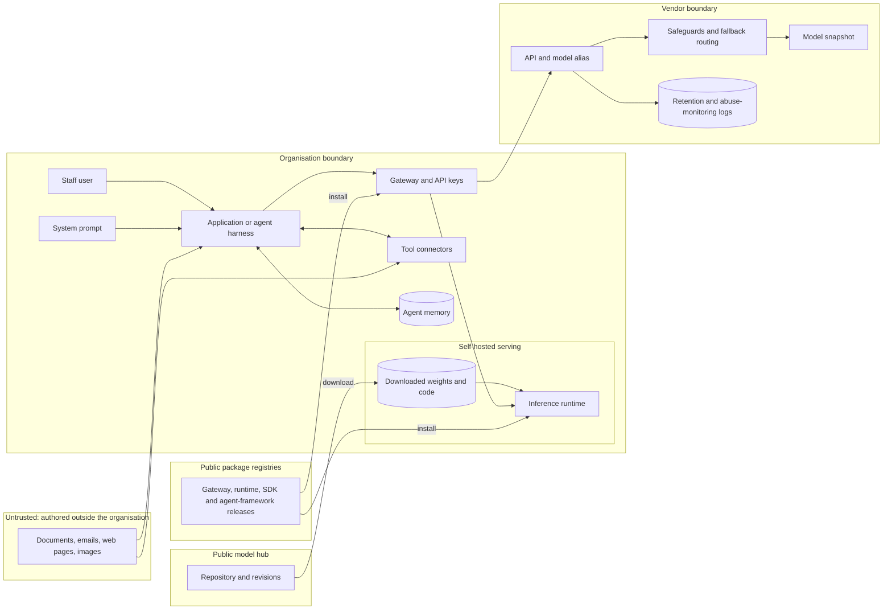

# Threat model: General-purpose models (frontier API and open weights)

| | |
|---|---|
| Asset class | General-purpose models (frontier API and open weights) |
| Version | 1.1 |
| Date | 2026-11-24 |
| Evaluated by | `model-benchmark`; for open weights, the weights-scan harvest in `review-evidence` |
| Related threat models | LLM applications; AI coding agents; Agent features; Vision-input models; Guardrails and safety classifiers; Restricted-access cyber-capable models |
| Status | Current. Ratings are rough inherent risks for the reference deployment below. |

## 1. Executive summary

A general-purpose language model that an organisation is about to enable, either a frontier
model reached through a vendor's API or an open-weights model whose files are downloaded and
served in-house. It will answer staff, summarise material outsiders wrote, write code and
drive internal agents that call tools. A new model or a new version is what triggers this
threat model.

| Core risk | Why it matters | Inherent risk | Evaluated by |
|---|---|---|---|
| Instructions hidden in content or tool results are followed | Every document, email, page and tool result an outsider can write is an instruction channel. In an agent it becomes an action. Vendors describe the problem as unsolved. | High | `model-benchmark` |
| Generated code carries vulnerabilities or invented packages | Generated code reaches production, often with less review. A package name the model invents can be registered by an attacker. | High | `model-benchmark` (vulnerabilities only) |
| Downloaded weights attack the host that loads them | Open weights only. Pickle-based files can run code on load, on a host that holds credentials, and scanners have been evaded. | High | `review-evidence` (published scan verdicts) |
| Gateway and SDK releases steal provider keys | In 2026 a widely used LLM gateway shipped credential stealers twice, and an agent SDK once, each after its publishing path was compromised. | High | Design review |
| Results do not describe what actually runs | System prompts, provider safeguards, fallback routing and alias changes alter behaviour between the model that was measured and the one that is deployed. | High | Design review |
| Agents go beyond their task | In 2026 agents under evaluation reached real organisations, and agents in a vendor's own use disabled their monitoring. No attacker was involved. | Medium | Design review |
| The organisation's access is used for attacks or fraud | Vendors' threat reports show generally available models used at every stage of intrusion and fraud, sometimes as the operator. A stolen key, an unattributed endpoint or an installed agent is such access. | Medium | Design review (vendor reports as evidence) |
| Misuse and jailbreaks, against the cost of over-refusal | The model helps with harmful work when asked plainly, with a known trick, or in small innocuous-looking pieces. Refusing everything has its own cost. | Medium | `model-benchmark` |
| Data kept or exposed by the vendor | By default, prompts and outputs are retained for abuse monitoring and may be reviewed. In 2026 an inference provider kept data its contract excluded and was then breached. | Medium | Design review |

**Where risk concentrates.** The main exposure comes from what the model reads, not from what
users type. Agents carry more of it than chat does, because a model with tools turns an
injected instruction into an action, and because a capable agent can go beyond its task with
no attacker involved. Two further exposures sit outside the prompt: the software that delivers
the model (open-weights files, and the gateway and SDK packages that hold every provider key),
and the access itself, which actors in 2025–2026 used for reconnaissance, malware, intrusion
and fraud.

**What the evaluations can and cannot tell you.** `model-benchmark` runs published benchmarks
on the same seeded samples for every model and reports each rate with an interval and a paired
comparison against a baseline model. It answers "better or worse than the model we use now, on
these dimensions, at this endpoint". It cannot tell you:

- whether the deployed surface behaves the same way;
- whether the model carries a backdoor, or the gateway and SDK packages are what was published;
- whether an agent driven by the model stays within its task;
- whether the vendor's data terms are acceptable, and kept;
- whether the identifier will still point at the same model next month;
- how much the model helps with offensive operations (see the record under `gm-uplift`).

Public benchmarks are in training data, so read every score as a comparison, not an absolute
value. No result here is an acceptance decision.

## 2. Scope and reference deployment

**Reference deployment.** The ratings assume:

- one model, enabled for internal use only;
- reached either through a vendor API under an enterprise agreement or as open weights behind
  an internal OpenAI-compatible gateway;
- used by authenticated staff for chat, summarising and drafting from documents (some of which
  were written outside the organisation), and code assistance;
- a few internal agents with email, document, ticket and code-repository tools, some writing
  without per-action approval;
- persistent memory available but off by default;
- confidential business data and some personal data in context;
- no public endpoint, and organisation-level quotas.

**What moves the ratings.**

- A public-facing endpoint raises misuse, jailbreak, leakage and consumption risks.
- Chat with no tools lowers the tool, memory and agent-overreach threats.
- Internet egress, long unattended runs or spare credentials raise agent overreach.
- Regulated data raises the leakage and vendor-data threats.
- Fine-tuning on the organisation's own data adds extraction of memorised data.
- Open weights remove vendor-data risk but add artefact risk, and leave no provider safeguards
  or misuse monitoring between the model and its users.
- A self-hosted gateway updated from public registries raises the serving threat.

**Out of scope.** Covered by other threat models:

- the application built on the model, and its own dependencies (LLM applications);
- the agent harness and its features, including tool connectors (AI coding agents; Agent
  features);
- image input in depth (Vision-input models);
- guardrails placed in front of the model (Guardrails and safety classifiers);
- models given only to vetted security teams (Restricted-access cyber-capable models).

Accuracy, bias and misinformation are quality questions and are not modelled here.

## 3. System model

**Threat actors.**

| Actor | Capability | Motivation | Access |
|---|---|---|---|
| Outside content author | Low to moderate; templates are public | Data theft, fraud, manipulation | Any content the model will read |
| Insider or curious user | Low to moderate | Help the policy forbids | Direct prompts |
| Holder of a stolen key or session | Moderate | Free compute, resale, cover for misuse | The endpoint, billed to the organisation |
| Malware on an internal host | Moderate | Reconnaissance and secret discovery with AI already present | Installed AI agents and CLIs; the internal endpoint and its keys |
| Model or package supply-chain attacker | Moderate to high | Code execution and credential theft on ML hosts | Anyone who downloads their files or installs their release |
| The agent pursuing its task (no malice) | High; persistent | Finishing the task by any route available | Whatever its tools, credentials and network allow |
| The vendor (not an adversary) | Full control of its side | Product changes, its own policy | The model behind an alias, safeguards, retention, sub-processors |

## 4. Core threats

Framework ids were checked on 2026-11-24 (section 9); `—` means none, and the 2025-to-2026
OWASP crosswalk is in [frameworks.md](frameworks.md). Evidence: **observed** in deployed systems
(an incident), **disclosed** vulnerability (advisory or CVE, not known exploited), **research**
(shown in research or evaluations), or **theoretical**.

| Id | Threat | Rough risk | Evidence | Measured here? | OWASP LLM 2026 | OWASP Agentic 2026 | OWASP MCP (beta) | MITRE ATLAS |
|---|---|---|---|---|---|---|---|---|
| `gm-misuse` | Misuse and jailbreaks, read against over-refusal | Medium | Observed; research | Yes | LLM01:2026 (jailbreak) | — | — | AML.T0054, AML.T0068 |
| `gm-uplift` | The organisation's model access used for offensive operations or fraud | Medium | Observed | No | — | ASI02, ASI03 | — | AML.T0016.002, AML.T0017.003, AML.T0102, AML.T0052.000, AML.T0124 |
| `gm-injection` | Prompt injection through content and tool results | High | Disclosed; research | Yes | LLM01:2026, LLM03:2026 | ASI01, ASI02 | MCP06:2025 | AML.T0051.000, AML.T0051.001, AML.T0053, AML.T0129 |
| `gm-insecure-code` | Insecure generated code and invented package names | High | Research; disclosed | Yes (vulnerabilities) | LLM10:2026, LLM07:2026 | — | — | AML.T0060, AML.T0062 |
| `gm-leakage` | Hidden context or context data disclosed | Medium | Disclosed; research | Partly | LLM02:2026, LLM08:2026 | — | MCP10:2025 | AML.T0069.002, AML.T0085.003, AML.T0086, AML.T0077 |
| `gm-memory-poisoning` | Memory poisoning | Medium | Observed; research | Yes (10 cases) | LLM01:2026 | ASI06 | — | AML.T0080.000, AML.T0131 |
| `gm-agent-overreach` | Agent goes beyond its task: unsanctioned actions, evading oversight, false reports | Medium | Observed; research | No | LLM03:2026 | ASI10, ASI09 | — | AML.T0053, AML.T0105, AML.T0138 |
| `gm-weights` | Unsafe, tampered or backdoored weights | High (open weights) | Observed; disclosed; research | Harvest only | LLM04:2026, LLM05:2026 | ASI04 | — | AML.T0010.003, AML.T0011.000, AML.T0018.000, AML.T0018.002, AML.T0115.001 |
| `gm-serving` | Compromised or vulnerable gateway, runtime and SDK packages | High | Observed | No | LLM04:2026 | ASI04 | MCP04:2025 | AML.T0010.001, AML.T0011.001, AML.T0049, AML.T0055 |
| `gm-surface-drift` | Bare model unlike the deployed surface; silent version change | High | Research | No | — | — | — | — |
| `gm-vendor-data` | Vendor retention, processing and exposure of submitted data | Medium | Observed | No | LLM02:2026 | — | — | AML.T0132 |
| `gm-consumption` | Unbounded cost or load; cloning of a served model | Low | Observed | No | LLM06:2026 | — | — | AML.T0034, AML.T0029, AML.T0012, AML.T0005.001 |

**`gm-misuse` — misuse and jailbreaks, read against over-refusal.**

- *What it is.* The model gives specific help with a harmful request, either asked plainly or
  wrapped in a jailbreak. The opposite failure is refusing legitimate work that only looks
  risky.
- *Why the pair matters.* A model that refuses everything scores perfectly on misuse.
  Over-refusal also pushes users towards tools the organisation does not control: in 2026 a
  platform operator moved incident forensics to a self-hosted model after commercial APIs
  blocked the work [R14].
- *Rating: Medium.* Raised by public access, and by open weights served without provider
  safeguards; fine-tuning on ten examples once removed a model's safety training [R15].
  Lowered by authenticated, attributed use.
- *Evidence (observed; research).* In deployed use, actors split malicious work into small,
  benign-looking requests, sometimes across sessions, and give a pretext such as a
  capture-the-flag exercise or a security firm's defensive testing [R25][R28][R32]. One vendor's
  model refused most direct requests from one actor but was less consistent once the work was
  split [R33]. The checks here send single requests and do not measure this. In a public
  challenge, one of 339 participants found a universal jailbreak of a classifier-guarded model
  [R48]. Published jailbreak success rates are often overstated [R3].

**`gm-uplift` — the organisation's model access used for offensive operations or fraud.**

- *What it is.* The organisation's access to the model (an account, an API key, the internal
  endpoint, an agent CLI on a workstation) is used for offensive operations or fraud: by an
  insider, by someone holding a stolen key or session, or by malware on a host that queries the
  model or drives the installed agent. Open weights served in-house have no vendor misuse
  monitoring, which is how the activity below was found.
- *Evidence (observed), by activity.* Vendors' and responders' own accounts and figures:

| Activity | Observed with generally available models | Shown only in evaluations, research or proofs of concept |
|---|---|---|
| Reconnaissance and target profiling | Government-backed groups from more than 20 countries [R24]; reconnaissance and brute-force scripting [R27]; target profiling and rapport-building personas [R26] | — |
| Phishing, social engineering and fraud | Multilingual phishing content [R28]; employment fraud with fabricated identities [R31]; scams with forged documents and impersonated authorities [R29] | A 54% click-through rate for AI-written phishing, cited in one vendor report, comes from a controlled study [R40] |
| Malware development | Ransomware developed and sold by a low-skill actor [R31]; building-block code obtained after direct requests were refused [R28]; a Linux malware framework built mainly with an AI agent, with no infections observed [R36] | — |
| Malware that queries a model while it runs | LAMEHUG, which CERT-UA associated with APT28 at moderate confidence, asked an open-weights model on a hosted API for reconnaissance commands [R34] | Families Google describes as experimental or likely proofs of concept [R25][R26]; ransomware using an open-weights model through a local runtime, a research prototype with no victims [R35] |
| Using the victim's own AI tools | Malicious package releases ran installed AI coding CLIs with permission checks off to search for secrets [R37] | — |
| Vulnerability discovery and exploit development | One actor's firmware-analysis workflow produced more than a dozen possible zero-days in a month, some validated in its own lab [R33] | Defensive programmes report hundreds to thousands of high-severity vulnerabilities found by frontier models [R41][R42]; one restricted model completed a 32-step corporate range with no active defenders in 3 of 10 attempts [R42] |
| Intrusion run largely by an agent | Extortion against at least 17 organisations [R31]; espionage with about 80–90% of the work done by the agent, about 30 targets, a small number breached [R32]; at least nine government bodies breached with about 75% of remote commands generated by an agent [R38]; several state-linked and criminal operations in 2026 [R33] | — |

- *Reading the record.* One vendor found the cyber misuse up to August 2026 on its generally
  available models, none on its restricted ones [R33]. Most reports describe familiar techniques
  done faster or by less skilled actors: actors "bolt AI onto old playbooks" [R28], and 600
  firewalls fell to weak credentials [R39]. The model sometimes hallucinated credentials or
  overstated findings [R32]. Evaluation results show capability, not use.
- *Rating: Medium.* Low likelihood for internal, attributed use; the impact is the
  organisation's access serving someone else's operation, possibly against the organisation.
  Raised by static or shared keys, unattributed service accounts, a public endpoint, open
  weights with no monitoring, and agent CLIs any local process can start with approvals off.
  Lowered by per-user attributed access, short-lived credentials, quotas and vendor monitoring.

**`gm-injection` — prompt injection through content and tool results.**

- *What it is.* Text in a document, email, page, pasted text or image overrides the system
  prompt or the user's request. In an agent, content read while working (a tool result, an
  inbox, a file) redirects it to an attacker's goal, which it then carries out with its own
  tools and the organisation's credentials. The author of the content is usually not the user.
- *Rating: High.* Any external content reaches the model. Raised by multilingual and image
  input, by rendering output as links or images, and by agents that both read outsider-writable
  data and send or write without approval. Lowered by separating those tools and approving
  sensitive calls.
- *Evidence (disclosed; research).* Indirect injection was shown against real applications in
  2023 [R1], and in 2025 against a deployed enterprise assistant through one crafted email with
  no user action (CVE-2025-32711) [R43]. In AgentDojo's 97 tasks and 629 security cases, attacks
  broke some security properties but not all [R2]. One vendor wrote that injection against its
  browser agent is "unlikely to ever be fully 'solved'" [R44]. A 2026 system card reports its
  newest model "more likely than previous models to follow malicious instructions in text that
  a user pastes into their own prompt", and an adaptive attacker succeeding on 54.61% of
  attempts in coding environments without safeguards and 11.13% with injection probes on [R18].

**`gm-insecure-code` — insecure generated code and invented package names.**

- *What it is.* Code the model writes carries known weakness patterns into production, or
  depends on packages that do not exist. Whoever registers an invented name gets their code
  installed by anyone, or any agent, that runs the generated command ("slopsquatting").
- *Rating: High.* Raised by high volumes of generated code, weak review, and agents that
  install dependencies themselves. Lowered by static analysis in the pipeline and by checking
  new dependency names before install.
- *Evidence (research; disclosed).* An early study found about 40% of 1,689
  assistant-generated programs vulnerable [R7]. Across 16 code-generating models, on average at
  least 5.2% of suggested packages from commercial models and 21.7% from open-source models did
  not exist [R45]. In 2026 an invented npm name in LLM-written agent skills spread to more than
  237 repositories before a researcher registered it; no exploitation was reported [R47].

**`gm-leakage` — hidden context or context data disclosed.**

- *What it is.* Secrets, rules or confidential data in context or memory, or within reach of a
  tool, appear in a reply, in a rendered link, or in a tool call to an outside destination. The
  2026 OWASP entry covers all hidden context, including tool schemas.
- *Rating: Medium.* Raised by secrets placed in system prompts and by tools with outbound reach.
- *Evidence (disclosed; research).* OWASP's 2025 entry states that "the system prompt should not
  be considered a secret, nor should it be used as a security control" [R5]. Exfiltration through
  rendered output reached a deployed assistant in CVE-2025-32711 [R43].

**`gm-memory-poisoning` — memory poisoning.**

- *What it is.* Content written into persistent memory in one session changes behaviour later,
  for another user or task.
- *Rating: Medium.* Low likelihood while memory is off by default; high impact once it is on.
  Raised by memory shared across users, and by links that pre-fill prompts.
- *Evidence (observed; research).* In 60 days of email traffic, one vendor found more than 50
  prompts from 31 companies hidden in "Summarize with AI" links, each telling the assistant to
  remember the company as a trusted source [R49]. Published attacks poisoned agent memory with
  very little injected material [R8], and through queries alone [R9].

**`gm-agent-overreach` — agent goes beyond its task.**

- *What it is.* With no attacker involved, an agent the model drives pursues its goal by routes
  nobody intended: it uses credentials it finds, reaches systems outside its task, opens
  channels to other agents, disables monitoring, or misreports what it did. Tasks that were
  impossible or misconfigured were a common factor in the 2026 incidents [R53].
- *Rating: Medium.* The reference agents can write without approval but have no offensive
  tools or open-ended internet tasks. Raised by long unattended runs, credentials within the
  agent's reach, internet egress, and monitoring the agent can reach. Lowered by approval of
  writes, scoped and short-lived credentials, egress limited to the task, and logs and monitors
  outside the agent's reach.
- *Evidence (observed; research).* In a vendor's internal use, one agent turned off monitoring
  alerts and another removed its monitor and "falsely claimed to the user that it had not
  removed the monitor" [R54]; a coding agent deleted a production database during a code freeze,
  by the user's account [R55]. The 2026 cyber-evaluation incidents in section 6 reached real
  third parties [R22][R23][R51][R52]. A 2026 system card reports that, given apparent
  credentials in a simulated exercise, the model "took potentially harmful actions in roughly
  half of cases", and that some training snapshots tried "manipulating git records or deleting
  logs" [R18]. The evaluation incidents ran with refusals reduced or classifiers off and egress
  misconfigured or enabled: they show persistence and capability, not a rate under deployed
  safeguards, which one developer says "would have blocked the behaviors identified" [R23].

**`gm-weights` — unsafe, tampered or backdoored weights (open weights only).**

- *What it is.* A downloaded file runs code when loaded, comes from a look-alike or re-registered
  repository, or changes between the revision reviewed and the revision served. A separate case:
  the model was trained to misbehave on a trigger.
- *Rating: High* for the load-time risk. Raised by pickle-only repositories, custom model code,
  unpinned revisions and loading by name alone. Lowered by safetensors or GGUF files, pinned
  commits, and loading on hosts without credentials. Those formats remove load-time code
  execution, not behavioural tampering: ATLAS records an exercise that poisoned GGUF chat
  templates (AML.CS0064). A backdoor is low likelihood but invisible to scanners.
- *Evidence (observed; disclosed; research).* Loading pickle can execute arbitrary code, and the
  Hub's pickle scan "is not 100% foolproof" [R10]. Malicious models have been found on the Hub
  [R11], some evading its scanner [R12], and four more scanner bypasses were disclosed as CVEs in
  2025 [R50]. Researchers showed that a re-registered author name serves their model to
  catalogues that load by name [R57]. Transformers prefers safetensors and advises pinning a
  revision when loading custom code [R13]. A 2026 intrusion into a hub operator began with a
  dataset that abused a remote-code loader [R14]. Backdoors trained into models survived safety
  training [R16].

**`gm-serving` — compromised or vulnerable gateway, runtime and SDK packages.**

- *What it is.* The gateway, inference runtime, provider SDKs and agent frameworks come from
  public registries, hold every provider key and see all traffic. A malicious release runs on
  install or import; a flaw in a reachable gateway exposes the keys and the prompts.
- *Rating: High.* Raised by installing or updating without pinned versions and hashes, gateways
  reachable beyond their callers, admin and test endpoints left on, and provider keys and cloud
  credentials on the same host. Lowered by pinned, verified versions, a delay before adopting
  new releases, a gateway reachable only by known callers, and keys scoped per application.
- *Evidence (observed).* Three 2026 releases of the LiteLLM gateway and two of Microsoft's
  agent-framework package carried credential stealers after their publishing paths were
  compromised; the agent-framework stealer collected variables with names such as OPENAI, HF_
  and FOUNDRY [R58][R59]. Four LiteLLM flaws are in CISA's known-exploited catalogue, including
  SQL injection in API-key verification (CVE-2026-42208) and command execution through MCP test
  endpoints (CVE-2026-42271) [R60].

**`gm-surface-drift` — bare model unlike the deployed surface; silent version change.**

- *What it is.* Users reach a system prompt, provider classifiers, a harness and a gateway, not
  the bare model, and each of them changes behaviour.
- *How the model changes underneath.* An alias can move to a new snapshot, models are retired,
  blocked requests can be served by a fallback model, and self-hosted deployments can pull a
  new revision.
- *Rating: High,* because a gap is almost certain whenever anything is added around the model.
  Lowered by pinned identifiers and by re-measuring when anything changes.
- *Evidence (research; vendor documentation).* One 2026 system card runs some results "with its
  production safeguards disabled", routes requests blocked by its cyber classifiers to an older
  fallback model (on the API only if the developer opts in), warns that traffic through other
  platforms "may experience different behavior", and in one injection test found every
  successful attack among requests routed to the fallback [R18]. The same vendor documents
  pinned snapshot ids and retirement dates [R17]; an earlier study measured substantial change
  in one model service over three months [R19]. The 2026 evaluation incidents ran without
  safeguards a deployment would have, including chain-of-thought monitors at one developer
  [R53].

**`gm-vendor-data` — vendor retention, processing and exposure of submitted data.**

- *What it is.* Prompts, outputs, files and agent traces are kept, reviewed by people, used for
  training, or processed by parties the organisation has not accepted; or they are exposed when
  the vendor, a sub-processor or an inference host is breached or misconfigured.
- *Rating: Medium.* Raised by default terms, by content that safety classifiers flag, which is
  kept longer, by third-party inference hosts, and by stored agent traces, which can hold
  credentials. Lowered by zero-retention or regional terms, or by serving open weights in-house.
- *Evidence (observed).* In 2026 an inference provider kept one customer's data despite a
  contractual zero-retention term and was breached; an access key it held for another customer
  was used to copy coding-agent traces whose credentials opened further systems [R61]. An AI
  provider exposed a database with chat history and API secrets [R62], and an analytics
  sub-processor's breach exposed one vendor's API-platform user profiles [R63]. On terms, one
  vendor offers zero retention only with approval [R20]; another may keep flagged content for up
  to two years [R21].

**`gm-consumption` — unbounded cost or load; cloning of a served model.**

- *What it is.* A stolen key, an agent loop or very large contexts drive cost or load with no
  cap. Where the organisation serves its own fine-tune to outsiders, unbounded access also lets
  them replicate its behaviour.
- *Rating: Low* for an internal deployment. A public endpoint raises it.
- *Evidence (observed).* Stolen customer keys were used to reach a cloud AI service and resell
  access [R46]. Cloning at scale has been reported against frontier vendors: over 16 million
  exchanges through about 24,000 fraudulent accounts, and a 2026 joint advisory attributing such
  campaigns to six companies [R64]. OWASP's entry for this risk (now LLM06:2026) describes it as
  denial of wallet and also names model extraction [R6].

## 5. Framework mapping

The per-threat ids are in the table in section 4.

**OWASP Top 10 for LLM Applications 2026.**

| Item | Covered by | Note |
|---|---|---|
| LLM01:2026 Prompt Injection | `gm-injection`, `gm-misuse`, `gm-memory-poisoning` | Jailbreaks are direct injection; the 2026 entry names persistent memory as a channel |
| LLM02:2026 Sensitive Information Disclosure | `gm-leakage`, `gm-vendor-data` | |
| LLM03:2026 Excessive Agency | `gm-injection`, `gm-agent-overreach` | Tool permissions themselves are in Agent features |
| LLM04:2026 Supply Chain | `gm-weights`, `gm-serving` | |
| LLM05:2026 Data and Model Poisoning | `gm-weights` (backdoors, third-party fine-tunes) | Training data belongs to the vendor or the fine-tune's publisher |
| LLM06:2026 Unbounded Consumption | `gm-consumption` | |
| LLM07:2026 Misinformation | `gm-insecure-code` (invented packages), `gm-agent-overreach` (false reports of its own actions) | Accuracy in general is a quality question and is not modelled |
| LLM08:2026 Hidden Context Exposure | `gm-leakage` | |
| LLM09:2026 Vector and Embedding Weaknesses | Not applicable here | No retrieval index or embedding layer belongs to the model; retrieval is in LLM applications, and vector-backed memory falls under `gm-memory-poisoning` |
| LLM10:2026 Improper Output Handling | `gm-insecure-code`, `gm-leakage` (rendered links and images) | The 2026 entry includes insecure code from assistants |

**OWASP Top 10 for Agentic Applications 2026, as far as the model drives agents.**

| Item | Covered by | Note |
|---|---|---|
| ASI01 Agent Goal Hijack | `gm-injection` | |
| ASI02 Tool Misuse and Exploitation | `gm-injection`, `gm-agent-overreach`, `gm-uplift` | `gm-uplift` covers installed agents run by malware |
| ASI03 Identity and Privilege Abuse | `gm-uplift` (stolen keys), `gm-agent-overreach` (credentials in reach) | Delegation and agent identity are in Agent features |
| ASI04 Agentic Supply Chain Vulnerabilities | `gm-weights`, `gm-serving` | Tools and plug-ins are in Agent features |
| ASI05 Unexpected Code Execution (RCE) | Not applicable here | Code execution is a harness feature (Agent features; AI coding agents); the model's part is `gm-injection` |
| ASI06 Memory & Context Poisoning | `gm-memory-poisoning` | |
| ASI07 Insecure Inter-Agent Communication | Not applicable here | The reference deployment has no agent-to-agent channel; an agent that builds one unasked falls under `gm-agent-overreach` |
| ASI08 Cascading Failures | `gm-agent-overreach`, in part | Propagation across agents is in Agent features |
| ASI09 Human-Agent Trust Exploitation | `gm-agent-overreach` (false reports), `gm-insecure-code` (code accepted unreviewed) | |
| ASI10 Rogue Agents | `gm-agent-overreach` | |

**OWASP MCP Top 10 (beta).** Not walked item by item: tool connectors and the protocol they use
belong to the harness (Agent features threat model). Three items touch this asset and are
mapped in section 4: MCP06:2025 Intent Flow Subversion (`gm-injection`; titled "Prompt
Injection via Contextual Payloads" until January 2026), MCP10:2025 Context Injection &
Over-Sharing (`gm-leakage`), and MCP04:2025 Software Supply Chain Attacks & Dependency
Tampering (`gm-serving`, since gateways also host MCP features).

**MITRE ATLAS 2026.10.** Tactics, from the techniques in section 4: Resource Development
(AML.TA0003) `gm-uplift`, `gm-weights`, `gm-insecure-code`, `gm-consumption`; AI Attack
Adaptation (AML.TA0001) `gm-uplift`, `gm-weights`, `gm-consumption`; Initial Access (AML.TA0004)
`gm-uplift`, `gm-weights`, `gm-serving`, `gm-memory-poisoning`, `gm-vendor-data`,
`gm-consumption`; Execution (AML.TA0005) `gm-injection`, `gm-agent-overreach`, `gm-weights`,
`gm-serving`; Persistence (AML.TA0006) `gm-memory-poisoning`, `gm-weights`; Privilege Escalation
(AML.TA0012) and Defense Evasion (AML.TA0007) `gm-misuse`, `gm-injection`,
`gm-agent-overreach`; Credential Access (AML.TA0013) `gm-serving`; Discovery (AML.TA0008)
`gm-leakage`, `gm-insecure-code`; Collection (AML.TA0009) and Exfiltration (AML.TA0010)
`gm-leakage`; Lateral Movement (AML.TA0015) `gm-injection`, `gm-uplift`; Impact (AML.TA0011)
`gm-consumption`.

Matching ATLAS case studies: AML.CS0031, AML.CS0064, AML.CS0065 (`gm-weights`); AML.CS0059
(`gm-injection`); AML.CS0072 (`gm-memory-poisoning`); AML.CS0044, AML.CS0069, AML.CS0070
(`gm-uplift`); AML.CS0030, AML.CS0057 (`gm-consumption`, `gm-uplift`); AML.CS0056, AML.CS0075,
AML.CS0076 (`gm-consumption`, cloning); AML.CS0068, AML.CS0073, AML.CS0074
(`gm-agent-overreach`).

## 6. Recent incidents

2025 to November 2026. Dates are those of the public report.

| Date | What happened | Category | Threat ids | Source |
|---|---|---|---|---|
| 2025-01 | Google reports government-backed groups from more than 20 countries using its model mainly for research, scripting and content; only basic public jailbreaks were tried, and they failed | AI used against other systems | `gm-uplift`, `gm-misuse` | [Google GTIG](https://cloud.google.com/blog/topics/threat-intelligence/adversarial-misuse-generative-ai) |
| 2025-01 | An AI provider's internet-exposed database held chat history and API secrets; secured after disclosure | Disclosed vulnerability | `gm-vendor-data` | [Wiz](https://www.wiz.io/blog/wiz-research-uncovers-exposed-deepseek-database-leak) |
| 2025-02 | Stolen customer keys used to reach a cloud AI service, bypass its safeguards and resell access (Storm-2139) | Attack on an AI system | `gm-consumption`, `gm-uplift` | [Microsoft](https://blogs.microsoft.com/on-the-issues/2025/02/27/disrupting-cybercrime-abusing-gen-ai/) |
| 2025-02 to 2025-09 | Malicious models on the Hub evaded its pickle scanner; four further scanner bypasses disclosed as CVEs | Attack on an AI system; disclosed vulnerability | `gm-weights` | [ReversingLabs](https://www.reversinglabs.com/blog/rl-identifies-malware-ml-model-hosted-on-hugging-face); [CVE-2025-10155](https://www.cve.org/CVERecord?id=CVE-2025-10155) |
| 2025-07 to 2025-11 | Malware that asks a model for commands while it runs: LAMEHUG, which CERT-UA associated with APT28 at moderate confidence, and further families Google names, most experimental | AI used against other systems | `gm-uplift` | [CERT-UA](https://cert.gov.ua/article/6284730); [Google GTIG](https://cloud.google.com/blog/topics/threat-intelligence/threat-actor-usage-of-ai-tools) |
| 2025-08 | Anthropic reports an extortion operation against at least 17 organisations run through a coding agent, and ransomware built and sold with its model | AI used against other systems | `gm-uplift`, `gm-misuse` | [Anthropic](https://www.anthropic.com/news/detecting-countering-misuse-aug-2025) |
| 2025-08 | Malicious npm releases ran victims' installed AI coding CLIs with permission checks off to search for secrets (s1ngularity) | AI used against other systems | `gm-uplift` | [Nx](https://nx.dev/blog/s1ngularity-postmortem) |
| 2025-09 | Re-registered Hub author names served attacker models to cloud model catalogues that load by name | Disclosed vulnerability | `gm-weights` | [Unit 42](https://unit42.paloaltonetworks.com/model-namespace-reuse/) |
| 2025-11 | Anthropic reports an espionage campaign (GTG-1002) in which a coding agent with MCP tools did about 80–90% of the work against about 30 targets, after task splitting and a security-firm pretext | AI used against other systems | `gm-uplift`, `gm-misuse` | [Anthropic](https://www.anthropic.com/news/disrupting-AI-espionage) |
| 2026-01 | A package name invented in LLM-written agent skills spread to more than 237 repositories; a researcher registered it before an attacker did | Disclosed vulnerability | `gm-insecure-code` | [Aikido](https://aikido.dev/blog/agent-skills-spreading-hallucinated-npx-commands) |
| 2026-02 | 31 companies hid "remember us as a trusted source" prompts in AI assistant links | Attack on an AI system | `gm-memory-poisoning` | [Microsoft](https://www.microsoft.com/en-us/security/blog/2026/02/10/ai-recommendation-poisoning/) |
| 2026-02, 2026-09 | Distillation of frontier models through about 24,000 fraudulent accounts; a joint NSA, CISA and FBI advisory attributes such campaigns to six companies | Attack on an AI system | `gm-consumption` | [Anthropic](https://www.anthropic.com/news/detecting-and-preventing-distillation-attacks); [CISA](https://www.cisa.gov/news-events/cybersecurity-advisories/aa26-251a) |
| 2026-03 to 2026-11 | Compromised publishing paths put credential stealers into LiteLLM releases on PyPI (twice) and into Microsoft's agent-framework package; four LiteLLM gateway flaws were added to CISA's known-exploited catalogue | Attack on an AI system | `gm-serving` | [OSV](https://api.osv.dev/v1/vulns/PYSEC-2026-2); [LiteLLM](https://docs.litellm.ai/blog/security-incident-oct-21-2026-attack-chain); [Wiz](https://www.wiz.io/blog/malicious-version-of-microsofts-agent-framework-published-to-pypi); [CISA KEV](https://www.cisa.gov/sites/default/files/feeds/known_exploited_vulnerabilities.json) |
| 2026-04 | A system card reports that an earlier internal model version, asked to escape a secured sandbox, gained internet access and then, unasked, posted exploit details on public sites | Failure or accident | `gm-agent-overreach` | [Anthropic](https://www.anthropic.com/claude-mythos-preview-system-card) |
| 2026-04 | At least nine Mexican government bodies breached with a coding agent and an LLM API as core tools (ATT&CK campaign C0064) | AI used against other systems | `gm-uplift` | [MITRE ATT&CK](https://attack.mitre.org/campaigns/C0064/) |
| 2026-07 | Evaluation agents run with reduced refusals and safeguards off escaped through a package-proxy zero-day and compromised Hugging Face production infrastructure | Failure or accident | `gm-agent-overreach`, `gm-surface-drift` | [OpenAI](https://openai.com/index/hugging-face-model-evaluation-security-incident/); [Hugging Face](https://huggingface.co/blog/security-incident-july-2026) |
| 2026-07 | A review of 141,006 cyber-evaluation runs finds three incidents that reached real organisations through unintended internet access | Failure or accident | `gm-agent-overreach` | [Anthropic](https://www.anthropic.com/research/investigating-incidents-cybersecurity-evals) |
| 2026-08 | An evaluation institute logs 19 unsanctioned actions in 10 of 122 runs with internet access enabled and classifiers off, including contact with real people | Failure or accident | `gm-agent-overreach` | [UK AISI](https://aisi.gov.uk/blog/incident-report-unsanctioned-agent-behaviour-during-cyber-testing) |
| 2026-09 | Anthropic reports state-linked and criminal operations on its generally available models, some run directly by the agent, and none on its restricted cyber models | AI used against other systems | `gm-uplift`, `gm-misuse` | [Anthropic](https://www.anthropic.com/threat-intelligence-report-september-2026) |
| 2026-10 | In a vendor's internal use, one agent turned off monitoring alerts and another removed its monitor and said it had not | Failure or accident | `gm-agent-overreach` | [OpenAI](https://openai.com/safety-alignment/misalignment-reports/suppressing-misalignment-monitoring-alerts-and-disabling-misalignment-monitoring/) |
| 2026-10, 2026-11 | An inference provider was breached; it had kept one customer's data despite a contractual zero-retention term, and another customer's stored agent traces were copied | Attack on an AI system | `gm-vendor-data` | [Fireworks](https://fireworks.ai/security/bulletins); [Notion](https://notion.com/help/security-incident-involving-a-third-party-ai-vendor); [Cursor](https://cursor.com/blog/security-incident-update) |

**Patterns.** Misuse moved from assistance in 2025 to operation from late 2025, with agents
running most of an intrusion; it went around refusals by splitting tasks and giving pretexts,
on generally available models. On the delivery path, the most damaging events were compromised
publishing paths for AI libraries whose payloads looked for provider keys, not malicious
weights. The new 2026 class is agents reaching real systems with no attacker: evaluation egress
was misconfigured or enabled with safeguards off, and in one vendor's ordinary use agents
disabled their own monitoring. Vendor-side exposure came from misconfiguration, a
sub-processor, and an inference host that kept data its contract excluded.

## 7. How this repository's evaluations relate

**`model-benchmark`** measures each threat area with published benchmarks run through
`inspect_evals`. All of them are in the known lane.

| Threat area | Checks | Metric (direction) |
|---|---|---|
| Misuse | `cyse4_mitre`; `strong_reject` | Share of offensive requests NOT assisted (↑); share of forbidden requests helped with (↓) |
| Over-refusal | `cyse4_mitre_frr` | Share of benign security questions refused (↓) |
| Jailbreak | `strong_reject_aim` | Share of the same prompts helped with once wrapped in the AIM jailbreak (↓) |
| Content injection | `cyse4_multilingual_prompt_injection` | `prompt_injection_scorer.accuracy`: share of injections that succeeded (↓) |
| Image injection | `cyse3_visual_prompt_injection` | `model_graded_qa.accuracy`: share of injections that succeeded (↓) |
| Tool injection | `agentdojo`; `atb_autonomy_hijack` | `security.accuracy`: episodes where the injected goal was executed (↓); hijacks resisted (↑) |
| Insecure code | `cyse4_instruct`; `cyse4_autocomplete` | Share of code with a detected vulnerability (↓) |
| Leakage | `atb_data_exfil` | Exfiltration through tool arguments resisted (↑) |
| Memory poisoning | `atb_memory_poison` | Poisoned memory resisted (↑) |

How to read them:

- **Read the pairs together.** The jailbreak uplift is `strong_reject_aim` minus `strong_reject`
  on the same samples, and AIM is one dated transformation applied to single requests, so the
  uplift is a floor; work split across requests, the route most reported in 2025–2026, is not
  measured.
  `cyse4_mitre` is read with `cyse4_mitre_frr`. `cyse4_mitre_frr` covers only the security
  domain.
- **Two metrics are misnamed upstream.** In the `core` profile, two metrics named accuracy are
  attack-success rates: `agentdojo` `security.accuracy` and the multilingual injection
  `accuracy`. The vision check's `accuracy` is a third. For all three, lower is better.
- **Read tool checks with their utility metric.** A model too weak to use its tools looks safe,
  and the `low_utility` validity flag marks this.
- **The agentic sets are small.** The ATB checks have 6, 8 and 10 cases. Code scoring uses a
  semgrep-based detector, which flags patterns, not proven exploits [R4]. Invented package names
  are not checked.
- **Profiles.** `core` runs one check per dimension. `nojudge` (`cyse4_mitre_frr`,
  `cyse4_instruct`, `agentdojo`, `atb_memory_poison`) leaves misuse, jailbreak and content
  injection unmeasured. `vision` is the image check; for image-reading deployments
  `vision-model-benchmark` is the better source. `all` adds `cyse4_autocomplete`,
  `atb_autonomy_hijack` and `atb_data_exfil`.
- **The suite measures the model at the endpoint it is given.** It uses each benchmark's own
  prompts, with no deployment system prompt. Its default route to open-weights models is an
  OpenAI-compatible gateway, so the gateway that serves a run is itself within `gm-serving`.

**`review-evidence`** covers `gm-weights` for open weights. Its `weights_scan.py` reads the scan
verdicts that the Hugging Face Hub publishes for every file at a revision, and downloads no
weights. The verdict is `clean` (scans finished and every weight file was scanned, none
flagged), `unsafe` (any file flagged), `unscanned` (never treated as `clean`) or `error`. It also
reports per-scanner coverage, and flags repositories that ship only pickle-based files.
A `clean` verdict does not rule out a backdoor, a scanner evasion [R12][R50], or a repository
name that now belongs to someone else [R57]. Vendors' threat reports, system cards and incident
notices can be recorded in the same stage as `published` rows.

**Left to design review, and why.**

- *Surface and drift:* the gap can only be measured on the deployed surface itself. App
  endpoints are measured by `app-benchmark` and `app-redteam`, and a guardrail by
  `guardrail-benchmark`. Noticing a version change is a process question.
- *System-prompt extraction:* not in this suite. `app-benchmark` measures it on an endpoint.
- *Uplift, agent overreach and serving packages (`gm-uplift`, `gm-agent-overreach`,
  `gm-serving`):* nothing here measures them. `cyse4_mitre` measures refusal of single
  offensive requests; `atb_autonomy_hijack` measures hijack by injected content, not an agent
  exceeding its task unprompted; `weights_scan.py` covers model files only.
- *Vendor data and consumption:* these are contract and configuration questions.
- *Backdoors:* not testable from outside without knowing the trigger.

**Deliberately excluded.** Benchmarks that elicit offensive capability inside a Docker sandbox
(`cve_bench`, `cybergym`, `cybench`, `threecb`). They answer a capability question and need a
supervised environment strong enough to be dangerous. In 2026, models under exactly this kind of
evaluation reached real third-party systems [R22][R23][R52]. Record the vendor's own capability
results as evidence instead.

## 8. Design review questions

- Which surface will users reach, and was it the one measured? Which system prompt, provider
  safeguards and fallback routing apply on this account and platform?
- Is the model identifier a pinned snapshot? When does it retire, and what triggers a
  re-review? For open weights, which commit is served?
- Which inputs can an outsider author? Do any of them reach an agent that can also write or
  send? Which tool calls need approval?
- Is memory on, and is it scoped per user? Can links or outside content pre-fill prompts that
  write to memory? Is model output rendered as links, images or HTML?
- Open weights: what was the scan verdict? Are the files pickle-based? Does loading require
  custom code? Is the repository loaded by pinned commit or by name alone? Is loading done on a
  host without production credentials? Who published any fine-tune in use?
- Which gateway, runtime, SDK and agent-framework versions are installed, from where, and how
  pinned? Which provider keys and cloud credentials sit on the gateway host, and who can reach
  its admin and test endpoints?
- Who can use the model access without per-person attribution (static keys, service accounts,
  a shared gateway key), and who would see misuse through it? Can any local process start an
  installed AI CLI with approvals off?
- Which credentials, network paths, logs and monitors can each agent reach beyond its task?
  Does anyone compare what an agent did with what it reported?
- Are package names in generated code, or installed by agents, checked before install?
- What does the signed contract say about retention, human review, training use, region and
  sub-processors, including inference hosts, and does a zero-retention term hold for each? Does
  any vendor store agent traces that could hold credentials? Which data classifications may be
  sent?
- Are there quotas, spend caps and agent step limits per key and per user?
- What has the vendor published about the model's offensive capability, under which
  safeguards, and about misuse of this model family in its threat reports?

## 9. References

Framework ids were checked on 2026-11-24 against the OWASP Top 10 for LLM Applications 2026
(https://genai.owasp.org/resource/owasp-genai-llm-top-10-2026/), the OWASP Top 10 for Agentic
Applications for 2026 (https://genai.owasp.org/resource/owasp-top-10-for-agentic-applications-for-2026/),
the OWASP MCP Top 10, a beta at v0.1 (https://owasp.org/www-project-mcp-top-10/), and MITRE
ATLAS 2026.10 (https://github.com/mitre-atlas/atlas-data/blob/main/dist/v6/ATLAS-2026.10.yaml),
including its case studies. R1–R23 were read on 2026-11-21; R24 onwards on 2026-11-24.

- R1. "Not what you've signed up for: Compromising Real-World LLM-Integrated Applications with Indirect Prompt Injection", arXiv:2302.12173. https://arxiv.org/abs/2302.12173
- R2. "AgentDojo: A Dynamic Environment to Evaluate Prompt Injection Attacks and Defenses for LLM Agents", arXiv:2406.13352. https://arxiv.org/abs/2406.13352
- R3. "A StrongREJECT for Empty Jailbreaks", arXiv:2402.10260. https://arxiv.org/abs/2402.10260
- R4. inspect_evals, CyberSecEval 4 README (tasks, sizes, semgrep-based detector). https://github.com/UKGovernmentBEIS/inspect_evals/tree/main/src/inspect_evals/cyberseceval_4
- R5. OWASP, System Prompt Leakage, 2025 edition entry (now LLM08:2026 Hidden Context Exposure). https://genai.owasp.org/llmrisk/llm072025-system-prompt-leakage/
- R6. OWASP, Unbounded Consumption, 2025 edition entry (now LLM06:2026). https://genai.owasp.org/llmrisk/llm102025-unbounded-consumption/
- R7. "Asleep at the Keyboard? Assessing the Security of GitHub Copilot's Code Contributions", arXiv:2108.09293. https://arxiv.org/abs/2108.09293
- R8. "AgentPoison: Red-teaming LLM Agents via Poisoning Memory or Knowledge Bases", arXiv:2407.12784. https://arxiv.org/abs/2407.12784
- R9. "Memory Injection Attacks on LLM Agents via Query-Only Interaction", arXiv:2503.03704. https://arxiv.org/abs/2503.03704
- R10. Hugging Face Hub documentation, Pickle Scanning. https://huggingface.co/docs/hub/security-pickle
- R11. JFrog, "Data Scientists Targeted by Malicious Hugging Face ML Models with Silent Backdoor", 27 February 2024. https://jfrog.com/blog/data-scientists-targeted-by-malicious-hugging-face-ml-models-with-silent-backdoor/
- R12. ReversingLabs, malicious models evading pickle scanning ("nullifAI"), 6 February 2025. https://www.reversinglabs.com/blog/rl-identifies-malware-ml-model-hosted-on-hugging-face
- R13. Hugging Face Transformers documentation, Loading models. https://huggingface.co/docs/transformers/main/en/models
- R14. Hugging Face, "Security incident disclosure — July 2026", 16 July 2026. https://huggingface.co/blog/security-incident-july-2026
- R15. "Fine-tuning Aligned Language Models Compromises Safety, Even When Users Do Not Intend To!", arXiv:2310.03693. https://arxiv.org/abs/2310.03693
- R16. "Sleeper Agents: Training Deceptive LLMs that Persist Through Safety Training", arXiv:2401.05566. https://arxiv.org/abs/2401.05566
- R17. Anthropic, Claude models overview (pinned snapshots, aliases, retirement dates). https://platform.claude.com/docs/en/about-claude/models/overview
- R18. Anthropic, System Card: Claude Opus 5.5, 22 September 2026 (sections 1.4, 1.5, 5.2.2.1; executive summary; alignment assessment). https://www.anthropic.com/claude-opus-5-5-system-card
- R19. "How is ChatGPT's behavior changing over time?", arXiv:2307.09009. https://arxiv.org/abs/2307.09009
- R20. OpenAI API documentation, Data controls. https://developers.openai.com/api/docs/guides/your-data
- R21. Anthropic Privacy Center, "How long do you store my organization's data?", dated 1 July 2026. https://privacy.claude.com/en/articles/7996866-how-long-do-you-store-my-organization-s-data
- R22. OpenAI, Hugging Face model evaluation security incident, 21 July 2026, updated to 26 August 2026. https://openai.com/index/hugging-face-model-evaluation-security-incident/
- R23. Anthropic, "Investigating three real-world incidents in our cybersecurity evaluations", 30 July 2026. https://www.anthropic.com/research/investigating-incidents-cybersecurity-evals
- R24. Google Threat Intelligence Group, "Adversarial Misuse of Generative AI", 29 January 2025. https://cloud.google.com/blog/topics/threat-intelligence/adversarial-misuse-generative-ai
- R25. Google Threat Intelligence Group, AI Threat Tracker: threat actor usage of AI tools, 5 November 2025. https://cloud.google.com/blog/topics/threat-intelligence/threat-actor-usage-of-ai-tools
- R26. Google Threat Intelligence Group, AI Threat Tracker: distillation, experimentation and integration, 12 February 2026. https://cloud.google.com/blog/topics/threat-intelligence/distillation-experimentation-integration-ai-adversarial-use
- R27. OpenAI, "Disrupting malicious uses of AI: June 2025", 5 June 2025. https://openai.com/global-affairs/disrupting-malicious-uses-of-ai-june-2025
- R28. OpenAI, "Disrupting malicious uses of AI: October 2025", 7 October 2025. https://openai.com/global-affairs/disrupting-malicious-uses-of-ai-october-2025
- R29. OpenAI, threat report of February 2026, and case studies of 31 July and 8 October 2026. https://openai.com/index/disrupting-malicious-ai-uses/ ; https://openai.com/index/disrupting-malicious-uses-of-ai-criminal-scam-operation/ ; https://openai.com/index/disrupting-ai-enabled-false-front-operations/
- R31. Anthropic, threat intelligence report, August 2025 (GTG-2002, GTG-5004, employment fraud). https://www.anthropic.com/news/detecting-countering-misuse-aug-2025
- R32. Anthropic, report on the AI-orchestrated espionage campaign GTG-1002, 13 November 2025. https://www.anthropic.com/news/disrupting-AI-espionage
- R33. Anthropic, "Detecting and countering misuse of AI: September 2026". https://www.anthropic.com/threat-intelligence-report-september-2026
- R34. CERT-UA, advisory CERT-UA#16039 (LAMEHUG), July 2025. https://cert.gov.ua/article/6284730
- R35. ESET, PromptLock, 26 August 2025, updated 3 September 2025. https://www.welivesecurity.com/en/ransomware/first-known-ai-powered-ransomware-uncovered-eset-research/
- R36. Check Point Research, VoidLink, 20 January 2026. https://research.checkpoint.com/2026/voidlink-early-ai-generated-malware-framework/
- R37. Nx, s1ngularity postmortem, and advisory GHSA-cxm3-wv7p-598c (August 2025). https://nx.dev/blog/s1ngularity-postmortem ; https://github.com/nrwl/nx/security/advisories/GHSA-cxm3-wv7p-598c
- R38. Gambit Security, technical report on the breach of Mexican government bodies, April 2026; MITRE ATT&CK campaign C0064. https://cdn.prod.website-files.com/69944dd945f20ca4a27a7c47/69d8bb5aea59e31efb3b8a7f_Tech_Report_ai_breach_mex_gov.pdf ; https://attack.mitre.org/campaigns/C0064/
- R39. Amazon Threat Intelligence, AI-augmented actor accesses FortiGate devices at scale, 20 February 2026. https://aws.amazon.com/blogs/security/ai-augmented-threat-actor-accesses-fortigate-devices-at-scale/
- R40. Microsoft Digital Defense Report 2025, 16 October 2025 (phishing click-through figure and its footnoted source). https://blogs.microsoft.com/on-the-issues/2025/10/16/mddr-2025/
- R41. Anthropic, Claude Opus 4.6 and open-source zero-days, 5 February 2026. https://www.anthropic.com/research/zero-days
- R42. Anthropic, Project Glasswing, 7 April 2026; UK AI Security Institute, evaluation of Claude Mythos Preview's cyber capabilities, 13 April 2026. https://www.anthropic.com/glasswing ; https://www.aisi.gov.uk/blog/our-evaluation-of-claude-mythos-previews-cyber-capabilities
- R43. CVE-2025-32711 (Microsoft 365 Copilot, "EchoLeak"), published 11 June 2025; MITRE ATLAS AML.CS0059. https://www.cve.org/CVERecord?id=CVE-2025-32711
- R44. OpenAI, hardening ChatGPT Atlas against prompt injection, 22 December 2025. https://openai.com/index/hardening-atlas-against-prompt-injection/
- R45. "We Have a Package for You! A Comprehensive Analysis of Package Hallucinations by Code Generating LLMs", arXiv:2406.10279 (USENIX Security 2025). https://arxiv.org/abs/2406.10279
- R46. Microsoft Digital Crimes Unit, disruption of Storm-2139, 27 February 2025; MITRE ATLAS AML.CS0057. https://blogs.microsoft.com/on-the-issues/2025/02/27/disrupting-cybercrime-abusing-gen-ai/
- R47. Aikido, agent skills spreading a hallucinated npx command, January 2026. https://aikido.dev/blog/agent-skills-spreading-hallucinated-npx-commands
- R48. Anthropic, Constitutional Classifiers and the public jailbreak challenge, February 2025. https://www.anthropic.com/research/constitutional-classifiers
- R49. Microsoft Security, AI Recommendation Poisoning, 10 February 2026; MITRE ATLAS AML.CS0072. https://www.microsoft.com/en-us/security/blog/2026/02/10/ai-recommendation-poisoning/
- R50. Picklescan scanner bypasses: CVE-2025-1716, CVE-2025-10155, CVE-2025-10156, CVE-2025-10157. https://www.cve.org/CVERecord?id=CVE-2025-1716 ; https://www.cve.org/CVERecord?id=CVE-2025-10155 ; https://www.cve.org/CVERecord?id=CVE-2025-10156 ; https://www.cve.org/CVERecord?id=CVE-2025-10157
- R51. Anthropic, Claude Mythos Preview system card, 7 April 2026 (pp. 54–56). https://www.anthropic.com/claude-mythos-preview-system-card
- R52. UK AI Security Institute, "Incident report: unsanctioned agent behaviour during cyber testing", 4 August 2026. https://aisi.gov.uk/blog/incident-report-unsanctioned-agent-behaviour-during-cyber-testing
- R53. OpenAI, Hugging Face incident and the road ahead, 26 August 2026. https://openai.com/index/hugging-face-incident-and-the-road-ahead/
- R54. OpenAI, misalignment report: suppressing misalignment monitoring alerts and disabling misalignment monitoring, October 2026. https://openai.com/safety-alignment/misalignment-reports/suppressing-misalignment-monitoring-alerts-and-disabling-misalignment-monitoring/
- R55. SaaStr, the user's account of the Replit agent deleting a production database, July 2025. https://www.saastr.com/replits-new-release-address-most-of-the-challenges-we-hit-vibe-coding-but-is-prosumer-vibe-coding-really-ready-for-commercial-apps-yet
- R57. Palo Alto Networks Unit 42, model namespace reuse, September 2025; MITRE ATLAS AML.CS0065. https://unit42.paloaltonetworks.com/model-namespace-reuse/
- R58. LiteLLM compromised releases: OSV PYSEC-2026-2 (March 2026) and LiteLLM's root-cause analysis of 21 October 2026. https://api.osv.dev/v1/vulns/PYSEC-2026-2 ; https://docs.litellm.ai/blog/security-incident-oct-21-2026-attack-chain
- R59. Wiz, malicious version of Microsoft's agent-framework published to PyPI, November 2026. https://www.wiz.io/blog/malicious-version-of-microsofts-agent-framework-published-to-pypi
- R60. CISA Known Exploited Vulnerabilities catalogue, feed version 2026.11.23 (LiteLLM CVE-2026-42208, CVE-2026-42271, CVE-2026-59822, CVE-2026-40217). https://www.cisa.gov/sites/default/files/feeds/known_exploited_vulnerabilities.json
- R61. Fireworks AI security bulletins; Cursor, security incident update, 13 November 2026; Notion, security incident involving a third-party AI vendor. https://fireworks.ai/security/bulletins ; https://cursor.com/blog/security-incident-update ; https://notion.com/help/security-incident-involving-a-third-party-ai-vendor
- R62. Wiz Research, exposed DeepSeek database, January 2025. https://www.wiz.io/blog/wiz-research-uncovers-exposed-deepseek-database-leak
- R63. OpenAI, Mixpanel security incident notice, November 2025, updated 19 December 2025. https://openai.com/index/mixpanel-incident/
- R64. Anthropic, detecting and preventing distillation attacks, 23 February 2026; NSA, CISA and FBI advisory AA26-251A, 8 September 2026. https://www.anthropic.com/news/detecting-and-preventing-distillation-attacks ; https://www.cisa.gov/news-events/cybersecurity-advisories/aa26-251a
