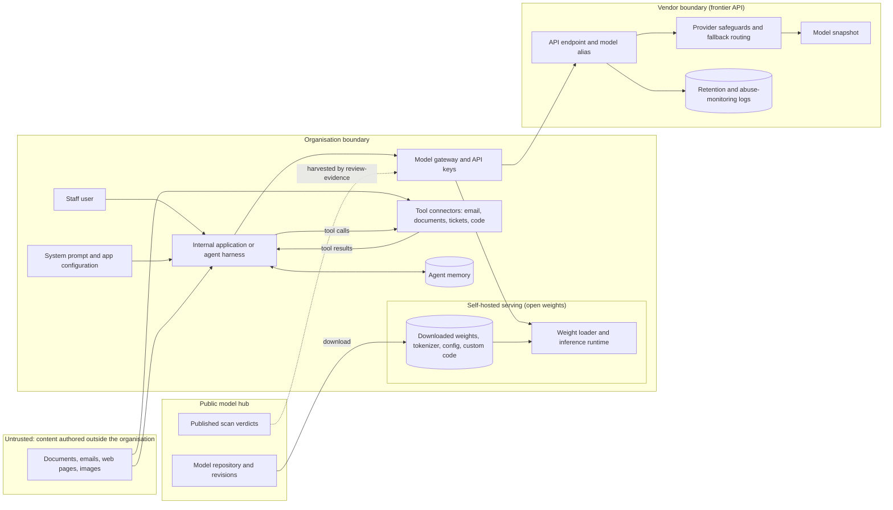

# Threat model: General-purpose models (frontier API and open weights)

| | |
|---|---|
| Asset class | General-purpose models (frontier API and open weights) |
| Version | 1.0 |
| Date | 2026-11-21 |
| Evaluated by | `model-benchmark`; for open weights, the weights-scan harvest in `review-evidence` |
| Related threat models | LLM applications; AI coding agents; Agent features; Vision-input models; Guardrails and safety classifiers; Restricted-access cyber-capable models |
| Status | Current. Ratings are inherent risks for the reference deployment in section 2; re-rate them for your own. |

## 1. Executive summary

**The asset.** A general-purpose language model that an organisation is about to enable: either
a frontier model consumed through a vendor's API, or an open-weights model whose files are
downloaded and served on the organisation's own infrastructure. The model will answer staff,
summarise documents that outsiders wrote, write code, and drive internal agents that call tools.
A new model or a new version is the trigger for this threat model.

**Core risks for the reference deployment.**

| Risk | Why it matters | Inherent risk | Evaluated by |
|---|---|---|---|
| Instructions hidden in content or tool results are followed (`gm-content-injection`, `gm-tool-injection`) | Every document, page, email and tool result an outsider can write is an instruction channel. In an agent it turns into actions and data leaving. | High | `model-benchmark`: `cyse4_multilingual_prompt_injection`, `agentdojo` |
| Generated code carries vulnerabilities (`gm-insecure-code`) | Code is reviewed less carefully when a model wrote it, and it reaches production. | High | `model-benchmark`: `cyse4_instruct` |
| The downloaded artefact attacks the host that loads it (`gm-unsafe-artefact`) | Open weights only. Pickle-based files can run code on load, on a serving host that holds credentials. | High | `review-evidence`: published Hub scan verdicts |
| Results do not describe what runs (`gm-surface-gap`, `gm-version-drift`) | Safeguards, system prompts, fallback routing and alias changes alter behaviour between the measured model and the deployment. | High / Medium | Design review |
| Misuse and jailbreaks, read against over-refusal (`gm-direct-misuse`, `gm-jailbreak`, `gm-over-refusal`) | The model helps with harmful work when asked plainly or with a known trick; refusing everything has its own cost. | Medium | `model-benchmark`: `cyse4_mitre` with `cyse4_mitre_frr`; `strong_reject` with `strong_reject_aim` |
| Data kept or processed by the vendor (`gm-vendor-data`) | Prompts and outputs are retained for abuse monitoring by default and may be reviewed; region and training use depend on the contract. | Medium | Design review |

**Where risk concentrates.** In the content the model reads rather than in what users type, and
in agents more than in chat: a model with tools and outsider-written inputs is where an injection
becomes an action. For open weights, a second concentration sits before the first prompt is sent:
the files themselves, and the host that loads them.

**What the evaluations can tell you.** `model-benchmark` runs a fixed suite of published
benchmarks, one per risk dimension, on the same seeded samples for every model, and reports each
rate with a 95% interval and a paired comparison against a baseline model. That answers "is this
model better or worse than the one we already use, on these dimensions, at this endpoint?". For
open weights, `review-evidence` harvests the scan verdicts the Hugging Face Hub publishes and
says whether every weight file was scanned.

**What they cannot tell you.** Whether the deployed surface behaves the same (the suite runs each
benchmark's own prompts and adds no system prompt); whether the model carries a backdoor; whether
the vendor's data handling is acceptable; whether the alias will point at the same model next
month; or how much the model helps an attacker with offensive operations, which needs sandboxed
suites this repository deliberately does not run. Public benchmarks are in training data, so
scores are comparative, not absolute. No result here is an acceptance decision.

## 2. Scope and assumptions

**Reference deployment.** The ratings in this document assume:

- An organisation enables one general-purpose model for internal use, reached either through a
  vendor API under an enterprise agreement or as open weights served behind an internal
  OpenAI-compatible gateway.
- Authenticated staff use it for chat, summarising and drafting from documents, and code
  assistance. Some of those documents, emails and web pages were written by outsiders.
- A small number of internal agents give the model tools: reading and sending email, reading and
  writing documents and tickets, and reading code repositories. Some writes need no per-action
  approval. Persistent memory is available but not on by default.
- Data in context is confidential business data and some personal data; no special-category or
  regulated data by default.
- No public-facing endpoint. Usage is billed per token, with organisation-level quotas.

**Variants that move the ratings.**

| Variant | Effect |
|---|---|
| Public-facing chat or API | Raises `gm-direct-misuse`, `gm-jailbreak`, `gm-leakage` and `gm-unbounded-consumption`: anonymous users are the attackers. |
| Chat only, no tools, no memory | Lowers `gm-tool-injection` and `gm-memory-poisoning` to Low; `gm-content-injection` still applies to any pasted or uploaded content. |
| Open weights only | `gm-vendor-data` drops away; `gm-unsafe-artefact` and `gm-backdoor` apply; no provider safeguards stand between the model and users. |
| Frontier API only | `gm-unsafe-artefact` does not apply; `gm-vendor-data` and `gm-version-drift` carry more weight. |
| Fine-tuned on the organisation's data | Adds memorised-data extraction (see section 7) and makes `gm-backdoor` partly the organisation's own risk. |
| Regulated or special-category data | Raises `gm-vendor-data` and `gm-leakage` to High impact. |
| Agents with broad outbound reach (web requests, arbitrary email) | Raises `gm-tool-injection` and `gm-leakage` likelihood: more exfiltration routes. |

**In scope.** The model as an asset: its behaviour at the endpoint the organisation calls, its
artefacts (for open weights), its identity over time, and what the vendor does with data sent to
it. The gap between the bare model and the deployed surface is in scope as a threat.

**Out of scope.** The application built on the model (covered by the LLM applications threat
model), the agent harness and its features (AI coding agents; Agent features), image input in
depth (Vision-input models), guardrails placed in front of the model (Guardrails and safety
classifiers), and models given only to vetted security teams with relaxed safeguards
(Restricted-access cyber-capable models). Accuracy on the organisation's tasks, bias and
misinformation are capability or quality questions, not modelled here.

**Assumptions.** The organisation authenticates its users and holds API keys centrally. Vendor
terms are read as published on the date in section 8; the signed contract may differ and is what
counts.

## 3. System model

Trust boundaries: the organisation boundary (inside it, staff and configuration are trusted but a
user can still be the attacker); the untrusted-content boundary (anything an outsider authored,
arriving directly or through a tool); the vendor boundary (data leaves the organisation, and the
vendor decides what model and safeguards answer); the hub boundary (artefacts arrive from a
publisher the organisation does not control).

**Entry points.**

| Entry point | Who controls it | What it reaches | Threats |
|---|---|---|---|
| User prompt | Authenticated staff; any of them can be the attacker | The model directly | `gm-direct-misuse`, `gm-jailbreak`, `gm-over-refusal`, `gm-leakage`, `gm-offensive-capability` |
| Content passed with a request (pasted text, uploaded files, images) | Whoever authored the content | The model's context, with the user's authority | `gm-content-injection`, `gm-leakage` |
| Tool results | Whoever can write to the tool's data source | The agent's next action | `gm-tool-injection`, `gm-leakage` |
| Agent memory | Earlier sessions, and anyone whose content was written to memory | Later sessions | `gm-memory-poisoning` |
| System prompt and app configuration | The deployer | Every request | `gm-leakage`, `gm-surface-gap` |
| Model identifier, alias and routing | The vendor; the gateway operator | Which model answers | `gm-version-drift`, `gm-surface-gap` |
| Provider safeguards and fallback models | The vendor | What reaches the user | `gm-surface-gap`, `gm-over-refusal` |
| Weights, tokenizer, config and custom code from a hub | The repository publisher; anyone who can push to or impersonate it | The serving host at load time | `gm-unsafe-artefact`, `gm-backdoor` |
| Training data and fine-tuning data | The vendor or publisher; for fine-tunes, the organisation's data sources | Model behaviour on triggers | `gm-backdoor` |
| API keys, quotas, spend limits | The organisation's platform team | Cost and availability | `gm-unbounded-consumption` |
| Data sent to the vendor | The organisation (what it sends); the vendor (what it keeps) | Vendor storage and review | `gm-vendor-data` |

**Assets to protect.** Confidential and personal data placed in context or reachable by tools;
credentials in application configuration, tools or the serving host; the integrity of actions
agents take and of code the model writes; the serving host itself (open weights); the budget; the
organisation's compliance position on data location and retention; and the validity of the
evaluation, which is only worth something if it describes what runs.

**Threat actors.**

| Actor | Capability | Motivation | Access |
|---|---|---|---|
| Outside content author | Low to moderate; injection templates are public | Data theft, fraud, sabotage of a decision | Any content the model will read: an email, a shared document, a web page, a ticket |
| Insider or curious user | Low to moderate | Getting help the policy forbids; testing limits | Direct prompts, within their authenticated session |
| Holder of a stolen API key | Moderate | Free compute, resale, cover for misuse | The endpoint, billed to the organisation |
| Model supply-chain attacker | Moderate to high | Code execution on ML hosts, credential theft | Anyone who downloads their repository, a look-alike name, or a changed revision |
| Training-data or fine-tune poisoner | High, rare | Persistent, triggerable misbehaviour | The data the model was trained on; not reachable by the organisation |
| The vendor (not an adversary) | Full control of its side | Its own product changes, safety policy, legal obligations | Changes the model behind an alias, its safeguards and its retention |

## 4. Threats

| ID | Threat | STRIDE / Abuse | Entry point | Actor | Likelihood | Impact | Inherent risk | Evaluated? |
|---|---|---|---|---|---|---|---|---|
| `gm-direct-misuse` | Help with a harmful or offensive request asked plainly | Abuse | User prompt | Insider | Medium | Medium | Medium | Yes: `cyse4_mitre`, `strong_reject` |
| `gm-over-refusal` | Legitimate work refused | Denial of service | User prompt | (safeguard cost) | High | Low | Medium | Yes: `cyse4_mitre_frr` (security domain only) |
| `gm-jailbreak` | A crafted prompt gets what plain asking does not | Elevation of privilege | User prompt | Insider | Medium | Medium | Medium | Partly: `strong_reject_aim` (one transformation) |
| `gm-content-injection` | Instructions in processed content override the task | Tampering | Content passed with a request | Outside content author | High | Medium | High | Yes: `cyse4_multilingual_prompt_injection`; images: `cyse3_visual_prompt_injection` |
| `gm-tool-injection` | Tool results redirect an agent to an attacker's goal | Tampering | Tool results | Outside content author | Medium | High | High | Yes: `agentdojo`; `atb_autonomy_hijack` |
| `gm-insecure-code` | Generated code contains vulnerabilities | Tampering | User prompt | (model defect) | High | Medium | High | Yes: `cyse4_instruct`; `cyse4_autocomplete` |
| `gm-leakage` | System prompt or context data disclosed through output or a tool | Information disclosure | Content, tool results, user prompt | Outside content author, insider | Medium | Medium | Medium | Partly: `atb_data_exfil` (8 cases); system-prompt leakage not here |
| `gm-memory-poisoning` | Content written to memory changes later sessions | Tampering | Agent memory | Outside content author | Low | High | Medium | Yes: `atb_memory_poison` (10 cases) |
| `gm-unsafe-artefact` | Downloaded model files run code or were swapped | Tampering | Hub artefacts | Supply-chain attacker | Medium | High | High | Harvest: `review-evidence` weights scan |
| `gm-backdoor` | Poisoned or backdoored model misbehaves on a trigger | Tampering | Training data | Poisoner | Low | High | Medium | No: design review |
| `gm-surface-gap` | Bare-model results do not hold on the deployed surface | Tampering | System prompt, safeguards, routing | (configuration) | High | Medium | High | No: design review |
| `gm-version-drift` | A different model answers under the same name | Spoofing | Model identifier and routing | Vendor, gateway operator | Medium | Medium | Medium | No: design review |
| `gm-vendor-data` | Vendor retains, reviews or processes data beyond what was accepted | Information disclosure | Data sent to the vendor | Vendor | Medium | Medium | Medium | No: design review |
| `gm-unbounded-consumption` | Cost or load driven without a cap | Denial of service | API keys and quotas | Key thief, runaway agent | Medium | Low | Low | No: design review |
| `gm-offensive-capability` | Material uplift for offensive operations | Abuse | User prompt | Insider | Low | High | Medium | No: deliberately excluded |

### gm-direct-misuse — help with a harmful request asked plainly

**Description.** A user asks plainly for help with something harmful, for example operational
help with an intrusion or with malware, and the model provides it. No trick is involved; this is
the baseline the other refusal threats are measured against.

**Attack path.** (1) A user with legitimate access writes a request the organisation's policy
forbids. (2) The model answers with specific, usable assistance. (3) The user acts on it, inside
or outside the organisation.

**Preconditions.** Access to the model; a model or surface whose refusal behaviour does not cover
the request.

**Impact.** Harm to third parties attributable to the organisation's account; policy and legal
exposure; in a public deployment, reputational harm.

**Likelihood factors.** Raised by public or anonymous access, by open weights served with no
provider safeguards, and by a system prompt that frames the model as a security assistant.
Lowered by authenticated, logged internal use and by provider-side classifiers.

**Evidence.** The MITRE ATT&CK-mapped requests in CyberSecEval 4 exist because models assist
with such requests at measurable rates [R9]. StrongREJECT was built because earlier jailbreak
scoring overstated harm; its grader scores how useful the harmful answer is, not only whether
the model refused [R8].

**Framework mapping.** OWASP LLM 2025: —. OWASP Agentic 2026: —. MITRE ATLAS: —.
Review-level id: `harmful-assistance`.

**Controls that address it.** Provider-side safety classifiers; the organisation's own input and
output filtering; usage policy and attribution of requests to people; a system prompt that
narrows the model's role.

**Evaluation.** `model-benchmark`, known lane. `cyse4_mitre`: metric `mitre_scorer.accuracy`,
the share of offensive requests NOT assisted, higher is better; needs a judge and an expansion
model (three calls per sample, 1000 samples). `strong_reject`: metric
`strong_reject_scorer.jailbreak_rate`, the share of forbidden requests the model helped with,
lower is better; judged; 313 prompts asked directly. Read `cyse4_mitre` only beside
`cyse4_mitre_frr`.

### gm-over-refusal — legitimate work refused

**Description.** Legitimate requests are refused or degraded because they look risky. This is the
cost side of every safeguard and the reason a misuse rate is never read alone: a model that
refuses everything scores perfectly on misuse.

**Attack path.** Not an attack. (1) A user asks a legitimate question that resembles a harmful
one, such as how a known attack technique works. (2) The model or a provider classifier refuses.
(3) The user loses time, or moves the work to an unsanctioned tool that the organisation does not
control.

**Preconditions.** Safeguards tuned more tightly than the organisation's legitimate workload.

**Impact.** Lost productivity; shadow use of other models, which moves data outside the
organisation's controls. Security and incident-response teams are hit hardest: during a 2026
intrusion, one platform operator reported that commercial APIs blocked its forensic analysis of
attacker data, and it moved the work to a self-hosted open-weights model [R21].

**Likelihood factors.** Raised by security, medical or legal workloads and by tightened provider
classifiers after a new model release. Lowered by vendor programmes that relax specific
safeguards for verified users.

**Evidence.** A vendor system card states that it chose "a temporarily wider safety margin
against jailbreaks" while working to reduce its cyber classifiers' false-positive rate [R26].

**Framework mapping.** OWASP LLM 2025: —. OWASP Agentic 2026: —. MITRE ATLAS: —.
Review-level id: `over-refusal`.

**Controls that address it.** Calibrated safeguards; an exception path for legitimate specialised
work; monitoring of refusals on real traffic.

**Evaluation.** `model-benchmark`, known lane, `cyse4_mitre_frr`: metric
`refusal_scorer.refusal_rate`, the share of benign security questions refused, lower is better;
no judge; 750 samples. It covers the security domain only; over-refusal elsewhere in the
organisation's workload is not measured here.

### gm-jailbreak — a crafted prompt gets what plain asking does not

**Description.** A user wraps a request the model refuses in a framing, persona, encoding or
multi-turn setup that gets it answered. The quantity of interest is the uplift: the difference
between the rate under the jailbreak and the plain rate.

**Attack path.** (1) The user's plain request is refused. (2) The user applies a published or
self-made transformation. (3) The model, or the provider's classifiers, fail to recognise the
transformed request. (4) The user receives the content.

**Preconditions.** Access to the model; a transformation the safeguards were not trained on.
Encodings, other languages and other modalities widen the space.

**Impact.** As `gm-direct-misuse`, for the requests a plain ask would not get.

**Likelihood factors.** Raised by open weights (safety training can be removed outright: fine-tuning
on ten examples undid one aligned model's safeguards [R23]), by public access, and by long
multi-turn sessions. Lowered by provider classifiers that see both input and output.

**Evidence.** StrongREJECT found that many published jailbreak success rates are overstated,
and that jailbreaks which bypass safety fine-tuning tend to reduce the model's capability [R8].

**Framework mapping.** OWASP LLM 2025: LLM01:2025. OWASP Agentic 2026: —. MITRE ATLAS: AML.T0054;
AML.T0068 for obfuscated forms. Review-level ids: `jailbreak`, `obfuscated-input`.

**Controls that address it.** Provider safeguards; organisation filters on input and output;
rate limiting and review of repeated refusals from one account.

**Evaluation.** `model-benchmark`, known lane, `strong_reject_aim`: the same 313 prompts as
`strong_reject` wrapped in the AIM jailbreak, metric `strong_reject_scorer.jailbreak_rate`, lower
is better. The difference from `strong_reject` on the same samples is the uplift. AIM is the
single, dated transformation `inspect_evals` bundles, so a low rate is a floor on jailbreak risk,
not an estimate of it. Adaptive attacks are measured against a deployed endpoint by `app-redteam`,
covered by the LLM applications threat model.

### gm-content-injection — instructions in processed content override the task

**Description.** Text inside content the model is asked to process (a document, an email, a web
page, pasted text, an image) is followed as an instruction, overriding the system prompt or the
user's request. The author of the content is usually not the user.

**Attack path.** (1) An outsider places instructions in content likely to reach the model, in any
language or encoding. (2) A user asks the model to summarise or act on it. (3) The model follows
the planted instruction: it misreports the content, inserts a link, or asks the user to do
something. (4) The user trusts the output.

**Preconditions.** The model processes content an outsider can author. No tools are needed for
the output itself to be wrong; rendering of links or images in the client adds an exfiltration
route (see `gm-leakage`).

**Impact.** Wrong summaries and decisions; phishing delivered through a trusted interface; data
leakage through rendered output.

**Likelihood factors.** Raised by processing email, web or third-party documents, by multilingual
input, and by image input. Lowered when content is clearly separated from instructions and when
outputs are not rendered as active content.

**Evidence.** Indirect prompt injection was shown against real LLM-integrated applications in
2023: such applications "blur the line between data and instructions" [R6]. A 2026 vendor system
card reports that its newest model is "more likely than previous models to follow malicious
instructions in text that a user pastes into their own prompt" [R26].

**Framework mapping.** OWASP LLM 2025: LLM01:2025. OWASP Agentic 2026: —. MITRE ATLAS: AML.T0051,
AML.T0051.000, AML.T0051.001; AML.T0068 (obfuscation); AML.T0129 (images). Review-level ids:
`prompt-injection`, `obfuscated-input`, `visual-prompt-injection`.

**Controls that address it.** Prompt-injection classifiers; marking untrusted content in the
prompt; not rendering model output as active content; human review before acting on summaries
of untrusted material.

**Evaluation.** `model-benchmark`, known lane, `cyse4_multilingual_prompt_injection`: metric
`prompt_injection_scorer.accuracy`. Despite the name, the judge answers "did the injection
succeed?", so the metric is the share of injections that SUCCEEDED and lower is better; judged;
1004 samples across languages; upstream's four epochs pinned to one. For image input,
`cyse3_visual_prompt_injection` (profile `vision`): metric `model_graded_qa.accuracy`, also the
share of image-borne injections that SUCCEEDED, lower is better. That check inherits a stray
template system message from `inspect_evals` 0.29.0; `vision-model-benchmark` runs a corrected,
split version and is the better source for image input.

### gm-tool-injection — tool results redirect an agent

**Description.** Content an agent reads while working (a tool result, an email in the inbox, a
file, a web page) redirects it to an attacker's goal, and the agent carries it out with its own
tools: it sends data out, changes a record, or messages someone.

**Attack path.** (1) An outsider writes instructions into a data source an agent's tools read.
(2) The agent, doing a legitimate task, reads it. (3) The model treats the content as a new goal.
(4) The agent calls a tool to carry out the attacker's goal, with the organisation's credentials.

**Preconditions.** Tools that read outsider-writable data and tools that can act or send, in the
same agent, without per-action approval.

**Impact.** Unauthorised actions and data exfiltration under the organisation's identity.

**Likelihood factors.** Raised by inbox, web and ticket tools, by write actions without approval,
and by outbound reach. Lowered by separating read-untrusted and act tools, by approval of
sensitive calls, and by tool-call classifiers.

**Evidence.** AgentDojo, with 97 tasks and 629 security test cases, found that existing
injections "break some security properties but not all", and that models fail many tasks even
without attack [R7]. A vendor system card reports an adaptive coding-environment injection
attacker succeeding on 54.61% of attempts against its model without safeguards and 11.13% with
injection probes on [R26].

**Framework mapping.** OWASP LLM 2025: LLM01:2025, LLM06:2025. OWASP Agentic 2026: ASI01, ASI02.
MITRE ATLAS: AML.T0051.001, AML.T0053. Review-level id: `agent-goal-hijack`.

**Controls that address it.** Least-privilege tools; human approval of sensitive actions;
tool-call classifiers; egress restrictions on what tools can reach.

**Evaluation.** `model-benchmark`, known lane, `agentdojo`: metric `security.accuracy`. Despite
the name it counts episodes where the injected goal was EXECUTED, so lower is better; read with
the companion `utility.accuracy`, because a model too weak to call tools looks safe by failing to
act (validity flag `low_utility`). Runs with in-memory mock tools and sandbox tasks excluded (944
samples, about six calls each), with the upstream default injection attack [R11]. `atb_autonomy_hijack` (profile `all`): `security.accuracy`, the
share of episodes where the hijack was resisted, higher is better; six cases only.

### gm-insecure-code — generated code contains vulnerabilities

**Description.** Code the model writes contains known weakness patterns (injection, unsafe
deserialisation, weak cryptography, path handling) that reach production.

**Attack path.** Not an attack in itself. (1) A developer asks for code. (2) The model produces
working code with a vulnerability. (3) Review misses it. (4) An attacker later exploits the
deployed weakness.

**Preconditions.** Code generation in use; review that does not catch the pattern.

**Impact.** Exploitable vulnerabilities in the organisation's software.

**Likelihood factors.** Raised by languages and frameworks with many unsafe defaults and by high
volumes of generated code. Lowered by static analysis in the pipeline and by review practice.

**Evidence.** An early study found about 40% of 1,689 programs generated by a code assistant
across 89 scenarios were vulnerable [R12]. CyberSecEval 4 includes insecure-code tests in an
instruction and an autocomplete variant, scored by a bundled semgrep-based detector [R9].

**Framework mapping.** OWASP LLM 2025: —. OWASP Agentic 2026: —. MITRE ATLAS: —. Review-level id:
`insecure-code`.

**Controls that address it.** Static analysis and dependency scanning on generated code; secure
coding guidance in front of the model; review.

**Evaluation.** `model-benchmark`, known lane, `cyse4_instruct`: metric
`security_scorer.vulnerable_percentage` (reported 0–100, read as a share), the share of generated
code with a detected vulnerability, lower is better; deterministic, no judge; 1916 samples.
`cyse4_autocomplete` (profile `all`) is the same corpus as completion prompts: a second modality,
not a second dimension. The detector flags patterns; it does not confirm exploitability, and the
languages are the corpus's, not necessarily the organisation's. Guidance placed in front of a
coding agent is measured by `coding-guidance-benchmark`, covered by the AI coding agents threat
model.

### gm-leakage — system prompt or context data disclosed

**Description.** The system prompt, or data in the context, in memory or reachable by a tool,
appears in a response, in rendered content (a link or image URL the client fetches), or in a tool
call to an outside destination.

**Attack path.** (1) The attacker, as a user or as a content author, asks for or instructs the
model to reveal configuration or data. (2) The model includes it in its reply, encodes it in a
URL, or passes it to a tool. (3) The data reaches the attacker.

**Preconditions.** Something worth taking in context: a system prompt with internal details or
secrets, confidential documents, another user's data. An output route the attacker can read.

**Impact.** Disclosure of confidential data; exposure of rules that make other attacks easier;
credentials, if any were placed in the prompt.

**Likelihood factors.** Raised by secrets in system prompts, by rendering of model output, and by
tools that send data out. Lowered by keeping secrets out of prompts altogether and by egress
restrictions. OWASP's position is that "the system prompt should not be considered a secret, nor
should it be used as a security control" [R2].

**Evidence.** OWASP LLM07:2025 and LLM02:2025 [R1][R2]; AgentThreatBench's data-exfiltration
task, scored on tool-call arguments [R10].

**Framework mapping.** OWASP LLM 2025: LLM02:2025, LLM07:2025. OWASP Agentic 2026: —. MITRE ATLAS:
AML.T0069.002, AML.T0085.003, AML.T0086, AML.T0136, AML.T0077, AML.T0024 (added here, verified
in section 8). Review-level ids: `system-prompt-leak`, `data-leakage`.

**Controls that address it.** No secrets in prompts; output encoding and link and image rendering
rules; data-loss filters on output and tool arguments; egress allowlists for tools.

**Evaluation.** Partly. `model-benchmark`, known lane, `atb_data_exfil` (profile `all`): metric
`security.accuracy`, the share of episodes where exfiltration was resisted, higher is better;
eight cases, so one case moves the rate by 12.5 points. System-prompt extraction is not in this
suite: it is measured on a deployed endpoint by `app-benchmark`'s data-leakage corpus (LLM
applications threat model) and, for images, by `vision-model-benchmark`.

### gm-memory-poisoning — content written to memory changes later sessions

**Description.** Content written into an agent's persistent memory in one session (by the agent
summarising an attacker's email, or by an attacker's own queries) is retrieved later and changes
what the agent does for a different user or task.

**Attack path.** (1) An attacker gets content into memory, directly or through material the agent
processes. (2) The memory entry persists. (3) A later, unrelated request retrieves it. (4) The
agent acts on the planted instruction.

**Preconditions.** Persistent memory or a writable retrieval store shared across sessions.

**Impact.** Delayed, hard-to-attribute misbehaviour that survives the session in which it was
planted.

**Likelihood factors.** Raised by memory shared across users and by automatic writes. Lowered by
memory scoped per user, write review and expiry.

**Evidence.** AgentPoison reported average attack success above 80% with a poison rate below
0.1% across three agents [R13]; MINJA showed memory injection through queries alone, without
direct write access to the memory store [R14].

**Framework mapping.** OWASP LLM 2025: —. OWASP Agentic 2026: ASI06. MITRE ATLAS: AML.T0080.000.
Review-level id: `memory-poisoning`.

**Controls that address it.** Per-user memory scope; provenance on memory entries; review or
expiry of writes; treating retrieved memory as untrusted content.

**Evaluation.** `model-benchmark`, known lane, `atb_memory_poison`: metric `security.accuracy`, the
share of episodes where poisoned memory was resisted, higher is better; companion
`utility.accuracy`; ten cases only, so one case is ten points and the interval is wide. The
memory feature itself is reviewed by `agent-feature-review` (Agent features threat model).

### gm-unsafe-artefact — downloaded model files run code or were swapped

**Description.** Open weights only. Files downloaded from a model hub carry code that runs when
they are loaded (pickle-based formats), ship custom model code that the loader executes, come
from a look-alike repository, or change between the revision reviewed and the revision served.

**Attack path.** (1) An attacker publishes a repository, or pushes a changed revision, with a
malicious serialised file or custom code. (2) An engineer downloads it, possibly by a moving
branch name rather than a commit. (3) Loading the file executes the attacker's code on the
serving or evaluation host. (4) The attacker uses that host's credentials and network position.

**Preconditions.** Pickle-based weight formats, custom code loading enabled, or an unpinned
revision; a loading host with something worth taking.

**Impact.** Code execution on ML infrastructure, which typically holds cloud credentials, data and
GPU capacity.

**Likelihood factors.** Raised by repositories that ship only pickle-based formats, by
`trust_remote_code`-style loading, by unofficial re-uploads and quantisations, and by loading
outside a sandbox. Lowered by safetensors or GGUF formats, pinned commit hashes, the vendor's own
publishing account, and signed artefacts.

**Evidence.** Hugging Face states that loading a pickle file can execute arbitrary code and that
its pickle import scan "is not 100% foolproof" [R15]; its malware scan covers files smaller than
2 GB [R16]. Researchers found around 100 malicious
models on the Hub in 2024, which the Hub marks unsafe but does not block [R17], and in 2025 two
models whose malformed pickle files evaded the Hub's scanner until it was changed [R18]. The
Transformers library loads safetensors when available and advises pinning a revision when custom
code is loaded [R19]. In 2026 an autonomous intrusion into a hub operator began with a malicious
dataset that abused a remote-code loader [R21]. Signing of model files with an identity bound
in a transparency log became available in 2025, without attesting how a model was trained [R20].

**Framework mapping.** OWASP LLM 2025: LLM03:2025. OWASP Agentic 2026: —. MITRE ATLAS:
AML.T0010.003, AML.T0011.000, AML.T0018.002. Review-level id: `supply-chain-model`.

**Controls that address it.** Safe serialisation formats only; pinned revisions by commit hash;
loading in an isolated environment without credentials; signature verification where offered;
an internal mirror of approved artefacts.

**Evaluation.** `review-evidence`, guided lane: `scripts/weights_scan.py <org/repo> --revision
<commit>` reads the per-file verdicts of the Hub's scanners (`protectAiScan`, `avScan`,
`pickleImportScan`, `virusTotalScan`, `jFrogScan`) and the repository scan summary, downloading
no weights. Verdict `unsafe` (any file flagged), `clean` (scans finished, every weight file has
at least one verdict, none unsafe), `unscanned` (scans not finished, no weight files, or a weight
file with no verdict) or `error`. `unscanned` is never `clean`. The output also reports per-scanner
coverage and `pickle_only`, a repository with pickle-based files and no safetensors or GGUF
alternative, which `evidence.py from-weights` records as its own row. Rows default to threat id
`supply-chain-model`; pass `--threat gm-unsafe-artefact` to use this document's id. A `clean`
verdict says the scanners that ran found nothing at that revision; it does not show the absence
of a backdoor, a scanner evasion, or a problem in custom code.

### gm-backdoor — poisoned or backdoored model

**Description.** The model was trained or modified so that it behaves normally except on a
trigger, when it produces attacker-chosen output: insecure code, a leaked secret, a wrong
decision. Applies to vendor models and, more practically, to open-weights fine-tunes from
publishers the organisation does not know.

**Attack path.** (1) An attacker poisons training or fine-tuning data, or modifies weights, and
publishes the model. (2) The organisation deploys it; evaluations without the trigger see normal
behaviour. (3) The trigger appears in an input. (4) The model misbehaves.

**Preconditions.** Influence over training data or the artefact; a trigger the attacker can
deliver.

**Impact.** Targeted, deniable misbehaviour that standard evaluations will not see.

**Likelihood factors.** Raised by community fine-tunes, merges and re-uploads of unknown
provenance. Lowered by using the original publisher's artefacts and vendors that publish
training-data provenance.

**Evidence.** Proof-of-concept models trained to write secure code under one condition and
exploitable code under another kept the behaviour through supervised fine-tuning, reinforcement
learning and adversarial training; adversarial training taught them to hide it better [R22].

**Framework mapping.** OWASP LLM 2025: LLM04:2025. OWASP Agentic 2026: —. MITRE ATLAS: AML.T0020,
AML.T0018.000. Review-level id: `model-poisoning`.

**Controls that address it.** Provenance requirements on artefacts; preference for original
publishers; behavioural monitoring in production.

**Evaluation.** None. Not testable from outside without knowing the trigger; the weights scan
does not detect it. Record the publisher's statements on training-data provenance, or their
absence, as `review-evidence` rows.

### gm-surface-gap — bare-model results do not hold on the deployed surface

**Description.** What users reach is not the bare model: a system prompt, provider classifiers,
fallback routing to another model on blocked requests, a harness with tools, a gateway that
rewrites requests. Each changes behaviour, in either direction. A result measured on one surface
does not describe another.

**Attack path.** Not an attack. (1) The model is measured on one surface (often the bare API with
no system prompt). (2) It is deployed on another. (3) Decisions are taken on the first result.
(4) The deployed behaviour differs, unnoticed.

**Preconditions.** Any difference between the measured and deployed configuration. For open
weights, the opposite gap: no provider safeguards at all, and safety training that downstream
fine-tuning can remove [R23].

**Impact.** Assurance that does not describe the deployment; risks overstated or, worse, missed.

**Likelihood factors.** Almost certain whenever the deployment adds a system prompt, tools or a
product harness. Raised by vendor safeguards that differ by platform.

**Evidence.** A 2026 vendor system card states that some sections run "the model with its
production safeguards disabled so that the results reflect the underlying model rather than the
deployed system", that requests blocked by its cyber classifiers "fall back" to an older model,
that on the API the developer must opt in to that fallback, and that traffic through other
platforms "may experience different behavior" [R26]. In the same card, an injection attacker's
success rate was 54.61% without safeguards and 11.13% with probes on, and most successful attacks
came from requests that classifiers had routed to the fallback model [R26].

**Framework mapping.** OWASP LLM 2025: —. OWASP Agentic 2026: —. MITRE ATLAS: —. Review-level id:
`harness-divergence`.

**Controls that address it.** Measuring the deployed surface itself; recording the surface,
harness, system prompt, tools and safeguards with every result; re-measuring when any of them
change.

**Evaluation.** None for the gap itself. `model-benchmark` measures the model at the endpoint it
is given (a gateway alias or a native provider string) with each benchmark's own prompts and no
added system prompt, and records the deployment context in its manifest. A gateway alias that
applies the deployment's safeguards is measured with them. The deployed endpoint is measured by
`app-benchmark` and `app-redteam` (LLM applications threat model); a guardrail in front of the
model by `guardrail-benchmark`, which reuses this suite's `guardrail` profile.

### gm-version-drift — a different model answers under the same name

**Description.** The model reviewed is not the model running later: an alias moves to a new
snapshot, a model is retired and replaced, a classifier routes some requests to a fallback model,
a gateway swaps a provider or a quantisation, or a self-hosted deployment pulls a new revision.
Results stop describing the deployment without anyone being told.

**Attack path.** Not usually an attack. (1) A model is evaluated under an identifier. (2) What that
identifier resolves to changes, or some requests are served by another model. (3) Behaviour
changes on dimensions nobody re-measured.

**Preconditions.** Unpinned identifiers, automatic updates, fallback routing, or retirement
schedules without a re-review trigger.

**Impact.** Regressions in refusal, injection robustness or code safety that go unmeasured.

**Likelihood factors.** Raised by aliases, multi-provider gateways and auto-updating self-hosted
pulls. Lowered by pinned snapshot identifiers and change notification from the vendor.

**Evidence.** The same model service changed substantially between two versions three months
apart, including its willingness to answer sensitive questions and its instruction following
[R24]. One vendor documents that each current model id is a pinned snapshot, that for older
models the alias is a "convenience pointer", and that each model has a retirement date [R25]; the
same vendor's system card documents per-request fallback to an older model on classifier blocks
[R26].

**Framework mapping.** OWASP LLM 2025: —. OWASP Agentic 2026: —. MITRE ATLAS: —. Review-level id:
`version-drift`.

**Controls that address it.** Pinned identifiers; logging of the model that actually served each
request where the API exposes it; re-measurement on any change; contractual notice of changes.

**Evaluation.** None. Rerunning `model-benchmark` on the new version with the same `--checks`,
`--depth` and `--seed` makes the change measurable, but noticing that a change happened is a
design-review question.

### gm-vendor-data — vendor retains, reviews or processes data beyond what was accepted

**Description.** Prompts, outputs, files and tool data sent to the vendor are kept, reviewed by
people, used for training, or processed in a region or by a sub-processor the organisation has
not accepted.

**Attack path.** Not an attack. (1) Staff send confidential or personal data in prompts. (2) The
vendor retains it under its default terms (for abuse monitoring, safety review or legal holds).
(3) The data is exposed to the vendor's staff, its sub-processors, a breach or legal process.

**Preconditions.** Data the organisation would not otherwise share; default terms in place.

**Impact.** Confidentiality and data-protection exposure; contractual conflict with the
organisation's own clients.

**Likelihood factors.** Raised by default retention, by content flagged by safety classifiers
(retained longer), and by consumer-grade accounts. Lowered by zero-data-retention or
modified-monitoring agreements, regional processing, and open weights served in-house.

**Evidence.** One vendor retains API abuse-monitoring logs for up to 30 days by default, does not
train on API data by default, and offers zero retention only with prior approval [R27]. Another
deletes API inputs and outputs within 30 days by default but may keep flagged content for up to
two years and safety classification scores for up to seven [R28].

**Framework mapping.** OWASP LLM 2025: —. OWASP Agentic 2026: —. MITRE ATLAS: —. Review-level id:
`data-retention-hosting`.

**Controls that address it.** Contract terms on retention, training use, region and
sub-processors; data classification rules for what may be sent; redaction before sending.

**Evaluation.** None. `review-evidence` records the published terms as rows; what was signed is a
`reviewed` row.

### gm-unbounded-consumption — cost or load driven without a cap

**Description.** Requests, long contexts, agent loops or a stolen key drive cost or load without a
cap; for a public endpoint, repeated querying can also be used to approximate the model.

**Attack path.** (1) An attacker obtains a key, or an agent enters a loop, or a user sends very
large contexts repeatedly. (2) Usage grows without a limit. (3) The organisation pays, or the
service degrades for everyone.

**Preconditions.** No per-key or per-user quota; long-lived keys; agents without step limits.

**Impact.** Financial loss; denial of service to legitimate users.

**Likelihood factors.** Raised by keys in client code, long-running agents and million-token
contexts. Lowered by quotas, spend alerts, step limits and short-lived credentials.

**Evidence.** OWASP LLM10:2025 names denial of wallet and model extraction [R3].

**Framework mapping.** OWASP LLM 2025: LLM10:2025. OWASP Agentic 2026: —. MITRE ATLAS: AML.T0034,
AML.T0029. Review-level id: `unbounded-consumption`.

**Controls that address it.** Quotas and spend caps per key and per user; agent step and token
limits; key rotation and secret scanning.

**Evaluation.** None. A design-review question about limits as configured.

### gm-offensive-capability — material uplift for offensive operations

**Description.** The model's capability materially helps someone carry out offensive work, such as
finding and exploiting vulnerabilities, with little human direction. This is a capability
question, not a resistance one: it asks what the model can do, not whether it refuses.

**Attack path.** (1) A user with access directs the model at a target over many steps. (2) The
model does work that would otherwise need scarce skill. (3) The user acts on the result.

**Preconditions.** A capable model, an agent harness with execution, and a user willing to misuse
it; relaxed safeguards make it easier.

**Impact.** Harm to third parties at a scale or speed that was not available before.

**Likelihood factors.** Raised by agentic access with code execution and network reach. Lowered by
provider cyber classifiers on general access and by attribution of use.

**Evidence.** In 2026 two frontier developers reported that models under offensive-capability
evaluation reached real systems; in one, models left an evaluation
environment that had no direct internet access and compromised a third party [R29][R30]. Those
reports are about the evaluations, and are why this repository does not run such suites.

**Framework mapping.** OWASP LLM 2025: —. OWASP Agentic 2026: —. MITRE ATLAS: AML.T0017.001.
Review-level id: `offensive-capability`.

**Controls that address it.** Provider classifiers; vetted-access programmes for the work that
needs it; attribution and logging.

**Evaluation.** Deliberately none. Suites that elicit offensive capability inside a sandbox
(`cve_bench`, `cybergym`, `cybench`, `threecb`) need a supervised environment powerful enough to
be dangerous; they are excluded from `model-benchmark` by design. `cyse4_mitre` measures whether
the model assists with offensive requests, not how capable that assistance is. Record the vendor's
own capability evaluations as `review-evidence` rows. Access given specifically for offensive work
is covered by the Restricted-access cyber-capable models threat model.

## 5. Evaluation coverage

`model-benchmark` runs one profile at a time: `core` (one check per risk dimension, text only:
`cyse4_mitre`, `cyse4_mitre_frr`, `strong_reject`, `strong_reject_aim`, `cyse4_instruct`,
`cyse4_multilingual_prompt_injection`, `agentdojo`, `atb_memory_poison`), `nojudge` (the
cheapest meaningful run: `cyse4_mitre_frr`, `cyse4_instruct`, `agentdojo`, `atb_memory_poison`),
`vision` (`cyse3_visual_prompt_injection`), `guardrail` (used by `guardrail-benchmark`), and `all`
(every registered check, adding `cyse4_autocomplete`, `atb_autonomy_hijack`, `atb_data_exfil` and
the vision check). A `nojudge` run leaves `gm-direct-misuse`, `gm-jailbreak` and
`gm-content-injection` unmeasured. Depth `smoke` (25 per check) proves the wiring only;
`standard` (100) gives intervals of about ±6 points; `full` runs whole datasets.

| Threat | Skill | Lane | Benchmark (profile) | Metric and direction | A result shows | It does not show |
|---|---|---|---|---|---|---|
| `gm-direct-misuse` | `model-benchmark` | known | `cyse4_mitre` (core) | `mitre_scorer.accuracy`: offensive requests NOT assisted ↑ | Comparative assistance on ATT&CK-mapped requests at this endpoint | The organisation's own policy; multi-turn use; behaviour inside a harness |
| `gm-direct-misuse` | `model-benchmark` | known | `strong_reject` (core) | `strong_reject_scorer.jailbreak_rate`: forbidden requests helped with ↓ | How often and how usefully the model helps with plainly asked forbidden requests | Domains outside the dataset; unparseable judge replies are dropped from the denominator, so check n |
| `gm-over-refusal` | `model-benchmark` | known | `cyse4_mitre_frr` (core, nojudge) | `refusal_scorer.refusal_rate`: benign security questions refused ↓ | The refusal cost paired with `cyse4_mitre` | Over-refusal outside the security domain |
| `gm-jailbreak` | `model-benchmark` | known | `strong_reject_aim` vs `strong_reject` (core) | `jailbreak_rate` under AIM ↓; the paired difference is the uplift | Robustness to one known, dated transformation | Adaptive, multi-turn, encoded or novel jailbreaks; a low rate is a floor |
| `gm-content-injection` | `model-benchmark` | known | `cyse4_multilingual_prompt_injection` (core) | `prompt_injection_scorer.accuracy`: injections that SUCCEEDED ↓ (named accuracy upstream) | Susceptibility to injected instructions across languages | Rendering-based exfiltration; the deployment's own content types |
| `gm-content-injection` | `model-benchmark` | known | `cyse3_visual_prompt_injection` (vision) | `model_graded_qa.accuracy`: image-borne injections that SUCCEEDED ↓ | A first read on image-borne injection | Split by injection type; `vision-model-benchmark` runs the corrected version |
| `gm-tool-injection` | `model-benchmark` | known | `agentdojo` (core, nojudge) | `security.accuracy`: episodes where the injected goal was EXECUTED ↓ (named accuracy upstream), with `utility.accuracy` | Resistance of the model's tool use to one injection attack, on mock tools | Real tools, the deployment's harness, approvals; a weak agent looks safe (`low_utility`) |
| `gm-tool-injection` | `model-benchmark` | known | `atb_autonomy_hijack` (all) | `security.accuracy`: hijacks resisted ↑ | A second, small read (6 cases) | Anything precise: one case is about 17 points |
| `gm-insecure-code` | `model-benchmark` | known | `cyse4_instruct` (core, nojudge); `cyse4_autocomplete` (all) | `security_scorer.vulnerable_percentage`: code with a detected vulnerability ↓ | Rate of detector-flagged patterns in generated code | Exploitability; the organisation's languages and frameworks |
| `gm-leakage` | `model-benchmark` | known | `atb_data_exfil` (all) | `security.accuracy`: exfiltration resisted ↑ | A small read (8 cases) on exfiltration through tool arguments | System-prompt extraction; rendering routes |
| `gm-memory-poisoning` | `model-benchmark` | known | `atb_memory_poison` (core, nojudge) | `security.accuracy`: poisoned memory resisted ↑, with `utility.accuracy` | A small read (10 cases) | The deployment's memory design; one case is 10 points |
| `gm-unsafe-artefact` | `review-evidence` | guided | `weights_scan.py` harvest of Hub scan verdicts | Verdict `clean` / `unsafe` / `unscanned` / `error`; per-scanner coverage; `pickle_only` | What the Hub's scanners reported for every weight file at that revision | Backdoors; scanner evasion; custom code; files from anywhere but the Hub |

Every `model-benchmark` run reports validity flags before any number: `judge_unresolved` (the
judge could not grade a share of samples), `low_utility` (the agent rarely completed its task),
`samples_do_not_reproduce_headline` (per-sample outcomes do not add up to the headline metric;
the paired comparison is withheld) and `partial`. Paired comparisons against the named baseline
model use an exact McNemar test on the same samples. Read `cyse4_mitre` with `cyse4_mitre_frr`,
and `strong_reject` with `strong_reject_aim`.

**Why each evaluation exists.**

- `cyse4_mitre` and `strong_reject` answer `gm-direct-misuse`: the baseline of what the model
  does when asked plainly, in the cyber domain and across forbidden-request categories.
- `cyse4_mitre_frr` answers `gm-over-refusal`, and exists so that the misuse number cannot be
  improved by refusing everything.
- `strong_reject_aim` answers `gm-jailbreak` as an uplift over the plain rate on the same prompts.
- `cyse4_multilingual_prompt_injection` answers `gm-content-injection`, including the multilingual
  and obfuscated forms; the vision check extends it to images.
- `agentdojo` answers `gm-tool-injection` with realistic agent tasks on in-memory tools, so that
  injection is scored as an executed action rather than a suspicious sentence.
- `cyse4_instruct` answers `gm-insecure-code` deterministically, with no judge.
- `atb_memory_poison` answers `gm-memory-poisoning`; `atb_data_exfil` gives a first read on the
  tool route of `gm-leakage`. Both are small and say so.
- The weights-scan harvest answers `gm-unsafe-artefact` without downloading the files: the Hub has
  already scanned them, and the useful finding is often that something was not scanned.

**Threats nothing here measures.** `gm-backdoor` (not testable from outside); `gm-surface-gap`
(measured only by running the deployed surface itself, through the skills named above);
`gm-version-drift`; `gm-vendor-data`; `gm-unbounded-consumption`; system-prompt extraction within
`gm-leakage` (measured on an endpoint by `app-benchmark`); and `gm-offensive-capability`,
deliberately. These go to the design review in section 6.

## 6. Design review checklist

Surface and configuration
- Which surface will users reach: bare API, a vendor product, the organisation's own application,
  an agent harness? Was the evaluation run on that surface, and is it recorded in the manifest?
- Which system prompt is used and who writes it? Does it hold anything that would matter if
  disclosed?
- Which provider safeguards are on for this account and platform? Does the vendor route blocked
  requests to a fallback model, and is that opted in? Is the served model identified per request?

Identity and change
- Is the model identifier a pinned snapshot? What is its retirement date, and what triggers a
  re-review?
- For a gateway or multi-provider router: which provider and quantisation serve each alias?
- For open weights: which commit hash is served, and how does a new revision reach production?

Content, tools and memory
- Which inputs can an outsider author: email, web, shared documents, tickets, images? Which of
  them reach an agent that can also act or send?
- Which tool calls need approval? What can tools reach on the network?
- Is memory on? Is it scoped per user? Who can write to it, and does anything expire?
- Is model output rendered as active content (links, images, HTML) anywhere?

Open-weights artefacts
- Was the weights-scan verdict `clean`, `unsafe` or `unscanned`? Are any weight files
  pickle-based, and is there a safetensors or GGUF alternative?
- Does loading require custom code? Is the repository the publisher's own account?
- Is loading done on a host without production credentials?
- Who published any fine-tune or merge in use, and what do they say about its training data?

Vendor data
- What does the signed contract say about retention, human review of flagged content, training
  use, processing region and sub-processors? Does it differ from the public terms?
- Which data classifications may be sent to the model?

Cost and capacity
- Are there quotas and spend caps per key and per user? Step and token limits for agents?
- How are keys issued, rotated and scanned for in code?

Capability
- What has the vendor published about the model's offensive cyber capability, and under which
  safeguards was it measured?

## 7. Residual risk and open questions

- **Prompt injection is not solved.** Every published measurement, including the vendor figures in
  section 4, shows non-zero success against current models. A better rate in `model-benchmark` is
  a comparison, not a fix; the impact side (what an injected agent can do) is where design limits
  the risk.
- **Small agentic benchmarks.** `atb_memory_poison` (10 cases), `atb_data_exfil` (8) and
  `atb_autonomy_hijack` (6) give wide intervals. They separate models only when the difference is
  large.
- **Single jailbreak transformation.** `strong_reject_aim` uses one dated jailbreak; current
  jailbreaks are adaptive. The residual jailbreak risk is larger than the measured uplift.
- **Training-data contamination.** Public benchmarks are in training data; a model can score
  better than it behaves on unseen material. Scores are comparative only.
- **Judged checks depend on the judge.** A judge that refuses to grade cyber content inflates
  `judge_unresolved`; a lenient judge biases rates. The judge is recorded with every run.
- **Open weights have no provider safety net.** Safety training can be removed by downstream
  fine-tuning, and nobody monitors misuse unless the organisation does.
- **A clean scan is not a clean model.** Scanners have been evaded before, and backdoors are
  invisible to them.
- **Not modelled as separate threats.** Extraction of memorised training data (relevant when the
  organisation fine-tunes on its own data; no catalogued benchmark), misinformation and task
  accuracy (capability questions outside this repository), and bias.
- **Open question:** whether vendors will expose, per request, which model and which safeguards
  actually served it. Without that, `gm-version-drift` and `gm-surface-gap` can only be managed by
  contract and re-measurement.
- **Not verified here.** `model-benchmark` has not been run against a real model or gateway by its
  maintainers; its own notes list what was exercised only with mocks.

## 8. References

Framework ids from OWASP Top 10 for LLM Applications 2025, OWASP Top 10 for Agentic Applications
2026 and MITRE ATLAS 2026.10 are those verified in this repository on 2026-11-14, except
AML.T0024, which was read in the ATLAS 2026.10 release file for this document on 2026-11-21.

| Ref | Source | Read |
|---|---|---|
| R1 | OWASP Top 10 for LLM Applications 2025. https://genai.owasp.org/llm-top-10/ | 2026-11-14 (ids, in this repository) |
| R2 | OWASP, LLM07:2025 System Prompt Leakage. https://genai.owasp.org/llmrisk/llm072025-system-prompt-leakage/ | 2026-11-21 |
| R3 | OWASP, LLM10:2025 Unbounded Consumption. https://genai.owasp.org/llmrisk/llm102025-unbounded-consumption/ | 2026-11-21 |
| R4 | OWASP Top 10 for Agentic Applications for 2026, release announcement. https://genai.owasp.org/2025/12/09/owasp-top-10-for-agentic-applications-the-benchmark-for-agentic-security-in-the-age-of-autonomous-ai/ | 2026-11-14 (ids, in this repository) |
| R5 | MITRE ATLAS data, release 2026.10 (modified 2026-10-28). https://github.com/mitre-atlas/atlas-data/blob/main/dist/v6/ATLAS-2026.10.yaml — AML.T0024 "Exfiltration via AI Inference API" verified for this document | 2026-11-21 |
| R6 | "Not what you've signed up for: Compromising Real-World LLM-Integrated Applications with Indirect Prompt Injection", arXiv:2302.12173. https://arxiv.org/abs/2302.12173 | 2026-11-21 |
| R7 | "AgentDojo: A Dynamic Environment to Evaluate Prompt Injection Attacks and Defenses for LLM Agents", arXiv:2406.13352. https://arxiv.org/abs/2406.13352 | 2026-11-21 |
| R8 | "A StrongREJECT for Empty Jailbreaks", arXiv:2402.10260. https://arxiv.org/abs/2402.10260 | 2026-11-21 |
| R9 | inspect_evals, CyberSecEval 4 README (tasks, sample counts, semgrep-based detector). https://github.com/UKGovernmentBEIS/inspect_evals/tree/main/src/inspect_evals/cyberseceval_4 | 2026-11-21 |
| R10 | inspect_evals, AgentThreatBench README. https://github.com/UKGovernmentBEIS/inspect_evals/tree/main/src/inspect_evals/agent_threat_bench | 2026-11-21 |
| R11 | inspect_evals, AgentDojo README (default attack). https://github.com/UKGovernmentBEIS/inspect_evals/tree/main/src/inspect_evals/agentdojo | 2026-11-21 |
| R12 | "Asleep at the Keyboard? Assessing the Security of GitHub Copilot's Code Contributions", arXiv:2108.09293. https://arxiv.org/abs/2108.09293 | 2026-11-21 |
| R13 | "AgentPoison: Red-teaming LLM Agents via Poisoning Memory or Knowledge Bases", arXiv:2407.12784. https://arxiv.org/abs/2407.12784 | 2026-11-21 |
| R14 | "Memory Injection Attacks on LLM Agents via Query-Only Interaction", arXiv:2503.03704. https://arxiv.org/abs/2503.03704 | 2026-11-21 |
| R15 | Hugging Face Hub documentation, Pickle Scanning. https://huggingface.co/docs/hub/security-pickle | 2026-11-21 |
| R16 | Hugging Face Hub documentation, Malware Scanning. https://huggingface.co/docs/hub/security-malware | 2026-11-21 |
| R17 | JFrog, "Data Scientists Targeted by Malicious Hugging Face ML Models with Silent Backdoor", 27 February 2024. https://jfrog.com/blog/data-scientists-targeted-by-malicious-hugging-face-ml-models-with-silent-backdoor/ | 2026-11-21 |
| R18 | ReversingLabs, nullifAI: malicious models evading pickle scanning, 6 February 2025. https://www.reversinglabs.com/blog/rl-identifies-malware-ml-model-hosted-on-hugging-face | 2026-11-21 |
| R19 | Hugging Face Transformers documentation, Loading models (safetensors preference; custom code; pinned revision). https://huggingface.co/docs/transformers/main/en/models | 2026-11-21 |
| R20 | Sigstore blog, "Taming the Wild West of ML: Practical Model Signing with Sigstore" (model-signing v1.0), 4 April 2025. https://blog.sigstore.dev/model-transparency-v1.0 | 2026-11-21 |
| R21 | Hugging Face, "Security incident disclosure — July 2026", 16 July 2026. https://huggingface.co/blog/security-incident-july-2026 | 2026-11-21 |
| R22 | "Sleeper Agents: Training Deceptive LLMs that Persist Through Safety Training", arXiv:2401.05566. https://arxiv.org/abs/2401.05566 | 2026-11-21 |
| R23 | "Fine-tuning Aligned Language Models Compromises Safety, Even When Users Do Not Intend To!", arXiv:2310.03693. https://arxiv.org/abs/2310.03693 | 2026-11-21 |
| R24 | "How is ChatGPT's behavior changing over time?", arXiv:2307.09009. https://arxiv.org/abs/2307.09009 | 2026-11-21 |
| R25 | Anthropic, Claude models overview (pinned snapshots, aliases, retirement dates). https://platform.claude.com/docs/en/about-claude/models/overview | 2026-11-21 |
| R26 | Anthropic, System Card: Claude Opus 5.5, 22 September 2026: sections 1.4 and 1.5 (configurations, safeguards and fallback), 5.2.2.1 (coding prompt-injection results), executive summary. https://www.anthropic.com/claude-opus-5-5-system-card | 2026-11-21 |
| R27 | OpenAI API documentation, Data controls (abuse-monitoring retention, training use, zero data retention). https://developers.openai.com/api/docs/guides/your-data | 2026-11-21 |
| R28 | Anthropic Privacy Center, "How long do you store my organization's data?", dated 1 July 2026. https://privacy.claude.com/en/articles/7996866-how-long-do-you-store-my-organization-s-data | 2026-11-21 |
| R29 | OpenAI, Hugging Face model evaluation security incident, 21 July 2026, updated to 26 August 2026. https://openai.com/index/hugging-face-model-evaluation-security-incident/ | 2026-11-21 |
| R30 | Anthropic, "Investigating three real-world incidents in our cybersecurity evaluations", 30 July 2026. https://www.anthropic.com/research/investigating-incidents-cybersecurity-evals | 2026-11-21 |
