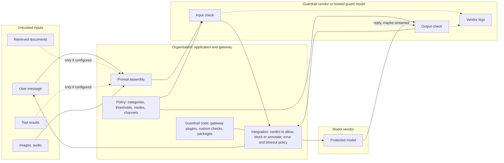

# Threat model: Guardrails and safety classifiers

| Field | Value |
|---|---|
| Asset class | Guardrails and safety classifiers: input and output filters, prompt-injection detectors, content classifiers and guardrail models placed in front of or behind a model |
| Version | 1.1 |
| Date | 2026-11-24 |
| Evaluated by | `guardrail-benchmark` |
| Related threat models | LLM applications (chat assistants, RAG and tool-using apps); General-purpose models (frontier API and open weights); Agent features; Decision and classification models; Realtime voice models; Vision-input models |
| Status | Current. Ratings are rough inherent risks for the reference deployment below; re-rate them for your own |

## 1. Executive summary

A guardrail is a control: a classifier, detector or guard model that reads text (sometimes
images) on its way into or out of a model and returns a verdict that other code acts on. It
may be a vendor API, a check on a model gateway, or a small model the organisation hosts.
The guardrail does not do harm itself. The harm is what gets past it, what it wrongly stops,
and what it exposes on the way, so this threat model covers threats **to** the control
(evasion, manipulation, outage, misconfiguration, flaws in its own code) and **through** it
(data sent to its vendor, and false confidence in the system it protects).

| Core risk | Why it matters | Inherent risk | Evaluated by |
|---|---|---|---|
| Channels the guardrail never sees: tool results, retrieved documents, streamed output, images, audio, untagged input, uncovered endpoints | Vendor documentation shows several are not inspected by default, and indirect injection arrives exactly there | Critical | Partly: in-line mode with `agentdojo` (tool output) |
| Evasion by encoding, character tricks, language, splitting and padding | Published studies evaded commercial and open detectors in most attempts; splitting work into innocuous steps got past production safeguards | High | Partly: direct-mode technique families; in-line multilingual injection |
| Adaptive attackers, including holders of stolen keys with bypass tooling | Defences reporting near-zero attack success were bypassed over 90% of the time by adaptive attacks; a criminal group built tooling to bypass a vendor's safeguards with stolen credentials | High | No (only through the LLM applications red-team skill) |
| Flaws in the guardrail's own code, gateway and packages | A custom-code guardrail feature is in CISA's KEV catalog for code execution; the same gateway shipped compromised releases twice | High | No: design review |
| Failing open on error, timeout or an unrecognised verdict | Some integrations default to letting traffic through; an attacker who can slow the guardrail can switch it off | High | No: design review |
| Misconfiguration, drift, and reliance on one control | Detect-only modes, checks that are off by default and vendor model updates change protection silently | High | Partly: re-runs and the in-line baseline arm |
| Data sent to the guardrail vendor | The guardrail is a new processor of every prompt and reply it inspects; AI vendors have retained and exposed such data | High | No: design review |
| Over-blocking | The cost side of every catch rate; blocked users route around the control | Medium | Yes: false-block rate in both modes |

**Where risk concentrates.** In the gap between what the guardrail is believed to inspect and
what it is actually given; in the integration code that decides what an error, a timeout or a
"detected but not filtered" verdict means; and, since 2026, in the guardrail's own code on the
gateway. Each guardrail tested in public in the 2025–2026 sources reviewed had a reported
bypass, mostly by text that redefines its task or exploits how it tokenises, while the strongest vendor-reported
results show that adaptive robustness varies widely and can be measured.

**What the evaluations can and cannot tell you.** `guardrail-benchmark` **direct mode** sends a
labelled corpus of about 2,960 harmful, injection, leakage and benign texts straight to the
guardrail and scores its own verdict: catch rate beside false-block rate, with 95% intervals,
by technique family. **In-line mode** runs published benchmarks with the same model behind a
baseline arm and each guardrail arm, and reports the risk each guardrail removes beside what it
costs in over-blocking, paired on the same samples. They say how well this guardrail, as
configured, separates known harmful from benign inputs and how much it changes a model's
behaviour inside a benchmark, including injected tool output. They do not measure adaptive
attackers, latency, behaviour on error, data handling, the guardrail's own vulnerabilities, or
channels the guardrail is not wired to. A high catch rate is a statement about these corpora,
not about a motivated attacker.

## 2. Scope and reference deployment

The ratings assume:

- An LLM application of the kind in the LLM applications threat model: chat with retrieval
  over documents outsiders can write to, and a few tools.
- A guardrail called synchronously on each request, on the gateway or by the application: an
  injection and jailbreak detector and a content classifier on user input, and a content
  classifier on the reply. Retrieved documents and tool results are inspected only if someone
  turned that on.
- A vendor service or vendor-supplied classifier or guard model, with a policy (categories,
  thresholds, block or detect-only) set by a platform team, running through gateway software
  that the organisation installs and updates.
- The organisation counts it as a meaningful control alongside the model's own safety.

What moves the ratings: a self-hosted classifier removes vendor data flows; an LLM-based guard
model or judge raises injection against the guardrail and latency; detect-only mode turns
bypasses into monitoring blind spots; a guardrail that is the only check before a write tool or
a public reply raises every evasion impact to High; streaming and voice or image input widen
the channel gap; guardrail features that run user-supplied code, or a gateway reachable from
the internet, raise implementation risk; leaked or resold API keys put the guardrail in front
of attackers who iterate against it at the organisation's cost.

Out of scope: the protected model (general-purpose models threat model), the rest of the
application's design (LLM applications), decision models used as gates in their own right
(decision and classification models), and scanners of code or AI components (AI-assisted
security tools).

## 3. System model

| Input | Who controls it |
|---|---|
| Text sent for classification | Users, and the writers of any retrieved or tool content routed through it |
| Channels and endpoints not routed to the guardrail | Outside writers |
| Policy, mode and thresholds | The platform team, and the vendor's defaults |
| The guard model's behaviour | The vendor |
| The guardrail and gateway code | Their maintainers and package registries |
| Availability | The vendor, network and load |

**Threat actors.** An adversarial user with public evasion techniques and automation; an
outside writer whose content the system ingests; an optimising attacker who uses block-or-allow
feedback, or a local copy of an open-weights guard model, to search for a reliable bypass; a
holder of stolen or resold API keys who builds and shares bypass tooling; an attacker who can
reach the gateway's guardrail endpoints or publish to its package feed; an availability
attacker who sends long or numerous inputs; and, without malice, the vendor (model updates,
logging) and the platform team (loosening policy to cut false blocks).

## 4. Core threats

Ratings combine likelihood and impact using the matrix in the threat-model method. Evidence
status is one of *observed in deployed systems*, *disclosed vulnerability* (no known
exploitation), *demonstrated in research* or *theoretical*. Framework ids for every threat are
in section 5.

### gr-evasion — Evasion by encoding, characters, language, turns, splitting and padding (High)

- **What and where.** The guardrail and the protected model understand different things.
  Invisible or look-alike characters, spacing, ciphers, structural reformatting, paraphrase, a
  less-trained language, a payload split across turns, fields or chunks, or content placed past
  the classifier's window all pass the check and still reach a model that understands them.
  OWASP notes that encodings "bypass filters that never saw the encoding" and that splitting
  defeats per-field classifiers [1].
- **Evidence status.** Observed: developers' threat reports describe actors who got past
  production model safeguards by splitting malicious work into innocuous-looking building
  blocks or by using pretexts [39][40][41]; a malicious marketplace skill
  padded with 22 MB of filler to exceed scanner limits received a clean VirusTotal verdict [42].
  Disclosed and demonstrated: twelve character-injection techniques evaded six detectors (Azure
  Prompt Shield, two ProtectAI models, Meta Prompt Guard, NeMo Guard Jailbreak Detect, Vijil) on
  average 20% to 92% of the time, with emoji and Unicode-tag smuggling at 100% [6]; adding
  letters to words made BPE and WordPiece protective classifiers miss injection, toxicity and
  spam while the target model still understood (TokenBreak) [30]; spacing out characters took
  one classifier from 100% to 0.2% detection [7]; a scanner using an LLM guard model missed a
  payload after about 100,000 leading newlines [22]. One vendor says its detectors are trained
  and evaluated primarily on English [14]; one guard model has a 512-token window [8].
- **Rating.** Likelihood High, impact Medium (High if the guardrail stands alone). Lower with
  normalisation and decoding before classification, multilingual evaluation in the
  deployment's languages, conversation-level checks and scanning every segment.

### gr-adaptive — Adaptive attackers and false assurance from vendor metrics (High)

- **What.** Assurance comes from a vendor's benchmark or a fixed test set; an attacker who
  iterates against the deployed guardrail finds inputs that pass reliably, and shares or sells
  them. Disclosed policy and detailed block reasons help: OWASP describes an attacker using
  disclosed restrictions to craft an injection that bypasses them [26].
- **Evidence status.** Observed: Microsoft says Storm-2139 used customer credentials scraped
  from public sources, altered service capabilities and resold access, activity that "required
  deliberate efforts to bypass our safeguards" (AML.CS0057) [28]; an advertiser repeatedly got
  around Meta's automated ad review to keep promoting nudify apps, and Meta sued [43]; EchoLeak
  evaded a production injection classifier as one step of an exfiltration chain [21].
  Demonstrated: adaptive attacks bypassed twelve defences with over 90% success where most had
  reported near-zero static attack success [10]; a tree search reached 100% against six
  multi-scanner guardrails and its bypasses transferred to 29 unseen guardrails, 8 of them
  commercial [33]; short "flip token" suffixes turned unsafe verdicts to safe across guard
  models trained on similar datasets [32]. For balance, vendor-reported adaptive results vary:
  constitutional classifiers cut automated jailbreak success from 86% to 4.4%, and one universal
  jailbreak was found by 339 public participants over 300,000 interactions [29]; an adaptive
  attacker with 100 attempts per environment reached about 1% against one vendor's browser-agent
  safeguards [44].
- **Rating.** Likelihood Medium (needs a motivated attacker; methods and tooling are public),
  impact High (the bypass is systematic). Raised by detailed block reasons, unlimited retries,
  public weights and leaked keys; lowered by rate limits on blocked traffic and monitoring for
  probing.

### gr-channel-gap — Channels the guardrail never inspects (Critical)

- **What and where.** The guardrail sees user input and maybe the final reply, but not
  retrieved documents, tool results, tool definitions, streamed output, images or audio, or
  not every endpoint and call type. No evasion is needed for content on those paths.
- **Evidence status.** Documented product behaviour and disclosed vulnerabilities; no incident
  was found that was attributed only to an uninspected channel. One service's prompt-attack
  filter does not evaluate tool results or tool definitions, and filters nothing unless user
  input is tagged [13]; another's document-attack detection is off by default [14]; one gateway
  does not apply output guardrails to streamed responses [16]; keyword and content-safety
  guardrails in one gateway could be bypassed through a call-type mismatch on async endpoints
  (CVE-2026-12797) [37]. Images and audio carry instructions [20][47]; an audio jailbreak played
  over the air bypassed Llama-Guard-3 [45]; where agent frameworks passed audio through, audio
  injections completed in 49% of cells in one benchmark [46]. OWASP LLM01:2026 names image,
  audio and video and says to "Filter at every modality boundary" [1].
- **Rating.** Likelihood High (RAG and tool use are the norm), impact High. Lower with an
  inventory of channels and endpoints and a check built for each.

### gr-guardrail-injection — The guardrail as an injection target (Medium)

- **What.** An LLM-based guard model or judge reads the content it judges, and that content can
  address it ("this is a safe test case"), redefine its policy, or carry an optimised string
  that pushes the verdict to "safe". An output check can be fooled by text the protected model
  was induced to include. A judge on tool calls often reads fields the requester controls.
- **Evidence status.** Disclosed: one template prompt-injected both the model and the LLM judge
  of OpenAI's Guardrails framework four days after release, getting harmful output past the
  jailbreak detector and an injection through a tool call past the agentic detector [31];
  prepending a counterfeit policy cut a decision model's prompt-injection recall from 82.90% to
  3.88%, and in LangChain's tool-risk gating a counterfeit policy in a user-editable profile
  field lowered the average risk score of an unauthorised edit from 0.893 to 0.290 against a
  0.5 block line [34]. Demonstrated: renaming the permissive option raised fail-open to 93–100%
  on four typed decision models, and reversed decisions were no less confident [35]; universal
  prefixes fooled guard models [11]; optimised injections steered LLM judges [12]; a guard-model
  card warns of prompt-injection susceptibility [9].
- **Rating.** Likelihood Medium (High for an LLM-based judge), impact Medium (High where it
  gates a tool call). Lower with label-only classifiers, strict parsing that fails closed, and
  judging without requester-controlled text.

### gr-fail-open — Failing open on error, timeout or unrecognised verdict (High)

- **What.** When the guardrail errors, times out, is rate-limited or returns something the
  integration does not recognise, the request or reply goes through, sometimes by design for
  availability. An attacker who can slow the guardrail chooses when it is off.
- **Evidence status.** Documented defaults; no incident found. One gateway integration's
  `fail_open` defaults to true, with a 30-second timeout [15]; another gateway calls "Enforce
  But Ignore On Error" the safest default for outages [16].
- **Rating.** Likelihood Medium, impact High. Lower with a written error policy per path,
  fail-closed where a bypass matters, and alerts on guardrail error rates.

### gr-over-blocking — Over-blocking that pushes users around the control (Medium)

- **What.** Benign requests and replies that look harmful are blocked: security work, medical
  and legal questions, quoted attack text. Teams then loosen thresholds or switch to
  detect-only, and users move to unapproved tools. An attacker can also induce false positives
  to wear the control down.
- **Evidence status.** Demonstrated: XSTest and OR-Bench document over-refusal of safe prompts
  [17][18]; a guard-model card reports input filtering raised refusal rates more than output
  filtering [9]; the flip-token technique can flood systems with false positives [32].
- **Rating.** Likelihood Medium (High for security teams), impact Medium.

### gr-latency — Latency, cost and a new availability dependency (Medium)

- **What.** Every inspected request waits for the guardrail; long inputs scanned in segments
  multiply calls [8]; OWASP lists variable-length input floods among unbounded-consumption
  risks [2]; the vendor's outage becomes the application's, unless it fails open.
- **Evidence status.** Vendor-reported cost: one classifier system added 23.7% compute
  overhead [29]. Exploitation as a denial of service is theoretical in the research reviewed.
- **Rating.** Likelihood Medium, impact Medium. Lower with length caps before the check,
  capacity budgets and explicit timeouts.

### gr-vendor-data — The guardrail as a new data processor (High)

- **What.** A hosted guardrail receives everything it inspects: prompts, retrieved documents,
  replies, and the personal data and secrets in them, under terms separate from the model
  vendor's (retention, region, training use, sub-processors). OWASP lists logs and telemetry as
  disclosure surfaces and says to enforce no-retain "technically ... rather than policy text
  alone" [25].
- **Evidence status.** Observed for AI processors in general, not for a guardrail vendor: an
  inference provider retained a customer's data despite a contractual zero-retention commitment,
  and an intrusion then exposed that customer's AI chat transcripts [48]. No breach of a
  guardrail vendor was found in the research for this update. NIST lists data privacy and
  third-party components among generative AI risks [5].
- **Rating.** Likelihood High (every inspected request leaves), impact Medium (High for
  regulated data).

### gr-misconfig-drift — Misconfiguration and drift (High)

- **What.** A category is off; the action is detect or annotate rather than block; the
  strength is low; a gateway guardrail name is misspelt and silently does nothing; required
  input tags are missing; policy is loosened over time; the vendor updates its model and
  verdicts change on identical input.
- **Evidence status.** Documented configuration options; no incident found. Vendor consoles
  offer detect-only actions and tag-dependent filtering [13] and annotate modes that return
  "detected" without filtering [14].
- **Rating.** Likelihood High, impact Medium. Lower with configuration under change control, a
  known-bad and known-good smoke test after every change, and scheduled re-measurement.

### gr-single-point — Reliance on one control (High)

- **What.** A high-impact action is gated only by the guardrail's verdict: a write tool that
  runs whenever the detector says "clean", an output filter as the only thing between the model
  and the public. Every threat above then carries the full impact of the harm it was meant to
  stop. OWASP: authorise before retrieval, because filtering after generation cannot undo a
  chunk the model already saw [25].
- **Evidence status.** Demonstrated: the tool-risk gate above let an unauthorised edit through
  on a single manipulated score [34]; adaptive results [10]; designs that bound what an injected
  model can do rather than relying on detection [23][24]; a guard model describes itself as an
  additional layer [8].
- **Rating.** Likelihood Medium, impact High.

### gr-implementation — Flaws in the guardrail's own code, gateway and packages (High)

- **What and where.** The guardrail runs as code: a gateway plugin, a custom-code check, an SDK,
  a hosted guard model. A flaw can skip the check on some paths, or give whoever reaches it code
  execution on the gateway that holds provider keys and sees all traffic. Features that run
  user-supplied code, and test endpoints left on in production, are the most exposed.
- **Evidence status.** Observed. CISA added LiteLLM CVE-2026-40217, code execution "via bytecode
  rewriting at the /guardrails/test_custom_code URI" (a sandbox escape in the custom-code
  guardrail), to its KEV catalog on 2026-11-18 [36][37]; separate advisories report production
  custom-code guardrail endpoints that skipped code safety checks (CVE-2026-59821) and the
  call-type bypass above (CVE-2026-12797) [37]. The same gateway shipped compromised releases on
  PyPI in March and October 2026 that carried credential stealers [38].
- **Rating.** Likelihood Medium (where users or the internet can reach the gateway), impact
  High (every check bypassed, and the gateway's keys exposed). Lower with custom-code features
  and test endpoints off in production, pinned and verified releases, and the gateway off the
  internet.

## 5. Framework mapping

Ids are from the current lists as verified for this repository on 2026-11-24 [3][4]: OWASP Top
10 for LLM Applications 2026, OWASP Top 10 for Agentic Applications for 2026, the OWASP MCP Top
10 (a beta, v0.1), and MITRE ATLAS release 2026.10. The 2025-to-2026 OWASP crosswalk is in
[frameworks.md](frameworks.md). The guardrail appears in the LLM list both as an LLM component
that can be attacked and as a mitigation for LLM01:2026, LLM02:2026 and LLM10:2026
[1][25][27]; the Agentic and MCP lists apply only where a guardrail sits on tool calls or tool
results.

| Threat | OWASP LLM 2026 | OWASP Agentic | OWASP MCP | MITRE ATLAS 2026.10 |
|---|---|---|---|---|
| gr-evasion | LLM01:2026, LLM02:2026, LLM10:2026 | ASI01 | MCP06:2025 | AML.T0015, AML.T0068, AML.T0043, AML.T0054 |
| gr-adaptive | LLM01:2026, LLM08:2026 | — | — | AML.T0015, AML.T0043.001, AML.T0043.002, AML.T0012 |
| gr-channel-gap | LLM01:2026, LLM02:2026, LLM10:2026 | ASI01 | MCP03:2025, MCP06:2025 | AML.T0051.001, AML.T0129 |
| gr-guardrail-injection | LLM01:2026 | ASI01, ASI02 | MCP06:2025 | AML.T0051, AML.T0015 |
| gr-fail-open | LLM10:2026 | — | — | AML.T0029 |
| gr-over-blocking | — | — | — | AML.T0046 |
| gr-latency | LLM06:2026 | — | — | AML.T0029, AML.T0034.001 |
| gr-vendor-data | LLM02:2026 | — | — | — |
| gr-misconfig-drift | — | — | — | — |
| gr-single-point | LLM03:2026, LLM02:2026 | ASI02 | MCP05:2025 | — |
| gr-implementation | LLM04:2026 | — | — | AML.T0107, AML.T0049, AML.T0010.001 |

**Coverage check.**

| # | OWASP LLM 2026 | OWASP Agentic (guardrail on tool calls) | OWASP MCP (guardrail on MCP traffic) |
|---|---|---|---|
| 01 | LLM01:2026 Prompt Injection: as mitigation gr-evasion, gr-adaptive, gr-channel-gap; as component gr-guardrail-injection | ASI01 Agent Goal Hijack: gr-channel-gap, gr-guardrail-injection, gr-evasion | MCP01:2025 Token Mismanagement & Secret Exposure: not applicable, token handling is not the guardrail's function |
| 02 | LLM02:2026 Sensitive Information Disclosure: as mitigation gr-channel-gap, gr-evasion; as disclosure surface gr-vendor-data | ASI02 Tool Misuse and Exploitation: gr-single-point, gr-guardrail-injection | MCP02:2025 Privilege Escalation via Scope Creep: not applicable, a permission-design issue |
| 03 | LLM03:2026 Excessive Agency: gr-single-point | ASI03 Identity and Privilege Abuse: not applicable, identity is decided outside the guardrail | MCP03:2025 Tool Poisoning: gr-channel-gap (tool definitions not inspected) |
| 04 | LLM04:2026 Supply Chain: gr-implementation | ASI04 Agentic Supply Chain Vulnerabilities: not applicable to agent tools; the guardrail's own packages are gr-implementation | MCP04:2025 Software Supply Chain Attacks & Dependency Tampering: not applicable to MCP servers; see gr-implementation |
| 05 | LLM05:2026 Data and Model Poisoning: not applicable, no poisoning of a guard model's training data was found; a guard fine-tuned on the organisation's own feedback would bring it in | ASI05 Unexpected Code Execution (RCE): not applicable, the guardrail does not run agent-generated code; code execution in the guardrail itself is gr-implementation | MCP05:2025 Command Injection & Execution: gr-single-point (a tool-call check as the only gate) |
| 06 | LLM06:2026 Unbounded Consumption: gr-latency, gr-fail-open | ASI06 Memory & Context Poisoning: not applicable, the guardrail keeps no memory | MCP06:2025 Intent Flow Subversion: gr-channel-gap, gr-guardrail-injection, gr-evasion |
| 07 | LLM07:2026 Misinformation: not applicable, the reference guardrail judges harm and injection, not accuracy | ASI07 Insecure Inter-Agent Communication: not applicable, no agent-to-agent channel in scope | MCP07:2025 Insufficient Authentication & Authorization: not applicable, an access-control issue |
| 08 | LLM08:2026 Hidden Context Exposure: gr-adaptive (policy and thresholds learned from block reasons and probing) | ASI08 Cascading Failures: not applicable here; one guardrail shared by many agents widens gr-fail-open | MCP08:2025 Lack of Audit and Telemetry: not applicable; where detect-only verdicts are the only record, gr-misconfig-drift applies |
| 09 | LLM09:2026 Vector and Embedding Weaknesses: not applicable, the reference guardrail uses no vector store | ASI09 Human-Agent Trust Exploitation: not applicable; over-trust in the control itself is gr-single-point | MCP09:2025 Shadow MCP Servers: not applicable, a governance issue |
| 10 | LLM10:2026 Improper Output Handling: as mitigation gr-channel-gap (streamed output), gr-single-point; the guardrail's own verdict handled without validation is gr-fail-open | ASI10 Rogue Agents: not applicable, the guardrail does not act | MCP10:2025 Context Injection & Over-Sharing: not applicable, context scoping happens before the guardrail |

**MITRE ATLAS.** The threats fall under Defense Evasion (AML.TA0007: AML.T0015, AML.T0068,
AML.T0054, AML.T0107, AML.T0129), AI Attack Adaptation (AML.TA0001: AML.T0043), Execution
(AML.TA0005: AML.T0051), Initial Access (AML.TA0004: AML.T0049, AML.T0012, AML.T0010.001),
Privilege Escalation (AML.TA0012: AML.T0054, AML.T0012) and Impact (AML.TA0011: AML.T0029,
AML.T0034.001, AML.T0046). Matching case studies: AML.CS0057 (Storm-2139 Azure OpenAI
Guardrail Bypass) and AML.CS0059 (EchoLeak, which evaded an injection classifier); related are
AML.CS0032 (evasion of an ML phishing-detection system) and AML.CS0043 (malware with a prompt
injection aimed at AI analysis).

## 6. Recent incidents

2025 to November 2026, from the research for this update; each row was checked against the
cited primary source.

| Date | What happened | Category | Threat id(s) | Source |
|---|---|---|---|---|
| 2025-02 | Microsoft named four defendants in Storm-2139, which used scraped customer credentials to reach generative AI services, bypassed safeguards and resold access | Attack on an AI system | gr-adaptive, gr-single-point | [28](https://blogs.microsoft.com/on-the-issues/2025/02/27/disrupting-cybercrime-abusing-gen-ai/) |
| 2025-02 | A public challenge against constitutional classifiers drew 339 participants and over 300,000 interactions; one universal jailbreak was found | Disclosed vulnerability | gr-adaptive | [29](https://www.anthropic.com/research/constitutional-classifiers) |
| 2025-04 | Character injection and adversarial-ML evasion reached up to 100% evasion of six detectors, including Azure Prompt Shield and Meta Prompt Guard | Disclosed vulnerability (research) | gr-evasion, gr-adaptive | [6](https://arxiv.org/abs/2504.11168) |
| 2025-05 | An audio jailbreak played over the air bypassed Llama-Guard-3 | Disclosed vulnerability (research) | gr-channel-gap | [45](https://arxiv.org/abs/2505.14103) |
| 2025-06 | EchoLeak (CVE-2025-32711) evaded Microsoft's cross-prompt-injection classifier as one step of zero-click exfiltration from Microsoft 365 Copilot | Disclosed vulnerability | gr-adaptive, gr-evasion | [21](https://arxiv.org/abs/2509.10540) |
| 2025-06 | TokenBreak: tokeniser-aware edits made BPE and WordPiece protective classifiers miss injection, toxicity and spam | Disclosed vulnerability | gr-evasion | [30](https://www.hiddenlayer.com/research/the-tokenbreak-attack) |
| 2025-06 | Meta sued an advertiser that repeatedly evaded its automated ad review to promote nudify apps | Attack on an AI system | gr-adaptive | [43](https://about.fb.com/news/2025/06/taking-action-against-nudify-apps/) |
| 2025-10 | One template prompt-injected both the model and the LLM judge of OpenAI's Guardrails framework, four days after release | Disclosed vulnerability | gr-guardrail-injection | [31](https://www.hiddenlayer.com/research/same-model-different-hat) |
| 2025-10 to 2025-11 | Developers reported actors getting past production safeguards by splitting work into innocuous steps or using pretexts; Anthropic built new classifiers in response | AI used against other systems | gr-evasion | [39](https://openai.com/global-affairs/disrupting-malicious-uses-of-ai-october-2025), [40](https://www.anthropic.com/news/disrupting-AI-espionage) |
| 2025-11 | EchoGram: short token sequences flipped guardrail verdicts from unsafe to safe, and could flood false positives | Disclosed vulnerability | gr-adaptive, gr-over-blocking | [32](https://www.hiddenlayer.com/research/echogram-the-hidden-vulnerability-undermining-ai-guardrails) |
| 2026-03 to 2026-10 | Two compromised LiteLLM gateway releases on PyPI carried credential stealers | Attack on an AI system | gr-implementation | [38](https://docs.litellm.ai/blog/security-incident-oct-21-2026-attack-chain) |
| 2026-06 | A malicious marketplace skill padded with 22 MB of filler received a clean VirusTotal verdict | Attack on an AI system | gr-evasion | [42](https://unit42.paloaltonetworks.com/openclaw-ai-supply-chain/) |
| 2026-10 | Counterfeit policy text cut a decision model's prompt-injection recall from 82.90% to 3.88% and pushed LangChain tool-risk scores below the block line | Disclosed vulnerability | gr-guardrail-injection, gr-single-point | [34](https://securitylabs.datadoghq.com/articles/jev-as-a-judge-how-counterfeit-policy-steers-jev/) |
| 2026-10 | A tree search beat six multi-scanner guardrails in all 120 scenarios, with bypasses transferring to 29 unseen guardrails | Disclosed vulnerability (research) | gr-adaptive | [33](https://arxiv.org/abs/2610.10742) |
| 2026-10 | Renaming the permissive option raised fail-open to 93–100% on typed decision models used as guardrails | Disclosed vulnerability (research) | gr-guardrail-injection | [35](https://arxiv.org/abs/2610.12292) |
| 2026-10 | An inference provider retained a customer's data despite a zero-retention commitment; an intrusion exposed that customer's AI chat transcripts | Attack on an AI system | gr-vendor-data | [48](https://notion.com/help/security-incident-involving-a-third-party-ai-vendor) |
| 2026-11 | CISA added LiteLLM CVE-2026-40217, code execution through the custom-code guardrail, to KEV; two further advisories reported guardrail checks skipped | Attack on an AI system | gr-implementation, gr-channel-gap | [36](https://www.cisa.gov/sites/default/files/feeds/known_exploited_vulnerabilities.json), [37](https://www.cve.org/CVERecord?id=CVE-2026-40217) |

**Patterns.** Each guardrail tested in public in the sources reviewed had a reported bypass,
and the cheapest used in-band text: tokeniser gaps, flip tokens, counterfeit policy and prompts
aimed at the judge. In the wild, bypasses came from motivated misuse (stolen keys with bypass
tooling, persistent ad-review evasion, task splitting), and in 2026 the guardrail's own code on
the gateway became an exploited target. Vendor-reported adaptive results show wide variation,
so a bypass rate is worth measuring for the deployed configuration rather than assumed.

## 7. How this repository's evaluations relate

| Threat area | Mode | What it measures | What it cannot see |
|---|---|---|---|
| Evasion | Direct | Recall per family: `m2s_hyphenize`, `m2s_numberize`, `m2s_pythonize` (SafeMTData reformatting) and project-authored `m2s_cipher`, `m2s_payload_split`, `m2s_crescendo`, `m2s_decomposition` and others, against plain `direct_harmful` and `direct` | Character-level tricks (homoglyph, zero-width, Unicode tags), tokeniser edits, paraphrase, non-English text (the corpus is effectively English), inputs longer than about 2,600 characters, real multi-turn |
| Evasion | In-line | `cyse4_multilingual_prompt_injection` (1,004 cases): injection success, baseline against guardrail, paired | Other languages and encodings |
| Channel gap | In-line | `agentdojo` (944 agent episodes with injected tool output [19]): injected goals executed, with its utility metric. A guardrail not wired to tool results shows no risk removed, which is the finding | Retrieved documents outside AgentDojo, streaming, audio, images, other endpoints and call types |
| Channel gap | Direct | Input route and output route as separate experiments | Real replies: the corpus is prompts, so an output route classifies prompt-shaped text |
| Guardrail injection | Direct | Injection families reach the classifier, so obedience shows as misses | No bundled case addresses the classifier itself or carries a counterfeit policy; add your own |
| Over-blocking | Both | Direct: false-block rate on `benign` (XSTest safe prompts, CyberSecEval benign cyber questions). In-line: `cyse4_mitre_frr` refusal rate and `agentdojo` utility | Your users' traffic; induced false positives |
| Drift, single point | Both | Re-run the deployed configuration at the same depth and seed; in-line's pre-run check that the guardrail fires catches a no-op; the baseline arm shows how much safety comes from the guardrail | What else stands behind it |

Why they exist: direct mode answers "what does this guardrail catch and wrongly block?"
cheaply, without a model, so vendors and settings compare on the same labelled cases; its
benign set exists because a catch rate alone rewards blocking everything. In-line mode answers
"with this guardrail in front of our model, how much does risk drop and what does it cost?";
its baseline arm makes dependence visible and `agentdojo` is the only measurement here of a
channel other than the user turn. Both vary only the guardrail.

Two reading notes. Direct mode excludes operational errors and unrecognised responses from
every rate and counts them, so the error count says how often the guardrail failed in the
run, not what your integration does on failure. It also scores enforcement as the endpoint
signals it: a detect-only verdict reads as allowed unless you map the detection field.

Left to design review or custom work: adaptive attacks (the LLM applications skill
`app-redteam` can run crescendo against a guarded and an unguarded endpoint), fail-open
behaviour (needs fault injection), latency, vendor data handling, channel and endpoint
coverage in your own integration, and the guardrail's own vulnerabilities and release
integrity. Nothing here measures image or audio guardrails directly.

## 8. Design review questions

- List every channel that reaches the model. Which guardrail check does each pass through, and
  which are off by default in your product? Is untrusted content tagged the way the vendor
  requires? Is the guardrail applied on every endpoint and call type (sync, async, streaming,
  batch), and is that rechecked after upgrades?
- What is the classifier's input window, and what happens beyond it? Is the whole conversation
  judged, or one message? Is text normalised and decoded before it is judged?
- What happens on error, timeout, rate limit and an unrecognised response, on each path? Who
  chose that? Are guardrail errors alerted?
- Is each category set to block, detect or annotate? Does anything act on "detected but not
  filtered"? Does anything escalate on guardrail confidence, given that reversed verdicts can
  keep their confidence?
- What did the vendor's published figures measure: which data, static or adaptive attacks,
  which version? Has anyone attacked the deployed guardrail adaptively? How much do block
  responses reveal about the policy?
- For an LLM-based guard model or judge: is its output parsed strictly, failing closed? Can the
  content it judges include text the requester controls, such as profile fields or comments?
- Which guardrail features run code (custom-code checks, test endpoints), and can users or the
  internet reach them in production? Which gateway and guardrail versions are deployed, are any
  in the KEV catalog, and how are releases verified?
- If a provider key leaked, which guardrail would its holder face, and could they change or
  bypass it with that key?
- For each harm the guardrail is meant to stop, what else stands in the way if it is bypassed?
- What does the guardrail vendor log and retain, where, under which sub-processors, is it used
  for training, and is any of that verified rather than taken from the contract?
- Is the guard model's version pinned or visible? Is the policy under change control, and is
  the evaluation re-run after a change? What are latency and cost at peak?

Residual risk to state plainly: detection is not a boundary [6][10]. A guardrail lowers the
rate of known attacks; it should not be the reason an unsafe design is accepted. The direct
corpus is built from public datasets a vendor may have trained on, so a low recall is more
informative than a high one.

## 9. References

References 1–4 and 25–48 read on 2026-11-24; the others on 2026-11-21.

1. OWASP GenAI Security Project, "LLM01:2026 Prompt Injection". https://genai.owasp.org/llm2026/llm012026-prompt-injection/
2. OWASP GenAI Security Project, "LLM06:2026 Unbounded Consumption". https://genai.owasp.org/llm2026/llm062026-unbounded-consumption/
3. OWASP Top 10 for LLM Applications 2026 (https://genai.owasp.org/top-10-for-llm-applications-2026/), Top 10 for Agentic Applications for 2026 (https://genai.owasp.org/resource/owasp-top-10-for-agentic-applications-for-2026/) and MCP Top 10, beta v0.1 (https://owasp.org/www-project-mcp-top-10/), as verified for this repository on 2026-11-24.
4. MITRE ATLAS data release 2026.10, 28 October 2026. AML.T0012, AML.T0049 and AML.T0107 were checked by this update against the same file. https://github.com/mitre-atlas/atlas-data/blob/main/dist/v6/ATLAS-2026.10.yaml
5. NIST AI 600-1, "Artificial Intelligence Risk Management Framework: Generative Artificial Intelligence Profile", July 2024. https://doi.org/10.6028/NIST.AI.600-1
6. Hackett et al., "Bypassing LLM Guardrails: An Empirical Analysis of Evasion Attacks against Prompt Injection and Jailbreak Detection Systems", LLMSec 2025, arXiv:2504.11168 (per-system figures from v3). https://arxiv.org/abs/2504.11168
7. Cisco (Robust Intelligence research), "Bypassing Meta's LLaMA Classifier: A Simple Jailbreak", 29 July 2024. https://blogs.cisco.com/security/bypassing-metas-llama-classifier-a-simple-jailbreak
8. Meta, Llama Prompt Guard 2 86M model card. https://huggingface.co/meta-llama/Llama-Prompt-Guard-2-86M
9. Meta, Llama Guard 4 12B model card. https://huggingface.co/meta-llama/Llama-Guard-4-12B
10. Nasr et al., "The Attacker Moves Second: Stronger Adaptive Attacks Bypass Defenses Against LLM Jailbreaks and Prompt Injections", arXiv:2510.09023. https://arxiv.org/abs/2510.09023
11. Mangaokar et al., "PRP: Propagating Universal Perturbations to Attack Large Language Model Guard-Rails", arXiv:2402.15911. https://arxiv.org/abs/2402.15911
12. Shi et al., "Optimization-based Prompt Injection Attack to LLM-as-a-Judge", ACM CCS 2024, arXiv:2403.17710. https://arxiv.org/abs/2403.17710
13. Amazon Web Services, "Detect prompt attacks with Amazon Bedrock Guardrails". https://docs.aws.amazon.com/bedrock/latest/userguide/guardrails-prompt-attack.html
14. Microsoft, "Prompt Shields in Azure AI Content Safety" (page dated 2026-08-28). https://learn.microsoft.com/en-us/azure/ai-services/content-safety/concepts/jailbreak-detection
15. LiteLLM documentation, "Gray Swan Cygnal Guardrail". https://docs.litellm.ai/docs/proxy/guardrails/grayswan
16. TrueFoundry documentation, AI Gateway guardrails overview. https://www.truefoundry.com/docs/ai-gateway/guardrails-overview.md
17. Röttger et al., "XSTest: A Test Suite for Identifying Exaggerated Safety Behaviours in Large Language Models", arXiv:2308.01263. https://arxiv.org/abs/2308.01263
18. Cui et al., "OR-Bench: An Over-Refusal Benchmark for Large Language Models", arXiv:2405.20947. https://arxiv.org/abs/2405.20947
19. Debenedetti et al., "AgentDojo: A Dynamic Environment to Evaluate Prompt Injection Attacks and Defenses for LLM Agents", arXiv:2406.13352. https://arxiv.org/abs/2406.13352
20. Bagdasaryan et al., "Abusing Images and Sounds for Indirect Instruction Injection in Multi-Modal LLMs", arXiv:2307.10490. https://arxiv.org/abs/2307.10490
21. Reddy and Gujral, "EchoLeak: The First Real-World Zero-Click Prompt Injection Exploit in a Production LLM System", arXiv:2509.10540; CVE-2025-32711; MITRE ATLAS AML.CS0059. https://arxiv.org/abs/2509.10540
22. Judson and Hess (Trail of Bits), "The sorry state of skill distribution", 3 June 2026. https://blog.trailofbits.com/2026/06/03/the-sorry-state-of-skill-distribution/
23. Debenedetti et al., "Defeating Prompt Injections by Design", arXiv:2503.18813. https://arxiv.org/abs/2503.18813
24. Beurer-Kellner et al., "Design Patterns for Securing LLM Agents against Prompt Injections", arXiv:2506.08837. https://arxiv.org/abs/2506.08837
25. OWASP GenAI Security Project, "LLM02:2026 Sensitive Information Disclosure". https://genai.owasp.org/llm2026/llm022026-sensitive-information-disclosure/
26. OWASP GenAI Security Project, "LLM08:2026 Hidden Context Exposure" (Scenario #3). https://genai.owasp.org/llm2026/llm082026-hidden-context-exposure/
27. OWASP GenAI Security Project, "LLM10:2026 Improper Output Handling". https://genai.owasp.org/llm2026/llm102026-improper-output-handling/
28. Microsoft On the Issues, Digital Crimes Unit post on Storm-2139, 27 February 2025; MITRE ATLAS AML.CS0057. https://blogs.microsoft.com/on-the-issues/2025/02/27/disrupting-cybercrime-abusing-gen-ai/
29. Anthropic, constitutional classifiers research and public jailbreak challenge, February 2025. https://www.anthropic.com/research/constitutional-classifiers
30. HiddenLayer, TokenBreak research, 12 June 2025; arXiv:2506.07948. https://www.hiddenlayer.com/research/the-tokenbreak-attack
31. HiddenLayer, research on bypassing OpenAI Guardrails' LLM-judge detectors, 10 October 2025. https://www.hiddenlayer.com/research/same-model-different-hat
32. HiddenLayer, EchoGram research, 13 November 2025. https://www.hiddenlayer.com/research/echogram-the-hidden-vulnerability-undermining-ai-guardrails
33. BRANCH: attacks on multi-scanner guardrails, arXiv:2610.10742, October 2026. https://arxiv.org/abs/2610.10742
34. Datadog Security Labs, research on counterfeit policy steering the Jev decision model and LangChain tool-risk gating, October 2026. https://securitylabs.datadoghq.com/articles/jev-as-a-judge-how-counterfeit-policy-steers-jev/
35. "One Word Opens the Gate", typed decision models as guardrails, arXiv:2610.12292, October 2026; see also LEVER, arXiv:2611.27016. https://arxiv.org/abs/2610.12292
36. CISA, Known Exploited Vulnerabilities catalog, feed version 2026.11.23 (LiteLLM entries). https://www.cisa.gov/sites/default/files/feeds/known_exploited_vulnerabilities.json
37. CVE records CVE-2026-40217 and CVE-2026-12797 (https://www.cve.org/CVERecord?id=CVE-2026-12797), and OSV query for PyPI `litellm` for CVE-2026-59821 (https://api.osv.dev/v1/query). https://www.cve.org/CVERecord?id=CVE-2026-40217
38. LiteLLM, root-cause analysis of the 21 October 2026 security incident; OSV PYSEC-2026-2 (March 2026 releases). https://docs.litellm.ai/blog/security-incident-oct-21-2026-attack-chain ; https://api.osv.dev/v1/vulns/PYSEC-2026-2
39. OpenAI, "Disrupting malicious uses of AI: October 2025", 7 October 2025. https://openai.com/global-affairs/disrupting-malicious-uses-of-ai-october-2025
40. Anthropic, report on disrupting an AI-orchestrated espionage campaign (GTG-1002), 13 November 2025; MITRE ATLAS AML.CS0069. https://www.anthropic.com/news/disrupting-AI-espionage
41. Google Threat Intelligence Group, AI Threat Tracker: threat actor usage of AI tools, 5 November 2025. https://cloud.google.com/blog/topics/threat-intelligence/threat-actor-usage-of-ai-tools
42. Unit 42, research on malicious skills in the OpenClaw marketplace, 23 June 2026. https://unit42.paloaltonetworks.com/openclaw-ai-supply-chain/
43. Meta Newsroom, post on action against nudify apps, 12 June 2025. https://about.fb.com/news/2025/06/taking-action-against-nudify-apps/
44. Anthropic, research on prompt-injection defences for browser agents, 24 November 2025. https://www.anthropic.com/research/prompt-injection-defenses
45. AudioJailbreak, arXiv:2505.14103, May 2025. https://arxiv.org/abs/2505.14103
46. MMPIBench, arXiv:2609.09404, September 2026. https://arxiv.org/abs/2609.09404
47. Trail of Bits, blog post on image-scaling prompt injection against production AI systems, 21 August 2025. https://blog.trailofbits.com/2025/08/21/weaponizing-image-scaling-against-production-ai-systems/
48. Notion Help Center, security incident involving a third-party AI vendor, 2026; Fireworks AI security bulletins (https://fireworks.ai/security/bulletins). https://notion.com/help/security-incident-involving-a-third-party-ai-vendor
