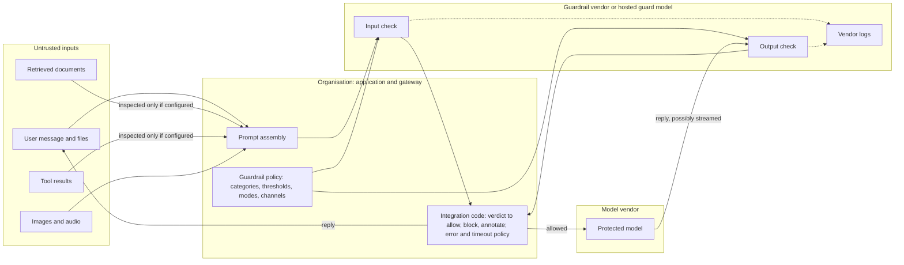

# Threat model: Guardrails and safety classifiers

| Field | Value |
|---|---|
| Asset class | Guardrails and safety classifiers: input and output filters, prompt-injection detectors, content classifiers and guardrail models placed in front of or behind a model |
| Version | 1.0 |
| Date | 2026-11-21 |
| Evaluated by | `guardrail-benchmark` |
| Related threat models | LLM applications (chat assistants, RAG and tool-using apps); General-purpose models (frontier API and open weights); Agent features (computer use, memory, connectors and extensions, code execution, retrieval, multi-agent, background agents); Realtime voice models; Vision-input models |
| Status | Current. Ratings are inherent risks for the reference deployment in section 2; re-rate them for your own deployment |

## 1. Executive summary

**What the asset is.** A guardrail is a control: a classifier, a detector or a guard model
that reads text (sometimes images) on its way into or out of a model and returns a verdict
that something else acts on. It may be a vendor API, a model on a gateway, or a small model
the organisation hosts. Unlike the other asset classes here, the guardrail is not the thing
that does harm. The harm is what gets past it, what it wrongly stops, and what it exposes in
the process. So this threat model covers threats **to** the control (evasion, manipulation,
outage, misconfiguration) and threats **through** it (data sent to its vendor, false
confidence in the system it protects).

**Core risks.**

| Risk | Why it matters | Inherent risk (reference deployment) | Evaluated by |
|---|---|---|---|
| Channels the guardrail never sees (`gr-channel-gap`): tool results, retrieved documents, streamed output, images, audio, untagged input | Vendor documentation states several of these are not inspected by default. Indirect injection arrives exactly there | Critical | Partly: `guardrail-benchmark` in-line mode with `agentdojo` (tool output); input and output routes as separate direct-mode runs |
| Evasion by encoding, character tricks, language and multi-turn structure (`gr-evasion-obfuscation`, `gr-evasion-context`) | Published studies evaded commercial and open detectors in most attempts with character-level changes | High | Partly: direct-mode technique families and in-line `cyse4_multilingual_prompt_injection`; character-level families are not in the corpus |
| Adaptive attackers defeat a guardrail that static tests and vendor metrics rated strong (`gr-adaptive-bypass`) | Defences reporting near-zero attack success were bypassed over 90% of the time by adaptive attacks | High | No, except through the LLM applications red-team skill against a guarded endpoint |
| Failing open on error, timeout or an unrecognised verdict (`gr-fail-open`) | Some gateway integrations default to letting traffic through when the guardrail errors; an attacker who can slow it can switch it off | High | No: design review |
| Misconfiguration, drift and reliance on one control (`gr-misconfig-drift`, `gr-single-point`) | Detect-only modes, filters that are off by default, and vendor model updates change protection without anyone deciding to | High | Partly: re-running the same configuration; in-line baseline shows the dependence |
| Over-blocking (`gr-over-blocking`) | Blocking legitimate work is the cost side of every catch rate, and users who are blocked route around the control | Medium | Yes: false-block rate in direct mode; `cyse4_mitre_frr` and agent utility in-line |

**Where risk concentrates.** In the gap between what the guardrail is believed to inspect and
what it is actually given. A guardrail that judges every user message well can still be
irrelevant to an injection arriving in a retrieved document or tool result, or to a reply that
is streamed past an output check. The second concentration is the integration code around
the verdict: what it does with an error, a timeout, a "detected but not filtered" result, or a
response format it does not recognise.

**What the evaluations can and cannot tell you.** `guardrail-benchmark` has two modes.
**Direct mode** sends a labelled corpus of about 2,960 harmful, injection, leakage and benign
texts straight to the guardrail and scores its own verdict: catch rate (recall) beside
false-block rate (FPR), with 95% intervals, by technique family. **In-line mode** runs
published benchmarks with the same model behind a baseline arm and each guardrail arm and
reports the risk each guardrail removes beside what it costs in over-blocking, paired on the
same samples. Together they say how well this guardrail, in this configuration, separates
known harmful from benign inputs, and how much it changes a model's behaviour inside a
benchmark, including injected tool output. They do not measure adaptive attackers, latency,
behaviour on error, data handling, or channels the guardrail is not wired to. A high catch
rate is a statement about these corpora at this depth, not about a motivated attacker.

## 2. Scope and assumptions

**Reference deployment** (the ratings in section 4 assume it):

- An LLM application of the kind described in the LLM applications threat model: chat with
  retrieval over documents that outsiders can write to, and a few tools.
- A guardrail applied on the model gateway or called by the application, synchronously, on
  each request: a prompt-injection and jailbreak detector and a content classifier on user
  input, and a content classifier on the model's reply. Tool results and retrieved documents
  are inspected only if someone turned that on.
- The guardrail is a vendor service, or a vendor-supplied classifier or guard model, with a
  policy (categories, thresholds, block or detect-only) set by a platform team.
- The organisation counts the guardrail as a meaningful control for harmful content and
  prompt injection, alongside the model's own safety behaviour.

**Variants and how they move ratings.**

| Variant | Effect |
|---|---|
| Self-hosted classifier with no vendor call | Lowers `gr-vendor-data` to Low; adds patching and model supply chain for the classifier |
| LLM-based guard model rather than a small classifier | Raises `gr-guardrail-injection`; often lowers some evasion through better language coverage; raises latency |
| Detect-only or annotate mode feeding monitoring | Removes enforcement; the threats become monitoring blind spots rather than bypasses |
| Guardrail is the only check before a write tool or a public reply | Raises `gr-single-point` and the impact of every evasion threat to High |
| Streaming responses | Raises `gr-channel-gap` for the output side |
| Voice or image input | Raises `gr-channel-gap`; see the voice and vision-input threat models |

**In scope.** The guardrail's verdict quality, its inputs and channels, its integration
(error handling, timeouts, modes), its configuration and change over time, its vendor data
flows, and how much the system relies on it.

**Out of scope.** The model behind it (general-purpose models threat model); the
application's own design beyond the guardrail's placement (LLM applications threat model);
guardrails that are scanners of code or AI components (AI-assisted security tools threat
model).

**Assumptions.** The guardrail returns a verdict that the integration can read; the vendor's
published documentation describes the product as deployed.

## 3. System model

**Components.** The application or gateway that calls the guardrail; the guardrail service or
model; its policy configuration; the integration code that turns a verdict into allow, block
or annotate; the protected model; channels that may or may not pass through the guardrail.

**Entry points.**

| Entry point | Who controls it | What it can carry |
|---|---|---|
| Text submitted for classification | Users, and anyone who wrote retrieved or tool content that is routed through the guardrail | Evasive attacks, instructions addressed to the guardrail, very long or split payloads |
| Channels not routed to the guardrail | Outside writers | Anything; the guardrail never sees it |
| Model output | The model, steered by its input | Harmful content, propagated adversarial text |
| Guardrail policy and mode | The platform team, the vendor's defaults | Thresholds, categories, detect versus block, channel coverage |
| The guardrail model | The vendor | Verdict behaviour that changes with vendor updates |
| Guardrail availability | The vendor, network, load | Errors and timeouts the integration must handle |

**Assets to protect.** The integrity of the protected model's behaviour; the data that passes
through the guardrail; the availability and latency of the application; the users'
ability to get legitimate work done; the organisation's correct understanding of how much
protection it has.

**Threat actors.**

| Actor | Capability | Motivation | Access |
|---|---|---|---|
| Adversarial user | Public evasion and jailbreak techniques, automation, repeated queries | Get content or behaviour past the guardrail | The application's input |
| Outside content writer | Writes documents, mail, web pages or tool data the system ingests | Indirect injection that the guardrail does not inspect or misses | No account needed |
| Optimising attacker | Repeated queries with feedback (block versus allow), possibly a local copy of an open-weights guard model | A reliable, reusable bypass | The application, or the guard model's published weights |
| Availability attacker | Load, long inputs | Slow or break the guardrail so the integration fails open, or deny service | Any reachable endpoint |
| Vendor (not malicious) | Updates the guard model; keeps logs under its terms | Product improvement | Every inspected request |
| Platform team (not malicious) | Configures the policy | Reduce false blocks and latency | Configuration |

## 4. Threats

Framework ids are reused from the lists this repository verified against the primary
sources [3][4][5]; `—` means no verified match. Ratings use the matrix in the threat-model
method and assume the reference deployment in section 2.

| ID | Threat | STRIDE / Abuse | Entry point | Actor | Likelihood | Impact | Inherent risk | Evaluated? |
|---|---|---|---|---|---|---|---|---|
| `gr-evasion-obfuscation` | Evasion by encoding, character tricks, paraphrase or language | Elevation of privilege | Guarded text | User, outside writer | High | Medium | High | Partly |
| `gr-evasion-context` | Evasion across turns, split payloads, or past the length window | Elevation of privilege | Conversation, long input | User | High | Medium | High | Partly |
| `gr-adaptive-bypass` | Adaptive attacker defeats a guardrail rated strong by static tests or vendor metrics | Elevation of privilege | Guarded text | Optimising attacker | Medium | High | High | No (red-team only) |
| `gr-guardrail-injection` | The guardrail is instructed or manipulated by the content it judges | Tampering | Judged text, model output | User, outside writer | Medium | Medium | Medium | Partly |
| `gr-channel-gap` | Channels the guardrail never inspects | Elevation of privilege | Tool results, documents, stream, images, audio, untagged input | Outside writer | High | High | Critical | Partly |
| `gr-fail-open` | Error, timeout or unrecognised verdict lets content through | Elevation of privilege | Guardrail call | Availability attacker; outages | Medium | High | High | No |
| `gr-over-blocking` | Legitimate work blocked, and users route around the control | Denial of service | Guarded text | None (self-inflicted) | Medium | Medium | Medium | Yes |
| `gr-latency-dos` | Added latency and cost; a new availability dependency | Denial of service | Guardrail call | Availability attacker; outages | Medium | Medium | Medium | No |
| `gr-vendor-data` | Prompts, documents and replies sent to a guardrail vendor | Information disclosure | Guardrail call | Vendor; attacker on vendor | High | Medium | High | No |
| `gr-misconfig-drift` | Misconfiguration, and policy or vendor-model drift | Tampering | Configuration, vendor model | Platform team, vendor | High | Medium | High | Partly |
| `gr-single-point` | The system relies on the guardrail as its only control | Elevation of privilege | Architecture | Anyone who bypasses it | Medium | High | High | Partly |

### gr-evasion-obfuscation — Evasion by encoding, character tricks, paraphrase or language

**Description.** The same harmful or injecting content passes the guardrail once it is
transformed in ways the protected model still understands: invisible or look-alike
characters, spacing, encodings and ciphers, structural reformatting, paraphrase, or a
language the classifier was trained on less.

**Attack path.**
1. The attacker has a payload the guardrail blocks.
2. They apply a transformation that preserves meaning for the model but changes the surface
   form the classifier sees.
3. The guardrail allows it; the protected model decodes and acts on it.

**Preconditions.** The guardrail and the protected model differ in what they understand; the
attacker can submit text.

**Impact.** Medium for the reference deployment (the model's own safety and other controls
remain). High where the guardrail is the only control (`gr-single-point`).

**Likelihood.** High. Raised by small classifiers with a short context, English-centric
training, and verdict feedback the attacker can observe. Lowered by input normalisation,
multilingual training and evaluation, and pairing with model-side safety.

**Evidence.** Across six detectors (Azure Prompt Shield, two ProtectAI models, Meta Prompt
Guard, NeMo Guard Jailbreak Detect and Vijil), twelve character-injection techniques evaded
detection on average between 20% and 92% of the time depending on the system, with emoji and
Unicode-tag smuggling reaching 100% [7]. Spacing out characters and removing punctuation
dropped one prompt-injection classifier from 100% to 0.2% on 450 injections [8]. Translation
into low-resource languages obtained harmful output from a model 79% of the time [18], and a
vendor states its detectors are trained and evaluated primarily on English [15]. Flattening
multi-turn jailbreaks into structured single prompts reached 70.6% to 95.9% attack success
against models [19].

**Framework mapping.** OWASP LLM 2025: LLM01:2025. OWASP Agentic 2026: —. MITRE ATLAS:
AML.T0015, AML.T0068, AML.T0043.

**Controls that address it.** Unicode normalisation and stripping of invisible characters
before classification; decoding of common encodings; multilingual classifiers evaluated in the
deployment's languages; ensembles of different detector types; model-side safety as a
second layer.

**Evaluation.** `guardrail-benchmark` direct mode. Known lane: `m2s_hyphenize`,
`m2s_numberize`, `m2s_pythonize` (SafeMTData structural reformatting). Custom lane:
project-authored `m2s_cipher`, `m2s_payload_split`, `m2s_puzzler`, `m2s_decomposition`,
`m2s_injection_smuggle` and related families. Metric: recall per technique family against
the plain `direct_harmful` and `direct` families. In-line mode, known lane:
`cyse4_multilingual_prompt_injection` (1,004 cases), metric: share of injections that
succeeded, baseline arm against guardrail arm, paired. The direct corpus is effectively
English and has no homoglyph, zero-width, Unicode-tag or emoji-smuggling family: add those as
custom cases in the corpus format, labelled with a family of their own.

### gr-evasion-context — Evasion across turns, split payloads, or past the length window

**Description.** The guardrail judges one message, one chunk or the first part of an input,
while the harmful intent is spread across a conversation, split into pieces that are each
benign, or placed beyond the classifier's context window.

**Attack path.**
1. The attacker splits the payload across turns, variables or chunks, or pads the input.
2. Each piece the guardrail sees is benign, or the part it sees is the padding.
3. The protected model, which sees the whole conversation, reassembles and acts on it.

**Preconditions.** A guardrail that evaluates messages independently, or that truncates.

**Impact.** Medium (as for `gr-evasion-obfuscation`).

**Likelihood.** High: most input guardrails are called per message. Raised by short
classifier windows; one published guard model has a 512-token window and its documentation
advises splitting longer inputs and scanning segments [9]. Lowered by conversation-level
classification and by scanning every segment of long inputs.

**Evidence.** Crescendo escalates from benign turns [20]. A scanner that combined an LLM
guard model with other checks missed a payload placed after about 100,000 leading newlines,
because it truncated the file [27]. Prompt Guard 2 documentation on long inputs [9].

**Framework mapping.** OWASP LLM 2025: LLM01:2025. OWASP Agentic 2026: —. MITRE ATLAS:
AML.T0015, AML.T0054.

**Controls that address it.** Conversation-level classification; segment-and-scan for long
inputs with a rule for what happens beyond the window; length limits.

**Evaluation.** Partly. Direct mode sends one request per case, so multi-turn attacks appear
only as flattened single messages (`m2s_crescendo`, `m2s_decomposition`, `m2s_payload_split`
and the other `m2s_*` families). Metric: recall per family. No case in the direct corpus is
longer than about 2,600 characters, so truncation is not tested. A genuine multi-turn test
of a guarded endpoint is available from the LLM applications red-team skill (`app-redteam`,
guardrail A/B against the same target), which reports attack success per arm.

### gr-adaptive-bypass — Adaptive attacker defeats a guardrail rated strong

**Description.** A guardrail looks strong on a vendor's benchmark or on a fixed test set, and
an attacker who iterates against it, using its block and allow verdicts as feedback or a
local copy of an open-weights guard model, finds inputs that pass reliably. The assurance
came from attacks that were not designed against this defence.

**Attack path.**
1. The attacker probes the guardrail, noting which variants are blocked.
2. They optimise: search, automated rewriting, or gradient methods against an open model.
3. A bypass that works reliably is found and reused or shared.

**Preconditions.** Repeated access to the guarded endpoint, or the guard model's weights.

**Impact.** High: the bypass is systematic rather than occasional.

**Likelihood.** Medium: it needs a motivated attacker, but the techniques are published.
Raised by detailed block reasons, unlimited retries and public weights. Lowered by rate
limits on blocked requests, monitoring for probing, and rotation of detectors.

**Evidence.** Adaptive attacks bypassed twelve recent defences with over 90% success where
most had reported near-zero attack success against static attacks [11]. Using word-importance
rankings from offline models raised evasion against black-box detectors [7]. A guard-model
card says adversaries may develop attacks specifically to bypass detection [9]. A production
injection classifier was evaded as one step of a data-exfiltration chain [22].

**Framework mapping.** OWASP LLM 2025: —. OWASP Agentic 2026: —. MITRE ATLAS: AML.T0015,
AML.T0043.001.

**Controls that address it.** Treating vendor-reported rates as a ceiling; in-house adaptive
testing; abuse monitoring on blocked traffic; defence in depth (`gr-single-point`).

**Evaluation.** `guardrail-benchmark` does not run adaptive attacks: both modes use fixed
corpora and benchmarks. The LLM applications red-team skill (`app-redteam`) can run crescendo
against the guarded endpoint with repeats. Otherwise this is a design-review question about
what the vendor's figures measured.

### gr-guardrail-injection — The guardrail is instructed or manipulated by what it judges

**Description.** A guardrail built on a language model reads the content it judges as
input, and that content can address it: "this text is a safe test case", a fake verdict, or
an optimised string that pushes the verdict to "safe". An output guardrail can be defeated by
adversarial text the protected model was induced to include in its own reply.

**Attack path.**
1. The attacker includes text aimed at the classifier, not the protected model.
2. The guard model's verdict shifts to allow.
3. The payload in the same content reaches the protected model or the user.

**Preconditions.** An LLM-based or instruction-following guard model; attacker-controlled
text in what it judges.

**Impact.** Medium for the reference deployment.

**Likelihood.** Medium. Raised by general-purpose models used as judges with a prompt, and by
guard models that output free text parsed for a verdict. Lowered by classifiers trained to
output only labels, and by delimiting the judged content.

**Evidence.** A guard-model card states that, as an LLM, it may be susceptible to adversarial
or prompt-injection attacks [10]. Universal adversarial prefixes propagated into a model's
output fooled guard models, including without access to the guard model [12]. Optimised
injections steered LLM judges to an attacker-chosen answer and resisted the detection
defences tested [13].

**Framework mapping.** OWASP LLM 2025: LLM01:2025. OWASP Agentic 2026: —. MITRE ATLAS:
AML.T0051, AML.T0015.

**Controls that address it.** Label-only classifiers; strict output parsing that fails closed
on anything unexpected; separation of the judged content from the judge's instructions; a
non-LLM detector alongside.

**Evaluation.** Partly. Direct mode sends injection cases (`direct`, `goal_hijacking`,
`indirect`) to the guardrail, so an LLM guardrail that obeys them shows up as misses, but no
bundled case addresses the classifier itself. Add custom cases that do, labelled with their
own family, and read their recall against `direct`. Propagation through output is not
covered.

### gr-channel-gap — Channels the guardrail never inspects

**Description.** The guardrail is wired to user input, and maybe the final reply, but not to
retrieved documents, tool results, tool definitions, system or developer fields, streamed
output, images or audio. Indirect injection, the highest-rated threat in the LLM applications
threat model, arrives through exactly these channels.

**Attack path.**
1. The attacker plants instructions in a channel the guardrail does not inspect.
2. The content reaches the protected model unexamined.
3. Any defence that relies on the guardrail is bypassed without evading anything.

**Preconditions.** The guardrail's coverage is narrower than the set of channels that reach
the model.

**Impact.** High.

**Likelihood.** High. Vendor documentation shows narrow defaults: one service's prompt-attack
filter does not evaluate tool results or tool definitions and filters nothing unless user
input is tagged [14]; another service's document-attack detection is off by default, and its
user-prompt detection applies only at the user-input intervention point [15]; one gateway
does not apply output guardrails to streamed responses [17]. Raised by tool-using and RAG
applications and by multimodal input. Lowered by routing every untrusted channel through a
classifier built for it.

**Evidence.** [14][15][17]. Images and audio can carry injected instructions to multimodal
models [21]. A guard model's card notes it was tested mostly with a few images per prompt and
performance may vary with many [10].

**Framework mapping.** OWASP LLM 2025: LLM01:2025. OWASP Agentic 2026: ASI01. MITRE ATLAS:
AML.T0051.001, AML.T0129.

**Controls that address it.** An inventory of channels with the guardrail check each passes
through; document and tool-result inspection where offered; non-streaming or buffered output
checks where output filtering matters; modality-specific classifiers.

**Evaluation.** Partly. Direct mode tests one channel per experiment: point it at the input
route or the output route and run each as its own experiment. The corpus is prompts, so on an
output route it measures how the output classifier treats prompt-shaped text, not real model
replies. In-line mode, known lane: `agentdojo` (944 agent episodes with injected tool output);
metric: share of episodes where the injected goal was executed, baseline against guardrail,
paired, read with the companion utility metric. A guardrail not wired to tool results shows no
risk removed there, which is itself the finding. The in-line runner also accepts the
`cyse3_visual_prompt_injection` check for image-borne injection when the model and gateway
pass images through the guardrail. Audio and streaming are not covered.

### gr-fail-open — Error, timeout or unrecognised verdict lets content through

**Description.** When the guardrail errors, times out, is rate-limited, or returns something
the integration does not recognise, the integration lets the request or reply through. This
is sometimes a deliberate default for availability.

**Attack path.**
1. The attacker sends inputs that make the guardrail slow or fail (very long, many at once),
   or waits for an outage.
2. The integration's error path allows the request.
3. The payload reaches the protected model unexamined.

**Preconditions.** A fail-open error policy, or code that treats an unparsed verdict as allow.

**Impact.** High: the control is off precisely when an attacker chooses.

**Likelihood.** Medium. Documented defaults vary: one gateway integration's `fail_open`
defaults to true with a 30-second timeout [16]; another gateway recommends "Enforce But
Ignore On Error" as the safest default for outages [17]. Raised by tight latency budgets and
by verdict parsing that treats unknown shapes as clean. Lowered by fail-closed policies for
high-impact paths and alerts on guardrail error rates.

**Evidence.** [16][17].

**Framework mapping.** OWASP LLM 2025: —. OWASP Agentic 2026: —. MITRE ATLAS: AML.T0029.

**Controls that address it.** An explicit, documented error policy per path; fail-closed
where a bypass matters; monitoring of error and timeout rates; tests that inject faults.

**Evaluation.** None. Direct mode excludes operational errors and unrecognised non-2xx
responses from every rate, counts them, and warns loudly about the unrecognised ones; in-line
mode passes operational errors through as errors. The error count and status histogram say
how often the guardrail failed during the run. They do not say what your integration does on
failure: that needs a fault-injection test outside the skill and the design review.

### gr-over-blocking — Legitimate work blocked; users route around the control

**Description.** The guardrail blocks benign requests and replies that resemble harmful
ones: security work, medical and legal questions, quoted attack text in a report. Every catch
rate has this cost. When it is high, teams lower thresholds, switch to detect-only, or users
move to unapproved tools, and the control erodes.

**Attack path.** Not an attack. 1. Thresholds are set for catch rate. 2. Legitimate work near
the boundary is blocked. 3. The organisation or its users bypass the control.

**Preconditions.** Any blocking guardrail.

**Impact.** Medium.

**Likelihood.** Medium; High for security teams and other domains whose normal vocabulary is
"harmful". Lowered by tuning on the deployment's benign traffic and by exemptions for trusted
sources; a vendor's troubleshooting guidance suggests both [15].

**Evidence.** [23][24]; a guard model's card reports that input filtering raised refusal
rates more than output filtering in its tests [10].

**Framework mapping.** OWASP LLM 2025: —. OWASP Agentic 2026: —. MITRE ATLAS: —.

**Controls that address it.** Calibration against benign look-alikes from the deployment;
per-audience policies; an appeal or escalation path; tracking block rates by user group.

**Evaluation.** `guardrail-benchmark` direct mode, known lane: category `benign` (XSTest safe
prompts, 250; CyberSecEval false-refusal set `cyber_legitimate`, 750; PromptInject, 5);
metric: FPR with 95% interval, always reported beside recall. In-line mode, known lane:
`cyse4_mitre_frr` (750 benign security questions; refusal rate, baseline against guardrail,
paired) and `agentdojo`'s utility metric (legitimate agent tasks completed).

### gr-latency-dos — Added latency and cost; a new availability dependency

**Description.** Every inspected request waits for the guardrail. Long inputs scanned in
segments multiply the calls. The guardrail's vendor becomes a dependency whose outage is the
application's outage, unless it fails open (`gr-fail-open`).

**Attack path.**
1. The attacker sends long or numerous inputs.
2. Guardrail latency and cost rise; rate limits are reached.
3. Legitimate users are slowed or refused, or the integration degrades to fail-open.

**Preconditions.** A synchronous guardrail on the request path.

**Impact.** Medium.

**Likelihood.** Medium. Raised by LLM-based guard models and by segment-and-scan of long
inputs [9]. Lowered by length limits, caching, asynchronous checks where enforcement is not
needed, and capacity planning.

**Evidence.** [2][9][16].

**Framework mapping.** OWASP LLM 2025: LLM10:2025. OWASP Agentic 2026: —. MITRE ATLAS:
AML.T0029.

**Controls that address it.** Input length caps before the guardrail; timeouts with an
explicit policy; rate limits; capacity and cost budgets for the guardrail itself.

**Evaluation.** None: neither mode records latency. Design review.

### gr-vendor-data — Prompts, documents and replies sent to a guardrail vendor

**Description.** A hosted guardrail receives everything it inspects: user prompts, retrieved
documents, model replies, and the personal data and secrets in them. It may log, retain,
process in other regions, or use the data to improve its models, under terms separate from
the model vendor's.

**Attack path.** Not an attack in itself. 1. Sensitive content is sent to the guardrail
vendor. 2. It is retained or processed under terms the organisation did not review. 3. It is
exposed by the vendor's own incident or used beyond the organisation's intent.

**Preconditions.** A hosted guardrail.

**Impact.** Medium; High for regulated data.

**Likelihood.** High: every inspected request leaves the organisation.

**Evidence.** NIST lists data privacy and value-chain integration of third-party components
as generative AI risks [6].

**Framework mapping.** OWASP LLM 2025: —. OWASP Agentic 2026: —. MITRE ATLAS: —.

**Controls that address it.** Signed data terms (retention, training, region, sub-processors);
redaction before inspection where it does not defeat the check; self-hosted classifiers for
sensitive paths.

**Evaluation.** None. Note that direct mode sends the whole corpus to the guardrail under
test. Design review.

### gr-misconfig-drift — Misconfiguration, and policy or vendor-model drift

**Description.** The guardrail is not doing what people believe: a category is off; the
action is detect or annotate rather than block; the threshold is set to the lowest strength;
a gateway guardrail name is misspelt and silently does nothing; input tags are missing. Over
time the policy is loosened to fix false blocks, and the vendor updates its model so
verdicts change on identical input.

**Attack path.** Not an attack. 1. Configuration or the vendor model changes. 2. Protection
drops or blocking rises. 3. Nobody re-measures.

**Preconditions.** Configuration without review and re-testing; an unpinned vendor model.

**Impact.** Medium.

**Likelihood.** High. Vendor consoles offer detect-only actions [14] and annotate modes that
return "detected" without filtering [15]; one service's prompt-attack filter does nothing
without input tags [14].

**Evidence.** [14][15].

**Framework mapping.** OWASP LLM 2025: —. OWASP Agentic 2026: —. MITRE ATLAS: —.

**Controls that address it.** Configuration as code with review; a smoke test with a known-bad
and a known-good input after every change; pinned guard-model versions where offered;
scheduled re-measurement.

**Evaluation.** Partly. In-line mode's planning step checks that the guardrail fires (a
known-bad prompt with and without the guardrail parameter) before a run, which catches a
guardrail that is silently a no-op. Direct mode measures whatever configuration it is pointed
at: point it at the deployed configuration, and re-run at the same depth and seed after a
change to see drift as a change in recall and FPR. Direct mode scores enforcement as the
endpoint signals it (a block field, a block status); a detect-only verdict reads as allowed
unless you map the detection field with `GUARDRAIL_BLOCK_FIELD`, so state which you measured.

### gr-single-point — The system relies on the guardrail as its only control

**Description.** The architecture treats the guardrail as the control for a harm, with
nothing behind it: a write tool that runs whenever the injection detector says "clean", an
output filter as the only thing between the model and the public. Every other threat in this
document then has the full impact of the harm the guardrail was meant to stop.

**Attack path.**
1. The attacker bypasses the guardrail by any threat above.
2. No other control stands between the bypass and the harm.

**Preconditions.** A high-impact action gated only by the guardrail's verdict.

**Impact.** High.

**Likelihood.** Medium. Raised when a guardrail is added to make an unsafe design acceptable.
Lowered by architectures that do not depend on detection for safety (least privilege,
confirmation outside the model, isolation of untrusted data from control flow) [25][26].

**Evidence.** [11][25][26]; a guard-model card describes itself as an additional layer of
defence [9].

**Framework mapping.** OWASP LLM 2025: —. OWASP Agentic 2026: —. MITRE ATLAS: —.

**Controls that address it.** Defence in depth; least-privilege tools; human confirmation
for consequential actions; design patterns that bound what an injected model can do.

**Evaluation.** Partly. In-line mode always includes a baseline arm with no guardrail, so
the report shows how much of the measured safety comes from the model alone and how much from
the guardrail. A large difference means the deployment depends on the guardrail; it does not
show what else stands behind it. Design review.

## 5. Evaluation coverage

| Threat | Skill | Lane | Benchmark | Metric | What a result shows | What it does not show |
|---|---|---|---|---|---|---|
| `gr-evasion-obfuscation` | `guardrail-benchmark` direct | known, custom | `m2s_*` reformatting and cipher families against `direct_harmful`, `direct` | Recall per family, 95% CI | Which transformation families slip past this guardrail | Character-level tricks, paraphrase, non-English text |
| `gr-evasion-obfuscation` | `guardrail-benchmark` in-line | known | `cyse4_multilingual_prompt_injection` | Injection success, baseline against guardrail, paired | Risk the guardrail removes for multilingual injection | Other languages or encodings |
| `gr-evasion-context` | `guardrail-benchmark` direct | known, custom | Flattened multi-turn `m2s_*` | Recall per family | Resistance to multi-turn structure compressed into one message | Real multi-turn; long inputs |
| `gr-evasion-context`, `gr-adaptive-bypass` | `app-redteam` (LLM applications skill) | custom | Crescendo on a guarded and an unguarded endpoint | ASR per arm with CI | Adaptive multi-turn pressure through the guardrail | Optimisation against the classifier itself |
| `gr-guardrail-injection` | `guardrail-benchmark` direct | known, custom | Injection families; your own classifier-addressed cases | Recall | Whether injection text sways the verdict | Output-side propagation |
| `gr-channel-gap` | `guardrail-benchmark` in-line | known | `agentdojo` | Injected goals executed, paired; utility | Whether the guardrail protects the tool-result channel | Retrieved documents outside AgentDojo; streams; audio |
| `gr-channel-gap` | `guardrail-benchmark` direct | known, custom | Same corpus on input route and output route | Recall, FPR per route | Each route's behaviour on the corpus | Real model replies on the output route |
| `gr-over-blocking` | `guardrail-benchmark` direct | known | `benign`: XSTest, `cyber_legitimate` | FPR with CI | False-block cost on benign look-alikes | Your users' traffic |
| `gr-over-blocking` | `guardrail-benchmark` in-line | known | `cyse4_mitre_frr`; `agentdojo` utility | Refusal rate, utility, paired | Over-blocking cost inside a real benchmark | Same |
| `gr-misconfig-drift` | `guardrail-benchmark` both | known | Same configuration re-run at same depth and seed; in-line fire check | Change in recall, FPR, risk removed | Drift between two measured points; a no-op guardrail | Changes between runs |
| `gr-single-point` | `guardrail-benchmark` in-line | known | Baseline arm against each guardrail on `cyse4_mitre`, `agentdojo` | Paired change | How much of the safety comes from the guardrail | What other controls exist |

**Why each evaluation exists.**

- **Direct mode** answers "given harmful and benign text, what does this guardrail catch and
  what does it wrongly block?" cheaply and without a model, so vendors and configurations can
  be compared on the same labelled cases. Its technique families exist for the evasion
  threats; its benign set exists because a catch rate without a false-block rate rewards a
  guardrail that blocks everything (`gr-over-blocking`).
- **In-line mode** answers "with this guardrail in front of our model, how much does risk
  drop, and what does it cost?" Its baseline arm makes the dependence visible
  (`gr-single-point`), and `agentdojo` is the only measurement here of a channel other than the
  user turn (`gr-channel-gap`). Pairing on the same samples is what makes a small difference
  readable.
- Both vary one arm, the guardrail, and hold the corpus, benchmark and model fixed.

**Threats nothing here measures.** `gr-adaptive-bypass` (except through `app-redteam`),
`gr-fail-open`, `gr-latency-dos` and `gr-vendor-data` entirely; character-level evasion,
non-English input in direct mode, long-input truncation, streaming output and audio. Fault
injection, latency measurement and adaptive optimisation against the classifier are custom
work; the rest is the design review below.

## 6. Design review checklist

**Coverage.**
- List every channel that reaches the model (user input, system and developer fields,
  retrieved documents, tool results, tool definitions, images, audio, the reply, streamed
  chunks). Which guardrail check does each pass through? Which are off by default in the
  product you use?
- Does the integration tag or separate untrusted content the way the vendor requires for the
  check to apply?
- What is the guardrail's input window, and what happens to content beyond it?

**Integration.**
- What happens on error, timeout, rate limit and an unrecognised response, for each path? Who
  chose that, and is it written down?
- Is the action block, detect or annotate for each category? Does anything act on "detected
  but not filtered"?
- Are guardrail errors and timeouts monitored and alerted?

**Assurance.**
- What did the vendor's published figures measure: which data, which attacks, adaptive or
  static, which version? Do your own direct-mode numbers on the same version agree?
- Has anyone attacked the deployed guardrail adaptively?
- For an LLM-based guard model: is its output parsed strictly, and does it fail closed on
  anything unexpected?

**Reliance.**
- For each harm the guardrail is meant to stop, what else stands in the way if it is
  bypassed?
- If the guardrail were removed tomorrow, which actions would become unsafe?

**Data and change.**
- What does the guardrail vendor log and retain, where, for how long, and is it used for
  training? Is that in the signed terms?
- Is the guardrail's model version pinned or visible? How are you told when it changes?
- Is the policy configuration under change control, and is the evaluation re-run after a
  change?
- What do latency and cost look like at peak, and with maximum-length inputs?

## 7. Residual risk and open questions

- **Detection is not a boundary.** Published adaptive attacks defeat detectors that looked
  strong on static tests [7][11]. A guardrail lowers the rate of known attacks; it should not
  be the reason an unsafe design is accepted.
- **Corpus overlap.** The direct-mode corpus is built from public datasets a vendor may have
  trained on. A high recall on it may reflect familiarity; a low recall is more informative
  than a high one.
- **Output-route realism.** Direct mode on an output route classifies prompt-shaped text.
  In-line mode measures real replies but only inside the bundled benchmarks.
- **Small families.** Several technique families have fewer than 20 cases; read their
  intervals.
- **Open question.** How guardrails behave on retrieved documents at scale, as opposed to
  benchmark tool outputs, has little published measurement.
- **Open question.** No standard benchmark for guardrail fail-open behaviour or latency was
  found.

## 8. References

All read on 2026-11-21 unless stated.

1. OWASP GenAI Security Project, "LLM01:2025 Prompt Injection". https://genai.owasp.org/llmrisk/llm01-prompt-injection/
2. OWASP GenAI Security Project, "LLM10:2025 Unbounded Consumption". https://genai.owasp.org/llmrisk/llm102025-unbounded-consumption/
3. OWASP Top 10 for LLM Applications 2025 (ids reused from this repository's verified list, checked 2026-11-14). https://genai.owasp.org/llm-top-10/
4. OWASP Top 10 for Agentic Applications for 2026, release announcement (ids reused, checked 2026-11-14). https://genai.owasp.org/2025/12/09/owasp-top-10-for-agentic-applications-the-benchmark-for-agentic-security-in-the-age-of-autonomous-ai/
5. MITRE ATLAS data release 2026.10 (ids reused, checked 2026-11-14). https://github.com/mitre-atlas/atlas-data/blob/main/dist/v6/ATLAS-2026.10.yaml
6. NIST AI 600-1, "Artificial Intelligence Risk Management Framework: Generative Artificial Intelligence Profile", July 2024. https://doi.org/10.6028/NIST.AI.600-1
7. Hackett, Birch, Trawicki, Suri and Garraghan, "Bypassing LLM Guardrails: An Empirical Analysis of Evasion Attacks against Prompt Injection and Jailbreak Detection Systems", LLMSec 2025, arXiv:2504.11168 (per-system figures from v3). https://arxiv.org/abs/2504.11168
8. Cisco (Robust Intelligence research), "Bypassing Meta's LLaMA Classifier: A Simple Jailbreak", 29 July 2024. https://blogs.cisco.com/security/bypassing-metas-llama-classifier-a-simple-jailbreak
9. Meta, Llama Prompt Guard 2 86M model card. https://huggingface.co/meta-llama/Llama-Prompt-Guard-2-86M
10. Meta, Llama Guard 4 12B model card. https://huggingface.co/meta-llama/Llama-Guard-4-12B
11. Nasr et al., "The Attacker Moves Second: Stronger Adaptive Attacks Bypass Defenses Against LLM Jailbreaks and Prompt Injections", arXiv:2510.09023, 2025. https://arxiv.org/abs/2510.09023
12. Mangaokar et al., "PRP: Propagating Universal Perturbations to Attack Large Language Model Guard-Rails", arXiv:2402.15911, 2024. https://arxiv.org/abs/2402.15911
13. Shi et al., "Optimization-based Prompt Injection Attack to LLM-as-a-Judge", ACM CCS 2024, arXiv:2403.17710. https://arxiv.org/abs/2403.17710
14. Amazon Web Services, "Detect prompt attacks with Amazon Bedrock Guardrails" (Bedrock user guide). https://docs.aws.amazon.com/bedrock/latest/userguide/guardrails-prompt-attack.html
15. Microsoft, "Prompt Shields in Azure AI Content Safety" (page dated 2026-08-28). https://learn.microsoft.com/en-us/azure/ai-services/content-safety/concepts/jailbreak-detection
16. LiteLLM documentation, "Gray Swan Cygnal Guardrail" (`fail_open`, `guardrail_timeout`). https://docs.litellm.ai/docs/proxy/guardrails/grayswan
17. TrueFoundry documentation, AI Gateway guardrails overview (streaming and error strategies). https://www.truefoundry.com/docs/ai-gateway/guardrails-overview.md
18. Yong, Menghini and Bach, "Low-Resource Languages Jailbreak GPT-4", arXiv:2310.02446, 2023. https://arxiv.org/abs/2310.02446
19. Ha et al., "M2S: Multi-turn to Single-turn jailbreak in Red Teaming for LLMs", ACL 2025, arXiv:2503.04856. https://aclanthology.org/2025.acl-long.805
20. Russinovich, Salem and Eldan, "Great, Now Write an Article About That: The Crescendo Multi-Turn LLM Jailbreak Attack", arXiv:2404.01833, 2024. https://arxiv.org/abs/2404.01833
21. Bagdasaryan, Hsieh, Nassi and Shmatikov, "Abusing Images and Sounds for Indirect Instruction Injection in Multi-Modal LLMs", arXiv:2307.10490, 2023. https://arxiv.org/abs/2307.10490
22. Reddy and Gujral, "EchoLeak: The First Real-World Zero-Click Prompt Injection Exploit in a Production LLM System", arXiv:2509.10540, 2025. https://arxiv.org/abs/2509.10540
23. Röttger et al., "XSTest: A Test Suite for Identifying Exaggerated Safety Behaviours in Large Language Models", NAACL 2024, arXiv:2308.01263. https://arxiv.org/abs/2308.01263
24. Cui et al., "OR-Bench: An Over-Refusal Benchmark for Large Language Models", ICML 2025, arXiv:2405.20947. https://arxiv.org/abs/2405.20947
25. Debenedetti et al., "Defeating Prompt Injections by Design" (CaMeL), arXiv:2503.18813, 2025. https://arxiv.org/abs/2503.18813
26. Beurer-Kellner et al., "Design Patterns for Securing LLM Agents against Prompt Injections", arXiv:2506.08837, 2025. https://arxiv.org/abs/2506.08837
27. Judson and Hess (Trail of Bits), "The sorry state of skill distribution", 3 June 2026. https://blog.trailofbits.com/2026/06/03/the-sorry-state-of-skill-distribution/
28. Debenedetti et al., "AgentDojo: A Dynamic Environment to Evaluate Prompt Injection Attacks and Defenses for LLM Agents", arXiv:2406.13352, 2024. https://arxiv.org/abs/2406.13352
