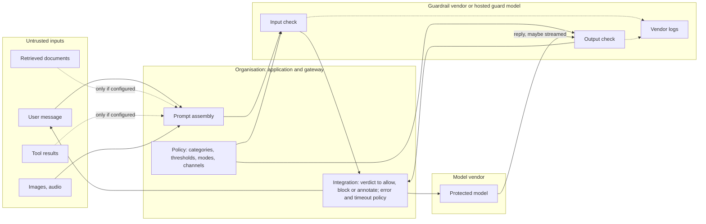

# Threat model: Guardrails and safety classifiers

| Field | Value |
|---|---|
| Asset class | Guardrails and safety classifiers: input and output filters, prompt-injection detectors, content classifiers and guardrail models placed in front of or behind a model |
| Version | 1.0 |
| Date | 2026-11-21 |
| Evaluated by | `guardrail-benchmark` |
| Related threat models | LLM applications (chat assistants, RAG and tool-using apps); General-purpose models (frontier API and open weights); Agent features; Realtime voice models; Vision-input models |
| Status | Current. Ratings are rough inherent risks for the reference deployment below; re-rate them for your own |

## 1. Executive summary

A guardrail is a control: a classifier, detector or guard model that reads text (sometimes
images) on its way into or out of a model and returns a verdict that other code acts on. It
may be a vendor API, a check on a model gateway, or a small model the organisation hosts.
The guardrail does not do harm itself. The harm is what gets past it, what it wrongly stops,
and what it exposes on the way, so this threat model covers threats **to** the control
(evasion, manipulation, outage, misconfiguration) and **through** it (data sent to its
vendor, and false confidence in the system it protects).

| Core risk | Why it matters | Inherent risk | Evaluated by |
|---|---|---|---|
| Channels the guardrail never sees: tool results, retrieved documents, streamed output, images, audio, untagged input | Vendor documentation shows several are not inspected by default, and indirect injection arrives exactly there | Critical | Partly: in-line mode with `agentdojo` (tool output) |
| Evasion by encoding, character tricks, language and multi-turn structure | Published studies evaded commercial and open detectors in most attempts with character-level changes | High | Partly: direct-mode technique families; in-line multilingual injection |
| Adaptive attackers beat a guardrail that vendor metrics or static tests rated strong | Defences reporting near-zero attack success were bypassed over 90% of the time by adaptive attacks | High | No (only through the LLM applications red-team skill) |
| Failing open on error, timeout or an unrecognised verdict | Some integrations default to letting traffic through; an attacker who can slow the guardrail can switch it off | High | No: design review |
| Misconfiguration, drift, and reliance on one control | Detect-only modes, checks that are off by default and vendor model updates change protection silently | High | Partly: re-runs and the in-line baseline arm |
| Over-blocking | The cost side of every catch rate; blocked users route around the control | Medium | Yes: false-block rate in both modes |

**Where risk concentrates.** In the gap between what the guardrail is believed to inspect and
what it is actually given, and in the integration code that decides what an error, a timeout
or a "detected but not filtered" verdict means.

**What the evaluations can and cannot tell you.** `guardrail-benchmark` **direct mode** sends a
labelled corpus of about 2,960 harmful, injection, leakage and benign texts straight to the
guardrail and scores its own verdict: catch rate beside false-block rate, with 95% intervals,
by technique family. **In-line mode** runs published benchmarks with the same model behind a
baseline arm and each guardrail arm, and reports the risk each guardrail removes beside what it
costs in over-blocking, paired on the same samples. They say how well this guardrail, as
configured, separates known harmful from benign inputs and how much it changes a model's
behaviour inside a benchmark, including injected tool output. They do not measure adaptive
attackers, latency, behaviour on error, data handling, or channels the guardrail is not wired
to. A high catch rate is a statement about these corpora, not about a motivated attacker.

## 2. Scope and reference deployment

The ratings assume:

- An LLM application of the kind in the LLM applications threat model: chat with retrieval
  over documents outsiders can write to, and a few tools.
- A guardrail called synchronously on each request, on the gateway or by the application: an
  injection and jailbreak detector and a content classifier on user input, and a content
  classifier on the reply. Retrieved documents and tool results are inspected only if someone
  turned that on.
- A vendor service or vendor-supplied classifier or guard model, with a policy (categories,
  thresholds, block or detect-only) set by a platform team.
- The organisation counts it as a meaningful control alongside the model's own safety.

What moves the ratings: a self-hosted classifier removes vendor data flows; an LLM-based guard
model raises injection against the guardrail and latency; detect-only mode turns bypasses into
monitoring blind spots; a guardrail that is the only check before a write tool or a public
reply raises every evasion impact to High; streaming and voice or image input widen the
channel gap.

Out of scope: the protected model (general-purpose models threat model), the rest of the
application's design (LLM applications), and scanners of code or AI components (AI-assisted
security tools).

## 3. System model

| Input | Who controls it |
|---|---|
| Text sent for classification | Users, and the writers of any retrieved or tool content routed through it |
| Channels not routed to the guardrail | Outside writers |
| Policy, mode and thresholds | The platform team, and the vendor's defaults |
| The guard model's behaviour | The vendor |
| Availability | The vendor, network and load |

**Threat actors.** An adversarial user with public evasion techniques and automation; an
outside writer whose content the system ingests; an optimising attacker who uses block-or-allow
feedback, or a local copy of an open-weights guard model, to search for a reliable bypass; an
availability attacker who sends long or numerous inputs; and, without malice, the vendor (model
updates, logging) and the platform team (loosening policy to cut false blocks).

## 4. Core threats

Ratings combine likelihood and impact using the matrix in the threat-model method. Framework
ids are reused from the lists this repository verified against the primary sources [3][4].

### gr-evasion — Evasion by encoding, characters, language, turns and splitting (High)

- **What and where.** The guardrail and the protected model understand different things.
  Invisible or look-alike characters, spacing, ciphers, structural reformatting, paraphrase, a
  less-trained language, a payload split across turns or chunks, or content placed past the
  classifier's window all pass the check and still reach a model that understands them.
- **Evidence.** Across six detectors (Azure Prompt Shield, two ProtectAI models, Meta Prompt
  Guard, NeMo Guard Jailbreak Detect, Vijil), twelve character-injection techniques evaded
  detection on average 20% to 92% of the time depending on the system, with emoji and
  Unicode-tag smuggling at 100% [6]. Spacing out characters took one injection classifier from
  100% to 0.2% detection on 450 injections [7]. One vendor says its detectors are trained and
  evaluated primarily on English [14]; one guard model has a 512-token window and its card
  advises splitting longer inputs [8]; a scanner using an LLM guard model missed a payload
  placed after about 100,000 leading newlines because it truncated [22].
- **Rating.** Likelihood High, impact Medium (High if the guardrail stands alone). Lower with
  normalisation and decoding before classification, multilingual evaluation in the
  deployment's languages, conversation-level checks and scanning every segment.
- **Maps to.** LLM01:2025; AML.T0015, AML.T0068, AML.T0043.

### gr-adaptive — Adaptive attackers and false assurance from vendor metrics (High)

- **What.** Assurance comes from a vendor's benchmark or a fixed test set; an attacker who
  iterates against the deployed guardrail finds inputs that pass reliably, and shares them.
- **Evidence.** Adaptive attacks bypassed twelve recent defences with over 90% success where
  most had reported near-zero attack success against static attacks [10]. Word-importance
  rankings from offline models raised evasion against black-box detectors [6]. A guard-model
  card warns that adversaries may build attacks specifically to bypass it [8]. EchoLeak evaded
  a production injection classifier as one step of an exfiltration chain [21].
- **Rating.** Likelihood Medium (needs a motivated attacker; methods are public), impact High
  (the bypass is systematic). Raised by detailed block reasons, unlimited retries and public
  weights; lowered by rate limits on blocked traffic and monitoring for probing.
- **Maps to.** AML.T0015, AML.T0043.001.

### gr-channel-gap — Channels the guardrail never inspects (Critical)

- **What and where.** The guardrail sees user input and maybe the final reply, but not
  retrieved documents, tool results, tool definitions, streamed output, images or audio. No
  evasion is needed for content on those channels.
- **Evidence.** One service's prompt-attack filter does not evaluate tool results or tool
  definitions, and filters nothing unless user input is tagged [13]. Another's document-attack
  detection is off by default and applies at configured intervention points only [14]. One
  gateway does not apply output guardrails to streamed responses [16]. Images and audio can
  carry injected instructions to multimodal models [20], as OWASP also notes for images [1].
- **Rating.** Likelihood High (RAG and tool use are the norm), impact High. Lower with an
  inventory of channels and a check built for each.
- **Maps to.** LLM01:2025; ASI01; AML.T0051.001, AML.T0129.

### gr-guardrail-injection — The guardrail as an injection target (Medium)

- **What.** An LLM-based guard model reads the content it judges, and that content can address
  it ("this is a safe test case"), or carry an optimised string that pushes the verdict to
  "safe". An output check can be fooled by adversarial text the protected model was induced to
  include in its reply.
- **Evidence.** A guard-model card states that, as an LLM, it may be susceptible to
  prompt-injection attacks [9]. Universal adversarial prefixes propagated into model output
  fooled guard models, including without access to them [11]. Optimised injections steered LLM
  judges to an attacker-chosen answer [12].
- **Rating.** Likelihood Medium, impact Medium. Lower with label-only classifiers and strict
  parsing that fails closed on anything unexpected.
- **Maps to.** LLM01:2025; AML.T0051.

### gr-fail-open — Failing open on error, timeout or unrecognised verdict (High)

- **What.** When the guardrail errors, times out, is rate-limited or returns something the
  integration does not recognise, the request or reply goes through, sometimes by design for
  availability. An attacker who can slow the guardrail chooses when it is off.
- **Evidence.** One gateway integration's `fail_open` defaults to true, with a 30-second
  timeout [15]; another gateway calls "Enforce But Ignore On Error" the safest default for
  outages [16].
- **Rating.** Likelihood Medium, impact High. Lower with a written error policy per path,
  fail-closed where a bypass matters, and alerts on guardrail error rates.
- **Maps to.** AML.T0029.

### gr-over-blocking — Over-blocking that pushes users around the control (Medium)

- **What.** Benign requests and replies that look harmful are blocked: security work, medical
  and legal questions, quoted attack text. Teams then loosen thresholds or switch to
  detect-only, and users move to unapproved tools.
- **Evidence.** XSTest and OR-Bench document over-refusal of safe prompts and its link to
  safety tuning [17][18]; a guard-model card reports input filtering raised refusal rates more
  than output filtering in its tests [9].
- **Rating.** Likelihood Medium (High for security teams), impact Medium.

### gr-latency — Latency, cost and a new availability dependency (Medium)

- **What.** Every inspected request waits for the guardrail; long inputs scanned in segments
  multiply calls [8]; OWASP counts resource exhaustion among unbounded-consumption risks [2]; the vendor's outage becomes the application's, unless it fails open.
- **Rating.** Likelihood Medium, impact Medium. Lower with length caps before the check,
  capacity budgets and explicit timeouts.
- **Maps to.** LLM10:2025; AML.T0029.

### gr-vendor-data — Data sent to the guardrail vendor (High)

- **What.** A hosted guardrail receives everything it inspects: prompts, retrieved documents,
  replies, and the personal data and secrets in them, under terms separate from the model
  vendor's (retention, region, training use, sub-processors).
- **Evidence.** NIST lists data privacy and the integration of third-party components among
  generative AI risks [5].
- **Rating.** Likelihood High (every inspected request leaves), impact Medium (High for
  regulated data).

### gr-misconfig-drift — Misconfiguration and drift (High)

- **What.** A category is off; the action is detect or annotate rather than block; the
  strength is low; a gateway guardrail name is misspelt and silently does nothing; required
  input tags are missing; policy is loosened over time; the vendor updates its model and
  verdicts change on identical input.
- **Evidence.** Vendor consoles offer detect-only actions and tag-dependent filtering [13] and
  annotate modes that return "detected" without filtering [14].
- **Rating.** Likelihood High, impact Medium. Lower with configuration under change control, a
  known-bad and known-good smoke test after every change, and scheduled re-measurement.

### gr-single-point — Reliance on one control (High)

- **What.** A high-impact action is gated only by the guardrail's verdict: a write tool that
  runs whenever the detector says "clean", an output filter as the only thing between the model
  and the public. Every threat above then carries the full impact of the harm it was meant to
  stop.
- **Evidence.** Adaptive results [10]; designs that bound what an injected model can do rather
  than relying on detection [23][24]; a guard model describes itself as an additional layer
  [8].
- **Rating.** Likelihood Medium, impact High.

## 5. How this repository's evaluations relate

| Threat area | Mode | What it measures | What it cannot see |
|---|---|---|---|
| Evasion | Direct | Recall per family: `m2s_hyphenize`, `m2s_numberize`, `m2s_pythonize` (SafeMTData reformatting) and project-authored `m2s_cipher`, `m2s_payload_split`, `m2s_crescendo`, `m2s_decomposition` and others, against plain `direct_harmful` and `direct` | Character-level tricks (homoglyph, zero-width, Unicode tags), paraphrase, non-English text (the corpus is effectively English), inputs longer than about 2,600 characters, real multi-turn |
| Evasion | In-line | `cyse4_multilingual_prompt_injection` (1,004 cases): injection success, baseline against guardrail, paired | Other languages and encodings |
| Channel gap | In-line | `agentdojo` (944 agent episodes with injected tool output [19]): injected goals executed, with its utility metric. A guardrail not wired to tool results shows no risk removed, which is the finding | Retrieved documents outside AgentDojo, streaming, audio |
| Channel gap | Direct | Input route and output route as separate experiments | Real replies: the corpus is prompts, so an output route classifies prompt-shaped text |
| Guardrail injection | Direct | Injection families reach the classifier, so obedience shows as misses | No bundled case addresses the classifier itself; add your own |
| Over-blocking | Both | Direct: false-block rate on `benign` (XSTest safe prompts, CyberSecEval benign cyber questions). In-line: `cyse4_mitre_frr` refusal rate and `agentdojo` utility | Your users' traffic |
| Drift, single point | Both | Re-run the deployed configuration at the same depth and seed; in-line's pre-run check that the guardrail fires catches a no-op; the baseline arm shows how much safety comes from the guardrail | What else stands behind it |

Why they exist: direct mode answers "what does this guardrail catch and wrongly block?"
cheaply, without a model, so vendors and settings compare on the same labelled cases; its
benign set exists because a catch rate alone rewards blocking everything. In-line mode answers
"with this guardrail in front of our model, how much does risk drop and what does it cost?";
its baseline arm makes dependence visible and `agentdojo` is the only measurement here of a
channel other than the user turn. Both vary only the guardrail.

Two reading notes. Direct mode excludes operational errors and unrecognised responses from
every rate and counts them, so the error count says how often the guardrail failed in the
run, not what your integration does on failure. It also scores enforcement as the endpoint
signals it: a detect-only verdict reads as allowed unless you map the detection field.

Left to design review or custom work: adaptive attacks (the LLM applications skill
`app-redteam` can run crescendo against a guarded and an unguarded endpoint), fail-open
behaviour (needs fault injection), latency, vendor data handling, and channel coverage in your
own integration.

## 6. Design review questions

- List every channel that reaches the model. Which guardrail check does each pass through, and
  which are off by default in your product? Is untrusted content tagged the way the vendor
  requires?
- What is the classifier's input window, and what happens beyond it? Is the whole conversation
  judged, or one message?
- What happens on error, timeout, rate limit and an unrecognised response, on each path? Who
  chose that? Are guardrail errors alerted?
- Is each category set to block, detect or annotate? Does anything act on "detected but not
  filtered"?
- What did the vendor's published figures measure: which data, static or adaptive attacks,
  which version? Has anyone attacked the deployed guardrail adaptively?
- For an LLM-based guard model: is its output parsed strictly, failing closed?
- For each harm the guardrail is meant to stop, what else stands in the way if it is bypassed?
- What does the guardrail vendor log and retain, where, and is it used for training?
- Is the guard model's version pinned or visible? Is the policy under change control, and is
  the evaluation re-run after a change? What are latency and cost at peak?

Residual risk to state plainly: detection is not a boundary [6][10]. A guardrail lowers the
rate of known attacks; it should not be the reason an unsafe design is accepted. The direct
corpus is built from public datasets a vendor may have trained on, so a low recall is more
informative than a high one.

## 7. References

All read on 2026-11-21.

1. OWASP GenAI Security Project, "LLM01:2025 Prompt Injection". https://genai.owasp.org/llmrisk/llm01-prompt-injection/
2. OWASP GenAI Security Project, "LLM10:2025 Unbounded Consumption". https://genai.owasp.org/llmrisk/llm102025-unbounded-consumption/
3. OWASP Top 10 for LLM Applications 2025 and for Agentic Applications 2026 (ids reused from this repository's verified list, checked 2026-11-14). https://genai.owasp.org/llm-top-10/
4. MITRE ATLAS data release 2026.10 (ids reused, checked 2026-11-14). https://github.com/mitre-atlas/atlas-data/blob/main/dist/v6/ATLAS-2026.10.yaml
5. NIST AI 600-1, "Artificial Intelligence Risk Management Framework: Generative Artificial Intelligence Profile", July 2024. https://doi.org/10.6028/NIST.AI.600-1
6. Hackett et al., "Bypassing LLM Guardrails: An Empirical Analysis of Evasion Attacks against Prompt Injection and Jailbreak Detection Systems", LLMSec 2025, arXiv:2504.11168 (per-system figures from v3). https://arxiv.org/abs/2504.11168
7. Cisco (Robust Intelligence research), "Bypassing Meta's LLaMA Classifier: A Simple Jailbreak", 29 July 2024. https://blogs.cisco.com/security/bypassing-metas-llama-classifier-a-simple-jailbreak
8. Meta, Llama Prompt Guard 2 86M model card. https://huggingface.co/meta-llama/Llama-Prompt-Guard-2-86M
9. Meta, Llama Guard 4 12B model card. https://huggingface.co/meta-llama/Llama-Guard-4-12B
10. Nasr et al., "The Attacker Moves Second: Stronger Adaptive Attacks Bypass Defenses Against LLM Jailbreaks and Prompt Injections", arXiv:2510.09023. https://arxiv.org/abs/2510.09023
11. Mangaokar et al., "PRP: Propagating Universal Perturbations to Attack Large Language Model Guard-Rails", arXiv:2402.15911. https://arxiv.org/abs/2402.15911
12. Shi et al., "Optimization-based Prompt Injection Attack to LLM-as-a-Judge", ACM CCS 2024, arXiv:2403.17710. https://arxiv.org/abs/2403.17710
13. Amazon Web Services, "Detect prompt attacks with Amazon Bedrock Guardrails". https://docs.aws.amazon.com/bedrock/latest/userguide/guardrails-prompt-attack.html
14. Microsoft, "Prompt Shields in Azure AI Content Safety" (page dated 2026-08-28). https://learn.microsoft.com/en-us/azure/ai-services/content-safety/concepts/jailbreak-detection
15. LiteLLM documentation, "Gray Swan Cygnal Guardrail". https://docs.litellm.ai/docs/proxy/guardrails/grayswan
16. TrueFoundry documentation, AI Gateway guardrails overview. https://www.truefoundry.com/docs/ai-gateway/guardrails-overview.md
17. Röttger et al., "XSTest: A Test Suite for Identifying Exaggerated Safety Behaviours in Large Language Models", arXiv:2308.01263. https://arxiv.org/abs/2308.01263
18. Cui et al., "OR-Bench: An Over-Refusal Benchmark for Large Language Models", arXiv:2405.20947. https://arxiv.org/abs/2405.20947
19. Debenedetti et al., "AgentDojo: A Dynamic Environment to Evaluate Prompt Injection Attacks and Defenses for LLM Agents", arXiv:2406.13352. https://arxiv.org/abs/2406.13352
20. Bagdasaryan et al., "Abusing Images and Sounds for Indirect Instruction Injection in Multi-Modal LLMs", arXiv:2307.10490. https://arxiv.org/abs/2307.10490
21. Reddy and Gujral, "EchoLeak: The First Real-World Zero-Click Prompt Injection Exploit in a Production LLM System", arXiv:2509.10540. https://arxiv.org/abs/2509.10540
22. Judson and Hess (Trail of Bits), "The sorry state of skill distribution", 3 June 2026. https://blog.trailofbits.com/2026/06/03/the-sorry-state-of-skill-distribution/
23. Debenedetti et al., "Defeating Prompt Injections by Design", arXiv:2503.18813. https://arxiv.org/abs/2503.18813
24. Beurer-Kellner et al., "Design Patterns for Securing LLM Agents against Prompt Injections", arXiv:2506.08837. https://arxiv.org/abs/2506.08837
