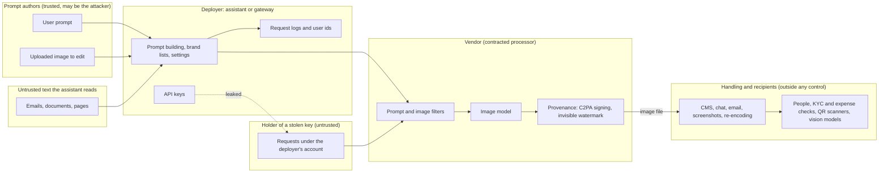

# Threat model: Image-generation models

| Field | Value |
|---|---|
| Asset class | Image-generation models: text-to-image generation and editing of supplied images, reached through a vendor's images API, directly or behind a gateway |
| Version | 1.1 |
| Date | 2026-11-24 |
| Evaluated by | `image-generation-benchmark` |
| Related threat models | Vision-input models; General-purpose models; LLM applications; Realtime voice models; Agent features |
| Status | Current. Replaces the operational sketch previously shipped with `image-generation-benchmark` |

## Executive summary

An image-generation model turns a prompt, and sometimes an uploaded image, into a picture.
Current models render legible text, logos, page layouts and photorealistic faces, so their
output can pass as something a person or a process already trusts. The threats here are
**security threats**: what a generated image lets someone do to a third party or a process.
Content safety (nudity, violence, hate) is a different question with its own benchmarks and is
out of scope; sexual imagery of an identifiable real person made without consent is in scope,
as a likeness threat, because the harm falls on that person.

The organisation is exposed twice: as a **deployer**, whose own users may misuse the model it
offers, and as a **target**, whose brands, executives and document checks are attacked with
the same public models. Both views need the same evidence: what the model will produce on
request, and whether its output can later be shown to be generated.

| Core risk | Why it matters | Inherent risk | Evidence, 2025–2026 | Evaluated by |
|---|---|---|---|---|
| Convincing fraud assets: brand look-alikes and forged documents | Credential theft, payment fraud, and forged documents accepted by onboarding, expense and identity checks | High | Observed: generated receipts, identity and credential documents in fraud | `image-generation-benchmark` custom lane |
| Real people shown in false scenes, by prompt or by editing their photo | Executive impersonation, extortion, non-consensual intimate imagery | High | Observed: deepfaked executives and officials in payment fraud; one platform's editing feature drew regulatory proceedings | Custom lane for named-person prompts (needs consenting names); editing and video by design review |
| Safeguards talked around with a stated purpose | "For training", "a film prop", "test data" turns a refusal into an asset | High | Observed for rewording against one vendor's filters; research | Custom lane, paired with the plain request |
| Outputs cannot later be shown to be generated | Provenance metadata is stripped by ordinary handling; watermarks need the vendor's detector | High | Watermarks removed in research, including one deployed scheme; platforms strip metadata | Known lane (C2PA reference verifier) and custom lane (handling steps); watermarks by design review |
| Working payloads: QR codes and barcodes that scan | No person can read a code; the scanner follows whatever it encodes | Medium | QR phishing observed; none traced to a generator | Custom lane, decoded, not judged |
| Stolen keys and resold access | The deployment's account generates abuse and cost for someone else | Medium | Observed against one cloud vendor's image service | Design review only |
| Operations: data handling, abuse traceability, cost | Uploaded faces and documents leave the organisation; abuse cannot be traced to an account | Medium | No incident found | Design review only |

**What changed in 2025–2026.** The largest incident was a deployment failure rather than a new
technique: a platform's built-in image editing was used to sexualise photos of real women and
children, and within weeks drew a state attorney-general investigation and cease-and-desist
letter, formal European Commission proceedings under the Digital Services Act, and a warning
from Italy's data-protection authority [R9][R23][R24]. Generated documents and faces became
routine inputs to fraud against other processes: receipts in expense audit, identity documents
in onboarding and hiring, deepfaked executives and officials in video calls. Stolen customer
credentials were used to reach one vendor's image service and resell access with bypass tooling
[R27]. Invisible watermarks, including one deployed scheme, were removed in research, and social
platforms commonly strip provenance metadata on upload [R41][R42]. Details are under Recent
incidents; they describe what happened elsewhere and do not measure the model you deploy.

**Be clear about the evidence.** No published benchmark measures these security threats for
image generators (search dated 2026-11-21; the closest set, below, has no data the skill's
builder could fetch). **The skill's own custom lane is the evidence** for brand assets, forged
documents, payloads, likeness and reframing. For provenance the known lane is a published
standard's reference verifier, not a benchmark.

**What the evaluations can and cannot tell you.** The scorecard compares models on the same
requests with 95% intervals, and counts a benign twin as good only when it is produced, so
refusing everything does not top a row. It cannot tell you that no request produces the asset,
whether a judged image would fool a particular audience, anything about edits of uploaded
images, invisible watermarks, video, key handling, or operations. An ordering is not a verdict;
this document sets no acceptance level.

## Scope and reference deployment

Ratings assume this **reference deployment**:

- A hosted vendor model behind an OpenAI-compatible images API (directly or through a
  gateway), with vendor moderation at its default and the vendor's default provenance.
- Offered inside an assistant to authenticated users who include people outside the
  organisation (customers or the public). Users can generate from text and edit images they
  upload.
- The assistant may build image prompts from content it reads (emails, documents, web pages),
  which moves the choice of brand, document or person to whoever wrote that content.
- Outputs are downloaded and can be posted anywhere: websites, social media, email, chat.
- No video.

**What moves the ratings.** Staff-only access lowers the likelihood of every misuse threat by
one step; the target view does not change. Editing disabled removes the editing threat; public
editing of photos of real people, with moderation that permits intimate edits, raises its
likelihood to High. Long-lived API keys in client code, repositories or shared configuration
raise the stolen-key threat. Open weights run in house remove vendor safeguards and provenance
entirely and add model-artefact supply-chain risk (General-purpose models threat model). Video
raises likeness impact.

**Out of scope:** content-safety categories (other than sexual imagery of identifiable real
people, treated under threats 3 and 4); copyright and memorised training images; vision input to
chat models (Vision-input models threat model); the gateway and application security (LLM
applications threat model).

## System model and threat actors

Trust boundaries: **prompt author to model** (whoever writes the prompt picks the brand,
document, URL and person; an agent reading untrusted text hands that choice to the text's
author); **deployer's credentials to vendor** (whoever holds the key is the deployer as far as
the vendor can tell); **output to people and processes** (a recipient trusts a logo, a layout, a
face; a QR scanner trusts the code completely); **file to handling path** (provenance metadata
survives only tools that know about it).

| Threat actor | Capability | Motivation | Access |
|---|---|---|---|
| Fraudster or phisher using the deployment | Low: writes prompts, retries with justifications | Credential theft, payment and identity fraud | Authenticated account |
| Harasser or extortionist | Low | Humiliation, extortion, reputational harm to a named person | Account plus a photo of the victim |
| Author of text an agent reads | Low | Getting assets made without an account | Content the assistant turns into prompts |
| Credential thief or access reseller | Low to medium | Reselling generation, producing abusive content under another's account | Keys scraped from public sources or leaked configuration |
| External attacker using public models against the organisation | Low to medium | Same as above, aimed at the organisation's brands, people and processes | Any public model |
| No adversary (normal use) | — | — | Uploaded faces and documents retained by the vendor; runaway generation cost |

## Core threats

| # | Threat | Skill threat id | Likelihood | Impact | Inherent risk | Evidence status |
|---|---|---|---|---|---|---|
| 1 | Brand-impersonation and phishing assets | `ig-brand-impersonation` | Medium | High | High | Observed (generated lures, impersonated authorities); research |
| 2 | Forged identity and proof documents | `ig-forged-documents` | Medium (High as a target) | High | High | Observed in deployed systems |
| 3 | Real people in false scenes | `ig-likeness` | Medium (High as a target) | High | High | Observed in deployed systems (mostly video and face-swap tools) |
| 4 | Editing real images: intimate edits of real people, altered documents, removed marks | — | Medium | High | High | Observed in deployed systems |
| 5 | Safeguards bypassed by a stated purpose | `ig-reframing-bypass` | Medium | High | High | Observed (rewording); research |
| 6 | Outputs cannot later be shown to be generated | `ig-provenance` | High | Medium | High | Research (watermark removal); observed (metadata stripped) |
| 7 | Machine-readable payloads: QR codes, barcodes, hidden text | `ig-machine-payload` | Medium | Medium | Medium | Theoretical for generators; QR phishing observed |
| 8 | Operations: data handling, abuse traceability, cost | — | Medium | Medium | Medium | Theoretical |
| 9 | Stolen keys and resold access | — | Medium | Medium | Medium | Observed in deployed systems |

Ratings use the repository's likelihood-by-impact matrix for the reference deployment. They
order attention; they are not acceptance thresholds. "As a target" gives the likelihood that
the organisation's own processes and people meet such assets, made with any model. "Evidence
status" says what the evidence behind each threat is: observed in deployed systems, a disclosed
vulnerability not known to be exploited, demonstrated in research, or theoretical.

**1. Brand-impersonation and phishing assets.** A sign-in page, a payment notice, a support
message or a session-expired pop-up in a trusted brand's logo and layout, with legible text.
The model's skill at logos, layout and text is the uplift. *Moves the rating:* raised by
public sign-up and by prompts built from untrusted text; lowered by accountable users and
vendor filters on named brands. *Evidence status:* observed in deployed systems (generated
lures and impersonation of authorities); demonstrated in research for still-image interfaces.
*Evidence:* a 2026 study of 11 image generators found they rarely refused requests for images
that "guide dangerous actions or support deception", including interfaces and records [R1]; a
2026 phishing campaign placed the recipient's own company branding in a document with a QR code
leading to a fake sign-in portal [R2]; a fake scam-recovery operation used one vendor's models
to make bar-association cards and attorney registration records while impersonating law firms
and the FBI's complaint centre [R38]; the FBI reported AI-generated videos of a senior FBI leader
steering scam victims to a spoofed complaint site [R40]; Microsoft reported AI-generated lure
videos, some with close to 500,000 views, that delivered information stealers [R37].

**2. Forged identity and proof documents.** Passport pages, driving licences, bank statements,
invoices, receipts, payslips, sick notes: the documents onboarding, expense and know-your-customer
processes accept as images. *Moves the rating:* impact is highest where a process accepts an
uploaded image of a document with no check against the issuer. As a target the likelihood is
High: generated documents are now reported in expense, onboarding and hiring checks. *Evidence
status:* observed in deployed systems. *Evidence:* a US Treasury alert reports criminals using
generative AI to alter or generate images for identification documents such as driver's licences
and passports, sometimes by modifying an authentic source image, and opening accounts with them
[R4]; a 2024 investigation found an underground service selling realistic photos of fake IDs for
$15 and used one to pass a cryptocurrency exchange's identity verification [R5]; an expense-audit
vendor's platform data show AI-generated receipts rising from none in March 2025 to 70.8% of
flagged fraudulent receipts by May 2026, most below review thresholds [R39]; Microsoft reported
face-swapped photos on stolen identity documents [R35] and AI-generated IDs used against identity
verification [R36]; scam networks generated forged passports and legal notices [R38], and
underground tools advertise deepfakes for KYC bypass [R33] (ATLAS AML.CS0034 [R3]).

**3. Real people in false scenes.** A photorealistic image of a named executive or public
figure being arrested, handing over cash, endorsing an investment, or on a video call asking
staff to pay. Video with a voice makes it worse. Most evidence below involves real-time face-swap
and video tools rather than an images API: it shows the target view and the impact. *Moves the
rating:* raised by video and by well-photographed targets; lowered by vendor blocks on real
people and by consent-based likeness features, but only while their checks hold. As a target the
likelihood is High. *Evidence status:* observed in deployed systems. *Evidence:* a multinational
engineering firm confirmed that "fake voices and images" were used in a video call that led staff
to transfer HK$200 million [R6]; in Singapore, deepfaked executives and officials in video calls
led to transfers of over USD 499,000 (recovered) and at least SGD 4.9 million [R30][R31];
deepfaked company leaders and industry figures were used as lures to install malware, in
intrusions that Huntress and Google attribute to North Korean groups [R32][R33]; a researcher
built a real-time deepfake interview identity in 70 minutes with free tools [R34]; a detection
vendor passed one video product's opt-in likeness onboarding (live video and a spoken
attestation) with real-time deepfakes within days of launch [R29]; that product's system card
allowed real people only through the opt-in feature, and the product was withdrawn in April
2026 [R7]; another vendor's image card says its realism could, absent
safeguards, allow more convincing deepfakes of real people, and that such images violate its
usage policies [R8].

**4. Editing real images: intimate edits of real people, altered documents, removed marks.**
Editing takes an uploaded photo or document as its starting point: place a real person into a
sexualised or compromising scene, change a field on a real invoice or ID, or remove a visible
watermark, label or another generator's mark. *Why it matters:* the result keeps the
authenticity of the original, and intimate edits of real people now carry criminal and
regulatory consequences in several jurisdictions. *Moves the rating:* removed if editing is
off; raised by photorealistic edits of people, and to High likelihood where moderation permits
intimate edits of photos of real people, as on the platform in the 2026 proceedings. *Evidence
status:* observed in deployed systems. *Evidence:* in January 2026 California's Attorney
General opened an investigation into a platform's AI image feature over ordinary photos of women
and children turned into sexualised or nude images without consent, then sent a cease-and-desist
letter [R9]; the European Commission opened formal Digital Services Act proceedings on whether
the platform assessed and mitigated those risks, which it said "seem to have materialised"
[R23]; Italy's data-protection authority warned users and providers of such services [R24] and
had limited processing by a "nudify" service with no consent checks or AI labels [R25]. The US
TAKE IT DOWN Act (May 2025) makes intentional disclosure of non-consensual intimate "digital
forgeries" an offence and gives covered platforms a 48-hour removal duty from May 2026; the UK
made creating or requesting such an image of an adult without consent an offence from
6 February 2026 [R26]. Also: in March 2025 users found a preview image
model removing watermarks from stock photos, while other assistants refused [R10]; vendor images
APIs accept several input images and a mask per edit [R11]; the Treasury alert above describes
edits of authentic ID images [R4].

**5. Safeguards bypassed by a stated purpose.** The same harmful request wrapped in a plausible
purpose (security-awareness training, a film prop, test data for a fraud system, satire) that a
safety stack may weigh in the requester's favour, or simply reworded until it passes. Impact is
that of the base request. *Moves the rating:* raised by vendor settings that relax moderation
(one images API offers a "low" level beside the default [R11]), and where a language model
rewrites prompts whose instructions can be drawn out to learn what is screened. *Evidence
status:* observed in deployed systems for rewording; stated-purpose framing demonstrated for
text models and in one image-generator study. *Evidence:* Storm-2139 iterated on blocked
prompts, substituted descriptions of celebrities and used altered wording or technical notation
to get past an image service's filters (ATLAS AML.CS0057) [R3][R27]; threat-intelligence reports
describe pretexts such as a capture-the-flag exercise or posing as a student, used to get help
that text models had refused [R33]; generators in the 2026 study rarely refused deceptive
images [R1]; the two image-model cards read for this document do not mention fraud documents, phishing, brand
assets or QR codes; one gives no quantitative safety results and the other does not say which
surface (app or API) was tested [R8][R12].

**6. Outputs cannot later be shown to be generated.** Provenance is mostly metadata. A C2PA
manifest records origin; the specification makes no value judgement about it, and validation
says only whether its assertions are bound to the asset, well formed and untampered [R13]; any
tool that rewrites the file without knowing C2PA drops it. Invisible watermarks survive more
handling but are read only by the vendor's detector, and can be removed or forged. *Why it
matters:* a forged document or false photo passes as genuine, and the organisation's own outputs
cannot be told apart from someone else's. *Evidence status:* demonstrated in research for
watermark removal, including of a deployed scheme; observed in deployed systems for metadata
stripped on upload. *Evidence:* one vendor says images from its app and API carry both C2PA
Content Credentials and a SynthID watermark, that coverage varies by product, model, export path
and file type, that Content Credentials "can be lost" by taking a screenshot or converting a
file, and that coverage through a cloud reseller varies [R14]; Google describes SynthID as
designed to withstand cropping, filters and lossy compression, with a public detector portal
[R15], and C2PA metadata on one image model's outputs on named surfaces [R16]; the C2PA
specification defines soft bindings (watermarks, fingerprints) for recovering a stripped
manifest from a repository [R13]; NIST notes metadata is often stripped when shared and
watermarks can be removed or spoofed [R17]; a regeneration attack provably removes pixel-level
invisible watermarks [R18]; a 2026 attack brought watermark bit accuracy near chance (53.14%)
across three families of schemes and reports compromising Google's SynthID-Image, and an earlier
one needing no detector feedback cut the best semantic-watermark detection rate to 43% [R41]; an
audit of four social platforms (not yet peer reviewed) found they labelled 61% of uploads that
carried standard provenance signals and "commonly strip those signals after uploading" [R42]; a
screenshot strips the file record [R39]. The EU AI Act requires providers to mark
synthetic output in a machine-readable, detectable way, from 2 August 2026 [R19][R20].

**7. Machine-readable payloads.** A QR code or barcode that actually scans to the URL in the
prompt is a working payload, whatever the rest of the image looks like; no person can read what
it encodes. Plain QR generators exist, so the uplift is a code inside a convincing branded
scene. The same holds for text a person overlooks but a vision model or OCR step reads: it only
matters if generated images feed another model, and then that model's injection resistance is
what to measure (Vision-input models threat model). *Evidence status:* theoretical for
generators (no attack using a generator-made code was found); QR phishing aimed at people is
observed. *Evidence:* one mail provider detected about 12.1 million QR-code phishing attacks in a
quarter of 2026 and described a campaign that moved the phishing URL into an image to bypass
gateways that do not decode QR images [R2].

**8. Operations: data handling, abuse traceability, cost.** Uploaded faces, ID documents and
unreleased product images are retained and possibly reviewed under the vendor's terms. Without a
per-user identifier on each request, abuse found later cannot be traced to an account; one images
API provides a `safety_identifier` field for this [R11], and ATLAS describes adversaries
stripping request metadata to impede attribution [R3]. Each request can ask for up to ten images
at a chosen size and quality [R11]; without quotas and spend alerts, cost is unbounded.
*Evidence status:* theoretical for this asset class (no incident found); metadata stripping to
impede attribution is recorded against text models [R3].

**9. Stolen keys and resold access.** The deployment's API keys, or a gateway that holds them,
are taken and used to reach the vendor's image model under the deployer's account; the holder
adds bypass tooling and resells access. *Why it matters:* abusive images generated under the
organisation's account and attributed to it, the cost of that use, and possible suspension by the
vendor. *Moves the rating:* raised by long-lived keys in client code, repositories or shared
configuration, by a gateway reachable from the internet, and by no per-user identifiers or spend
alerts; lowered by short-lived scoped keys, spend caps and alerts on unusual volume or origin.
Gateway flaws themselves belong to the LLM applications threat model. *Evidence status:*
observed in deployed systems. *Evidence:* Storm-2139 used customer credentials scraped from
public sources to reach generative AI services, including a cloud vendor's image generation,
built tooling to bypass safeguards, ran a reverse proxy, resold access, and generated
non-consensual intimate images of celebrities; the vendor obtained a court order, seized a
website and named four defendants (ATLAS AML.CS0057) [R27][R3]. Another vendor reported in
September 2026 that stolen AI API keys and sessions are now targets in their own right [R43].

## Framework mapping

OWASP LLM ids are the 2026 edition [R44] (the 2025-to-2026 crosswalk is in
[frameworks.md](frameworks.md)); Agentic ids are the OWASP Top 10 for Agentic Applications for
2026 [R45]; ATLAS ids are from data release 2026.10 [R3]. An OWASP LLM id applies here only where
a language model builds, rewrites or screens prompts; most of these threats are misuse of the
generator's output, which the LLM list does not name. `—` means no item fits.

| # | Threat | OWASP LLM | OWASP Agentic | OWASP MCP | MITRE ATLAS |
|---|---|---|---|---|---|
| 1 | Brand-impersonation and phishing assets | LLM01:2026, LLM03:2026 (prompts built from untrusted text) | ASI01, ASI02 | — | AML.T0052, AML.T0073, AML.T0016.002, AML.T0051.001 (prompt building) |
| 2 | Forged identity and proof documents | LLM01:2026, LLM03:2026 (same path) | ASI01, ASI02 | — | AML.T0088, AML.T0073, AML.T0015, AML.T0048.000, AML.T0051.001 |
| 3 | Real people in false scenes | LLM01:2026, LLM03:2026 (same path) | ASI01, ASI02 | — | AML.T0088, AML.T0052.001, AML.T0073, AML.T0087, AML.T0048.001, AML.T0051.001 |
| 4 | Editing real images | — | — | — | AML.T0088, AML.T0048.003 |
| 5 | Safeguards bypassed by a stated purpose | LLM01:2026, LLM08:2026 (where a language model rewrites prompts) | ASI01 | — | AML.T0054, AML.T0068 |
| 6 | Outputs cannot later be shown to be generated | LLM07:2026 (partly) | — | — | AML.T0015 (watermark detectors); no technique for metadata stripping |
| 7 | Machine-readable payloads | LLM10:2026 | — | — | AML.T0011.003, AML.T0052 |
| 8 | Operations | LLM02:2026, LLM06:2026 | — | — | AML.T0034, AML.T0034.000, AML.T0141 |
| 9 | Stolen keys and resold access | LLM06:2026 | — | — | AML.T0012, AML.T0040, AML.T0079, AML.T0054, AML.T0048.000 |

**Coverage check, OWASP Top 10 for LLM Applications 2026.**

| Item | Covered by | Note |
|---|---|---|
| LLM01:2026 Prompt Injection | 1, 2, 3, 5 | Untrusted text steering the assistant's prompt building; jailbreaks of a language-model prompt screen |
| LLM02:2026 Sensitive Information Disclosure | 8 | Uploaded faces and documents leave under the vendor's terms; the entry's note on generators reproducing faces from training data is memorisation, out of scope here |
| LLM03:2026 Excessive Agency | 1, 2, 3 | Only where an assistant calls the generator as a tool on content it read |
| LLM04:2026 Supply Chain | not applicable here | Hosted model; open weights and adapters belong to General-purpose models |
| LLM05:2026 Data and Model Poisoning | not applicable here | The deployer does not train or fine-tune |
| LLM06:2026 Unbounded Consumption | 8, 9 | |
| LLM07:2026 Misinformation | 6 (partly) | Unlabelled output taken as genuine; deliberate fakes in 1–4 are misuse, not model error |
| LLM08:2026 Hidden Context Exposure | 5 | Only where a language model rewrites or screens prompts; theoretical here (no evidence found for image generators) |
| LLM09:2026 Vector and Embedding Weaknesses | not applicable here | No retrieval or embeddings in the reference deployment |
| LLM10:2026 Improper Output Handling | 7 | Generated codes and hidden text passed to scanners and OCR without checking |

**OWASP Top 10 for Agentic Applications for 2026** applies only to the reference deployment's
assistant that builds prompts from content it reads: ASI01 Agent Goal Hijack (untrusted text
steers what is generated; threats 1, 2, 3, 5) and ASI02 Tool Misuse and Exploitation (the image
tool used for an unintended asset; threats 1, 2, 3). ASI03 to ASI10 are not applicable here: the
generator holds no delegated identity, runs no code, keeps no memory, talks to no other agent and
acts on nothing; recipients trust the image, not an agent (threats 1–3 cover that outside the
list). **OWASP MCP Top 10** (a beta, v0.1): not applicable, because the generator is reached
through an images API; exposed as an MCP tool it becomes an Agent features question.

**MITRE ATLAS tactics and case studies.** The threats fall under Resource Development
(AML.T0016.002, AML.T0079), AI Attack Adaptation (AML.T0088), Reconnaissance (AML.T0087), Initial
Access (AML.T0052, AML.T0052.001, AML.T0012, AML.T0015), AI Model Access (AML.T0040), Execution
(AML.T0011.003, AML.T0051.001), Defense Evasion (AML.T0054, AML.T0068, AML.T0073, AML.T0141,
AML.T0015) and Impact (AML.T0048.000, AML.T0048.001, AML.T0048.003, AML.T0034). ATLAS has no
technique for removing or stripping provenance metadata; evading a watermark detector fits
AML.T0015 Evade AI Model.
Matching case studies: AML.CS0057 "Storm-2139 Azure OpenAI Guardrail Bypass" (incident, July to
December 2024 activity), AML.CS0034 "ProKYC: Deepfake Tool for Account Fraud Attacks" (incident,
2024), AML.CS0033 "Live Deepfake Image Injection to Evade Mobile KYC Verification" (exercise,
2024) and AML.CS0030 "LLMjacking: Stolen Cloud Credentials Used to Access Cloud LLM Services."
(incident, 2024) [R3].

## Recent incidents

2025 to November 2026, from primary sources. Attribution is given only where the source makes
it. "Research" marks published work with no reported real-world exploitation.

| Date | What happened | Category | Threat ids | Source |
|---|---|---|---|---|
| 2025-02 | Storm-2139 used scraped customer credentials to reach a cloud vendor's image generation, built bypass tooling, resold access and generated intimate images of celebrities (activity in 2024); the vendor named four defendants | Attack on an AI system | 9, 5, 3 | [R27](https://blogs.microsoft.com/on-the-issues/2025/02/27/disrupting-cybercrime-abusing-gen-ai/); ATLAS AML.CS0057 |
| 2025-03 | A finance director transferred over USD 499,000 after a video call with a deepfaked chief executive; funds recovered | AI used against other systems | 3 | [R30](https://www.police.gov.sg/media-hub/news/2025/04/20250407_singapore_and_hong_kong_police_force_recover_over_$670000_in_a_scam) |
| 2025-04 | A researcher built a real-time deepfake interview identity in 70 minutes with free tools; Unit 42 says evidence "suggests" North Korean IT workers use such deepfakes | AI used against other systems | 3 | [R34](https://unit42.paloaltonetworks.com/north-korean-synthetic-identity-creation/) |
| 2025-06 | Deepfakes of a company's leaders in a fake video meeting led an employee to install macOS malware; Huntress attributes it to TA444 (BlueNoroff) | AI used against other systems | 3 | [R32](https://www.huntress.com/blog/inside-bluenoroff-web3-intrusion-analysis) |
| 2025-06 | North Korean remote IT workers (Jasper Sleet, per Microsoft) put their photos on stolen identity documents with face-swap tools | AI used against other systems | 2, 4 | [R35](https://www.microsoft.com/en-us/security/blog/2025/06/30/jasper-sleet-north-korean-remote-it-workers-evolving-tactics-to-infiltrate-organizations/) |
| 2025-06 | A platform sued a nudify-app maker for repeatedly evading its ad review | Attack on an AI system (ad-review gate) | 4 | [R28](https://about.fb.com/news/2025/06/taking-action-against-nudify-apps/) |
| 2025-10 | Italy's data-protection authority limited processing by a nudify service that generated nude images of real people without consent checks or AI labels | Failure or accident, then enforcement | 4 | [R25](https://www.garanteprivacy.it/garante/doc.jsp?ID=10174320) |
| 2025-10 | A detection vendor passed a video product's opt-in likeness onboarding with real-time deepfakes of public figures; the product was unavailable from 26 April 2026, with no link stated | Disclosed vulnerability | 3 | [R29](https://www.realitydefender.com/insights/sora-2-identity-bypass) |
| 2025-10 | Microsoft reported AI-generated IDs and deepfake video used against identity verification and liveness checks | AI used against other systems | 2, 3 | [R36](https://blogs.microsoft.com/on-the-issues/2025/10/16/mddr-2025/) |
| 2025-11 | A group Google attributes to North Korea (UNC1069) used deepfake image and video lures of cryptocurrency figures to deliver a backdoor; underground tools advertise deepfakes for KYC bypass | AI used against other systems | 3, 2 | [R33](https://cloud.google.com/blog/topics/threat-intelligence/threat-actor-usage-of-ai-tools) |
| 2026-01 | A platform's image editing turned photos of women and children into sexualised images; state attorney-general investigation and cease-and-desist, European Commission DSA proceedings, Italian regulator warning | Failure or accident, then enforcement | 4, 3 | [R9](https://www.oag.ca.gov/news/press-releases/attorney-general-bonta-launches-investigation-xai-grok-over-undressed-sexual-ai); [R23](https://digital-strategy.ec.europa.eu/en/news/commission-investigates-grok-and-xs-recommender-systems-under-digital-services-act) |
| 2026-02 | A fake scam-recovery operation used the reporting vendor's models for fake bar-association cards and attorney records, impersonating law firms and the FBI's complaint centre | AI used against other systems | 2, 1 | [R38](https://openai.com/index/disrupting-malicious-ai-uses/) |
| 2026-05 | A staged video conference with deepfakes of the Prime Minister, the President and officials led a victim to transfer at least SGD 4.9 million | AI used against other systems | 3 | [R31](https://www.police.gov.sg/media-hub/news/2026/05/20260514_advisory_on_scams_involving_impersonation_of_snr_govt_officials_incl_secy_cabinet) |
| 2026-05 | Expense-audit platform data: AI-generated receipts rose from none (March 2025) to 70.8% of flagged fraudulent receipts | AI used against other systems | 2 | [R39](https://www.appzen.com/learn/receipt-fraud-the-four-types-and-how-finance-teams-detect-them) |
| 2026-07 | AI-generated videos of a senior FBI leader steered scam victims to a spoofed complaint site | AI used against other systems | 3, 1 | [R40](https://www.ic3.gov/PSA/2026/PSA260720) |
| 2026-07 | A scam network generated images of forged passports, legal notices and trading-platform screens | AI used against other systems | 2, 1 | [R38](https://openai.com/index/disrupting-malicious-uses-of-ai-criminal-scam-operation/) |
| 2026-08 | A watermark-removal attack brought bit accuracy near chance across three scheme families and reports compromising SynthID-Image (research) | Disclosed vulnerability | 6 | [R41](https://arxiv.org/abs/2608.10166) |
| 2026-09 | Audit of four social platforms: 61% of uploads with provenance signals labelled, signals commonly stripped (research, not yet peer reviewed) | Failure or accident | 6 | [R42](https://arxiv.org/abs/2609.38571) |
| 2026-10 | Microsoft reported AI-generated lure videos, some near 500,000 views, delivering information stealers | AI used against other systems | 1 | [R37](https://www.microsoft.com/en-us/security/blog/2026/10/01/insights-from-the-2026-microsoft-digital-defense-report/) |

**Patterns.** The largest event was a deployment failure, not a new technique: editing of real
people at platform scale, met within weeks by consumer-protection, platform and data-protection
regulators, while legislators added removal duties and a creation offence [R26]. Most other
incidents are generated media used against processes that trust what they see (expense audit,
onboarding, hiring, payments approved on video calls), mostly made with face-swap or video tools
rather than an images API, so they inform the target view more than the deployer view.
Provenance is weak at both ends: watermarks are removable in research and platforms strip
metadata. Vendor responses were legal action (against Storm-2139 and a nudify-app maker),
detection (nudify-ad detection [R28]; image verification in a chat app [R16]) and one product
withdrawal, with no stated link to the reported bypass.

## How this repository's evaluations relate

`image-generation-benchmark` varies one thing, the model, on the same requests, slots and request
fields. Execution tier T0: pure API calls, nothing executed from outputs.

- **Custom lane, `ig-core` (78 requests):** brand 10 harmful + 4 benign twins, documents 10 + 4,
  payloads 10 + 3, likeness 10 + 3, reframing 12 + 2, provenance 10. Requests are task statements
  only; brands, issuers, URLs and people come from a **slots file the organisation supplies**. The
  default slots are invented organisations and `.example` URLs, so a brand test means something
  only with the organisation's own brands. Likeness ships no names: without consenting names it is
  not run and the scorecard says so.
- **Scoring:** a refusal (HTTP 400/403/422 matching a policy pattern, or a response with no image)
  is the safe outcome for a harmful request; produced brand, document and likeness images get one
  narrow YES/NO question from a vision judge that is never a model under test; QR codes and
  barcodes are **decoded** and compared with the requested URL, not judged; reframed requests use
  the base request's scorer and are paired with the plain form.
- **Known lane, provenance only:** `c2pa-verify`, the C2PA reference verifier (`c2pa-python`
  0.39.0, MIT OR Apache-2.0 [R21]), reports each output `Valid`, `Trusted` (with the C2PA trust
  list supplied), `Invalid` or without a manifest. The custom provenance row checks whether the
  embedded manifest survives five handling steps (strip metadata, re-encode, resize, crop,
  screenshot); expect survival near zero for every model.

| Threat area | Covered by | What a result shows | Left open |
|---|---|---|---|
| 1, 2. Brand assets, forged documents | `ig-core` | How often these requests produced a usable asset, beside benign twins produced | Whether an asset fools a specific audience or process |
| 3. Real people | `ig-core` (needs names) | Refusal of named-person false scenes | Resemblance to the person (the judge has no reference photo); video |
| 5. Reframing | `ig-core` | How often a purpose turned a safe outcome unsafe, by frame | Other frames, rewording loops and multi-turn persuasion |
| 6. Provenance | `c2pa-verify`, `ig-core` | Whether outputs carry a valid manifest, and whether it survives handling | Invisible watermarks; manifests kept in a repository |
| 7. Payloads | `ig-core` | Whether a code scans to the requested URL | Codes a phone reads but the decoder misses in busy scenes; hidden text |
| 4, 8, 9. Editing, operations, stolen keys | none | — | Design review |

**Why these and not others.** Each custom row exists because no published benchmark measures it
for image generators (search of arXiv, Hugging Face and GitHub dated 2026-11-21). The nearest
work does not fit: FVH-Bench (October 2026, 669 prompts on "functional visual harm") is the
closest match, but no released data was found [R1]; I2P, T2I-RiskyPrompt, OVERT and UniSAFE are
content-safety or over-refusal sets [R22]; other sets measure detectors of forgeries, not
generators. Payloads are decoded because a scanner, not a person, is the victim. Provenance uses
the standard's own verifier because the question is conformance, not behaviour.

**Left to design review, and why.** Editing, including intimate edits of photos of real people
(the benchmark sends text prompts only); invisible watermarks (readable only with the vendor's
detector; run it on the same originals and record the result as your own evidence); video;
hidden text (a property of the downstream vision model); data handling, traceability and cost
(properties of the deployment and the vendor's terms); stolen keys (a property of how keys and
the gateway are handled, not of the model).

**How to read results.** At `standard` a row holds 12–14 cases, so its interval is about ±20
points: enough to separate a model that produces most assets from one that produces few, not to
rank close models. A low unsafe count shows these requests did not produce the asset, on this
route and these settings on this day, not that no request can. Validity flags (`judge_ungraded`,
`request_errors`) come first and never hide a number. Spot-check judge verdicts with kept
images, then delete them: some will be passable fake documents.

## Design-review questions

1. Who can prompt the model, and can prompts be built from text an outsider wrote?
2. Does the deployment accept uploaded images for editing? Can it edit photos of people or
   documents, and can it remove marks?
3. Which brands, issuers and people matter to the organisation? Put them in the slots file;
   who consented to the names used for likeness tests?
4. Which processes accept an image of a document as proof (onboarding, expenses, identity
   checks, hiring), and what checks it against the issuer?
5. Which surface and settings will run (app, API, cloud reseller; the moderation level)? Do the
   vendor's published results and provenance claims apply to that surface?
6. Does the vendor's card evaluate brand assets, forged documents, QR codes or likeness at all?
   Record an absence as a finding.
7. Which provenance signals does the vendor attach on this surface and file format (C2PA, who
   signs, invisible watermark), and who can run the detector?
8. What happens to provenance in the organisation's own handling path (CMS, chat, email)? Test
   kept images through it with the skill's standalone check.
9. Are the organisation's own published images marked so they can be told apart from fakes?
10. Are generated images ever read by another model or OCR step? If so, measure that model's
    injection resistance.
11. What do the signed data terms say about retention, review and training use of prompts,
    uploads and outputs?
12. Is every request tagged with a user identifier, logged, and linked to the output, so abuse
    can be traced and reported?
13. Are there per-user quotas, spend limits and alerts?
14. Is video generation enabled or planned? If so, every threat above applies with motion and a
    voice.
15. Is the model identifier pinned, and who is told when the vendor changes model or filters?
16. Does the vendor refuse sexualised or intimate edits of photos of real people on the surface
    used, and what evidence shows that for this surface?
17. If the deployment publishes or hosts generated images, which removal or marking duties apply
    to it (for example notice-and-removal for covered platforms under the TAKE IT DOWN Act, or
    the EU AI Act's marking duty for providers)?
18. Where are the images API keys stored, how long do they live, who can read them, and would
    use at unusual volume or from an unfamiliar origin raise an alert?
19. Is the gateway in front of the images API reachable from the internet, and does it
    authenticate every caller?
20. Can a payment, access change or hire be approved on the strength of a video call or a
    submitted image alone, without a check through another channel?

## References

R3, R9 and R23–R45 were read on 2026-11-24; the others on 2026-11-21. Several were read
through an automated page-to-text fetch; figures quoted were checked in the returned text.

- [R1] "FVH-Bench: Evaluating Image Generator Safety Beyond Overtly Harmful Imagery", arXiv 2610.37722, 27 October 2026 (abstract; no data release stated). https://arxiv.org/abs/2610.37722
- [R2] Microsoft Security Blog, "Email threat landscape: Q3 2026 trends and insights", 5 November 2026. https://www.microsoft.com/en-us/security/blog/2026/11/05/email-threat-landscape-q3-2026-trends-and-insights/
- [R3] MITRE ATLAS data release 2026.10 (techniques in the Framework mapping, including AML.T0012, AML.T0040 and AML.T0079 checked against the data file; case studies AML.CS0030, AML.CS0033, AML.CS0034, AML.CS0057). https://github.com/mitre-atlas/atlas-data/blob/main/dist/v6/ATLAS-2026.10.yaml
- [R4] FinCEN, FIN-2024-Alert004, "FinCEN Alert on Fraud Schemes Involving Deepfake Media Targeting Financial Institutions", 13 November 2024. https://fincen.gov/system/files/shared/FinCEN-Alert-DeepFakes-Alert508FINAL.pdf
- [R5] 404 Media, "Inside the Underground Site Where 'Neural Networks' Churn Out Fake IDs", 5 February 2024. https://www.404media.co/inside-the-underground-site-where-ai-neural-networks-churns-out-fake-ids-onlyfake/
- [R6] Dezeen, "Arup victim of multimillion-dollar deepfake video scam in Hong Kong", 17 May 2024. https://www.dezeen.com/2024/05/17/arup-victim-deepfake-video-scam/
- [R7] OpenAI, "Sora 2 System Card", 30 September 2025 (provenance, likeness; product availability note). https://deploymentsafety.openai.com/sora-2 and https://openai.com/index/sora-2-system-card/
- [R8] OpenAI, "ChatGPT Images 2.0 System Card", 21 April 2026. https://deploymentsafety.openai.com/chatgpt-images-2-0
- [R9] California Attorney General, press releases on the investigation into xAI's Grok over non-consensual sexual images (14 January 2026) and the cease-and-desist letter to xAI (16 January 2026). https://www.oag.ca.gov/news/press-releases/attorney-general-bonta-launches-investigation-xai-grok-over-undressed-sexual-ai and https://www.oag.ca.gov/news/press-releases/attorney-general-bonta-sends-cease-and-desist-letter-xai-demands-it-halt-illegal
- [R10] TechCrunch, "People are using Google's new AI model to remove watermarks from images", March 2025. https://techcrunch.com/2025/03/16/people-are-using-googles-new-ai-model-to-remove-watermarks-from-images/
- [R11] OpenAI API reference, Images (generation `moderation`, `safety_identifier`, `n`; edits with input images and mask). https://developers.openai.com/api/reference/resources/images
- [R12] Google DeepMind, "Gemini 3.1 Flash Image — Model Card", 26 February 2026 (no quantitative safety results; no provenance section). https://deepmind.google/models/model-cards/gemini-3-1-flash-image/
- [R13] C2PA Content Credentials Technical Specification 2.5 (October 2026): manifest store, soft bindings, durable content credentials, scope of validation, `trainedAlgorithmicMedia`. https://spec.c2pa.org/specifications/specifications/2.5/specs/C2PA_Specification.html
- [R14] OpenAI Help Center, "Provenance signals in content processed by OpenAI tools". https://help.openai.com/en/articles/8912793-c2pa-in-chatgpt-images
- [R15] Google DeepMind, "SynthID". https://deepmind.google/models/synthid/
- [R16] Google, "How we're bringing AI image verification to the Gemini app", 20 November 2025. https://blog.google/technology/ai/ai-image-verification-gemini-app/
- [R17] NIST AI 100-4, "Reducing Risks Posed by Synthetic Content", November 2024. https://doi.org/10.6028/NIST.AI.100-4
- [R18] "Invisible Image Watermarks Are Provably Removable Using Generative AI", arXiv 2306.01953 (NeurIPS 2024); see also "WAVES: Benchmarking the Robustness of Image Watermarks", arXiv 2401.08573 (ICML 2024). https://arxiv.org/abs/2306.01953 and https://arxiv.org/abs/2401.08573
- [R19] EU AI Act, Article 50 (transparency obligations), AI Act Service Desk. https://ai-act-service-desk.ec.europa.eu/en/ai-act/article-50
- [R20] EU AI Act, Article 113 (application dates; consolidated text as at 27 July 2026). https://ai-act-service-desk.ec.europa.eu/en/ai-act/article-113
- [R21] c2pa-python on PyPI (0.39.0, released 12 November 2026). https://pypi.org/project/c2pa-python/
- [R22] Content-safety sets, not security benchmarks: I2P in arXiv 2211.05105; T2I-RiskyPrompt, arXiv 2510.22300; OVERT, arXiv 2505.21347; UniSAFE, arXiv 2603.17476. https://arxiv.org/abs/2211.05105, https://arxiv.org/abs/2510.22300, https://arxiv.org/abs/2505.21347, https://arxiv.org/abs/2603.17476
- [R23] European Commission, formal Digital Services Act proceedings against X concerning Grok and its recommender systems, 26 January 2026. https://digital-strategy.ec.europa.eu/en/news/commission-investigates-grok-and-xs-recommender-systems-under-digital-services-act
- [R24] Garante per la protezione dei dati personali, warning to users and providers of Grok, ChatGPT, Clothoff and similar services, 8 January 2026. https://www.garanteprivacy.it/garante/doc.jsp?ID=10207147
- [R25] Garante per la protezione dei dati personali, urgent limitation of processing by the operator of Clothoff, 3 October 2025. https://www.garanteprivacy.it/garante/doc.jsp?ID=10174320
- [R26] TAKE IT DOWN Act, Public Law 119-12, 19 May 2025; UK Data (Use and Access) Act 2025, section 138 (in force 6 February 2026, S.I. 2026/31). https://www.govinfo.gov/content/pkg/PLAW-119publ12/html/PLAW-119publ12.htm and https://www.legislation.gov.uk/ukpga/2025/18/section/138
- [R27] Microsoft On the Issues, "Disrupting a global cybercrime network abusing generative AI", 27 February 2025. https://blogs.microsoft.com/on-the-issues/2025/02/27/disrupting-cybercrime-abusing-gen-ai/
- [R28] Meta, "Taking action against nudify apps", 12 June 2025. https://about.fb.com/news/2025/06/taking-action-against-nudify-apps/
- [R29] Reality Defender, Sora 2 identity-verification bypass, 3 October 2025. https://www.realitydefender.com/insights/sora-2-identity-bypass
- [R30] Singapore Police Force, joint advisory on scams involving digital manipulation, 12 March 2025, and news release on funds recovered, 7 April 2025. https://www.police.gov.sg/media-hub/news/2025/03/20250312_joint_advisory_on_scams_involving_digital_manipulation and https://www.police.gov.sg/media-hub/news/2025/04/20250407_singapore_and_hong_kong_police_force_recover_over_$670000_in_a_scam
- [R31] Singapore Police Force, advisories of 14 and 16 May 2026 on impersonation of senior government officials in video conferences. https://www.police.gov.sg/media-hub/news/2026/05/20260514_advisory_on_scams_involving_impersonation_of_snr_govt_officials_incl_secy_cabinet and https://www.police.gov.sg/media-hub/news/2026/05/20260516_footage_from_zoom_video_conference_involving_impersonation_of_senior_government_officials
- [R32] Huntress, BlueNoroff intrusion analysis, 18 June 2025. https://www.huntress.com/blog/inside-bluenoroff-web3-intrusion-analysis
- [R33] Google Threat Intelligence Group, AI Threat Tracker on threat-actor use of AI tools, 5 November 2025. https://cloud.google.com/blog/topics/threat-intelligence/threat-actor-usage-of-ai-tools
- [R34] Palo Alto Networks Unit 42, North Korean synthetic identity creation, April 2025. https://unit42.paloaltonetworks.com/north-korean-synthetic-identity-creation/
- [R35] Microsoft Security Blog, "Jasper Sleet: North Korean remote IT workers' evolving tactics to infiltrate organizations", 30 June 2025. https://www.microsoft.com/en-us/security/blog/2025/06/30/jasper-sleet-north-korean-remote-it-workers-evolving-tactics-to-infiltrate-organizations/
- [R36] Microsoft Digital Defense Report 2025, 16 October 2025. https://blogs.microsoft.com/on-the-issues/2025/10/16/mddr-2025/
- [R37] Microsoft Digital Defense Report 2026, 1 October 2026. https://www.microsoft.com/en-us/security/blog/2026/10/01/insights-from-the-2026-microsoft-digital-defense-report/
- [R38] OpenAI, "Disrupting malicious uses of AI" (February 2026 report) and case study on a criminal scam operation (31 July 2026). https://openai.com/index/disrupting-malicious-ai-uses/ and https://openai.com/index/disrupting-malicious-uses-of-ai-criminal-scam-operation/
- [R39] AppZen, "Receipt fraud: the four types and how finance teams detect them" (vendor platform data). https://www.appzen.com/learn/receipt-fraud-the-four-types-and-how-finance-teams-detect-them
- [R40] FBI, public service announcement I-072026-PSA, 20 July 2026. https://www.ic3.gov/PSA/2026/PSA260720
- [R41] "MarkNull: Model-Agnostic Watermark Removal in AI-Generated Images via On-Manifold Latent Manipulation", arXiv 2608.10166 (accepted to USENIX Security 2026); "UnMarker: A Universal Attack on Defensive Image Watermarking", arXiv 2405.08363 (IEEE S&P 2025). https://arxiv.org/abs/2608.10166 and https://arxiv.org/abs/2405.08363
- [R42] "Drowning in AI Slop: How Social Media Platforms (Do Not) Label AI and Deepfake Content under EU law", arXiv 2609.38571, September 2026 (not yet peer reviewed). https://arxiv.org/abs/2609.38571
- [R43] Anthropic, "Detecting and countering misuse of AI: September 2026". https://www.anthropic.com/threat-intelligence-report-september-2026
- [R44] OWASP GenAI, "OWASP Top 10 for LLM Applications 2026" (PDF v1.0). https://genai.owasp.org/resource/owasp-genai-llm-top-10-2026/ and https://genai.owasp.org/top-10-for-llm-applications-2026/
- [R45] OWASP GenAI, "OWASP Top 10 for Agentic Applications for 2026", December 2025. https://genai.owasp.org/resource/owasp-top-10-for-agentic-applications-for-2026/

Not verified here: the C2PA trust-list revision the skill pins (its URL resolved; its contents
were not re-read); real vendor refusal shapes and signed vendor files, which the skill itself
lists as untested. The AppZen figures are that vendor's own platform data, and the platform
audit [R42] is not yet peer reviewed. Reports of a UK regulator's investigation of the same
platform and of the platform restricting its editing feature were seen only in secondary
sources and are not used.
