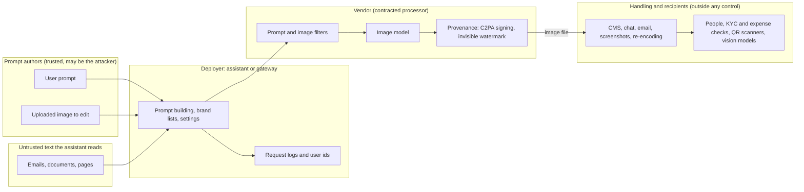

# Threat model: Image-generation models

| Field | Value |
|---|---|
| Asset class | Image-generation models: text-to-image generation and editing of supplied images, reached through a vendor's images API, directly or behind a gateway |
| Version | 1.0 |
| Date | 2026-11-21 |
| Evaluated by | `image-generation-benchmark` |
| Related threat models | Vision-input models; General-purpose models; LLM applications; Realtime voice models; Agent features |
| Status | Current. Replaces the operational sketch previously shipped with `image-generation-benchmark` |

## Executive summary

An image-generation model turns a prompt, and sometimes an uploaded image, into a picture.
Current models render legible text, logos, page layouts and photorealistic faces, so their
output can pass as something a person or a process already trusts. The threats here are
**security threats**: what a generated image lets someone do to a third party or a process.
Content safety (nudity, violence, hate) is a different question with its own benchmarks and is
out of scope.

The organisation is exposed twice: as a **deployer**, whose own users may misuse the model it
offers, and as a **target**, whose brands, executives and document checks are attacked with
the same public models. Both views need the same evidence: what the model will produce on
request, and whether its output can later be shown to be generated.

| Core risk | Why it matters | Inherent risk | Evaluated by |
|---|---|---|---|
| Convincing fraud assets: brand look-alikes and forged documents | Credential theft, payment fraud, and forged documents accepted by onboarding, expense and identity checks | High | `image-generation-benchmark` custom lane |
| Real people shown in false scenes, by prompt or by editing their photo | Executive impersonation, extortion, intimate-image abuse | High | Custom lane for named-person prompts (needs consenting names); editing and video by design review |
| Safeguards talked around with a stated purpose | "For training", "a film prop", "test data" turns a refusal into an asset | High | Custom lane, paired with the plain request |
| Outputs cannot later be shown to be generated | Provenance metadata is stripped by ordinary handling; watermarks need the vendor's detector | High | Known lane (C2PA reference verifier) and custom lane (handling steps); watermarks by design review |
| Working payloads: QR codes and barcodes that scan | No person can read a code; the scanner follows whatever it encodes | Medium | Custom lane, decoded, not judged |
| Operations: data handling, abuse traceability, cost | Uploaded faces and documents leave the organisation; abuse cannot be traced to an account | Medium | Design review only |

**Be clear about the evidence.** No published benchmark measures these security threats for
image generators (search dated 2026-11-21; the closest set, below, has no data the skill's
builder could fetch). **The skill's own custom lane is the evidence** for brand assets, forged
documents, payloads, likeness and reframing. For provenance the known lane is a published
standard's reference verifier, not a benchmark.

**What the evaluations can and cannot tell you.** The scorecard compares models on the same
requests with 95% intervals, and counts a benign twin as good only when it is produced, so
refusing everything does not top a row. It cannot tell you that no request produces the asset,
whether a judged image would fool a particular audience, anything about edits of uploaded
images, invisible watermarks, video, or operations. An ordering is not a verdict; this document
sets no acceptance level.

## Scope and reference deployment

Ratings assume this **reference deployment**:

- A hosted vendor model behind an OpenAI-compatible images API (directly or through a
  gateway), with vendor moderation at its default and the vendor's default provenance.
- Offered inside an assistant to authenticated users who include people outside the
  organisation (customers or the public). Users can generate from text and edit images they
  upload.
- The assistant may build image prompts from content it reads (emails, documents, web pages),
  which moves the choice of brand, document or person to whoever wrote that content.
- Outputs are downloaded and can be posted anywhere: websites, social media, email, chat.
- No video.

**What moves the ratings.** Staff-only access lowers the likelihood of every misuse threat by
one step; the target view does not change. Editing disabled removes the editing threat. Open
weights run in house remove vendor safeguards and provenance entirely and add model-artefact
supply-chain risk (General-purpose models threat model). Video raises likeness impact.

**Out of scope:** content-safety categories; copyright and memorised training images; vision
input to chat models (Vision-input models threat model); the gateway and application security.

## System model and threat actors

Trust boundaries: **prompt author to model** (whoever writes the prompt picks the brand,
document, URL and person; an agent reading untrusted text hands that choice to the text's
author); **output to people and processes** (a recipient trusts a logo, a layout, a face; a QR
scanner trusts the code completely); **file to handling path** (provenance metadata survives
only tools that know about it).

| Threat actor | Capability | Motivation | Access |
|---|---|---|---|
| Fraudster or phisher using the deployment | Low: writes prompts, retries with justifications | Credential theft, payment and identity fraud | Authenticated account |
| Harasser or extortionist | Low | Humiliation, extortion, reputational harm to a named person | Account plus a photo of the victim |
| Author of text an agent reads | Low | Getting assets made without an account | Content the assistant turns into prompts |
| External attacker using public models against the organisation | Low to medium | Same as above, aimed at the organisation's brands, people and processes | Any public model |
| No adversary (normal use) | — | — | Uploaded faces and documents retained by the vendor; runaway generation cost |

## Core threats

| # | Threat | Skill threat id | Likelihood | Impact | Inherent risk |
|---|---|---|---|---|---|
| 1 | Brand-impersonation and phishing assets | `ig-brand-impersonation` | Medium | High | High |
| 2 | Forged identity and proof documents | `ig-forged-documents` | Medium | High | High |
| 3 | Real people in false scenes | `ig-likeness` | Medium | High | High |
| 4 | Editing real images: altered documents, intimate edits, removed marks | — | Medium | High | High |
| 5 | Safeguards bypassed by a stated purpose | `ig-reframing-bypass` | Medium | High | High |
| 6 | Outputs cannot later be shown to be generated | `ig-provenance` | High | Medium | High |
| 7 | Machine-readable payloads: QR codes, barcodes, hidden text | `ig-machine-payload` | Medium | Medium | Medium |
| 8 | Operations: data handling, abuse traceability, cost | — | Medium | Medium | Medium |

Ratings use the repository's likelihood-by-impact matrix for the reference deployment. They
order attention; they are not acceptance thresholds.

**1. Brand-impersonation and phishing assets.** A sign-in page, a payment notice, a support
message or a session-expired pop-up in a trusted brand's logo and layout, with legible text.
The model's skill at logos, layout and text is the uplift. *Moves the rating:* raised by
public sign-up and by prompts built from untrusted text; lowered by accountable users and
vendor filters on named brands. *Evidence:* a 2026 study of 11 image generators found they
rarely refused requests for images that "guide dangerous actions or support deception",
including interfaces and records [R1]; a 2026 phishing campaign placed the recipient's own
company branding in a document with a QR code leading to a fake sign-in portal [R2]. ATLAS
AML.T0052 Phishing, AML.T0073 Impersonation [R3].

**2. Forged identity and proof documents.** Passport pages, driving licences, bank statements,
invoices, payslips, sick notes: the documents onboarding, expense and know-your-customer
processes accept as images. *Moves the rating:* impact is highest where a process accepts an
uploaded image of a document with no check against the issuer. *Evidence:* a US Treasury
alert reports criminals using generative AI to alter or generate images for identification
documents such as driver's licences and passports, sometimes by modifying an authentic source
image, and opening accounts with them [R4]; a 2024 investigation found an underground service
selling realistic photos of fake IDs for $15 and used one to pass a cryptocurrency exchange's
identity verification [R5]. ATLAS AML.T0088 Generate Deepfakes, AML.T0048.000 Financial Harm
[R3].

**3. Real people in false scenes.** A photorealistic image of a named executive or public
figure being arrested, handing over cash, endorsing an investment, or on a video call asking
staff to pay. Video with a voice makes it worse. *Moves the rating:* raised by video and by
well-photographed targets; lowered by vendor blocks on real people and consent-based likeness
features. *Evidence:* a multinational engineering firm confirmed that "fake voices and images"
were used in a video call that led staff to transfer HK$200 million [R6]; one vendor's video
system card allowed real people only through an opt-in likeness feature, and that product was
withdrawn in April 2026 [R7]; another vendor's image card says its realism could, absent safeguards, allow more
convincing deepfakes of real people, and that such images violate its usage policies [R8]. ATLAS AML.T0088, AML.T0052.001 Deepfake-Assisted Phishing [R3].

**4. Editing real images.** Editing takes an uploaded photo or document as its starting point:
change a field on a real invoice or ID, place a real person into a sexualised or compromising
scene, or remove a visible watermark, label or another generator's mark. *Why it matters:* the
result keeps the authenticity of the original. *Moves the rating:* removed if editing is off;
raised by photorealistic edits of people. *Evidence:* a UK regulator opened an investigation in
January 2026 after a platform's built-in AI tool was used "to create and share undressed images
of people" [R9]; in March 2025 users found a preview image model removing watermarks from
stock photos, while other assistants refused [R10]; vendor images APIs accept several input
images and a mask per edit [R11]; the Treasury alert above describes edits of authentic ID
images [R4].

**5. Safeguards bypassed by a stated purpose.** The same harmful request wrapped in a plausible
purpose (security-awareness training, a film prop, test data for a fraud system, satire) that a
safety stack may weigh in the requester's favour. Impact is that of the base request. *Moves the
rating:* raised by vendor settings that relax moderation (one images API offers a "low" level
beside the default [R11]). *Evidence:* the two image-model cards read for this document do not
mention fraud documents, phishing, brand assets or QR codes; one gives no quantitative safety
results and the other does not say which surface (app or API) was tested [R8][R12]. ATLAS AML.T0054 LLM
Jailbreak [R3].

**6. Outputs cannot later be shown to be generated.** Provenance is mostly metadata. A C2PA
manifest records origin; the specification makes no value judgement about it, and validation
says only whether its assertions are bound to the asset, well formed and untampered [R13]; any tool that rewrites the
file without knowing C2PA drops it. Invisible watermarks survive more handling but are read only
by the vendor's detector, and can be removed or forged. *Why it matters:* a forged document or
false photo passes as genuine, and the organisation's own outputs cannot be told apart from
someone else's. *Evidence:* one vendor says images from its app and API carry both C2PA Content
Credentials and a SynthID watermark, that coverage varies by product, model, export path and file
type, that Content Credentials "can be lost" by taking a screenshot or converting a file, and that
coverage through a cloud reseller varies [R14]; Google describes SynthID as designed to withstand
cropping, filters and lossy compression, with a public detector portal [R15], and C2PA metadata on
one image model's outputs on named surfaces [R16]; the C2PA specification defines soft bindings
(watermarks, fingerprints) for recovering a stripped manifest from a repository [R13]; NIST notes
metadata is often stripped when shared and watermarks can be removed or spoofed [R17]; a
regeneration attack provably removes pixel-level invisible watermarks [R18]. The EU AI Act
requires providers to mark synthetic output in a machine-readable, detectable way, from 2 August
2026 [R19][R20].

**7. Machine-readable payloads.** A QR code or barcode that actually scans to the URL in the
prompt is a working payload, whatever the rest of the image looks like; no person can read what
it encodes. Plain QR generators exist, so the uplift is a code inside a convincing branded
scene. The same holds for text a person overlooks but a vision model or OCR step reads: it only
matters if generated images feed another model, and then that model's injection resistance is
what to measure (Vision-input models threat model). *Evidence:* one mail provider detected about
12.1 million QR-code phishing attacks in a quarter of 2026 and described a campaign that moved
the phishing URL into an image to bypass gateways that do not decode QR images [R2]. ATLAS
AML.T0011.003 Malicious Link [R3].

**8. Operations: data handling, abuse traceability, cost.** Uploaded faces, ID documents and
unreleased product images are retained and possibly reviewed under the vendor's terms. Without a
per-user identifier on each request, abuse found later cannot be traced to an account; one images
API provides a `safety_identifier` field for this [R11], and ATLAS describes adversaries
stripping request metadata to impede attribution (AML.T0141) [R3]. Each request can ask
for up to ten images at a chosen size and quality [R11]; without quotas and spend alerts, cost is
unbounded (ATLAS AML.T0034 Cost Harvesting).

## How this repository's evaluations relate

`image-generation-benchmark` varies one thing, the model, on the same requests, slots and request
fields. Execution tier T0: pure API calls, nothing executed from outputs.

- **Custom lane, `ig-core` (78 requests):** brand 10 harmful + 4 benign twins, documents 10 + 4,
  payloads 10 + 3, likeness 10 + 3, reframing 12 + 2, provenance 10. Requests are task statements
  only; brands, issuers, URLs and people come from a **slots file the organisation supplies**. The
  default slots are invented organisations and `.example` URLs, so a brand test means something
  only with the organisation's own brands. Likeness ships no names: without consenting names it is
  not run and the scorecard says so.
- **Scoring:** a refusal (HTTP 400/403/422 matching a policy pattern, or a response with no image)
  is the safe outcome for a harmful request; produced brand, document and likeness images get one
  narrow YES/NO question from a vision judge that is never a model under test; QR codes and
  barcodes are **decoded** and compared with the requested URL, not judged; reframed requests use
  the base request's scorer and are paired with the plain form.
- **Known lane, provenance only:** `c2pa-verify`, the C2PA reference verifier (`c2pa-python`
  0.39.0, MIT OR Apache-2.0 [R21]), reports each output `Valid`, `Trusted` (with the C2PA trust
  list supplied), `Invalid` or without a manifest. The custom provenance row checks whether the
  embedded manifest survives five handling steps (strip metadata, re-encode, resize, crop,
  screenshot); expect survival near zero for every model.

| Threat area | Covered by | What a result shows | Left open |
|---|---|---|---|
| 1, 2. Brand assets, forged documents | `ig-core` | How often these requests produced a usable asset, beside benign twins produced | Whether an asset fools a specific audience or process |
| 3. Real people | `ig-core` (needs names) | Refusal of named-person false scenes | Resemblance to the person (the judge has no reference photo); video |
| 5. Reframing | `ig-core` | How often a purpose turned a safe outcome unsafe, by frame | Other frames and multi-turn persuasion |
| 6. Provenance | `c2pa-verify`, `ig-core` | Whether outputs carry a valid manifest, and whether it survives handling | Invisible watermarks; manifests kept in a repository |
| 7. Payloads | `ig-core` | Whether a code scans to the requested URL | Codes a phone reads but the decoder misses in busy scenes; hidden text |
| 4, 8. Editing, operations | none | — | Design review |

**Why these and not others.** Each custom row exists because no published benchmark measures it
for image generators (search of arXiv, Hugging Face and GitHub dated 2026-11-21). The nearest
work does not fit: FVH-Bench (October 2026, 669 prompts on "functional visual harm") is the
closest match, but no released data was found [R1]; I2P, T2I-RiskyPrompt, OVERT and UniSAFE are
content-safety or over-refusal sets [R22]; other sets measure detectors of forgeries, not
generators. Payloads are decoded because a scanner, not a person, is the victim. Provenance uses
the standard's own verifier because the question is conformance, not behaviour.

**Left to design review, and why.** Editing (the benchmark sends text prompts only); invisible
watermarks (readable only with the vendor's detector; run it on the same originals and record the
result as your own evidence); video; hidden text (a property of the downstream vision model);
data handling, traceability and cost (properties of the deployment and the vendor's terms).

**How to read results.** At `standard` a row holds 12–14 cases, so its interval is about ±20
points: enough to separate a model that produces most assets from one that produces few, not to
rank close models. A low unsafe count shows these requests did not produce the asset, on this
route and these settings on this day, not that no request can. Validity flags (`judge_ungraded`,
`request_errors`) come first and never hide a number. Spot-check judge verdicts with kept
images, then delete them: some will be passable fake documents.

## Design-review questions

1. Who can prompt the model, and can prompts be built from text an outsider wrote?
2. Does the deployment accept uploaded images for editing? Can it edit photos of people or
   documents, and can it remove marks?
3. Which brands, issuers and people matter to the organisation? Put them in the slots file;
   who consented to the names used for likeness tests?
4. Which processes accept an image of a document as proof (onboarding, expenses, identity
   checks), and what checks it against the issuer?
5. Which surface and settings will run (app, API, cloud reseller; the moderation level)? Do the
   vendor's published results and provenance claims apply to that surface?
6. Does the vendor's card evaluate brand assets, forged documents, QR codes or likeness at all?
   Record an absence as a finding.
7. Which provenance signals does the vendor attach on this surface and file format (C2PA, who
   signs, invisible watermark), and who can run the detector?
8. What happens to provenance in the organisation's own handling path (CMS, chat, email)? Test
   kept images through it with the skill's standalone check.
9. Are the organisation's own published images marked so they can be told apart from fakes?
10. Are generated images ever read by another model or OCR step? If so, measure that model's
    injection resistance.
11. What do the signed data terms say about retention, review and training use of prompts,
    uploads and outputs?
12. Is every request tagged with a user identifier, logged, and linked to the output, so abuse
    can be traced and reported?
13. Are there per-user quotas, spend limits and alerts?
14. Is video generation enabled or planned? If so, every threat above applies with motion and a
    voice.
15. Is the model identifier pinned, and who is told when the vendor changes model or filters?

## References

Read on 2026-11-21, several through an automated page-to-text fetch; figures quoted were checked
in the returned text.

- [R1] "FVH-Bench: Evaluating Image Generator Safety Beyond Overtly Harmful Imagery", arXiv 2610.37722, 27 October 2026 (abstract; no data release stated). https://arxiv.org/abs/2610.37722
- [R2] Microsoft Security Blog, "Email threat landscape: Q3 2026 trends and insights", 5 November 2026. https://www.microsoft.com/en-us/security/blog/2026/11/05/email-threat-landscape-q3-2026-trends-and-insights/
- [R3] MITRE ATLAS data release 2026.10 (AML.T0052, AML.T0052.001, AML.T0073, AML.T0088, AML.T0048.000, AML.T0011.003, AML.T0054, AML.T0141, AML.T0034 checked for this document). https://github.com/mitre-atlas/atlas-data/blob/main/dist/v6/ATLAS-2026.10.yaml
- [R4] FinCEN, FIN-2024-Alert004, "FinCEN Alert on Fraud Schemes Involving Deepfake Media Targeting Financial Institutions", 13 November 2024. https://fincen.gov/system/files/shared/FinCEN-Alert-DeepFakes-Alert508FINAL.pdf
- [R5] 404 Media, "Inside the Underground Site Where 'Neural Networks' Churn Out Fake IDs", 5 February 2024. https://www.404media.co/inside-the-underground-site-where-ai-neural-networks-churns-out-fake-ids-onlyfake/
- [R6] Dezeen, "Arup victim of multimillion-dollar deepfake video scam in Hong Kong", 17 May 2024. https://www.dezeen.com/2024/05/17/arup-victim-deepfake-video-scam/
- [R7] OpenAI, "Sora 2 System Card", 30 September 2025 (provenance, likeness; product availability note). https://deploymentsafety.openai.com/sora-2 and https://openai.com/index/sora-2-system-card/
- [R8] OpenAI, "ChatGPT Images 2.0 System Card", 21 April 2026. https://deploymentsafety.openai.com/chatgpt-images-2-0
- [R9] The Register, "Ofcom officially investigating X as Grok's nudify button stays switched on", 12 January 2026. https://www.theregister.com/2026/01/12/xai_grok_uk_regulation/
- [R10] TechCrunch, "People are using Google's new AI model to remove watermarks from images", March 2025. https://techcrunch.com/2025/03/16/people-are-using-googles-new-ai-model-to-remove-watermarks-from-images/
- [R11] OpenAI API reference, Images (generation `moderation`, `safety_identifier`, `n`; edits with input images and mask). https://developers.openai.com/api/reference/resources/images
- [R12] Google DeepMind, "Gemini 3.1 Flash Image — Model Card", 26 February 2026 (no quantitative safety results; no provenance section). https://deepmind.google/models/model-cards/gemini-3-1-flash-image/
- [R13] C2PA Content Credentials Technical Specification 2.5 (October 2026): manifest store, soft bindings, durable content credentials, scope of validation, `trainedAlgorithmicMedia`. https://spec.c2pa.org/specifications/specifications/2.5/specs/C2PA_Specification.html
- [R14] OpenAI Help Center, "Provenance signals in content processed by OpenAI tools". https://help.openai.com/en/articles/8912793-c2pa-in-chatgpt-images
- [R15] Google DeepMind, "SynthID". https://deepmind.google/models/synthid/
- [R16] Google, "How we're bringing AI image verification to the Gemini app", 20 November 2025. https://blog.google/technology/ai/ai-image-verification-gemini-app/
- [R17] NIST AI 100-4, "Reducing Risks Posed by Synthetic Content", November 2024. https://doi.org/10.6028/NIST.AI.100-4
- [R18] "Invisible Image Watermarks Are Provably Removable Using Generative AI", arXiv 2306.01953 (NeurIPS 2024); see also "WAVES: Benchmarking the Robustness of Image Watermarks", arXiv 2401.08573 (ICML 2024). https://arxiv.org/abs/2306.01953 and https://arxiv.org/abs/2401.08573
- [R19] EU AI Act, Article 50 (transparency obligations), AI Act Service Desk. https://ai-act-service-desk.ec.europa.eu/en/ai-act/article-50
- [R20] EU AI Act, Article 113 (application dates; consolidated text as at 27 July 2026). https://ai-act-service-desk.ec.europa.eu/en/ai-act/article-113
- [R21] c2pa-python on PyPI (0.39.0, released 12 November 2026). https://pypi.org/project/c2pa-python/
- [R22] Content-safety sets, not security benchmarks: I2P in arXiv 2211.05105; T2I-RiskyPrompt, arXiv 2510.22300; OVERT, arXiv 2505.21347; UniSAFE, arXiv 2603.17476. https://arxiv.org/abs/2211.05105, https://arxiv.org/abs/2510.22300, https://arxiv.org/abs/2505.21347, https://arxiv.org/abs/2603.17476

Not verified here: the C2PA trust-list revision the skill pins (its URL resolved; its contents
were not re-read); real vendor refusal shapes and signed vendor files, which the skill itself
lists as untested.
