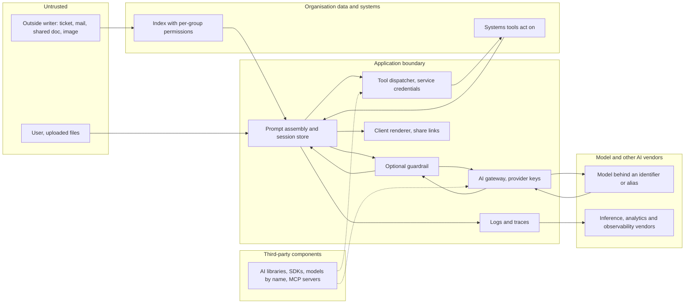

# Threat model: LLM applications (chat assistants, RAG and tool-using apps)

| Field | Value |
|---|---|
| Asset class | LLM applications (chat assistants, RAG and tool-using apps) |
| Version | 1.1 |
| Date | 2026-11-24 |
| Evaluated by | `app-benchmark`, `app-redteam` |
| Related threat models | Guardrails and safety classifiers; General-purpose models (frontier API and open weights); Agent features; AI coding agents; Vision-input models; Realtime voice models |
| Status | Current. Ratings are rough inherent risks for the reference deployment below; re-rate them for your own |

## 1. Executive summary

An LLM application is software built around a model the organisation does not control: a
chat assistant, an assistant that answers from the organisation's documents (RAG), or a
workflow where the model calls tools. The application owns the system prompt, the index and
its permissions, the tools and their credentials, how replies are rendered, the logs, the
gateway that holds the provider keys, the libraries and MCP servers it loads, and the choice
of model. Most of the risk sits in the joins: instructions, user input and retrieved content
share one prompt, and the application then trusts what comes back.

| Core risk | Why it matters | Inherent risk | Evaluated by |
|---|---|---|---|
| Indirect prompt injection through documents, mail, tickets, tool results, images and files | Anyone who can write to a source the assistant reads can instruct it; zero-click exfiltration was disclosed in several production assistants in 2025–2026 | Critical | Partly: both skills, but only text and only through the user turn |
| Data disclosure across users or tenants, and identity decided in the prompt | The service account and the index usually see more than any one user may | High | Partly: `app-redteam` objectives you write |
| Model output acted on: tools, rendering, SQL, shells | Whoever steers the model inherits what its output can do | High | Partly: `app-redteam` sees the reply text, not the effect |
| The AI platform around the model: gateways, flow builders, provider keys | The AI-application flaws listed as exploited in CISA's KEV catalog in 2025–2026 were in these components; stolen keys are resold and used for abuse (LLMjacking) | High | No: design review |
| Compromised AI libraries, models and MCP servers | Malicious releases of widely used LLM packages harvested provider keys in 2026 | High | No: design review |
| Jailbreaks and direct injection, including multi-turn escalation | Users will try; the output carries the organisation's name | High | Yes: `app-benchmark` by technique, `app-redteam` adaptively |
| Conversation data in logs, stores, share links and AI vendors | Logs are wider-access and longer-lived than the source systems, and AI vendors have retained and exposed them | High | No: design review |
| The model changes under a fixed application | Every result describes one model version; aliases move | High | Yes, by re-running on the new version |
| Wrong or manipulated answers that people or workflows act on | Customer-facing assistants speak for the organisation; recommendations and summaries have been steered by planted text | Medium | Partly: `app-redteam` objectives you write |

**Where risk concentrates.** In every channel that carries outsider-written content into the
prompt, since no model reliably separates data from instructions [1][8]; in the service
identity behind retrieval and tools, since the model cannot enforce authorisation [3]; in the
code that acts on the reply [2]; and in the platform around the model (gateway, flow builder,
packages, vendors), which holds every key and every conversation. The 2025–2026 record splits
along that line: exfiltration through the model was disclosed many times and fixed at the
rendering and egress layer, while the exploited incidents were in the platform and supply chain.

**What the evaluations can and cannot tell you.** `app-benchmark` sends a fixed labelled
corpus (about 2,960 single-message cases) to the application's endpoint and reports block
rate, false-block rate and attack success with 95% intervals, by category and technique
family. `app-redteam` runs adaptive multi-turn attacks seeded by objectives you write,
repeated so the success rate has an interval. Together they measure how the deployed
application responds to hostile **text conversation**. Neither plants content in your index
or tools, sends images, documents or audio, sees tool calls, rendered output or logs, drives
two user identities, measures cost, or looks at the gateway, packages or vendors. A good
result means the conversation channel held at this depth on this model version.

## 2. Scope and reference deployment

The ratings assume:

- Authenticated users (employees or customers) in a web client that renders Markdown.
- A hosted third-party model behind an identifier the application configures, called through
  an AI gateway or SDK that holds the provider keys; the application writes the system prompt.
- Retrieval over documents that different groups may see differently, including content
  written outside the team (customer tickets, inbound mail, shared documents), and file
  upload for documents and images.
- Read tools and at least one write tool (create a ticket, send a message), running under the
  application's service credentials, possibly through MCP servers.
- Optional input or output guardrails; conversations logged for support and debugging.

What moves the ratings: an anonymous public chatbot raises jailbreak and cost risk; no write
tools lowers the impact of output and tool threats (rendering still leaks); a single-tenant
index lowers cross-tenant risk; an index fed only by a curated team lowers indirect injection
to Medium; no file or image input lowers multimodal injection; a gateway, flow builder or
vector store reachable from the internet raises platform risk to Critical; a pinned
self-hosted model lowers vendor-change and vendor-logging risk; answers that commit the
organisation (prices, refunds, eligibility) raise misinformation to High.

Out of scope: the model's training and weights, a guardrail's own quality, agent-harness
features such as persistent memory and computer use (each has its own threat model), and
generic web security that does not involve model output. The AI-specific platform (gateway,
workflow builder, provider keys, MCP connections) is in scope because it holds the
application's model access and conversations.

## 3. System model

| Input | Who controls it |
|---|---|
| User message and uploaded files | The user, or whoever wrote the file |
| Retrieved content, tool results | Whoever can write to the source |
| System prompt, tool descriptions | The application team |
| Session and identity context | The application's authentication layer |
| Libraries, models loaded by name, MCP servers | Their publishers and registries |
| Model behaviour | The model vendor |

**Threat actors.** An adversarial user with public jailbreak and extraction techniques; an
outside writer with no account who can put text, hidden text or an image where the assistant
will read it; an insider seeking data beyond their permissions; a cost attacker scripting
requests; a credential thief who wants the provider keys for free compute or resale
(LLMjacking); a supply-chain attacker who publishes or takes over a package, model name or
MCP server; a business that wants the assistant to favour it; and, without malice, the
vendors, who change the model and keep logs under their terms.

## 4. Core threats

Ratings combine likelihood and impact (Low, Medium, High) using the matrix in the
threat-model method, for the reference deployment. Evidence status is one of *observed in
deployed systems*, *disclosed vulnerability* (no known exploitation), *demonstrated in
research* or *theoretical*. Framework ids for every threat are in section 5.

### app-indirect-injection — Indirect prompt injection (Critical)

- **What and where.** Instructions planted in a document, mail, ticket, calendar invitation,
  web form or tool result are retrieved beside the user's data and followed; applications
  "blur the line between data and instructions" [8]. Planted content can also be false: a few
  passages in a large index steered answers to chosen questions [10]. The way out is a
  rendered link or image, a write tool, or the user acting on a phishing answer.
- **Evidence status.** Disclosed vulnerabilities in production assistants, fixed by the
  vendors mostly at the rendering and egress layer; no malicious use publicly confirmed.
  EchoLeak (CVE-2025-32711): one email made Microsoft 365 Copilot exfiltrate data, evading an
  injection classifier and link redaction [9][34]. ForcedLeak: a public web form made
  Salesforce Agentforce send CRM data via an image URL on an expired but still-allowed domain
  [35]. Calendar invitations made Gemini take unrequested actions [37]; earlier, Slack AI put a
  private key into a link [11]. Planted instructions aimed at assistants are observed in the
  wild [41][42].
- **Rating.** Likelihood High (outsider-written content is indexed), impact High. Lower with
  a curated index, no remote image or link rendering, and confirmation before write tools.

### app-multimodal-injection — Instructions hidden in images, documents and audio (High)

- **What and where.** Files carry instructions the user does not see: white or 1-pixel text,
  zero-size fonts, text that appears only after the platform downscales an image, speech under
  other sound. OWASP LLM01:2026 names image, audio and video as injection channels and says to
  "Filter at every modality boundary" [1]; a text-only check never sees them.
- **Evidence status.** Disclosed: a document with 1-pixel white text made ChatGPT with Google
  Drive connected leak API keys through an image URL that rendered without a click [36]; text
  revealed only by downscaling steered Gemini and Vertex AI Studio, whose interface showed the
  full-size image [39]; hidden HTML in an email made Gemini's summary show a fake password
  warning with a phone number [40]. Observed: hidden instructions in 18 arXiv manuscripts aimed
  at LLM-assisted peer review [41].
- **Rating.** Likelihood Medium (needs a feature that reads files; tooling is public), impact
  High. Lower when files become text that is inspected like any input and hidden text is
  stripped or flagged.

### app-direct-injection — Direct injection and jailbreaks, including multi-turn (High)

- **What and where.** The user overrides the application's instructions or gets harmful or
  off-policy output, by asking plainly, wrapping the request (persona, cipher, code framing,
  another language), or escalating over several innocuous turns. It is the cheapest attack,
  the output carries the organisation's name, and an override starts the tool and data threats.
- **Evidence status.** Observed: developers' threat reports describe actors getting malware
  building blocks from public assistants after refusals, by splitting the work or claiming a
  capture-the-flag exercise [58][59], and assistant share links hosting ClickFix malware
  instructions [57]. Demonstrated: Crescendo succeeded across the models tested [12];
  flattened multi-turn jailbreaks reached 70.6% to 95.9% success [13]; low-resource languages
  got harmful output 79% of the time from one model [14]; adaptive attacks bypassed twelve
  defences that reported near-zero success on static tests [23]. OWASP: "no reliable
  prevention mechanism exists today" [1].
- **Rating.** Likelihood High, impact Medium (High for public or sensitive-domain
  assistants). Moves with model choice, output classification, and whether authority lives in
  the prompt.

### app-prompt-leak — Hidden context exposure: system prompt, tool schemas, retrieved policy (Medium)

- **What.** An attacker recovers what the application put in the context as configuration:
  system prompt, developer instructions, tool schemas, retrieved policy text. OWASP LLM08:2026,
  which replaces System Prompt Leakage, says to assume "hidden context is discoverable" and not
  to rely on it for authorisation or content filtering [4].
- **Evidence status.** Demonstrated: simple attacks recovered prompts with high probability
  across eleven models [15]. Disclosed (integrity): an enterprise AI platform kept 95
  system-prompt and model configurations where an unauthenticated attacker could rewrite them [45].
- **Rating.** Likelihood High, impact Low if the context holds nothing sensitive, High if it
  holds credentials, customer data or the only copy of an access rule.

### app-data-disclosure — Data disclosure across users and tenants (High)

- **What and where.** Retrieval runs with the application's identity or with stale or
  prompt-enforced filters, so another group's documents, personal data or secrets reach the
  answer. OWASP notes that similarity search "frequently runs across the full index before
  access control is applied" [5], and that filtering after generation cannot undo a chunk the
  model already saw [27].
- **Evidence status.** Theoretical in the research for this update (no public 2025–2026
  cross-tenant retrieval incident found); rated on the mechanism.
- **Rating.** Likelihood Medium, impact High (a reportable breach across customer
  boundaries). Lower with query-time permission checks and per-tenant indexes.

### app-session-identity — Session and identity handled around the model (High)

- **What and where.** History or cached results served to the wrong user; a claim in the chat
  ("I am the account owner") accepted as authorisation; tools that take a user id from the
  model; one service identity for every call, so only the model decides who may do what.
- **Evidence status.** Observed: a shared-cache fault showed some ChatGPT users others' chat
  titles and some payment details (2023) [19]. Disclosed: a secret shared by every ServiceNow
  instance and email-only account linking let an attacker act as any user and drive an AI
  agent to create an administrator (CVE-2025-12420) [44]; an MCP server SDK could deliver one
  client's messages to another (CVE-2026-111770) [61]. OWASP: run tools in the user's context [3].
- **Rating.** Likelihood Medium, impact High. Lower when identity comes only from the
  authenticated session and tools use per-user credentials.

### app-output-agency — Model output acted on: tools and downstream interpreters (High)

- **What and where.** The reply is rendered as HTML or Markdown, run as SQL or code, fetched as
  a URL, or turned into a tool call, so whoever steers the model reaches the browser, database,
  host or tool targets. OWASP lists XSS, CSRF, SSRF, privilege escalation and remote code
  execution [2], and excessive functionality, permissions and autonomy [3].
- **Evidence status.** Disclosed; no exploitation through model output publicly confirmed.
  Vanna.AI ran generated code with `exec` (CVE-2024-5565) [16]; a prompt to Lenovo's support
  chatbot produced HTML that ran in a support agent's browser and sent the session cookie out
  [43]; a popup escape from ChatGPT's HTML-preview sandbox could exfiltrate chats and files with
  Lockdown Mode on [38]; EchoLeak and ForcedLeak left through links and images [9][35].
- **Rating.** Likelihood Medium, impact High. Raised by text-to-SQL, run-the-code and preview
  features, generic tools and auto-approval; lowered by treating the model as an untrusted user
  (encoding, parameterised queries, sandboxes, confirmation outside the model).

### app-ai-platform — The AI platform around the model: gateways, flow builders and provider keys (High)

- **What and where.** The gateway that holds provider keys, the flow builder, the vector store
  and their admin and test endpoints are web software that sees every prompt, and several run
  code by design (flow validation, MCP test endpoints, custom-code guardrails). A stolen key
  gives its holder the model on the organisation's account, at its cost and under its name
  (LLMjacking); OWASP counts stolen credentials among the ways to trigger expensive computation [6].
- **Evidence status.** Observed. CISA's KEV catalog lists six Langflow flaws (the first with
  known ransomware use), one n8n flaw and four LiteLLM gateway flaws, including SQL injection in
  key verification and command execution through MCP test endpoints [46]. Sysdig saw an
  operator exploit an exposed Langflow host and harvest LLM provider keys [47]; Storm-2139 used
  scraped customer credentials to reach generative AI accounts and resold access [49]; an
  inference provider linked its 2026 breaches to an "LLMJacking" group [50]. Disclosed: SQL
  injection in an enterprise AI platform exposed 46.5 million chat messages [45].
- **Rating.** Likelihood Medium (High when internet-reachable), impact High (all prompts,
  logs, keys and system prompts at once). Lower with the platform off the internet, test
  endpoints off in production, and keys scoped per application with usage alerts.

### app-supply-chain — Compromised AI libraries, models and MCP servers (High)

- **What and where.** The application loads SDKs, gateway and orchestration libraries, models
  by name from hubs, and MCP servers. A malicious release, a taken-over namespace or a server
  that changes after approval runs with the application's credentials (LLM04:2026 [28]; ASI04 [31]).
- **Evidence status.** Observed: compromised LiteLLM releases on PyPI in March and October 2026
  [53] and Microsoft Agent Framework releases in November 2026 [54] carried stealers for cloud
  and AI-provider keys; a package impersonating Postmark's MCP server copied every email sent
  through it to an outside address after 15 clean releases [55]. Disclosed: re-registered
  abandoned Hugging Face namespaces gave code execution on Vertex AI and Azure AI Foundry
  endpoints that loaded models by name [56].
- **Rating.** Likelihood Medium, impact High. Raised by unpinned dependencies, models loaded by
  name and unreviewed MCP servers; lowered by pinned hashes, mirrors and re-review on change.

### app-misinformation — Wrong or manipulated answers that people or workflows act on (Medium)

- **What and where.** A credible wrong answer is acted on: a support assistant states a refund
  rule or price that does not exist, a summary carries a planted alert, a recommendation was
  steered, a workflow accepts the model's claim that a condition is met. OWASP LLM07:2026: "The
  core risk is that the incorrect output is trusted and acted upon" [30]. In code or commands,
  a hallucinated package name is a lure: one spread to over 237 repositories through
  LLM-written agent skills [60].
- **Evidence status.** Observed (manipulation): over 50 prompts from 31 companies in
  "Summarize with AI" links told assistants to remember the company as a trusted source [42].
  Disclosed: the fake warning in a Gemini summary [40]. Demonstrated: planted passages steered
  RAG answers [10]. No verified 2025–2026 incident of a customer-facing assistant inventing a
  commitment was found in the research, so that case is rated on the mechanism.
- **Rating.** Likelihood Medium, impact Medium (High where answers commit the organisation or
  drive financial, medical, legal or security decisions without review). Lower with answers
  citing checkable sources and commitments taken from systems of record, not model text.

### app-over-refusal — Over-refusal (Medium)

- **What.** Legitimate requests that resemble harmful ones are refused or blocked: the cost
  side of every safeguard, and an availability risk, since refused users route around the
  assistant, often with unapproved tools.
- **Evidence status.** Demonstrated: XSTest documented refusals of clearly safe prompts [17];
  OR-Bench found safety gains often come with over-refusal across 32 models [18].
- **Rating.** Likelihood Medium (High for security, health and legal users), impact Medium.

### app-denial-of-wallet — Unbounded cost (Medium)

- **What.** Scripted requests, very long inputs or tool loops run up spend or exhaust a shared
  quota; OWASP names "Denial of Wallet" [6]. Cost abuse with stolen keys is app-ai-platform.
- **Evidence status.** Theoretical for the application endpoint in the research reviewed
  (ATLAS rates Cost Harvesting feasible [33]); the observed cost abuse came through stolen keys
  [49][50].
- **Rating.** Likelihood Medium (High for anonymous endpoints), impact Medium. Lower with
  per-user rate, token, step and spend limits.

### app-prompt-logging — Conversation data in logs, stores, share links and AI vendors (High)

- **What and where.** The application, gateway, observability tools and AI vendors (model,
  inference, analytics, guardrail) log or store prompts, chunks, replies and agent traces, with
  whatever users pasted; logs are wider-access and longer-lived than the sources, and share
  links publish conversations. OWASP: enforce no-retain "technically ... rather than policy
  text alone" [27].
- **Evidence status.** Observed: an inference provider retained a customer's data despite a
  zero-retention commitment, and an intrusion exposed that customer's AI chat transcripts for
  under 1% of its workspaces [50][51]; a key held by the same provider was used to copy another
  customer's agent traces, whose credentials opened further systems [52]. Disclosed: exposed
  databases held chat history and API secrets [20] and 46.5 million chat messages [45]. NIST
  lists data privacy among generative AI risks [7].
- **Rating.** Likelihood High (full logging is a common default), impact Medium (High for
  health, financial or credential data).

### app-model-change — The model changes under a fixed application (High)

- **What.** An alias moves, the vendor updates in place, the gateway falls back to another
  model, or the team switches vendor. Refusal and injection resistance move with it.
- **Evidence status.** Observed: a vendor rolled back a production update within a week after
  users noticed a behaviour change [22]. Demonstrated: the same named models changed
  substantially between March and June 2023 [21].
- **Rating.** Likelihood High, impact Medium. Lower with pinned dated identifiers and a change
  process that re-runs the evaluations.

## 5. Framework mapping

Ids are from the current lists as verified for this repository on 2026-11-24: OWASP Top 10
for LLM Applications 2026 [1]–[6][27]–[30], OWASP Top 10 for Agentic Applications for 2026
[31], the OWASP MCP Top 10, which is still a beta (v0.1) [32], and MITRE ATLAS release
2026.10 [33]. The 2025-to-2026 OWASP crosswalk is in [frameworks.md](frameworks.md).

| Threat | OWASP LLM 2026 | OWASP Agentic | OWASP MCP | MITRE ATLAS 2026.10 |
|---|---|---|---|---|
| app-indirect-injection | LLM01:2026, LLM05:2026, LLM09:2026 | ASI01, ASI06 | MCP06:2025, MCP03:2025 | AML.T0051.001, AML.T0093, AML.T0070, AML.T0071, AML.T0077, AML.T0136 |
| app-multimodal-injection | LLM01:2026 | ASI01 | — | AML.T0051.001, AML.T0129, AML.T0068, AML.T0043, AML.T0077 |
| app-direct-injection | LLM01:2026 | ASI01 | — | AML.T0051.000, AML.T0054, AML.T0068 |
| app-prompt-leak | LLM08:2026 | — | — | AML.T0069.002, AML.T0085.003, AML.T0084.001 |
| app-data-disclosure | LLM02:2026, LLM09:2026 | ASI03 | MCP10:2025 | AML.T0085.000, AML.T0136 |
| app-session-identity | LLM02:2026, LLM03:2026 | ASI03 | MCP07:2025, MCP10:2025 | AML.T0085.002, AML.T0012 |
| app-output-agency | LLM10:2026, LLM03:2026 | ASI02, ASI05 | MCP05:2025, MCP02:2025 | AML.T0077, AML.T0053, AML.T0050, AML.T0086 |
| app-ai-platform | LLM06:2026, LLM02:2026 | ASI05 | MCP01:2025, MCP05:2025, MCP07:2025 | AML.T0049, AML.T0132, AML.T0055, AML.T0012, AML.T0040, AML.T0034 |
| app-supply-chain | LLM04:2026 | ASI04 | MCP04:2025, MCP03:2025, MCP09:2025 | AML.T0010.001, AML.T0010.003, AML.T0010.005, AML.T0115.002, AML.T0109, AML.T0110 |
| app-misinformation | LLM07:2026 | ASI09, ASI08 | — | AML.T0130, AML.T0067, AML.T0131, AML.T0060, AML.T0048.000, AML.T0048.001 |
| app-over-refusal | — | — | — | — |
| app-denial-of-wallet | LLM06:2026 | — | — | AML.T0034.000, AML.T0034.001, AML.T0034.002, AML.T0029 |
| app-prompt-logging | LLM02:2026 | — | MCP01:2025 | AML.T0085.002, AML.T0055, AML.T0132 |
| app-model-change | — | — | — | — |

**Coverage check.** Every item of the three lists, with the threats that cover it. The
Agentic list applies because the reference deployment calls tools; the MCP list applies
where the application connects MCP servers.

| # | OWASP LLM 2026 | OWASP Agentic | OWASP MCP |
|---|---|---|---|
| 01 | LLM01:2026 Prompt Injection: app-indirect-injection, app-multimodal-injection, app-direct-injection | ASI01 Agent Goal Hijack: app-indirect-injection, app-multimodal-injection, app-direct-injection | MCP01:2025 Token Mismanagement & Secret Exposure: app-ai-platform, app-prompt-logging |
| 02 | LLM02:2026 Sensitive Information Disclosure: app-data-disclosure, app-session-identity, app-prompt-logging | ASI02 Tool Misuse and Exploitation: app-output-agency | MCP02:2025 Privilege Escalation via Scope Creep: app-output-agency |
| 03 | LLM03:2026 Excessive Agency: app-output-agency, app-session-identity | ASI03 Identity and Privilege Abuse: app-session-identity, app-data-disclosure | MCP03:2025 Tool Poisoning: app-supply-chain, app-indirect-injection |
| 04 | LLM04:2026 Supply Chain: app-supply-chain | ASI04 Agentic Supply Chain Vulnerabilities: app-supply-chain | MCP04:2025 Software Supply Chain Attacks & Dependency Tampering: app-supply-chain |
| 05 | LLM05:2026 Data and Model Poisoning: app-indirect-injection (index poisoning); training data is not applicable, as the application does not train the model | ASI05 Unexpected Code Execution (RCE): app-output-agency, app-ai-platform | MCP05:2025 Command Injection & Execution: app-output-agency, app-ai-platform |
| 06 | LLM06:2026 Unbounded Consumption: app-denial-of-wallet, app-ai-platform; model cloning is the vendor's risk | ASI06 Memory & Context Poisoning: app-indirect-injection (index and session context); persistent memory is in agent features | MCP06:2025 Intent Flow Subversion (earlier "Prompt Injection via Contextual Payloads"): app-indirect-injection |
| 07 | LLM07:2026 Misinformation: app-misinformation | ASI07 Insecure Inter-Agent Communication: not applicable, no agent-to-agent messages | MCP07:2025 Insufficient Authentication & Authorization: app-session-identity, app-ai-platform |
| 08 | LLM08:2026 Hidden Context Exposure: app-prompt-leak | ASI08 Cascading Failures: app-misinformation where a wrong answer feeds a workflow; multi-agent propagation not applicable | MCP08:2025 Lack of Audit and Telemetry: not a threat on its own; a design-review question (section 8) |
| 09 | LLM09:2026 Vector and Embedding Weaknesses: app-data-disclosure, app-indirect-injection | ASI09 Human-Agent Trust Exploitation: app-misinformation | MCP09:2025 Shadow MCP Servers: app-supply-chain (servers connected outside review) |
| 10 | LLM10:2026 Improper Output Handling: app-output-agency | ASI10 Rogue Agents: not applicable, each request runs a bounded loop the application controls (agent features, coding agents) | MCP10:2025 Context Injection & Over-Sharing: app-data-disclosure, app-session-identity |

No OWASP item covers app-over-refusal or app-model-change; both stay because they change what
every other measurement means.

**MITRE ATLAS.** The threats fall under Initial Access (AML.TA0004), AI Model Access
(AML.TA0000), Execution (AML.TA0005), Persistence (AML.TA0006), Privilege Escalation
(AML.TA0012), Defense Evasion (AML.TA0007), Credential Access (AML.TA0013), Discovery
(AML.TA0008), Collection (AML.TA0009), Exfiltration (AML.TA0010), Impact (AML.TA0011),
Resource Development (AML.TA0003) and AI Attack Adaptation (AML.TA0001). Matching case
studies: app-indirect-injection AML.CS0059 (EchoLeak), AML.CS0035 (Slack AI), AML.CS0063
(Gemini invitations), AML.CS0026, AML.CS0029, AML.CS0037, AML.CS0039, AML.CS0066;
app-output-agency AML.CS0060 (Lenovo), AML.CS0052, AML.CS0062; app-misinformation
AML.CS0072; app-ai-platform AML.CS0030 (LLMjacking), AML.CS0057 (Storm-2139), AML.CS0070 [48];
app-supply-chain AML.CS0053, AML.CS0054, AML.CS0065.

## 6. Recent incidents

2025 to November 2026, from the research for this update; each row was checked against the
cited primary source.

| Date | What happened | Category | Threat id(s) | Source |
|---|---|---|---|---|
| 2025-01 | An unauthenticated DeepSeek database held over a million log entries including chat history and API secrets; secured after disclosure | Disclosed vulnerability | app-prompt-logging, app-ai-platform | [20](https://www.wiz.io/blog/wiz-research-uncovers-exposed-deepseek-database-leak) |
| 2025-02 | Microsoft named four defendants in Storm-2139, which used scraped customer credentials to reach generative AI accounts, bypass safeguards and resell access | Attack on an AI system | app-ai-platform | [49](https://blogs.microsoft.com/on-the-issues/2025/02/27/disrupting-cybercrime-abusing-gen-ai/) |
| 2025-05 to 2026-11 | CISA added six Langflow flaws (the first with known ransomware use), one n8n flaw and four LiteLLM gateway flaws to KEV, including code execution via the custom-code guardrail and MCP test endpoints | Attack on an AI system | app-ai-platform | [46](https://www.cisa.gov/sites/default/files/feeds/known_exploited_vulnerabilities.json) |
| 2025-06 | EchoLeak (CVE-2025-32711): one email made Microsoft 365 Copilot exfiltrate data with no user action; fixed service-side | Disclosed vulnerability | app-indirect-injection, app-output-agency | [34](https://www.cve.org/CVERecord?id=CVE-2025-32711) |
| 2025-07 | Hidden HTML in an email made Gemini's summary show a fabricated password warning with a phone number | Disclosed vulnerability | app-multimodal-injection, app-misinformation | [40](https://0din.ai/blog/phishing-for-gemini) |
| 2025-07 | 18 arXiv manuscripts carried hidden instructions aimed at LLM-assisted peer review | Attack on an AI system | app-multimodal-injection, app-misinformation | [41](https://arxiv.org/abs/2507.06185) |
| 2025-08 | Instructions in calendar invitations and email subjects made Gemini take unrequested actions; Google added confirmations and classifiers | Disclosed vulnerability | app-indirect-injection, app-output-agency | [37](https://www.safebreach.com/blog/invitation-is-all-you-need-hacking-gemini/) |
| 2025-08 | A document with 1-pixel white text made ChatGPT with Google Drive connected leak API keys via a rendered image URL; text revealed only by image downscaling steered Gemini and Vertex AI Studio | Disclosed vulnerability | app-multimodal-injection, app-indirect-injection | [36](https://labs.zenity.io/p/agentflayer-chatgpt-connectors-0click-attack-5b41), [39](https://blog.trailofbits.com/2025/08/21/weaponizing-image-scaling-against-production-ai-systems/) |
| 2025-08 | A prompt to Lenovo's support chatbot produced HTML that ran in a support agent's browser and sent the session cookie out | Disclosed vulnerability | app-output-agency, app-direct-injection | [43](https://atlas.mitre.org/studies/AML.CS0060) |
| 2025-09 | ForcedLeak: text in a public web form made Salesforce Agentforce send CRM data via an image URL on an expired, still-allowed domain | Disclosed vulnerability | app-indirect-injection, app-output-agency | [35](https://noma.security/blog/forcedleak-agent-risks-exposed-in-salesforce-agentforce/) |
| 2025-09 | A package impersonating Postmark's MCP server began copying every email sent through it to an outside address | Attack on an AI system | app-supply-chain | [55](https://postmarkapp.com/blog/information-regarding-malicious-postmark-mcp-package/) |
| 2025-09 | Re-registered abandoned Hugging Face namespaces gave code execution on Vertex AI and Azure AI Foundry endpoints | Disclosed vulnerability | app-supply-chain | [56](https://unit42.paloaltonetworks.com/model-namespace-reuse/) |
| 2025-10 to 2026-02 | OpenAI and Google reported actors getting malware building blocks from public assistants after refusals, and ClickFix instructions hosted on assistant share links | AI used against other systems | app-direct-injection | [58](https://openai.com/global-affairs/disrupting-malicious-uses-of-ai-october-2025), [57](https://cloud.google.com/blog/topics/threat-intelligence/distillation-experimentation-integration-ai-adversarial-use) |
| 2026-01 | BodySnatcher (CVE-2025-12420): a shared secret and email-only account linking let an attacker act as any ServiceNow user and drive an AI agent | Disclosed vulnerability | app-session-identity | [44](https://appomni.com/ao-labs/bodysnatcher-agentic-ai-security-vulnerability-in-servicenow/) |
| 2026-02 | Over 50 prompts from 31 companies in "Summarize with AI" links told assistants to remember the company as a trusted source | Attack on an AI system | app-misinformation, app-indirect-injection | [42](https://www.microsoft.com/en-us/security/blog/2026/02/10/ai-recommendation-poisoning/) |
| 2026-03 | An autonomous agent found SQL injection in an enterprise AI platform exposing 46.5 million chat messages and writable system prompts; patched next day | Disclosed vulnerability | app-ai-platform, app-prompt-logging, app-prompt-leak | [45](https://codewall.ai/blog/how-we-hacked-mckinseys-ai-platform) |
| 2026-03 to 2026-11 | Compromised LiteLLM (twice) and Microsoft Agent Framework releases on PyPI carried credential stealers aimed at cloud and AI-provider keys | Attack on an AI system | app-supply-chain, app-ai-platform | [53](https://docs.litellm.ai/blog/security-incident-oct-21-2026-attack-chain), [54](https://www.wiz.io/blog/malicious-version-of-microsofts-agent-framework-published-to-pypi) |
| 2026-10 | An inference provider's breaches exposed Notion AI transcripts it had retained despite a zero-retention commitment, and Cursor's stored agent traces | Attack on an AI system | app-prompt-logging, app-ai-platform | [50](https://fireworks.ai/security/bulletins), [51](https://notion.com/help/security-incident-involving-a-third-party-ai-vendor) |
| 2026-11 | A popup escape from ChatGPT's HTML-preview sandbox could exfiltrate chats and files with Lockdown Mode on; fixed in September | Disclosed vulnerability | app-output-agency, app-indirect-injection | [38](https://research.checkpoint.com/2026/chatgpt-lockdown-mode-bypass-phishing-malware-delivery-and-silent-data-exfiltration/) |

**Patterns.** Zero-click and one-click exfiltration from production assistants was disclosed
again and again, and vendors fixed it mostly at the output and egress layer (allowed domains,
image rendering, sandbox permissions) rather than by model resistance; no malicious use of
these chains was publicly confirmed, but planted instructions aimed at assistants were found
in the wild, increasingly hidden in documents and images. The exploited incidents sat in the
platform around the model (gateways, flow builders, packages, AI vendors), and what attackers
took was mostly keys and stored conversations.

## 7. How this repository's evaluations relate

| Threat area | Skill | What it measures | What it cannot see |
|---|---|---|---|
| Direct injection and jailbreaks | `app-benchmark` | Recall and attack success per family: `direct`, `goal_hijacking` (injection); `direct_harmful`, the ten ATT&CK-tactic `cyber_*` families and `cyber_interpreter_*` (plain requests); `m2s_*` flattened multi-turn wrappers (jailbreak uplift over the plain rate) | New techniques; non-English input |
| Same, adaptively | `app-redteam` | Crescendo (5 turns, 5 backtracks by default [24]) with `--repeat 3`: attack success with interval, objectives broken at least once, mixed outcomes | A score comparable run to run |
| Indirect injection | both | `indirect` family (55 cases) and `indirect` objectives, all delivered in the user turn | Whether retrieval or tools carry planted content; rendered exfiltration |
| Multimodal injection | neither | Both skills send text only. Outside the application, `vision-model-benchmark` (`vi-image-injection`, `vi-tool-hijack`) and `voice-model-benchmark` (`vm-third-party-speech`) measure the model's own response to image-borne and second-voice instructions | Your upload, conversion and rendering path |
| Hidden context exposure | both | `data_leakage`: `system_prompt_exfiltration` and `m2s_*` leak families; extraction objectives | Exact leakage: the judge does not know your prompt unless you add a canary; tool schemas and retrieved policy |
| Data disclosure, identity, output and tools | `app-redteam` | Objectives you write, plus the optional cyber pack (`bola`, `bfla`, `rbac`, `pii:*`, `shell-injection`, `sql-injection`, `ssrf`, `excessive-agency`, `hijacking`, `tool-discovery`) | Tool calls actually made, downstream execution, a second identity |
| Misinformation and commitments | `app-redteam` | Objectives you write, such as getting a support bot to issue a refund without approval; the grader judges the reply against the objective | Whether a factual answer is correct: neither skill checks answers against your sources |
| Over-refusal | `app-benchmark` | False-block rate on the `benign` set (XSTest safe prompts, CyberSecEval benign cyber questions), the required pair of every recall | Your users' real traffic |
| Model change | both | The same corpus or cached objectives on the new version; change in recall, false-block rate and attack success | Changes between your runs |
| AI platform, supply chain, conversation data, cost | none | Nothing here measures these. If you rely on a scanner for MCP servers or other AI components, `security-tool-benchmark` compares scanners on labelled samples | The components themselves |

Why they exist: `app-benchmark` gives a repeatable number for known hostile and benign
conversation, comparable across model versions and defence settings, and its families stop a
good overall score hiding a weak technique. `app-redteam` exists because static attacks
overstate robustness [23] and multi-turn escalation succeeds where single turns fail [12];
its objectives are the only way to reach threats specific to your data and tools. Both vary
one arm (the target or one defence setting) and hold the corpus or objectives and the judge
fixed. A guardrail in front of the application is measured on its own by `guardrail-benchmark`.

Left to design review, because they live in code, configuration and contracts a conversation
cannot observe: the retrieval, tool and file channels of injection, permission-correct
retrieval, session and cache keying, downstream handling of output, tool scopes, the gateway
and flow builder, provider keys, dependencies and MCP servers, cost limits, logging, share
links and vendor data terms. Custom probes for these need your own index, files with hidden
content, canaries, a second identity and your tool audit log.

## 8. Design review questions

- Which sources and file types reach the prompt, who can write to each, and can someone
  outside the organisation? Is retrieved, tool and file content inspected, or only user input?
  Is hidden or invisible text in documents and images stripped or flagged?
- Is retrieval filtered by the requesting user's permissions at query time? Are tenants in
  separate indexes?
- Where does identity come from on each tool call, and can the model supply or change it? Are
  caches, session stores and MCP transports keyed by tenant and user?
- For each tool: what can it change or send, under which credential, with what confirmation
  outside the model? Is there an audit log linking tool calls to users?
- Does the client fetch remote images, follow links or run previews in replies, and to which
  domains? Is model output encoded or parameterised before SQL, shells and templates?
- Does the hidden context (system prompt, tool schemas, retrieved policy) contain anything
  that would matter if published or changed, and who can edit where it is stored?
- Where does the application state prices, policies or commitments? Do they come from a system
  of record or from model text, and who reviews answers that trigger actions?
- Is the gateway, flow builder or vector store reachable from the internet, with admin, test
  or code-validation endpoints on? Are deployed versions in the KEV catalog? How are provider
  keys scoped and rotated, and would use of a stolen key be noticed?
- Which AI libraries, models and MCP servers are loaded, from where, pinned how, and who
  reviews an update or a newly connected server?
- What are the per-user and global limits on requests, tokens, tool steps and spend?
- What is logged, where, for how long, and who can read it? Which vendors receive prompts,
  replies or traces, what do their terms say about retention and training, and is that
  checked? Are share links public by default?
- Is the model identifier pinned? Does the gateway fall back to another model? Who is told,
  and is this evaluation re-run?

Residual risk to state plainly: prompt injection is not solved [1][23], so a deployment that
indexes outsider content and can act or render links carries risk however it scores here.
Designs that keep untrusted data from steering control flow reduce it at a utility cost
[25][26]. Both skills grade with a judge whose error rate is not measured; spot-check
transcripts.

## 9. References

References 1–6 and 27–61 read on 2026-11-24; the others on 2026-11-21.

1. OWASP GenAI Security Project, "LLM01:2026 Prompt Injection". https://genai.owasp.org/llm2026/llm012026-prompt-injection/
2. OWASP GenAI Security Project, "LLM10:2026 Improper Output Handling". https://genai.owasp.org/llm2026/llm102026-improper-output-handling/
3. OWASP GenAI Security Project, "LLM03:2026 Excessive Agency". https://genai.owasp.org/llm2026/llm032026-excessive-agency/
4. OWASP GenAI Security Project, "LLM08:2026 Hidden Context Exposure". https://genai.owasp.org/llm2026/llm082026-hidden-context-exposure/
5. OWASP GenAI Security Project, "LLM09:2026 Vector and Embedding Weaknesses". https://genai.owasp.org/llm2026/llm092026-vector-and-embedding-weaknesses/
6. OWASP GenAI Security Project, "LLM06:2026 Unbounded Consumption". https://genai.owasp.org/llm2026/llm062026-unbounded-consumption/
7. NIST AI 600-1, "Artificial Intelligence Risk Management Framework: Generative Artificial Intelligence Profile", July 2024. https://doi.org/10.6028/NIST.AI.600-1
8. Greshake et al., "Not what you've signed up for: Compromising Real-World LLM-Integrated Applications with Indirect Prompt Injection", arXiv:2302.12173. https://arxiv.org/abs/2302.12173
9. Reddy and Gujral, "EchoLeak: The First Real-World Zero-Click Prompt Injection Exploit in a Production LLM System", arXiv:2509.10540. https://arxiv.org/abs/2509.10540
10. Zou et al., "PoisonedRAG: Knowledge Corruption Attacks to Retrieval-Augmented Generation of Large Language Models", arXiv:2402.07867. https://arxiv.org/abs/2402.07867
11. PromptArmor, "Data Exfiltration from Slack AI via indirect prompt injection", 20 August 2024. https://promptarmor.substack.com/p/data-exfiltration-from-slack-ai-via
12. Russinovich, Salem and Eldan, "Great, Now Write an Article About That: The Crescendo Multi-Turn LLM Jailbreak Attack", arXiv:2404.01833. https://arxiv.org/abs/2404.01833
13. Ha et al., "M2S: Multi-turn to Single-turn jailbreak in Red Teaming for LLMs", ACL 2025. https://aclanthology.org/2025.acl-long.805
14. Yong, Menghini and Bach, "Low-Resource Languages Jailbreak GPT-4", arXiv:2310.02446. https://arxiv.org/abs/2310.02446
15. Zhang, Carlini and Ippolito, "Effective Prompt Extraction from Language Models", arXiv:2307.06865. https://arxiv.org/abs/2307.06865
16. JFrog Security Research, "When Prompts Go Rogue: Analyzing a Prompt Injection Code Execution in Vanna.AI", 27 June 2024. https://jfrog.com/blog/prompt-injection-attack-code-execution-in-vanna-ai-cve-2024-5565/
17. Röttger et al., "XSTest: A Test Suite for Identifying Exaggerated Safety Behaviours in Large Language Models", arXiv:2308.01263. https://arxiv.org/abs/2308.01263
18. Cui et al., "OR-Bench: An Over-Refusal Benchmark for Large Language Models", arXiv:2405.20947. https://arxiv.org/abs/2405.20947
19. OpenAI, "March 20 ChatGPT outage: Here's what happened", March 2023. https://openai.com/index/march-20-chatgpt-outage/
20. Wiz Research, "Wiz Research Uncovers Exposed DeepSeek Database Leaking Sensitive Information, Including Chat History", 29 January 2025. https://www.wiz.io/blog/wiz-research-uncovers-exposed-deepseek-database-leak
21. Chen, Zaharia and Zou, "How is ChatGPT's behavior changing over time?", arXiv:2307.09009. https://arxiv.org/abs/2307.09009
22. OpenAI, "Sycophancy in GPT-4o: What happened and what we're doing about it", 29 April 2025. https://openai.com/index/sycophancy-in-gpt-4o/
23. Nasr et al., "The Attacker Moves Second: Stronger Adaptive Attacks Bypass Defenses Against LLM Jailbreaks and Prompt Injections", arXiv:2510.09023. https://arxiv.org/abs/2510.09023
24. Promptfoo documentation, "Multi-turn Jailbreaks Strategy". https://www.promptfoo.dev/docs/red-team/strategies/multi-turn/
25. Debenedetti et al., "Defeating Prompt Injections by Design", arXiv:2503.18813. https://arxiv.org/abs/2503.18813
26. Beurer-Kellner et al., "Design Patterns for Securing LLM Agents against Prompt Injections", arXiv:2506.08837. https://arxiv.org/abs/2506.08837
27. OWASP GenAI Security Project, "LLM02:2026 Sensitive Information Disclosure". https://genai.owasp.org/llm2026/llm022026-sensitive-information-disclosure/
28. OWASP GenAI Security Project, "LLM04:2026 Supply Chain". https://genai.owasp.org/llm2026/llm042026-supply-chain/
29. OWASP GenAI Security Project, "LLM05:2026 Data and Model Poisoning". https://genai.owasp.org/llm2026/llm052026-data-and-model-poisoning/
30. OWASP GenAI Security Project, "LLM07:2026 Misinformation". https://genai.owasp.org/llm2026/llm072026-misinformation/
31. OWASP GenAI Security Project, "OWASP Top 10 for Agentic Applications for 2026", December 2025. https://genai.owasp.org/resource/owasp-top-10-for-agentic-applications-for-2026/
32. OWASP, "OWASP MCP Top 10" (beta, Top10 tab v0.1; source repository HEAD 165fe0f, 2026-07-29). https://owasp.org/www-project-mcp-top-10/ ; https://github.com/OWASP/www-project-mcp-top-10
33. MITRE ATLAS data release 2026.10, 28 October 2026. AML.T0012, AML.T0049 and AML.T0055 were checked by this update against the same file. https://github.com/mitre-atlas/atlas-data/blob/main/dist/v6/ATLAS-2026.10.yaml
34. CVE-2025-32711 (EchoLeak), CVE record; MITRE ATLAS case study AML.CS0059. https://www.cve.org/CVERecord?id=CVE-2025-32711
35. Noma Security, ForcedLeak write-up on Salesforce Agentforce, September 2025. https://noma.security/blog/forcedleak-agent-risks-exposed-in-salesforce-agentforce/
36. Zenity Labs, AgentFlayer write-up on a zero-click attack through ChatGPT Connectors, August 2025. https://labs.zenity.io/p/agentflayer-chatgpt-connectors-0click-attack-5b41
37. SafeBreach, write-up on promptware attacks against Gemini through calendar invitations, August 2025; Nassi, Cohen and Yair, arXiv:2508.12175; MITRE ATLAS AML.CS0063. https://www.safebreach.com/blog/invitation-is-all-you-need-hacking-gemini/
38. Check Point Research, write-up on a ChatGPT Lockdown Mode bypass through the HTML-preview sandbox, 5 November 2026. https://research.checkpoint.com/2026/chatgpt-lockdown-mode-bypass-phishing-malware-delivery-and-silent-data-exfiltration/
39. Trail of Bits, blog post on image-scaling prompt injection against production AI systems, 21 August 2025. https://blog.trailofbits.com/2025/08/21/weaponizing-image-scaling-against-production-ai-systems/
40. 0DIN, blog post on hidden-text prompt injection in Gemini email summaries, July 2025 (submission 0xE24D9E6B). https://0din.ai/blog/phishing-for-gemini
41. Lin, hidden prompts in arXiv manuscripts aimed at AI-assisted peer review, arXiv:2507.06185. https://arxiv.org/abs/2507.06185
42. Microsoft Security blog, AI Recommendation Poisoning, 10 February 2026; MITRE ATLAS AML.CS0072. https://www.microsoft.com/en-us/security/blog/2026/02/10/ai-recommendation-poisoning/
43. MITRE ATLAS case study AML.CS0060, "Cross-Site Scripting via Prompt Manipulation in Lenovo AI Chatbot" (ATLAS 2026.10). https://atlas.mitre.org/studies/AML.CS0060
44. AppOmni Labs, BodySnatcher write-up on ServiceNow AI agents, 13 January 2026; CVE-2025-12420. https://appomni.com/ao-labs/bodysnatcher-agentic-ai-security-vulnerability-in-servicenow/
45. CodeWall, write-up on an SQL injection in McKinsey's Lilli AI platform, 9 March 2026. https://codewall.ai/blog/how-we-hacked-mckinseys-ai-platform
46. CISA, Known Exploited Vulnerabilities catalog, feed version 2026.11.23 (Langflow, n8n and LiteLLM entries). https://www.cisa.gov/sites/default/files/feeds/known_exploited_vulnerabilities.json
47. Sysdig Threat Research Team, JADEPUFFER agentic ransomware report, 1 July 2026. https://sysdig.com/blog/jadepuffer-agentic-ransomware-for-automated-database-extortion
48. Unit 42, autonomous AI agent attempts against Langflow and n8n, 2026; MITRE ATLAS AML.CS0070. https://unit42.paloaltonetworks.com/autonomous-ai-cyber-attack-campaign/
49. Microsoft On the Issues, Digital Crimes Unit post on Storm-2139, 27 February 2025; MITRE ATLAS AML.CS0057. https://blogs.microsoft.com/on-the-issues/2025/02/27/disrupting-cybercrime-abusing-gen-ai/
50. Fireworks AI, security bulletins (2026 incidents). https://fireworks.ai/security/bulletins
51. Notion Help Center, security incident involving a third-party AI vendor, 2026. https://notion.com/help/security-incident-involving-a-third-party-ai-vendor
52. Cursor blog, security incident update, 13 November 2026. https://cursor.com/blog/security-incident-update
53. LiteLLM, root-cause analysis of the 21 October 2026 security incident; OSV PYSEC-2026-2 (March 2026 releases). https://docs.litellm.ai/blog/security-incident-oct-21-2026-attack-chain ; https://api.osv.dev/v1/vulns/PYSEC-2026-2
54. Wiz Research, blog post on a malicious version of Microsoft's agent-framework on PyPI, November 2026. https://www.wiz.io/blog/malicious-version-of-microsofts-agent-framework-published-to-pypi
55. Postmark, statement on the malicious postmark-mcp package, 25 September 2025; MITRE ATLAS AML.CS0053. https://postmarkapp.com/blog/information-regarding-malicious-postmark-mcp-package/
56. Unit 42, research on model namespace reuse, September 2025; MITRE ATLAS AML.CS0065. https://unit42.paloaltonetworks.com/model-namespace-reuse/
57. Google Threat Intelligence Group, AI Threat Tracker: distillation, experimentation and continued integration, 12 February 2026. https://cloud.google.com/blog/topics/threat-intelligence/distillation-experimentation-integration-ai-adversarial-use
58. OpenAI, "Disrupting malicious uses of AI: October 2025", 7 October 2025. https://openai.com/global-affairs/disrupting-malicious-uses-of-ai-october-2025
59. Google Threat Intelligence Group, AI Threat Tracker: threat actor usage of AI tools, 5 November 2025. https://cloud.google.com/blog/topics/threat-intelligence/threat-actor-usage-of-ai-tools
60. Aikido Security, blog post on agent skills spreading a hallucinated npx package, January 2026. https://aikido.dev/blog/agent-skills-spreading-hallucinated-npx-commands
61. CVE-2026-111770, `@modelcontextprotocol/server` cross-client message delivery, CVE record (GHSA-jm63-cq47-j5jp). https://www.cve.org/CVERecord?id=CVE-2026-111770
