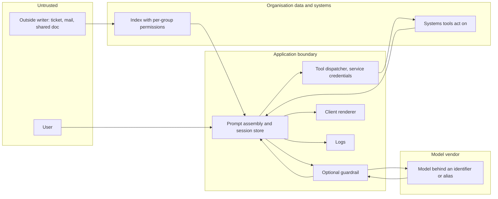

# Threat model: LLM applications (chat assistants, RAG and tool-using apps)

| Field | Value |
|---|---|
| Asset class | LLM applications (chat assistants, RAG and tool-using apps) |
| Version | 1.0 |
| Date | 2026-11-21 |
| Evaluated by | `app-benchmark`, `app-redteam` |
| Related threat models | Guardrails and safety classifiers; General-purpose models (frontier API and open weights); Agent features; AI coding agents |
| Status | Current. Ratings are rough inherent risks for the reference deployment below; re-rate them for your own |

## 1. Executive summary

An LLM application is software built around a model the organisation does not control: a
chat assistant, an assistant that answers from the organisation's documents (RAG), or a
workflow where the model calls tools. The application owns the system prompt, the index and
its permissions, the tools and their credentials, how replies are rendered, the logs and the
choice of model. Most of the risk sits in the joins: instructions, user input and retrieved
content share one prompt, and the application then trusts what comes back.

| Core risk | Why it matters | Inherent risk | Evaluated by |
|---|---|---|---|
| Indirect prompt injection through documents, mail, tickets or tool results | Anyone who can write to a source the assistant reads can instruct it; published attacks exfiltrated data from production assistants with no user action | Critical | Partly: both skills, but only through the user turn |
| Data disclosure across users or tenants, and identity decided in the prompt | The service account and the index usually see more than any one user may | High | Partly: `app-redteam` objectives you write |
| Model output acted on: tools, rendering, SQL, shells | Whoever steers the model inherits what its output can do | High | Partly: `app-redteam` sees the reply text, not the effect |
| Jailbreaks and direct injection, including multi-turn escalation | Users will try; the output carries the organisation's name | High | Yes: `app-benchmark` by technique, `app-redteam` adaptively |
| The model changes under a fixed application | Every result describes one model version; aliases move | High | Yes, by re-running on the new version |
| Personal data kept in conversation logs | Logs are wider-access and longer-lived than the source systems | High | No: design review |

**Where risk concentrates.** In every channel that carries outsider-written content into the
prompt, since no model reliably separates data from instructions [1][8]; in the service
identity behind retrieval and tools, since the model cannot enforce authorisation [3]; and in
the code that acts on the reply [2].

**What the evaluations can and cannot tell you.** `app-benchmark` sends a fixed labelled
corpus (about 2,960 single-message cases) to the application's endpoint and reports block
rate, false-block rate and attack success with 95% intervals, by category and technique
family. `app-redteam` runs adaptive multi-turn attacks seeded by objectives you write,
repeated so the success rate has an interval. Together they measure how the deployed
application responds to hostile **conversation**. Neither plants content in your index or
tools, sees tool calls, rendered output or logs, drives two user identities, or measures
cost. A good result means the conversation channel held at this depth on this model version.

## 2. Scope and reference deployment

The ratings assume:

- Authenticated users (employees or customers) in a web client that renders Markdown.
- A hosted third-party model behind an identifier the application configures; the
  application writes the system prompt.
- Retrieval over documents that different groups may see differently, including content
  written outside the team (customer tickets, inbound mail, shared documents).
- Read tools and at least one write tool (create a ticket, send a message), running under the
  application's service credentials.
- Optional input or output guardrails; conversations logged for support and debugging.

What moves the ratings: an anonymous public chatbot raises jailbreak and cost risk; no write
tools lowers the impact of output and tool threats (rendering still leaks); a single-tenant
index lowers cross-tenant risk; an index fed only by a curated team lowers indirect injection
to Medium; a pinned self-hosted model lowers vendor-change and vendor-logging risk.

Out of scope: the model's training and weights, a guardrail's own quality, agent-harness
features such as memory and computer use (each has its own threat model), and web security
that does not involve model output.

## 3. System model

| Input | Who controls it |
|---|---|
| User message and files | The user |
| Retrieved content, tool results | Whoever can write to the source |
| System prompt, tool descriptions | The application team |
| Session and identity context | The application's authentication layer |
| Model behaviour | The model vendor |

**Threat actors.** An adversarial user with public jailbreak and extraction techniques; an
outside writer with no account who can put text where the assistant will read it; an insider
seeking data beyond their permissions; a cost attacker scripting requests; and, without
malice, the vendor, who changes the model and keeps logs under its terms.

## 4. Core threats

Ratings combine likelihood and impact (Low, Medium, High) using the matrix in the
threat-model method, for the reference deployment. Framework ids are reused from the lists
this repository verified against the primary sources (OWASP LLM 2025, OWASP Agentic 2026,
MITRE ATLAS 2026.10).

### app-indirect-injection — Indirect prompt injection (Critical)

- **What and where.** Instructions planted in a document, mail, ticket, web page or tool
  result are retrieved beside the user's data and followed. The user does nothing wrong;
  LLM-integrated applications "blur the line between data and instructions" [8]. Planted
  content can also be false rather than instructive: a few passages in a large index steered
  answers to chosen questions in one study [10].
- **Why it matters.** The way out is a rendered link or image, a write tool, or the user
  acting on a phishing answer. EchoLeak (CVE-2025-32711) exfiltrated data from a production
  assistant from one crafted email, evading an injection classifier and link redaction [9];
  in Slack AI a message in a public channel made the assistant put a private API key into a
  link [11].
- **Rating.** Likelihood High (outsider-written content is indexed), impact High. Lower with
  a curated index, no remote image or link rendering, and confirmation before write tools.
- **Maps to.** LLM01:2025, LLM08:2025; ASI01; AML.T0051.001, AML.T0070.

### app-direct-injection — Direct injection and jailbreaks, including multi-turn (High)

- **What and where.** The user overrides the application's instructions or gets harmful or
  off-policy output, by asking plainly, wrapping the request (persona, cipher, code framing,
  another language), or escalating over several innocuous turns.
- **Why it matters.** It is the cheapest attack, the output is published under the
  organisation's name, and an override is the first step of the tool and data threats.
- **Rating.** Likelihood High, impact Medium (High for public or sensitive-domain
  assistants). Moves with model choice, output classification, and whether authority lives in
  the prompt.
- **Evidence.** Crescendo's gradual escalation succeeded across the models tested [12];
  flattening multi-turn jailbreaks into one structured prompt reached 70.6% to 95.9% success
  [13]; low-resource languages obtained harmful output 79% of the time from one model [14];
  adaptive attacks bypassed twelve defences that reported near-zero success on static tests
  [23]. OWASP says it is unclear whether fool-proof prevention exists [1].
- **Maps to.** LLM01:2025; AML.T0051.000, AML.T0054, AML.T0068.

### app-prompt-leak — System prompt leakage (Medium)

- **What.** The model repeats its instructions, tool descriptions or anything else placed in
  the context as configuration. OWASP says the system prompt should be neither a secret nor a
  security control, and must not hold credentials [4].
- **Rating.** Likelihood High (simple attacks recovered prompts with high probability across
  eleven models [15]), impact Low if the prompt holds nothing sensitive, High if it holds
  credentials or customer data.
- **Maps to.** LLM07:2025; AML.T0069.002.

### app-data-disclosure — Data disclosure across users and tenants (High)

- **What and where.** Retrieval runs with the application's identity or with stale or
  prompt-enforced filters, so another group's documents, personal data or secrets reach the
  answer. OWASP warns that shared vector stores leak context between user groups and
  recommends permission-aware stores [5].
- **Rating.** Likelihood Medium, impact High (a reportable breach across customer
  boundaries). Lower with query-time permission checks against the source system and
  per-tenant indexes.
- **Maps to.** LLM02:2025, LLM08:2025; AML.T0136.

### app-session-identity — Session and identity handled around the model (High)

- **What and where.** History or cached results served to the wrong user; a claim in the chat
  ("I am the account owner") accepted as authorisation; tools that take a user id as a
  model-supplied argument; every call made with one service identity so only the model decides
  who may do what.
- **Evidence.** A fault in a shared cache client showed some ChatGPT users other users' chat
  titles and, for a share of subscribers, payment details [19]. OWASP: authorise in
  downstream systems, not in the model [3].
- **Rating.** Likelihood Medium, impact High. Lower when identity comes only from the
  authenticated session and tools use per-user credentials.
- **Maps to.** LLM06:2025; ASI03; AML.T0085.002.

### app-output-agency — Model output acted on: tools and downstream interpreters (High)

- **What and where.** The reply is rendered as HTML or Markdown, run as SQL or code, fetched as
  a URL, or turned into a tool call, so whoever steers the model reaches the browser, the
  database, the host or the systems the tools change. OWASP lists XSS, SQL injection, command
  execution and path traversal through model output [2], and excessive functionality,
  permissions and autonomy as the causes of excessive agency [3].
- **Evidence.** In Vanna.AI (CVE-2024-5565) generated plotting code was run with `exec`, so a
  prompt became code execution [16]. EchoLeak's way out was Markdown links and auto-fetched
  images [9].
- **Rating.** Likelihood Medium, impact High. Raised by text-to-SQL, run-the-code features,
  generic tools (fetch any URL, email anyone) and auto-approval; lowered by treating the model
  as an untrusted user (encoding, parameterised queries, sandboxes, confirmation outside the
  model).
- **Maps to.** LLM05:2025, LLM06:2025; ASI02, ASI05; AML.T0077, AML.T0053.

### app-over-refusal — Over-refusal (Medium)

- **What.** Legitimate requests that resemble harmful ones are refused or blocked. It is the
  cost side of every safeguard, and an availability and trust risk: refused users work around
  the assistant, often with tools the organisation has not approved.
- **Evidence.** XSTest documented models refusing clearly safe prompts [17]; OR-Bench found
  safety gains often come with over-refusal across 32 models [18].
- **Rating.** Likelihood Medium (High for security, health and legal users), impact Medium.

### app-denial-of-wallet — Unbounded cost (Medium)

- **What.** Scripted requests, very long inputs or tool loops run up per-token spend or
  exhaust a shared quota. OWASP names "Denial of Wallet" among unbounded-consumption risks [6].
- **Rating.** Likelihood Medium (High for anonymous endpoints), impact Medium. Lower with
  per-user rate, token, step and spend limits.
- **Maps to.** LLM10:2025; AML.T0034, AML.T0029.

### app-prompt-logging — Personal data in conversation logs (High)

- **What and where.** The application, gateway, observability tools and the vendor log
  prompts, retrieved chunks and replies, which hold whatever users pasted. Logs are often
  readable by more people and kept longer than the source systems.
- **Evidence.** An unauthenticated database at an AI provider exposed over a million log
  lines including plaintext chat history and API secrets [20]; NIST lists data privacy among
  generative AI risks [7].
- **Rating.** Likelihood High (full logging is a common default), impact Medium (High for
  health, financial or credential data).

### app-model-change — The model changes under a fixed application (High)

- **What.** An alias moves, the vendor updates in place, the gateway falls back to another
  model, or the team switches vendor. Refusal and injection resistance move with it.
- **Evidence.** The same named models changed substantially between March and June 2023,
  including willingness to answer sensitive questions [21]; a vendor rolled back a production
  model update within a week after users noticed a behaviour change [22].
- **Rating.** Likelihood High, impact Medium. Lower with pinned dated identifiers and a change
  process that re-runs the evaluations.

## 5. How this repository's evaluations relate

| Threat area | Skill | What it measures | What it cannot see |
|---|---|---|---|
| Direct injection and jailbreaks | `app-benchmark` | Recall and attack success per family: `direct`, `goal_hijacking` (injection); `direct_harmful`, the ten ATT&CK-tactic `cyber_*` families and `cyber_interpreter_*` (plain requests); `m2s_*` flattened multi-turn wrappers (jailbreak uplift over the plain rate) | New techniques; non-English input |
| Same, adaptively | `app-redteam` | Crescendo (5 turns, 5 backtracks by default [24]) with `--repeat 3`: attack success with interval, objectives broken at least once, mixed outcomes | A score comparable run to run |
| Indirect injection | both | `indirect` family (55 cases) and `indirect` objectives, all delivered in the user turn | Whether retrieval or tools carry planted content; rendered exfiltration |
| Prompt leakage | both | `data_leakage`: `system_prompt_exfiltration` and `m2s_*` leak families; extraction objectives | Exact leakage: the judge does not know your prompt unless you add a canary |
| Data disclosure, identity, output and tools | `app-redteam` | Objectives you write, plus the optional cyber pack (`bola`, `bfla`, `rbac`, `pii:*`, `shell-injection`, `sql-injection`, `ssrf`, `excessive-agency`, `hijacking`, `tool-discovery`) | Tool calls actually made, downstream execution, a second identity |
| Over-refusal | `app-benchmark` | False-block rate on the `benign` set (XSTest safe prompts, CyberSecEval benign cyber questions), the required pair of every recall | Your users' real traffic |
| Model change | both | The same corpus or cached objectives on the new version; change in recall, false-block rate and attack success | Changes between your runs |

Why they exist: `app-benchmark` gives a repeatable number for known hostile and benign
conversation, comparable across model versions and defence settings, and its families stop a
good overall score hiding a weak technique. `app-redteam` exists because static attacks
overstate robustness [23] and multi-turn escalation succeeds where single turns fail [12];
its objectives are the only way to reach threats specific to your data and tools. Both vary
one arm (the target or one defence setting) and hold the corpus or objectives and the judge
fixed.

Left to design review, because they live in code and configuration a conversation cannot
observe: the retrieval and tool channels of indirect injection, permission-correct retrieval,
session and cache keying, downstream handling of output, tool scopes, cost limits, logging
and vendor data terms. Custom probes for these need your own index, canaries, a second
identity and your tool audit log.

## 6. Design review questions

- Which sources reach the prompt, who can write to each, and can someone outside the
  organisation? Is retrieved and tool content inspected, or only user input?
- Is retrieval filtered by the requesting user's permissions at query time? Are tenants in
  separate indexes?
- Where does identity come from on each tool call, and can the model supply or change it? Are
  caches and session stores keyed by tenant and user?
- For each tool: what can it change or send, under which credential, with what confirmation
  outside the model? Is there an audit log linking tool calls to users?
- Does the client fetch remote images or follow links in replies? Is model output encoded or
  parameterised before SQL, shells, interpreters or templates?
- Does the system prompt contain anything that would matter if published?
- What are the per-user and global limits on requests, tokens, tool steps and spend?
- What is logged, where, for how long, and who can read it? What do the signed vendor terms
  say about retention and training use?
- Is the model identifier pinned? Does the gateway fall back to another model? Who is told,
  and is this evaluation re-run?

Residual risk to state plainly: prompt injection is not solved [1][23], so a deployment that
indexes outsider content and can act or render links carries risk however it scores here.
Designs that keep untrusted data from steering control flow reduce it at a utility cost
[25][26]. Both skills grade with a judge whose error rate is not measured; spot-check
transcripts.

## 7. References

All read on 2026-11-21.

1. OWASP GenAI Security Project, "LLM01:2025 Prompt Injection". https://genai.owasp.org/llmrisk/llm01-prompt-injection/
2. OWASP GenAI Security Project, "LLM05:2025 Improper Output Handling". https://genai.owasp.org/llmrisk/llm052025-improper-output-handling/
3. OWASP GenAI Security Project, "LLM06:2025 Excessive Agency". https://genai.owasp.org/llmrisk/llm062025-excessive-agency/
4. OWASP GenAI Security Project, "LLM07:2025 System Prompt Leakage". https://genai.owasp.org/llmrisk/llm072025-system-prompt-leakage/
5. OWASP GenAI Security Project, "LLM08:2025 Vector and Embedding Weaknesses". https://genai.owasp.org/llmrisk/llm082025-vector-and-embedding-weaknesses/
6. OWASP GenAI Security Project, "LLM10:2025 Unbounded Consumption". https://genai.owasp.org/llmrisk/llm102025-unbounded-consumption/
7. NIST AI 600-1, "Artificial Intelligence Risk Management Framework: Generative Artificial Intelligence Profile", July 2024. https://doi.org/10.6028/NIST.AI.600-1
8. Greshake et al., "Not what you've signed up for: Compromising Real-World LLM-Integrated Applications with Indirect Prompt Injection", arXiv:2302.12173. https://arxiv.org/abs/2302.12173
9. Reddy and Gujral, "EchoLeak: The First Real-World Zero-Click Prompt Injection Exploit in a Production LLM System", arXiv:2509.10540. https://arxiv.org/abs/2509.10540
10. Zou et al., "PoisonedRAG: Knowledge Corruption Attacks to Retrieval-Augmented Generation of Large Language Models", arXiv:2402.07867. https://arxiv.org/abs/2402.07867
11. PromptArmor, "Data Exfiltration from Slack AI via indirect prompt injection", 20 August 2024. https://promptarmor.substack.com/p/data-exfiltration-from-slack-ai-via
12. Russinovich, Salem and Eldan, "Great, Now Write an Article About That: The Crescendo Multi-Turn LLM Jailbreak Attack", arXiv:2404.01833. https://arxiv.org/abs/2404.01833
13. Ha et al., "M2S: Multi-turn to Single-turn jailbreak in Red Teaming for LLMs", ACL 2025. https://aclanthology.org/2025.acl-long.805
14. Yong, Menghini and Bach, "Low-Resource Languages Jailbreak GPT-4", arXiv:2310.02446. https://arxiv.org/abs/2310.02446
15. Zhang, Carlini and Ippolito, "Effective Prompt Extraction from Language Models", arXiv:2307.06865. https://arxiv.org/abs/2307.06865
16. JFrog Security Research, "When Prompts Go Rogue: Analyzing a Prompt Injection Code Execution in Vanna.AI", 27 June 2024. https://jfrog.com/blog/prompt-injection-attack-code-execution-in-vanna-ai-cve-2024-5565/
17. Röttger et al., "XSTest: A Test Suite for Identifying Exaggerated Safety Behaviours in Large Language Models", arXiv:2308.01263. https://arxiv.org/abs/2308.01263
18. Cui et al., "OR-Bench: An Over-Refusal Benchmark for Large Language Models", arXiv:2405.20947. https://arxiv.org/abs/2405.20947
19. OpenAI, "March 20 ChatGPT outage: Here's what happened", March 2023. https://openai.com/index/march-20-chatgpt-outage/
20. Wiz Research, "Wiz Research Uncovers Exposed DeepSeek Database Leaking Sensitive Information, Including Chat History", 29 January 2025. https://www.wiz.io/blog/wiz-research-uncovers-exposed-deepseek-database-leak
21. Chen, Zaharia and Zou, "How is ChatGPT's behavior changing over time?", arXiv:2307.09009. https://arxiv.org/abs/2307.09009
22. OpenAI, "Sycophancy in GPT-4o: What happened and what we're doing about it", 29 April 2025. https://openai.com/index/sycophancy-in-gpt-4o/
23. Nasr et al., "The Attacker Moves Second: Stronger Adaptive Attacks Bypass Defenses Against LLM Jailbreaks and Prompt Injections", arXiv:2510.09023. https://arxiv.org/abs/2510.09023
24. Promptfoo documentation, "Multi-turn Jailbreaks Strategy". https://www.promptfoo.dev/docs/red-team/strategies/multi-turn/
25. Debenedetti et al., "Defeating Prompt Injections by Design", arXiv:2503.18813. https://arxiv.org/abs/2503.18813
26. Beurer-Kellner et al., "Design Patterns for Securing LLM Agents against Prompt Injections", arXiv:2506.08837. https://arxiv.org/abs/2506.08837
