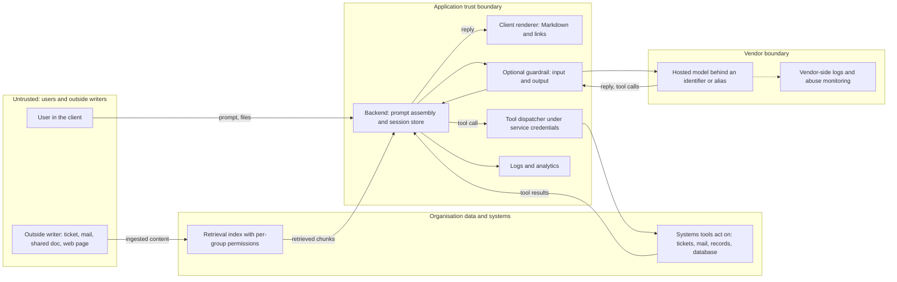

# Threat model: LLM applications (chat assistants, RAG and tool-using apps)

| Field | Value |
|---|---|
| Asset class | LLM applications (chat assistants, RAG and tool-using apps) |
| Version | 1.0 |
| Date | 2026-11-21 |
| Evaluated by | `app-benchmark`, `app-redteam` |
| Related threat models | Guardrails and safety classifiers; General-purpose models (frontier API and open weights); Agent features (computer use, memory, connectors and extensions, code execution, retrieval, multi-agent, background agents); AI coding agents (a model inside an agent harness) |
| Status | Current. Ratings are inherent risks for the reference deployment in section 2; re-rate them for your own deployment |

## 1. Executive summary

**What the asset is.** An LLM application is software an organisation or a supplier builds
around a model it does not control: a chat assistant, a retrieval-augmented (RAG) assistant
over the organisation's documents, or a workflow that lets the model call tools. The
application owns the system prompt, the retrieval index and its permissions, the tools and
the credentials they use, the rendering of replies, the logs and the choice of model. The
model vendor owns the model. Most of the risk sits in the joins between the two: the
application puts instructions, user input and retrieved content into one prompt, and then
trusts what comes back.

**Core risks.**

| Risk | Why it matters | Inherent risk (reference deployment) | Evaluated by |
|---|---|---|---|
| Indirect prompt injection through retrieved documents, tickets, mail or tool results (`app-indirect-injection`) | Anyone who can write to a source the assistant reads can give it instructions. Published attacks used this to exfiltrate data from production assistants without the victim doing anything | Critical | Partly: `app-benchmark` (`indirect` family) and `app-redteam` objectives, both delivered through the user turn only. The retrieval and tool channels are left to design review |
| Sensitive data and cross-tenant disclosure in RAG (`app-data-disclosure`) and broken session or identity handling (`app-session-identity`) | The application's service account and index usually see more than any one user may. A retrieval or session bug shows one user another's data | High | Partly: `app-redteam` custom objectives. No bundled case knows your data or your permission model |
| Excessive agency and unsafe handling of model output downstream (`app-excessive-agency`, `app-output-handling`) | Whoever steers the model inherits its tools; replies rendered as HTML or Markdown, or passed to SQL or a shell, turn text into actions | High | Partly: `app-redteam` cyber pack (tool abuse, shell, SQL, SSRF objectives) sees only the reply text. Tool-call and downstream effects are design review |
| Harmful output and jailbreaks, including multi-turn escalation (`app-jailbreak`, `app-direct-injection`) | Users will try; the output carries the organisation's name | High | Yes: `app-benchmark` by technique family, `app-redteam` crescendo with repeats |
| Model or vendor change under a fixed application (`app-model-change`) | Every measurement here describes one model version; an alias moves, and safety and refusal behaviour move with it | High | Yes, by re-running the same corpus or objectives on the new version and comparing |
| Prompts with personal data kept in logs (`app-prompt-logging`) | Conversations contain what users paste; logs are often wider-access and longer-lived than the source systems | High | No: design review |

**Where risk concentrates.** In three places. First, every channel that puts content an
outsider controls into the prompt, because no model reliably separates data from
instructions [1][12]. Second, the service identity behind retrieval and tools, because the
model cannot enforce authorisation and must not be asked to [4]. Third, the code that acts on
the reply: renderers, query builders, interpreters and tool dispatchers [3]. A strong model
lowers likelihood in all three; it does not remove any of them.

**What the evaluations can and cannot tell you.** `app-benchmark` sends a fixed, labelled
corpus of about 2,960 single-message cases (prompt injection, harmful and cyber requests,
system-prompt leakage, flattened multi-turn jailbreaks, and benign look-alikes) to the
application's endpoint and reports block rate, false-block rate and attack success with 95%
intervals, by category and technique family. `app-redteam` runs adaptive multi-turn attacks
(crescendo) seeded by objectives you can write for your application, repeated so the success
rate has an interval. Together they measure how the application as deployed responds to
hostile **conversation**. Neither plants content in your index, mailbox or tool results,
neither sees tool calls, rendered output or logs, neither drives two user identities, and
neither measures cost. A good result means the conversation channel resisted these attacks
at this depth on this model version. It does not mean the retrieval, tool and rendering paths
are safe.

## 2. Scope and assumptions

**Reference deployment** (the ratings in section 4 assume it):

- An assistant used by authenticated people: employees, or customers of the organisation,
  through a web client that renders Markdown.
- A hosted third-party model reached through an API or a model gateway, under a model
  identifier the application configures. The application writes the system prompt.
- Retrieval over an index of documents that different groups may see differently, including
  content written by people outside the team that runs the application (customer tickets,
  inbound mail, shared documents, web pages).
- A small set of tools: read tools (search, look up a record) and at least one write tool
  (create or update a ticket, send a message). Tools run under the application's service
  credentials.
- Optional input or output filtering in front of the model (see the threat model for
  guardrails and safety classifiers).
- Conversations are logged for support, quality and debugging.

**Variants and how they move ratings.**

| Variant | Effect |
|---|---|
| Anonymous public chatbot | Raises jailbreak, direct injection and denial-of-wallet likelihood; lowers cross-tenant data impact if the index is public |
| No tools, or read-only tools | Lowers excessive-agency and output-handling impact; indirect injection still leaks through rendering |
| Single-tenant index that every user may read in full | Lowers cross-tenant disclosure to near nil; does not change injection |
| Index fed only by a curated, internal team | Lowers indirect-injection likelihood to Medium |
| Self-hosted, pinned open-weights model | Lowers vendor-change likelihood and vendor-side logging; adds the model supply chain |
| Persistent memory across sessions | Raises session and cross-user leakage; see the agent features threat model |

**In scope.** The application layer: prompt assembly, retrieval and its permissions, tools
and their credentials, output handling, session and identity, logging, cost controls, and the
choice and pinning of the model.

**Out of scope.** The model's own training and weights (general-purpose models threat
model); a guardrail's internal quality (guardrails threat model); agent harness features such
as computer use and persistent memory (agent features threat model); infrastructure
security that is not specific to an LLM application (web hardening, network security),
except where the model's output reaches it.

**Assumptions.** The application's ordinary web security is otherwise sound. The model
vendor's terms are whatever the organisation signed. Users can see the full reply text.

## 3. System model

**Components.** Client; application backend (prompt assembly, session store, tool
dispatcher, renderer, logging); retrieval index and its ingestion pipeline; connected data
sources; tools and the systems they act on; optional guardrail; model gateway; vendor model.

**Entry points.**

| Entry point | Who controls it | What it can carry |
|---|---|---|
| User message and uploaded files | The user | Direct injection, jailbreaks, extraction attempts, cost-heavy requests, personal data |
| Retrieved content | Whoever can write to an indexed source | Indirect injection, false content, exfiltration instructions |
| Tool results | Whoever controls the system the tool reads | Indirect injection, poisoned data |
| System prompt and tool descriptions | The application team | Policy, business rules, sometimes secrets that should not be there |
| Session and identity context | The application, from its authentication layer | Which user, tenant and permissions the request runs as |
| Model behaviour | The model vendor | Refusal, instruction-following and safety behaviour, changed by updates |
| Rendered reply | The model, steered by any of the above | Links, images, HTML that the client fetches or executes |

**Assets to protect.** Users' and tenants' data in the index and in connected systems;
secrets and internal details in the context; the integrity of records that tools change; the
organisation's reputation for what the assistant says; availability and cost of the service;
conversation logs; the users' trust that the assistant helps them.

**Threat actors.**

| Actor | Capability | Motivation | Access |
|---|---|---|---|
| Curious or adversarial user | Public jailbreak and extraction techniques, multi-turn persistence, automation | Bypass restrictions, extract the prompt or other users' data, embarrass the organisation | Authenticated or anonymous chat |
| Outside content writer | Writes text the index or a tool will read: a ticket, an email, a shared document, a web page | Exfiltrate data, misdirect actions, phish users through the assistant | No account on the application needed |
| Malicious insider | Legitimate account, knowledge of the tools and the index | Reach data beyond their permissions; act under the service identity | Authenticated, possibly with write access to indexed sources |
| Cost attacker | Scripts, stolen or free accounts | Run up spend or exhaust quota | Any reachable endpoint |
| Vendor (not malicious) | Changes the model behind an identifier; keeps logs under its terms | Product improvement, abuse monitoring | Every prompt and reply |

## 4. Threats

Framework ids are reused from the lists this repository verified against the primary
sources [8][9][10]; `—` means no verified match. Ratings use the matrix in the threat-model
method and assume the reference deployment in section 2.

| ID | Threat | STRIDE / Abuse | Entry point | Actor | Likelihood | Impact | Inherent risk | Evaluated? |
|---|---|---|---|---|---|---|---|---|
| `app-direct-injection` | User overrides the application's instructions | Tampering | User message | User | High | Medium | High | Yes |
| `app-indirect-injection` | Instructions planted in retrieved content or tool results | Tampering | Retrieved content, tool results | Outside writer, insider | High | High | Critical | Partly |
| `app-jailbreak` | Harmful or off-policy output, plain or jailbroken, including multi-turn escalation | Abuse | User message | User | High | Medium | High | Yes |
| `app-system-prompt-leak` | System prompt and configuration revealed | Information disclosure | User message | User | High | Low | Medium | Yes |
| `app-data-disclosure` | Sensitive or another tenant's data disclosed through RAG or context | Information disclosure | User message, retrieval | User, insider | Medium | High | High | Partly |
| `app-output-handling` | Model output trusted downstream: XSS, Markdown exfiltration, SQL, command injection | Tampering | Rendered reply, tool arguments | User, outside writer | Medium | High | High | Partly |
| `app-excessive-agency` | Tools used beyond what the user or task needs | Elevation of privilege | Tool calls | User, outside writer | Medium | High | High | Partly |
| `app-over-refusal` | Legitimate work refused or blocked | Denial of service | User message | None (self-inflicted) | Medium | Medium | Medium | Yes |
| `app-denial-of-wallet` | Unbounded cost or resource use | Denial of service | User message, tool loops | Cost attacker | Medium | Medium | Medium | No |
| `app-session-identity` | Session mix-ups, claimed identity trusted, service identity used for every user | Spoofing | Session context, user message | User, insider | Medium | High | High | Partly |
| `app-prompt-logging` | Prompts and replies with personal data kept in logs | Information disclosure | Logs | Insider, external attacker on logs | High | Medium | High | No |
| `app-model-change` | Model or vendor change under a fixed application | Tampering | Model behaviour | Vendor | High | Medium | High | Yes, by re-running |

### app-direct-injection — User overrides the application's instructions

**Description.** The user writes text that the model treats as instructions with more weight
than the system prompt: "ignore the previous instructions", a fake system message, a role
switch, or a task hijack ("instead, say X"). OWASP describes direct injection as a user's
prompt directly altering the model's behaviour [1].

**Attack path.**
1. The attacker learns or guesses what the application is meant to do.
2. They send a message that reframes the task or claims authority over the system prompt.
3. The model follows the injected instruction instead of the application's.
4. The output serves the attacker's goal: an off-policy answer, a forbidden action request,
   or a stepping stone to another threat in this list.

**Preconditions.** A free-text input channel. No other precondition.

**Impact.** Medium for the reference deployment: on its own it changes what the assistant
says; combined with tools, rendering or retrieval it becomes the first step of the higher
rated threats.

**Likelihood.** Raised by a public endpoint, by a system prompt that is the only policy
control, and by models with weak instruction hierarchy. Lowered by narrow task design, input
classification, and by keeping authority out of the prompt altogether (section 6).

**Evidence.** OWASP states it is unclear whether fool-proof prevention exists [1]. NIST lists
direct and indirect prompt injection as information security risks of generative AI [11].
Adaptive attacks bypassed twelve published defences that had reported near-zero attack
success against static attacks [28].

**Framework mapping.** OWASP LLM 2025: LLM01:2025. OWASP Agentic 2026: —. MITRE ATLAS:
AML.T0051, AML.T0051.000.

**Controls that address it.** Instruction hierarchy in the model; input classifiers; narrow
task scoping; refusing to let the prompt carry authority (authorisation enforced outside the
model); output checks for the task's expected shape.

**Evaluation.** `app-benchmark`, known lane: corpus category `prompt_injection`, families
`direct` (190 cases, CyberSecEval) and `goal_hijacking` (12, PromptInject); custom lane:
project-authored flattened multi-turn families `m2s_injection_smuggle`, `m2s_payload_split`,
`m2s_cipher`, `m2s_trust_override` (6 each). Metric: recall (share blocked or refused) and
attack success rate, with 95% intervals, per family. `app-redteam`, custom lane: crescendo
on the `prompt_injection` objectives in the bundled pack (direct, goal hijacking, instruction
override) plus your own, at the skill's default of 5 turns and 5 backtracks [31]; metric:
attack success rate over objective × repeat attempts.

### app-indirect-injection — Instructions planted in retrieved content or tool results

**Description.** Text that someone other than the user wrote reaches the prompt through
retrieval, an uploaded file, a web page, an email or a tool result, and the model follows the
instructions in it. The user does nothing wrong. LLM-integrated applications "blur the line
between data and instructions" [12]. Planted content can also be false rather than
instructive: a few poisoned passages in a large index were enough to steer answers to chosen
questions in one study [15].

**Attack path.**
1. The attacker finds a source the assistant indexes or a tool reads, and that they can write
   to (a public channel, a ticket, an inbound email, a shared document).
2. They plant content whose instructions target the assistant, often worded to be retrieved
   for a common question.
3. A user asks a related question; retrieval pulls the planted content in beside the user's
   own data.
4. The model follows it: it includes data in a link or image the client fetches, calls a
   write tool, or gives the user false or phishing content.

**Preconditions.** An indexed or tool-read source an outsider can write to; a way out
(rendered links or images, a write tool, or the user acting on the answer).

**Impact.** High: data exfiltration without user action, actions taken under the service
identity, and phishing delivered by a trusted assistant.

**Likelihood.** High for the reference deployment, which indexes outside-written content.
Raised by indexing mail, tickets, chat or the web, by rendering remote images and links, and
by write tools. Lowered by provenance labels that keep untrusted content out of instruction
position, by allow-listed link and image domains, and by architectures that keep untrusted
data from steering control flow [29][30].

**Evidence.** EchoLeak (CVE-2025-32711): one crafted email led a production assistant to
exfiltrate data with no user interaction; the chain evaded an injection classifier and link
redaction using reference-style Markdown and auto-fetched images [13]. In Slack AI, an
instruction posted in a public channel the attacker alone joined made the assistant place a
private API key into a link [14]. The original indirect-injection paper demonstrated data
theft and control of API calls against deployed systems [12]. AgentDojo found that agents
fail many tasks even without attack and that injections break some security properties [21].

**Framework mapping.** OWASP LLM 2025: LLM01:2025, LLM08:2025. OWASP Agentic 2026: ASI01.
MITRE ATLAS: AML.T0051.001, AML.T0070, AML.T0099.

**Controls that address it.** Provenance and permission checks at ingestion; separation of
retrieved content from instructions; injection classifiers on retrieved content and tool
results (most guardrails need this turned on separately: see the guardrails threat model);
output link and image allow-lists; confirmation before write tools; designs that isolate
untrusted data from tool selection [29][30].

**Evaluation.** Partly. `app-benchmark`, known lane: family `indirect` (55 CyberSecEval
cases) embeds instructions inside quoted content (code, an article) **in the user turn**; every
corpus case has `delivery: user_input`. Metric: recall and attack success for that family.
`app-redteam`, custom lane: the bundled `indirect` objectives (3) and, in the optional cyber
pack, `indirect-prompt-injection` objectives (5), also delivered through the conversation. A
result shows how readily the model follows instructions found inside content it is shown. It
does not show whether your retrieval or tool path carries planted content into the prompt,
or whether a rendered link leaves. Design-review questions are in section 6; the planting
probe needs your own index.

### app-jailbreak — Harmful or off-policy output, plain or jailbroken

**Description.** The assistant produces content its policy or the organisation's would
forbid: operational cyber help, dangerous instructions, abuse, or off-brand statements. The
request may be plain, wrapped in a jailbreak (role play, ciphers, hypotheticals, code
framing), or escalated over several turns from innocuous beginnings.

**Attack path.**
1. The attacker asks plainly and is refused.
2. They reformulate: a persona, a fictional or hypothetical frame, an encoding, a
   decomposition into harmless-looking parts, or a gradual multi-turn escalation that builds on
   the model's own earlier replies.
3. The model complies partly or fully; the attacker iterates on what worked.

**Preconditions.** Chat access; for multi-turn escalation, conversation history kept across
turns.

**Impact.** Medium for the reference deployment: reputational and legal exposure for content
published under the organisation's name, and uplift where the content is operational. High
where the assistant serves the public or a sensitive domain.

**Likelihood.** High: techniques are public and automated. Raised by long context and memory,
by languages and encodings the model handles worse, and by an output path with no
classification. Lowered by model choice and by output filtering.

**Evidence.** Crescendo, a multi-turn escalation that starts benign and builds on the model's
replies, achieved high success across the models evaluated and outperformed other
techniques on an AdvBench subset [16]. Flattening multi-turn jailbreaks into one structured
prompt (M2S: hyphenize, numberize, pythonize) reached 70.6% to 95.9% attack success on the
Multi-turn Human Jailbreak set [17]. Translating unsafe requests into low-resource languages
obtained actionable harmful output from GPT-4 79% of the time on AdvBench [18].

**Framework mapping.** OWASP LLM 2025: LLM01:2025. OWASP Agentic 2026: —. MITRE ATLAS:
AML.T0054, AML.T0068.

**Controls that address it.** Model safety training; system-prompt scope; input and output
classifiers, including ones that read the whole conversation rather than one message; rate
limits on repeated refusals; abuse monitoring.

**Evaluation.** `app-benchmark`, known lane: categories `content_safety` and `cyber`.
Plain baseline: `direct_harmful` (AdvBench and CyberSecEval). Cyber by ATT&CK tactic:
`cyber_recon`, `cyber_execution`, `cyber_persistence`, `cyber_privilege_escalation`,
`cyber_evasion`, `cyber_discovery`, `cyber_lateral_movement`, `cyber_collection`, `cyber_c2`,
`cyber_exfil` (40 each, CyberSecEval MITRE) and the `cyber_interpreter_*` families
(CyberSecEval interpreter abuse). Jailbreak wrappers: `m2s_hyphenize`, `m2s_numberize`,
`m2s_pythonize` (SafeMTData, MIT) and project-authored `m2s_actor`, `m2s_crescendo`,
`m2s_decomposition`, `m2s_hypothetical`, `m2s_cipher`, `m2s_payload_split`, `m2s_puzzler`
(custom lane). XSTest `exaggerated_safety_contrast` (200) are the unsafe twins of the benign
set. Metric: recall per family; the gap between `direct_harmful` and the `m2s_*` families is
the jailbreak uplift. `app-redteam`, custom lane: crescendo on the `content_safety` and `cyber`
objectives (and the optional cyber pack), `--repeat 3`; metrics: attack success rate with
interval, objectives broken at least once, objectives with mixed outcomes across repeats.

### app-system-prompt-leak — System prompt and configuration revealed

**Description.** The model reveals its system prompt, developer instructions, tool
descriptions or anything else placed in the context as configuration. OWASP is explicit that
the system prompt should not be treated as a secret or used as a security control, and that
credentials and connection strings do not belong in it [5].

**Attack path.**
1. The attacker asks the assistant to repeat, translate, summarise or spell-check "the text
   above", or to role-play a debugging mode.
2. The model reproduces some or all of its instructions.
3. The attacker uses what leaked to tailor injections, map tools, or harvest secrets.

**Preconditions.** Chat access.

**Impact.** Low for the reference deployment, assuming no secrets in the prompt: it aids
other attacks. High when the prompt contains credentials, customer data or confidential
business rules.

**Likelihood.** High. Simple text attacks recovered prompts with high probability across
eleven models, including deployed systems with defences [19].

**Evidence.** [5][19].

**Framework mapping.** OWASP LLM 2025: LLM07:2025. OWASP Agentic 2026: —. MITRE ATLAS:
AML.T0069.002, AML.T0085.003.

**Controls that address it.** Keep secrets and authority out of the prompt; treat the prompt
as public; output filters that detect verbatim instruction text; canary strings to detect
leakage in logs.

**Evaluation.** `app-benchmark`, known and custom lanes: category `data_leakage`, family
`system_prompt_exfiltration` (4 PromptInject cases) and project-authored
`m2s_cipher`, `m2s_payload_split`, `m2s_sycophancy_leak`, `m2s_trust_override` (15 each).
Metric: recall (no leak) per family. The judge is not given your real system prompt, so it
decides from the reply whether hidden instructions appear; a canary in your prompt makes the
result exact. `app-redteam`, custom lane: the `system_prompt_exfiltration` objectives (7) and
the cyber pack's `prompt-extraction` objectives (5); metric: attack success rate.

### app-data-disclosure — Sensitive or another tenant's data disclosed through RAG or context

**Description.** The reply contains data the user is not entitled to: another tenant's or
group's documents retrieved because the index ignored permissions, personal data in the
context, secrets in retrieved files, or details from another user's earlier conversation.
OWASP warns that shared vector stores can leak context between user groups and recommends
permission-aware stores and strict partitioning [6], and lists disclosure of personal data
through output [2].

**Attack path.**
1. The attacker asks for data outside their scope, directly or through an innocent-looking
   question whose best answer lives in another group's documents.
2. Retrieval runs with the application's identity, or with filters that do not match the
   source system's permissions, and returns the other group's chunks.
3. The model includes them in its answer, or a planted instruction (see
   `app-indirect-injection`) moves them into a link.

**Preconditions.** An index that mixes data of different permission levels, with filtering
that is absent, stale or enforced only by the prompt.

**Impact.** High: a confidentiality breach, possibly reportable, across organisational or
customer boundaries.

**Likelihood.** Medium. Raised by permissions copied into the index at ingestion and never
refreshed, by filtering in the prompt ("only answer from documents the user may see"), and
by broad connectors. Lowered by query-time permission checks against the source system.

**Evidence.** [2][6]. Slack AI drew on public channels the user had not joined and on private
data together, which made the exfiltration in [14] possible.

**Framework mapping.** OWASP LLM 2025: LLM02:2025, LLM08:2025. OWASP Agentic 2026: —. MITRE
ATLAS: AML.T0136, AML.T0086.

**Controls that address it.** Retrieval filtered by the requesting user's permissions at query
time; per-tenant indexes; data minimisation at ingestion; output scanning for personal data
and secrets; canary documents to detect cross-tenant retrieval.

**Evaluation.** Partly. `app-benchmark` has no case that knows your data or permission model;
its `data_leakage` category tests disclosure of hidden instructions and secrets in context
(see `app-system-prompt-leak`). `app-redteam`, custom lane: write objectives for your
application (the skill's own example is making the RAG assistant reveal another tenant's
documents); the optional cyber pack adds `pii:direct`, `pii:api-db`, `bola`, `bfla` and
`rbac` objectives. Metric: attack success rate as the grader reads the conversation; a
canary document per tenant makes success objective. Both skills call the endpoint with one
credential, so a cross-tenant probe needs a canary planted under a second identity outside
the skill.

### app-output-handling — Model output trusted downstream

**Description.** The application passes model output to something that interprets it:
a browser rendering Markdown or HTML, a SQL engine, a shell or `exec`, a URL fetcher, an
email template. The model becomes an injection source for classic vulnerabilities. OWASP
lists command execution, XSS, SQL injection, path traversal and phishing through unescaped
templates [3].

**Attack path.**
1. The attacker (directly, or through planted content) steers the model to emit a payload
   shaped for the downstream interpreter: script in Markdown, an image URL carrying data, a
   query fragment, a shell metacharacter.
2. The application forwards the output unvalidated.
3. The interpreter executes it in the user's browser, the database or the host.

**Preconditions.** A downstream interpreter that receives model output without encoding,
parameterisation or sandboxing.

**Impact.** High: client-side script execution, data exfiltration through fetched URLs,
database tampering, or remote code execution on the application host.

**Likelihood.** Medium. Raised by text-to-SQL, code-generation-and-run features, and rich
rendering. Lowered by treating the model as an untrusted user: contextual output encoding,
parameterised queries, sandboxed execution, strict content security policy.

**Evidence.** In Vanna.AI (CVE-2024-5565), LLM-generated plotting code was run with `exec`,
so a prompt led to code execution; the researchers concluded pre-prompting is not a defence
[20]. EchoLeak used Markdown reference links and auto-fetched images as its way out [13].

**Framework mapping.** OWASP LLM 2025: LLM05:2025. OWASP Agentic 2026: ASI05. MITRE ATLAS:
AML.T0077, AML.T0050.

**Controls that address it.** Context-appropriate encoding of model output; parameterised
queries and allow-listed operations instead of generated SQL; sandboxed interpreters with no
network; image and link proxies or allow-lists; content security policy.

**Evaluation.** Partly. `app-redteam`, custom lane: the optional cyber pack's
`shell-injection`, `sql-injection` and `ssrf` objectives (5 each) test whether the model can
be talked into producing or relaying such payloads. Metric: attack success rate as the grader
reads the reply. Neither skill observes what downstream code does with the reply. Whether a
payload executes is a property of the code around the model: trace each output path in
design review (section 6).

### app-excessive-agency — Tools used beyond what the user or task needs

**Description.** The application's tools let the model do more than the task requires, with
more permission than the user has, or without confirmation. Whoever steers the model, by
direct or indirect injection, inherits that reach. OWASP names excessive functionality,
permissions and autonomy as the root causes and says authorisation belongs in downstream
systems, not in the model's judgement [4].

**Attack path.**
1. The attacker steers the model through any injection channel.
2. The model calls a write or send tool with attacker-chosen arguments, or enumerates tools
   and finds a debug or admin capability.
3. The tool runs with the service identity and changes or sends data.

**Preconditions.** At least one tool that changes state or sends data out, reachable by the
model without a check outside the model.

**Impact.** High: data sent out, records changed or destroyed, messages sent in the
organisation's name.

**Likelihood.** Medium for the reference deployment (one write tool). Raised by generic tools
(HTTP fetch, send email to any address, run query), by service credentials broader than the
user's, and by auto-approval. Lowered by per-user credentials, narrow tools, human
confirmation of consequential actions, and policy checks on arguments.

**Evidence.** [4][12][21]; EchoLeak and Slack AI both show retrieved content redirecting an
assistant [13][14].

**Framework mapping.** OWASP LLM 2025: LLM06:2025. OWASP Agentic 2026: ASI02, ASI03. MITRE
ATLAS: AML.T0053, AML.T0086, AML.T0101.

**Controls that address it.** Least-privilege, user-scoped credentials; narrow tools with
validated arguments; confirmation outside the model for consequential actions; action audit
logs; rate limits on tool calls.

**Evaluation.** Partly. `app-redteam`, custom lane: the cyber pack's `excessive-agency`,
`hijacking`, `tool-discovery` and `debug-access` objectives and `bfla` (5 each), plus your own
tool-specific objectives. Metric: attack success rate. The grader sees the conversation, not
tool-call logs, so it scores what the assistant says it did; join its transcript to your tool
audit log to score what it did. `app-benchmark` does not exercise tools.

### app-over-refusal — Legitimate work refused or blocked

**Description.** The application refuses, deflects or blocks legitimate requests that look
risky: security questions from a security team, medical or legal questions, words that
resemble harmful ones. It is the cost side of every safety control, and an availability and
trust risk: users who are refused work around the assistant, often with tools the
organisation has not approved.

**Attack path.** Not an attack. 1. A safeguard (model training, system prompt, guardrail) is
tuned tightly. 2. Legitimate requests near a policy boundary are refused. 3. Users stop
relying on the assistant or move to unapproved alternatives.

**Preconditions.** Any safeguard.

**Impact.** Medium: lost productivity, loss of trust, and shadow use that takes data outside
the organisation's controls.

**Likelihood.** Medium. Raised by stacking safeguards, by domains with sensitive vocabulary
(security operations, health), and by output filters with no context. Lowered by tuning on
the deployment's own benign traffic.

**Evidence.** XSTest documented models refusing clearly safe prompts that resemble unsafe
ones [22]. OR-Bench measured over-refusal across 32 models and reports that safety gains
often come with over-refusal [23].

**Framework mapping.** OWASP LLM 2025: —. OWASP Agentic 2026: —. MITRE ATLAS: —.

**Controls that address it.** Calibrating safeguards against benign look-alikes; domain
allow-lists for known user groups; refusal analytics; an escalation path.

**Evaluation.** `app-benchmark`, known lane: category `benign` (1,005 cases): XSTest safe
prompts (250), PromptInject benign (5), and `cyber_legitimate` (750, CyberSecEval
false-refusal set). Metric: FPR (share of benign refused or blocked) with 95% interval. It is
the mandatory pair of every recall in this document: an application that refuses everything
scores perfect recall. `app-redteam` does not measure it.

### app-denial-of-wallet — Unbounded cost or resource use

**Description.** Requests, long contexts, tool loops or retrieval fan-out drive cost or
consume quota without a cap. OWASP lists "Denial of Wallet" among unbounded-consumption
risks, exploiting the per-use cost of hosted AI services [7].

**Attack path.**
1. The attacker scripts many requests, very long inputs, or prompts that maximise output
   length or tool iterations.
2. The application forwards them to the paid model and tools.
3. Spend rises, or a shared quota runs out and legitimate users are refused.

**Preconditions.** Reachable endpoint; per-token or per-call cost; no per-user caps.

**Impact.** Medium: financial loss and outage for legitimate users.

**Likelihood.** Medium; High for anonymous public endpoints. Lowered by per-user rate and
spend limits, input and output length caps, step limits on agent loops, and alerts.

**Evidence.** [7].

**Framework mapping.** OWASP LLM 2025: LLM10:2025. OWASP Agentic 2026: —. MITRE ATLAS:
AML.T0034, AML.T0029.

**Controls that address it.** Authentication; per-user and per-tenant quotas; token and step
caps; budget alerts; caching.

**Evaluation.** None. Both skills show their own cost before running, which is not a
measurement of the application. Design review (section 6).

### app-session-identity — Session mix-ups, claimed identity trusted, one identity for all

**Description.** The application gets identity wrong around the model: conversation history
or cached results served to the wrong user; session identifiers that can be guessed or
replayed; a user's claim in the chat ("I am the account owner", "I am an administrator")
accepted by the model as authorisation; every tool and retrieval call made with one service
identity so the model is the only thing deciding who may do what.

**Attack path.**
1. The attacker claims an identity or role in conversation, or reuses another session's
   identifier, or benefits from a caching or session-store fault.
2. The model or the backend treats the claim or the session as authoritative.
3. The attacker reads another user's history or acts with another user's or the service's
   rights.

**Preconditions.** Identity or authorisation decided in the prompt, or a session store and
cache shared across users.

**Impact.** High: account-level data exposure and actions under another identity.

**Likelihood.** Medium. Raised by shared caches, by stateful sessions bolted on later, and by
tools that take a user or account id as a model-supplied argument. Lowered by identity taken
only from the authenticated session and passed to tools outside the model.

**Evidence.** A fault in a shared cache client let some ChatGPT users see other active users'
chat titles and, for a share of subscribers in a nine-hour window, payment details [24].
OWASP recommends authorisation in downstream systems rather than in the model [4].

**Framework mapping.** OWASP LLM 2025: LLM02:2025, LLM06:2025. OWASP Agentic 2026: ASI03.
MITRE ATLAS: AML.T0085.002.

**Controls that address it.** Identity from the authenticated session only; per-user
credentials for tools; tenant keys on every cache and session entry; no model-supplied
identity arguments; session fixation and replay protection.

**Evaluation.** Partly. `app-redteam`, custom lane: the cyber pack's `bola`, `bfla` and
`rbac` objectives and your own; with `stateful: true` the attack runs inside a real server
session. Metric: attack success rate. Neither skill drives two authenticated users, so
cross-session leakage needs a canary stored by one identity and requested by another,
outside the skills.

### app-prompt-logging — Prompts and replies with personal data kept in logs

**Description.** Conversations are logged by the application, its gateway, its analytics and
observability tools, and the model vendor. Users paste personal data, credentials and
confidential documents into chats, and retrieved content adds more. Logs are often readable
by more people, kept longer and secured less than the systems the data came from.

**Attack path.**
1. Prompts, retrieved chunks and replies are written to logs and traces in full.
2. The logs are retained, copied into analytics, or exposed by a misconfiguration.
3. An insider, an attacker on the log store, or a vendor process reads data the source
   system would have protected.

**Preconditions.** Full-text logging without minimisation or access control matching the
data.

**Impact.** Medium for the reference deployment; High where conversations include health,
financial or credential data.

**Likelihood.** High: full logging is the default in most frameworks and gateways.

**Evidence.** An unauthenticated database belonging to an AI provider exposed more than a
million log lines including plaintext chat history and API secrets [25]. NIST lists data
privacy, including leakage and unauthorised use of personal data, as a generative AI risk
[11].

**Framework mapping.** OWASP LLM 2025: —. OWASP Agentic 2026: —. MITRE ATLAS: —.

**Controls that address it.** Redaction before logging; separate retention for content and
metadata; access control on traces equal to the data's classification; vendor retention and
training terms; user notice.

**Evaluation.** None. Note that both skills put attack prompts into the target's logs, and
that `app-redteam`'s optional community generation sends your `purpose` text to a hosted
service once. Design review.

### app-model-change — Model or vendor change under a fixed application

**Description.** The application stays the same while the model under it changes: an alias
moves to a new snapshot, the vendor updates a model in place, the gateway reroutes to a
fallback model, or the team switches vendor. Refusal, instruction-following and injection
resistance all move. Every result in this document describes one model version.

**Attack path.** Not an attack. 1. The model behind the identifier changes. 2. Safety and
refusal behaviour shift. 3. The application's earlier measurement no longer describes it,
and nobody is told.

**Preconditions.** An unpinned alias, an in-place vendor update, or automatic fallback.

**Impact.** Medium: regressions in safety or over-refusal that go unmeasured.

**Likelihood.** High. Raised by aliases and fallbacks. Lowered by pinned dated identifiers,
change notices and re-running the evaluation on every change.

**Evidence.** Between March and June 2023 the same named models changed substantially on the
same tasks, including willingness to answer sensitive questions [26]. A vendor rolled back an
update to a production chat model within a week after its behaviour changed in a way users
noticed [27].

**Framework mapping.** OWASP LLM 2025: —. OWASP Agentic 2026: —. MITRE ATLAS: —.

**Controls that address it.** Pinned model identifiers; a change process that re-runs the
evaluations; gateway logs of the model that actually served each request.

**Evaluation.** `app-benchmark`: re-run the same corpus at the same depth on the new
version, or run old and new as two providers in one run if the application exposes the
model as a parameter. Metric: change in recall and FPR per family, read with intervals.
`app-redteam`: re-evaluate the cached objectives file on the new version. Adaptive runs are
not comparable run to run the way the benchmark is, so read the attack success intervals.

## 5. Evaluation coverage

| Threat | Skill | Lane | Benchmark | Metric | What a result shows | What it does not show |
|---|---|---|---|---|---|---|
| `app-direct-injection` | `app-benchmark` | known, custom | `prompt_injection`: `direct`, `goal_hijacking`; `m2s_*` injection families | Recall, ASR, 95% CI per family | How often the deployed app resists single-message overrides | Adaptive attackers; injection through other channels |
| `app-direct-injection` | `app-redteam` | custom | Bundled `prompt_injection` objectives and your own; crescendo, repeats | ASR with CI; objectives broken at least once | Resistance to multi-turn, adaptive override | A fixed comparable score; runs are not directly comparable |
| `app-indirect-injection` | `app-benchmark` | known | `indirect` (55, in the user turn) | Recall, ASR | Whether the model follows instructions inside content it is shown | Whether retrieval or tools carry planted content; exfiltration through rendering |
| `app-indirect-injection` | `app-redteam` | custom | `indirect` objectives; cyber pack `indirect-prompt-injection` | ASR | Adaptive pressure through the conversation | Same as above |
| `app-jailbreak` | `app-benchmark` | known, custom | `content_safety`, `cyber`: `direct_harmful`, `cyber_*`, `cyber_interpreter_*`, `m2s_*` | Recall per family; `m2s_*` minus `direct_harmful` as uplift | Baseline refusal and jailbreak uplift by technique | New techniques; languages other than English |
| `app-jailbreak` | `app-redteam` | custom | `content_safety` and `cyber` objectives; cyber pack | ASR with CI; mixed outcomes across repeats | Multi-turn escalation weaknesses | Coverage of every harmful domain |
| `app-system-prompt-leak` | `app-benchmark` | known, custom | `data_leakage`: `system_prompt_exfiltration`, `m2s_*` leak families | Recall | How readily the app reveals instructions | Exact leakage without a canary; what the prompt contains |
| `app-system-prompt-leak` | `app-redteam` | custom | `system_prompt_exfiltration` objectives; `prompt-extraction` | ASR | Adaptive extraction | Same |
| `app-data-disclosure` | `app-redteam` | custom | Your tenant objectives; `pii:*`, `bola`, `rbac`, `bfla` | ASR as graded | Whether a conversation can talk the app into out-of-scope data | Retrieval permission correctness; a second identity |
| `app-output-handling` | `app-redteam` | custom | `shell-injection`, `sql-injection`, `ssrf` | ASR as graded | Whether the model relays such payloads | Whether downstream code executes them |
| `app-excessive-agency` | `app-redteam` | custom | `excessive-agency`, `hijacking`, `tool-discovery`, `debug-access`, `bfla` | ASR as graded | What the assistant says it will do under pressure | Actual tool calls, unless joined to your audit log |
| `app-over-refusal` | `app-benchmark` | known | `benign`: XSTest, `cyber_legitimate` | FPR with CI | False-block cost of all safeguards together | Over-refusal on your users' real traffic |
| `app-session-identity` | `app-redteam` | custom | `bola`, `bfla`, `rbac`; `stateful: true` | ASR | Whether a claimed role is honoured in conversation | Cross-session leakage; session-store faults |
| `app-model-change` | `app-benchmark`, `app-redteam` | known, custom | Same corpus or cached objectives on the new version | Change in recall, FPR, ASR with CIs | Behavioural regression between versions | Changes between the runs you make |

**Why each evaluation exists.**

- `app-benchmark` answers "how does this application, as deployed, respond to known hostile
  and benign conversation?" with a number that can be repeated and compared across model
  versions and defence settings. Its benign set exists because every block rate is
  meaningless without the false-block rate beside it (`app-over-refusal`). Its technique
  families exist so a strong overall number cannot hide a weak family (`app-jailbreak`,
  `app-direct-injection`).
- `app-redteam` answers "what can a persistent, adaptive attacker get out of it?", because
  static attacks overstate robustness [28] and multi-turn escalation succeeds where single
  turns fail [16]. Its objectives are yours to write, which is the only way to reach
  application-specific threats (`app-data-disclosure`, `app-excessive-agency`,
  `app-session-identity`). Repeats exist because one adaptive run is one sample.
- Both vary one arm (the target, or one defence setting) and hold the corpus or objectives
  and the judge fixed, which is what makes `app-model-change` measurable.

**Threats nothing here measures.** `app-denial-of-wallet`, `app-prompt-logging` and the
non-conversational halves of `app-indirect-injection`, `app-output-handling`,
`app-excessive-agency`, `app-data-disclosure` and `app-session-identity`: planting content in
a real index or tool, observing tool calls and rendered output, permission-correct retrieval,
and two-identity tests. These need either the design review in section 6 or custom probes
built on your own data, canaries and audit logs. Multilingual and modality-specific attacks
(images, audio) are not in either skill; see the vision-input and voice threat models.

## 6. Design review checklist

**Prompt assembly and channels.**
- List every source that reaches the prompt. For each: who can write to it, and can someone
  outside the organisation?
- Is retrieved and tool content marked as data and kept out of instruction position? Is any
  injection classifier applied to it, or only to user input?
- Does the system prompt contain anything that would matter if published?

**Retrieval and identity.**
- Is retrieval filtered by the requesting user's permissions at query time, checked against
  the source system, or by permissions copied at ingestion? How stale can they be?
- Are tenants in separate indexes or separated by a filter? Who tested the filter?
- Where does the user's identity come from on each tool call? Can the model supply or change
  it?
- Are caches, session stores and memory keyed by tenant and user?

**Tools and output.**
- For each tool: what can it change or send, under which credential, with what confirmation
  outside the model?
- Trace each output path: browser rendering (are remote images and links fetched; is there a
  content security policy?), SQL, shell or interpreter, URL fetch, email or document templates.
  Is output encoded or parameterised for each?
- Is there an audit log of tool calls that links each to the user and conversation?

**Cost and availability.**
- What are the per-user, per-tenant and global limits on requests, tokens, tool steps and
  spend? What happens when the vendor quota is exhausted?

**Data handling.**
- What is logged, by whom (application, gateway, observability, vendor), for how long, and
  who can read it? Is personal data redacted before logging?
- What do the signed vendor terms say about retention, training use and region?

**Change.**
- Is the model identifier pinned to a dated version? Does the gateway fall back to another
  model? Who is told when either changes, and is this evaluation re-run?

## 7. Residual risk and open questions

- **Prompt injection is not solved.** OWASP states fool-proof prevention is unclear [1], and
  adaptive attacks defeat published defences [28]. A deployment that indexes outside-written
  content and can act or render links carries residual risk however it scores here.
  Architectural isolation of untrusted data [29][30] reduces it at a utility cost.
- **The benchmark is a floor.** A corpus that is public and English-language measures known
  techniques; a model may have been trained against them. Read a strong result as "resists
  these", not "resists attack".
- **Judge error.** Both skills grade with a judge model. Its error rate is not measured here;
  spot-check transcripts, especially near-miss answers and partial compliance.
- **Channel gap.** The largest open question for most deployments is whether the retrieval
  and tool channels behave like the user channel. No skill here answers it end to end.
- **Small families.** Several technique families have fewer than 20 cases; their intervals
  are wide at any depth.
- **Over-refusal on real traffic.** The benign set is generic; whether users in your domain
  are refused is visible only in your own refusal analytics.

## 8. References

All read on 2026-11-21 unless stated.

1. OWASP GenAI Security Project, "LLM01:2025 Prompt Injection". https://genai.owasp.org/llmrisk/llm01-prompt-injection/
2. OWASP GenAI Security Project, "LLM02:2025 Sensitive Information Disclosure". https://genai.owasp.org/llmrisk/llm022025-sensitive-information-disclosure/
3. OWASP GenAI Security Project, "LLM05:2025 Improper Output Handling". https://genai.owasp.org/llmrisk/llm052025-improper-output-handling/
4. OWASP GenAI Security Project, "LLM06:2025 Excessive Agency". https://genai.owasp.org/llmrisk/llm062025-excessive-agency/
5. OWASP GenAI Security Project, "LLM07:2025 System Prompt Leakage". https://genai.owasp.org/llmrisk/llm072025-system-prompt-leakage/
6. OWASP GenAI Security Project, "LLM08:2025 Vector and Embedding Weaknesses". https://genai.owasp.org/llmrisk/llm082025-vector-and-embedding-weaknesses/
7. OWASP GenAI Security Project, "LLM10:2025 Unbounded Consumption". https://genai.owasp.org/llmrisk/llm102025-unbounded-consumption/
8. OWASP Top 10 for LLM Applications 2025 (ids reused from this repository's verified list, checked 2026-11-14). https://genai.owasp.org/llm-top-10/
9. OWASP Top 10 for Agentic Applications for 2026, release announcement (ids reused, checked 2026-11-14). https://genai.owasp.org/2025/12/09/owasp-top-10-for-agentic-applications-the-benchmark-for-agentic-security-in-the-age-of-autonomous-ai/
10. MITRE ATLAS data release 2026.10 (ids reused, checked 2026-11-14). https://github.com/mitre-atlas/atlas-data/blob/main/dist/v6/ATLAS-2026.10.yaml
11. NIST AI 600-1, "Artificial Intelligence Risk Management Framework: Generative Artificial Intelligence Profile", July 2024. https://doi.org/10.6028/NIST.AI.600-1
12. Greshake et al., "Not what you've signed up for: Compromising Real-World LLM-Integrated Applications with Indirect Prompt Injection", arXiv:2302.12173, 2023. https://arxiv.org/abs/2302.12173
13. Reddy and Gujral, "EchoLeak: The First Real-World Zero-Click Prompt Injection Exploit in a Production LLM System", arXiv:2509.10540, 2025. https://arxiv.org/abs/2509.10540
14. PromptArmor, "Data Exfiltration from Slack AI via indirect prompt injection", 20 August 2024. https://promptarmor.substack.com/p/data-exfiltration-from-slack-ai-via
15. Zou et al., "PoisonedRAG: Knowledge Corruption Attacks to Retrieval-Augmented Generation of Large Language Models", arXiv:2402.07867 (USENIX Security 2025). https://arxiv.org/abs/2402.07867
16. Russinovich, Salem and Eldan, "Great, Now Write an Article About That: The Crescendo Multi-Turn LLM Jailbreak Attack", arXiv:2404.01833, 2024. https://arxiv.org/abs/2404.01833
17. Ha et al., "M2S: Multi-turn to Single-turn jailbreak in Red Teaming for LLMs", ACL 2025, arXiv:2503.04856. https://aclanthology.org/2025.acl-long.805
18. Yong, Menghini and Bach, "Low-Resource Languages Jailbreak GPT-4", arXiv:2310.02446, 2023. https://arxiv.org/abs/2310.02446
19. Zhang, Carlini and Ippolito, "Effective Prompt Extraction from Language Models", arXiv:2307.06865. https://arxiv.org/abs/2307.06865
20. JFrog Security Research, "When Prompts Go Rogue: Analyzing a Prompt Injection Code Execution in Vanna.AI" (CVE-2024-5565), 27 June 2024. https://jfrog.com/blog/prompt-injection-attack-code-execution-in-vanna-ai-cve-2024-5565/
21. Debenedetti et al., "AgentDojo: A Dynamic Environment to Evaluate Prompt Injection Attacks and Defenses for LLM Agents", arXiv:2406.13352, 2024. https://arxiv.org/abs/2406.13352
22. Röttger et al., "XSTest: A Test Suite for Identifying Exaggerated Safety Behaviours in Large Language Models", NAACL 2024, arXiv:2308.01263. https://arxiv.org/abs/2308.01263
23. Cui et al., "OR-Bench: An Over-Refusal Benchmark for Large Language Models", ICML 2025, arXiv:2405.20947. https://arxiv.org/abs/2405.20947
24. OpenAI, "March 20 ChatGPT outage: Here's what happened", March 2023. https://openai.com/index/march-20-chatgpt-outage/
25. Wiz Research, "Wiz Research Uncovers Exposed DeepSeek Database Leaking Sensitive Information, Including Chat History", 29 January 2025. https://www.wiz.io/blog/wiz-research-uncovers-exposed-deepseek-database-leak
26. Chen, Zaharia and Zou, "How is ChatGPT's behavior changing over time?", arXiv:2307.09009, 2023. https://arxiv.org/abs/2307.09009
27. OpenAI, "Sycophancy in GPT-4o: What happened and what we're doing about it", 29 April 2025. https://openai.com/index/sycophancy-in-gpt-4o/
28. Nasr et al., "The Attacker Moves Second: Stronger Adaptive Attacks Bypass Defenses Against LLM Jailbreaks and Prompt Injections", arXiv:2510.09023, 2025. https://arxiv.org/abs/2510.09023
29. Debenedetti et al., "Defeating Prompt Injections by Design" (CaMeL), arXiv:2503.18813, 2025. https://arxiv.org/abs/2503.18813
30. Beurer-Kellner et al., "Design Patterns for Securing LLM Agents against Prompt Injections", arXiv:2506.08837, 2025. https://arxiv.org/abs/2506.08837
31. Promptfoo documentation, "Multi-turn Jailbreaks Strategy" (crescendo configuration). https://www.promptfoo.dev/docs/red-team/strategies/multi-turn/
