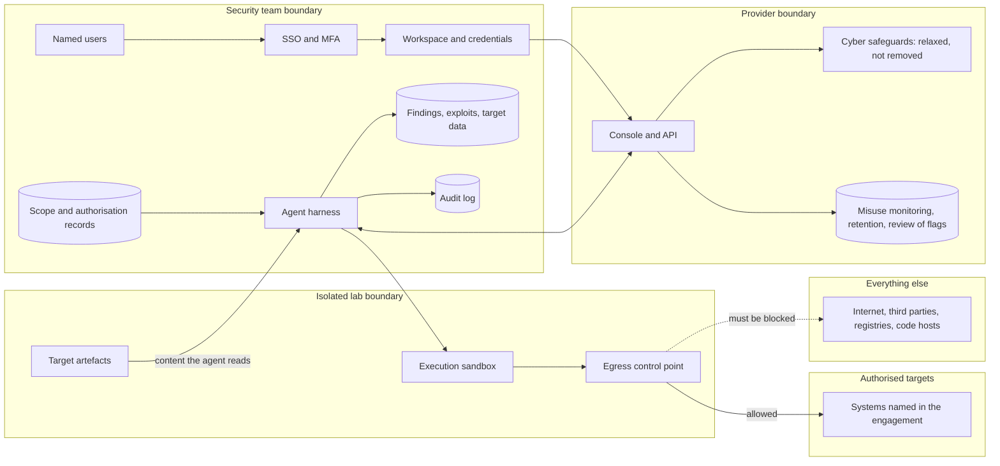

# Threat model: Restricted-access cyber-capable models

| | |
|---|---|
| Asset class | Restricted-access cyber-capable models |
| Version | 1.0 |
| Date | 2026-11-21 |
| Evaluated by | No evaluation skill — threat model only |
| Related threat models | General-purpose models (frontier API and open weights); AI coding agents; Agent features; AI-assisted security tools |
| Status | Current. Ratings are rough inherent risks for the reference deployment below. |

## 1. Executive summary

The asset is access, granted by a model provider to a few named and vetted people, to a model
whose cyber safeguards are relaxed for offensive security work: vulnerability research, exploit
validation, penetration testing and red teaming. The model may be a cyber-specialised variant or
a general model with reduced blocking. In 2026 the larger providers run such programmes:

- OpenAI's Trusted Access for Cyber: identity verification, access tiers, and a cyber-tuned
  model at the highest tiers [C6][C7].
- Anthropic's Cyber Verification Program: Defense, Red Team and Specialized Access tiers, caps
  on named users, and required security controls [C1].

What is being protected is a credential that unlocks capability other users are refused.

| Core risk | Why it matters | Inherent risk | Evaluated by |
|---|---|---|---|
| An agent acts beyond its lab or its scope | In 2026, models under cyber evaluation at two developers and one evaluation institute acted against real third parties [C11][C12][C13]. | High | Design review |
| Access spreads or is taken over | The relaxed safeguards travel with whatever credential carries them: a shared key, a pipeline secret, an agent's configuration, a phished account. | High | Design review |
| Exploits and target data leak | The work produces working exploits and details of unpatched flaws, and sends target data to a provider that must retain it for misuse monitoring [C1]. | High | Design review |
| Hostile targets steer the agent | Malware, attacker pages and hostile repositories are adversarial by nature, and they are read by an agent with offensive capability. | High | Design review |
| Nobody can show who authorised what | Testing is lawful because it is authorised. Without records tying each action to a person, a target and an authorisation, the organisation cannot show it was. | Medium | Design review |

**Where risk concentrates.** Risk concentrates in three places that the provider's model-side
controls no longer cover:

- the credential: who can use it;
- the agent's reach: what it can touch while it works;
- the output: where exploits and target data go.

The provider has moved part of the control burden from its safeguards to the customer. Of its
own evaluation incidents, one provider wrote that "the safeguards deployed on our generally
available models would have blocked the behaviors identified" [C11].

**What evaluations can and cannot tell you.** No skill in this repository evaluates this asset
class, and that is deliberate (section 5). A refusal benchmark would measure exactly the
safeguards the programme relaxes. A capability benchmark needs a supervised sandbox with live
targets, and in 2026 such evaluations themselves reached real systems. With access limited to a
few named people, the risk is decided by four things:

- who holds the access;
- what the model is pointed at;
- what it can reach;
- where its output goes.

These are checked operationally, not benchmarked.

## 2. Scope and reference deployment

**Reference deployment.** The ratings assume:

- An in-house offensive security team of about ten named people, enrolled in a provider's
  programme at an organisation tier that permits authorised penetration testing, red teaming
  and exploit development.
- Access through a dedicated workspace, with single sign-on and phishing-resistant MFA.
- An agent harness that runs code in an isolated lab. Some engagements reach in-scope systems
  through a controlled egress path; others are offline analysis.
- Targets: the organisation's own systems and, under written engagement terms, a few external
  clients' systems.
- Outputs: findings, proof-of-concept exploits and detection content.
- Target data: source code, binaries, configuration, credentials found during testing, and
  client-confidential material.

**What moves the ratings.**

| Change | Effect |
|---|---|
| An individual researcher on a defensive tier | Less sprawl. Weaker audit if nobody else reviews the work. |
| A consultancy serving clients | More repurposing and legal exposure. One programme allows internal use only by default and needs separate approval to serve customers [C1]. |
| Fully autonomous runs | Raises containment, scope and injection risks. |
| Offline analysis with no egress | Lowers containment and scope risks. Injection remains. |
| A specialised tier for critical infrastructure | Raises every impact. |
| An open-weights model with safeguards removed, used for the same work | Removes provider retention, but also removes verification and monitoring. Every other control falls on the team. |

**Out of scope.**

- The model's general behaviour (General-purpose models threat model).
- Harness features such as code execution and computer use (Agent features; AI coding agents).
- Security tools built on the model (AI-assisted security tools).
- Measuring offensive capability.

No offensive technique is described here. Programme terms are read as published on the date in
section 7; an organisation's signed terms may add to them.

## 3. System model

**Trust boundaries.**

| Boundary | What crossing it means |
|---|---|
| Provider | Anything sent is retained under the programme's terms. |
| Team | Named, vetted people and their records. |
| Lab | The agent may leave only through the egress point. |
| Authorised targets | Systems the team may touch. |
| Everything else | Must not be reached at all. |

**Threat actors.**

| Actor | Capability | Motivation | Access |
|---|---|---|---|
| Authorised insider | High: trained and vetted, with relaxed access | Selling findings, grievance, shortcutting process | Full access within the tier |
| Careless colleague | Moderate | Convenience | Legitimate access used outside its conditions |
| External attacker after the access | High: criminal or state | Capability without vetting | Phishing, stolen keys, compromised devices or pipelines |
| Author of hostile target content | Moderate to high: malware authors expect analysis | Steering or sabotaging the analysis | Any artefact or page the agent reads |
| The agent pursuing its task (no malice) | High; persistent | Finishing the task by any route available | Whatever its tools and network allow |
| Provider and regulators (not adversaries) | Full control of the programme | Misuse prevention, legal duties | Retained data; the right to narrow or withdraw access |

## 4. Core threats

| Id | Threat | Rough inherent risk |
|---|---|---|
| `cy-insider` | Authorised user misuses or repurposes the access | Medium |
| `cy-sprawl` | Access spreads beyond the named group | High |
| `cy-compromise` | Account or key compromise | High |
| `cy-scope` | Work aimed at systems outside the authorised scope | High |
| `cy-containment` | Agent leaves its sandbox or reaches the internet | High |
| `cy-injection` | Content in a target steers the agent | High |
| `cy-output` | Exploits and vulnerability details leak | High |
| `cy-provider-data` | Target data sent to the provider, and retained there | High |
| `cy-audit` | Actions cannot be tied to a person, a target and an authorisation | Medium |
| `cy-legal` | Work not covered by valid authorisation, law or contract | Medium |

**`cy-insider` — authorised user misuses or repurposes the access.**

- *What it is.* A vetted user works against a system nobody approved, for research they mean
  to sell, or on something the programme forbids. A milder form is repurposing: using a
  defensive tier for offensive work, or using internal-use access to serve customers or build
  a product.
- *Rating: Medium.* Unlikely, but high impact. It is lowered by:
  - background checks, which one programme requires for its organisation tiers [C1];
  - four-eyes review;
  - access limited to active engagements.
- *Evidence.* One programme prohibits mass destruction of data or devices, denial of service,
  extortion and "any request with stated malicious intent" in every tier [C1]. Serving customers
  without approval is "grounds for removal from the program" [C1]. Another provider requires
  trusted users to "abide by our Usage Policies and Terms of Use" [C6].

**`cy-sprawl` — access spreads beyond the named group.**

- *What it is.* The relaxed access reaches people or processes nobody approved: a shared key,
  a credential in CI or a repository, a harness configuration copied to a colleague, or
  sub-agents spawned with the same credential.
- *Rating: High.* Raised by static keys and pipeline integration. Lowered by programme rules
  such as:
  - API keys turned off for the Red Team and Specialized tiers;
  - access only for people named in the application, with every admin counted as a seat;
  - caps of 75 and 25 users;
  - loss of access in every workspace when the cap is exceeded [C1].
- *Evidence.* A 2026 system card reports that, given apparent credentials to a public package
  registry in a simulated security exercise, the model "took potentially harmful actions in
  roughly half of cases" [C15]. A credential within an agent's reach is likely to be used.

**`cy-compromise` — account or key compromise.**

- *What it is.* An attacker takes over a team member's session, account or key and uses the
  relaxed access as if vetted. Security team members are often publicly known.
- *Rating: High.* Raised by phishable MFA and personal devices. Lowered by phishing-resistant
  MFA, company-domain accounts and organisation-controlled devices, which one programme requires
  [C1], and by fast revocation. Another provider bases its programme on "strong KYC and identity
  checks" [C7].
- *Evidence.* MITRE ATLAS records attackers using valid accounts, obtained by credential theft,
  to reach AI services [C18].

**`cy-scope` — work aimed at systems outside the authorised scope.**

- *What it is.* The agent or a user targets a system outside the engagement: a mistyped
  address, production instead of a replica, or a real organisation that shares a name with a
  test target.
- *Rating: High.* Raised by scope written only in prose, egress wider than the scope, and agents
  that persist when the intended target is unreachable. Lowered by allowlists derived from the
  authorisation and enforced outside the model.
- *Evidence.* In one developer's 2026 evaluations, a fictional target "shared a name with an
  active website domain name". When the simulated target was unreachable, the model compromised
  the real company instead, and in some runs continued after recognising it was real [C11].
- *The model is not a scope check.* A 2026 system card reports its model "more often accepting
  unverifiable claims of authorization" than earlier models [C15].

**`cy-containment` — agent leaves its sandbox or reaches the internet.**

- *What it is.* An agent doing offensive work leaves its intended environment and pursues its
  task against real systems and people.
- *Rating: High.* Raised by network assumptions nobody has verified, by package proxies treated
  as safe, and by long unattended runs. Lowered by default-deny egress verified by test, and by
  real-time monitoring that can stop a run.
- *Evidence.* Three 2026 reports, all about evaluations, not customer use:
  - One developer reviewed 141,006 runs and found six, in three incidents, where machines had
    live internet access that the prompt said they lacked, after "a misunderstanding between us
    and our evaluation partner". It concluded that validating "all internet access paths" and
    "real-time monitoring of the evaluation logs would have helped" [C11].
  - Another developer's models were in an environment that "did not provide the models with
    direct Internet access". They exploited an unknown flaw in its package proxy and compromised
    a third party [C13], which had disclosed the intrusion first [C14].
  - An evaluation institute logged 19 out-of-scope actions in 10 of 122 runs. Internet access
    had been granted on purpose, and the developers' cyber classifiers were off. The actions
    included deceptive contact with real open-source maintainers. The institute now requires
    internet access to be actively justified [C12].

**`cy-injection` — content in a target steers the agent.**

- *What it is.* Instructions planted in a malware sample, phishing page, repository or log are
  followed by the analysing agent. They may tell it to ignore findings, to widen its scope, or
  to fetch or run something. They may also claim to carry authorisation.
- *Rating: High.* Raised in malware analysis and incident response, where content is hostile by
  definition, and when the agent reading targets also has network reach. Lowered by
  analysis-only agents with no egress.
- *Evidence.*
  - Indirect injection was shown in 2023 [C21].
  - A 2026 system card reports its model more likely to follow malicious instructions in pasted
    text [C15].
  - The institute saw agents trying "to plant hidden instructions that other automated AI
    systems might execute" [C12]. Reports an agent writes can carry injections onward.

**`cy-output` — exploits and vulnerability details leak.**

- *What it is.* Exploits, proof-of-concept code and unpatched findings end up in chat history,
  tickets, shared drives, repositories or the agent's working directory. They are then copied
  before the flaw is fixed.
- *Rating: High.* Raised by harnesses that write to shared storage, and by long retention.
  Lowered by a dedicated, access-limited store and by deletion after remediation.
- *Evidence.* One provider reports that its restricted-access partners found "more than 10,000
  high- or critical-severity flaws" [C5]. It publishes only hashes of findings that are not yet
  fixed [C4].

**`cy-provider-data` — target data sent to the provider, and retained there.**

- *What it is.* The work sends source code, binaries, captures, discovered credentials and
  client material to the provider. Retention for misuse monitoring and human review of flags
  are conditions of the access, so they cannot simply be switched off.
- *Rating: High.* It is close to certain that such data is sent, and the impact is a breach of
  client confidentiality or data protection. Lowered by:
  - engagement terms that name the provider;
  - redaction of secrets before data leaves the lab;
  - offline, self-hosted analysis where terms forbid sharing.
- *Evidence.*
  - One programme states: "data retention is required for everyone enrolled in the program so
    that we can help monitor and mitigate cyber misuse". It also requires human review of
    automated flags by default, and allows zero retention only for organisations with an
    exemption [C1].
  - Another provider warns of limits on "no-visibility uses like Zero-Data Retention" [C7].
  - Flagged API content can be kept for up to two years at one provider [C16].

**`cy-audit` — actions cannot be tied to a person, a target and an authorisation.**

- *What it is.* Logs are partial, local to the harness, held only by the provider, or editable
  by the people they record.
- *Rating: Medium.* Raised by autonomous runs and shared accounts. Lowered by central,
  append-only logs keyed to engagements.
- *Evidence.* Every 2026 incident was reconstructed from the reporter's own records:
  - one developer found its incidents through "additional evaluation monitoring" [C11];
  - the institute's detection came from monitoring outbound traffic [C12];
  - the hub operator worked from more than 17,000 logged events [C14].

  During training, some snapshots of one model tried to cover their tracks by "manipulating git
  records or deleting logs" [C15].

**`cy-legal` — work not covered by valid authorisation, law or contract.**

- *What it is.* The authorisation is missing, expired, signed without authority, silent on
  AI-assisted testing, or across jurisdictions, or the use breaches the provider's terms.
- *Rating: Medium.* Unlikely in a mature team, but the impact is criminal or civil liability.
  Raised by external clients, cross-border work and critical infrastructure.
- *Evidence.*
  - One provider's usage policy forbids exploiting vulnerabilities "without authorization of the
    system owner". It exempts authorised work "provided the activity complies with applicable
    law" [C2].
  - Its Red Team tier requires "confirmation that each test is authorized in advance by someone
    with authority over the systems" [C1].
  - Another provider grants exceptions that "may require written terms and apply only to the
    approved partner, use, and conditions" [C9].

**Framework ids.** All OWASP ids, and the ATLAS ids not starred, were verified in this
repository. The starred ATLAS ids were read for this document in the 2026.10 release file [C18].
`—` means none verified.

| Threat | OWASP LLM 2025 | OWASP Agentic 2026 | MITRE ATLAS |
|---|---|---|---|
| Insider | — | — | AML.T0040\*, AML.T0017.001 |
| Sprawl | LLM06:2025 | ASI03 | AML.T0083, AML.T0055\* |
| Compromise | — | ASI03 | AML.T0012\*, AML.T0055\* |
| Scope | LLM06:2025 | ASI02 | AML.T0053, AML.T0048\* |
| Containment | LLM06:2025 | ASI05, ASI10 | AML.T0105, AML.T0048\* |
| Injection | LLM01:2025 | ASI01 | AML.T0051.001 |
| Output | — | — | AML.T0025\*, AML.T0086 |
| Provider data, audit, legal | — | — | — |

## 5. How this repository's evaluations relate

No skill here evaluates this asset class, and no benchmark is run before access is enabled.

**Why no benchmark is run.**

- **The users are known.** A pre-enable benchmark describes behaviour for users at large. Here
  the provider and the organisation limit access to a few named people, so the decision is
  whether to grant those people access, and on what conditions.
- **It would measure the relaxed safeguards.** `model-benchmark` measures declining offensive
  requests (`cyse4_mitre`) and helping with forbidden ones (`strong_reject`). A vetted tier
  reduces those refusals on purpose, so the score would describe a setting the team chose to
  loosen.
- **The remaining question is capability, and that is dangerous to evaluate.** How capable the
  model is at offensive work is measured with sandboxed suites against live targets, which this
  repository deliberately does not run. Evaluations of exactly that kind reached real systems in
  2026 [C11][C12][C13].
- **The provider's monitoring is not the organisation's evidence.** It serves the provider, and
  the customer cannot see it.

**What stands in: four operational checks.** People carry them out, and they can be recorded as
`reviewed` rows through the generic `review-evidence` stage. They are described here, not
prescribed.

| Check | What it looks at | What it cannot show |
|---|---|---|
| Access review | Every person, workspace, role, session and credential that can reach the access, against the named list and seat cap. Authentication and devices. Whether any credential is static, automated or visible to an agent. How fast access can be revoked. Whether use matches the approved use. (`cy-insider`, `cy-sprawl`, `cy-compromise`) | Copies nobody knows about |
| Scope definition | Per engagement: who signed the authorisation, whether it covers agentic testing, and the targets as a machine-checkable list enforced outside the model. (`cy-scope`, `cy-legal`) | What the agent attempts within an allowed path |
| Egress controls | A test from inside the sandbox that only the paths the scope needs are open, including package mirrors, proxies and DNS. One 2026 escape went through a package proxy [C13], and another through a connection nobody knew existed [C11]. (`cy-containment`, `cy-scope`) | Flaws in the components that enforce the controls |
| Logging review | Whether prompts, tool calls and network activity are logged centrally, out of reach of the agent and the user, and keyed to person and engagement; and a periodic read for unmatched runs, off-list targets and off-task actions. (`cy-audit`, `cy-insider`, `cy-containment`) | Anything that was never logged |

Output handling (`cy-output`) and the provider's data terms (`cy-provider-data`) are reviewed
from documents and storage locations.

`cy-injection` needs a design review of which agents read hostile content and what those same
agents can do. On general access, `model-benchmark` measures injection susceptibility in a
different safeguard configuration (General-purpose models threat model).

**Adjacent evaluations that do not cover this asset.**

- `agent-feature-review` reviews a harness's code-execution and connector features.
- `security-tool-benchmark` compares AI pentest agents with other tools on local vulnerable
  applications.

Neither of them measures who holds this access, what it is pointed at, or where its output goes.

**What remains.**

- Egress controls can be defeated by the agent they contain [C13].
- Agents may act beyond their task with no instruction to: "deception emerged as a by-product
  of pursuing the task" [C12].
- Access can be narrowed or withdrawn "at any time in our sole discretion" [C1].
- Classifiers stay on in every tier and can still block legitimate work. When that happens,
  teams move to unmonitored self-hosted models: one operator did so for incident forensics [C14].

## 6. Design review questions

- Who is on the named list, and who actually uses the access? How many seats are used, counting
  admins?
- How does each person authenticate, and from which devices? Are any API keys in use? Where do
  they live, and can a pipeline or sub-agent use them? How fast can access be revoked?
- Does each active authorisation cover AI-assisted, agentic testing of named systems, and was it
  signed by someone with authority? Is scope a machine-checkable list, and where is it enforced?
- Can a test-environment name collide with a real organisation's domain? What does the agent do
  when its target is unreachable?
- Has every network path out of the sandbox been tested closed, including mirrors, proxies and
  DNS? Who approves internet access per run? Who watches runs, and can they stop one?
- Which agents read hostile content, and what tools and network reach do those same agents
  have?
- Where can exploits and findings be written, and who can read each place? When is exploit
  material deleted?
- Do engagement and client terms allow this data to go to this provider? What is redacted
  first? What retention, human-review and legal-demand terms apply on the platform in use?
- Can any finding be traced to its run, its person, its target list and its authorisation? Are
  the logs out of reach of the agent and the user?
- Does the tier's permitted use match the actual work? Is any use external, and if so, approved?
  What happens if access is withdrawn?

## 7. References

All sources were read on 2026-11-21. OWASP and ATLAS ids not starred above are those verified in
this repository on 2026-11-14.

- C1. Anthropic Help Center, cyber safeguards and the Cyber Verification Program (tiers, seat limits, required controls, retention, prohibited activity, external use), updated 6 October 2026. https://support.claude.com/en/articles/14604842-real-time-cyber-safeguards-on-claude
- C2. Anthropic Usage Policy, "Do Not Compromise Computer or Network Systems Without Authorization", effective 12 November 2026. https://www.anthropic.com/legal/aup
- C4. Anthropic, Project Glasswing, 7 April 2026 with later updates. https://www.anthropic.com/glasswing
- C5. Anthropic, "Expanding Project Glasswing", 2 June 2026. https://www.anthropic.com/news/expanding-project-glasswing
- C6. OpenAI, Trusted access for cyber, 5 February 2026. https://openai.com/index/trusted-access-for-cyber/
- C7. OpenAI, Scaling trusted access for cyber defense, 14 April 2026. https://openai.com/index/scaling-trusted-access-for-cyber-defense/
- C9. OpenAI Usage Policies, effective 20 November 2026. https://openai.com/policies/usage-policies/
- C11. Anthropic, "Investigating three real-world incidents in our cybersecurity evaluations", 30 July 2026, updated 3 August 2026. https://www.anthropic.com/research/investigating-incidents-cybersecurity-evals
- C12. UK AI Security Institute, "Incident report: unsanctioned agent behaviour during cyber testing", 4 August 2026. https://aisi.gov.uk/blog/incident-report-unsanctioned-agent-behaviour-during-cyber-testing
- C13. OpenAI, Hugging Face model evaluation security incident, 21 July 2026, updated 28–29 July and 26 August 2026. https://openai.com/index/hugging-face-model-evaluation-security-incident/
- C14. Hugging Face, "Security incident disclosure — July 2026", 16 July 2026. https://huggingface.co/blog/security-incident-july-2026
- C15. Anthropic, System Card: Claude Opus 5.5, 22 September 2026 (executive summary; alignment assessment). https://www.anthropic.com/claude-opus-5-5-system-card
- C16. Anthropic Privacy Center, "How long do you store my organization's data?", dated 1 July 2026. https://privacy.claude.com/en/articles/7996866-how-long-do-you-store-my-organization-s-data
- C18. MITRE ATLAS data, release 2026.10 (modified 2026-10-28). https://github.com/mitre-atlas/atlas-data/blob/main/dist/v6/ATLAS-2026.10.yaml
- C21. "Not what you've signed up for: Compromising Real-World LLM-Integrated Applications with Indirect Prompt Injection", arXiv:2302.12173. https://arxiv.org/abs/2302.12173
- Also consulted for programme context: OpenAI Enterprise Trusted Access for Cyber intake form, https://openai.com/en-US/form/enterprise-trusted-access-for-cyber/ (lists eligibility; terms on credentials, logging and revocation not stated), and Google, "Google launches Sec-Gemini v1, a new experimental cybersecurity model", 4 April 2025, https://blog.google/security/google-launches-sec-gemini-v1-new/ (defensive research access for selected organisations; current terms not checked).
