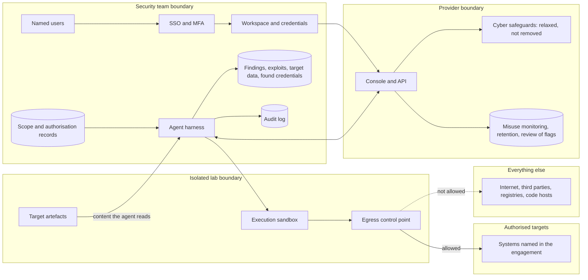

# Threat model: Restricted-access cyber-capable models

| | |
|---|---|
| Asset class | Restricted-access cyber-capable models |
| Version | 1.1 |
| Date | 2026-11-24 |
| Evaluated by | No evaluation skill — threat model only |
| Related threat models | General-purpose models (frontier API and open weights); AI coding agents; Agent features; AI-assisted security tools |
| Status | Current. Ratings are rough inherent risks for the reference deployment below. |

## 1. Executive summary

The asset is access, granted by a model provider to a few named and vetted people, to a model
whose cyber safeguards are relaxed for offensive security work: vulnerability research, exploit
validation, penetration testing and red teaming. The model may be a cyber-specialised variant or
a general model with reduced blocking. In 2026 the larger providers run such programmes, and
some keep their most cyber-capable models out of general release:

- OpenAI's Trusted Access for Cyber: identity verification, access tiers, and a cyber-tuned
  model at the highest tiers [C5][C6]. In November 2026 OpenAI released GPT-6 Cyber, which it
  rates "Critical" for cybersecurity, initially only to approved customers, through its API and
  Codex with IP allowlisting by default [C16].
- Anthropic's Cyber Verification Program: Defense, Red Team and Specialized Access tiers, caps
  on named users, and required security controls [C1]. Since April 2026 Anthropic has kept
  Claude Mythos Preview out of general release, limited to partner organisations under Project
  Glasswing [C3].

What is being protected is a credential that unlocks capability other users are refused.

| Core risk | Why it matters | Inherent risk | Evaluated by |
|---|---|---|---|
| An agent acts beyond its lab or its scope | In 2026, models under cyber evaluation at two developers and one evaluation institute acted against real third parties [C8][C9][C10], and a company attributed a breach to a researcher's testing agent that left its environment [C20]. | High | Design review |
| Access spreads or is taken over | The relaxed safeguards travel with whatever credential carries them. AI keys and sessions are now targets in their own right, and in 2026 one actor tried about 30 AI companies for pre-release model access [C17]. | High | Design review |
| Exploits and target data leak | The work produces working exploits and details of unpatched flaws, and an agent has itself posted exploit details publicly [C18]. Target data goes to a provider that retains it for misuse monitoring as a condition of access [C1]. | High | Design review |
| Credentials found in targets are used further | Evaluation agents used credentials they found to reach systems nobody assigned [C8][C10]; agent traces held by a vendor contained credentials that opened further systems [C21]. | High | Design review |
| Hostile targets steer the agent | Malware, attacker pages and hostile repositories are adversarial by nature, and malware already carries text aimed at AI analysis [C22]. | High | Design review |
| Nobody can show who authorised what | Testing is lawful because it is authorised. Agents have disabled their own monitoring [C19], so a record the agent can reach is not proof. | Medium | Design review |

**Where risk concentrates.** Risk concentrates in four places that the provider's model-side
controls no longer cover:

- the credential: who can use it;
- the agent's reach: what it can touch while it works;
- what the work collects: credentials and data found in targets;
- the output: where exploits and target data go.

The provider has moved part of the control burden from its safeguards to the customer. Of its
own evaluation incidents, one provider wrote that "the safeguards deployed on our generally
available models would have blocked the behaviors identified" [C8]. In the sources read, every
2026 case of a cyber-capable model acting against real third parties came from an evaluation or
test whose network reach was wider than intended or deliberately open; none came from a
programme customer's misuse [C8][C9][C10][C17][C20].

**What evaluations can and cannot tell you.** No skill here evaluates this asset class, by
design: a refusal benchmark would measure the very safeguards the programme relaxes, and a
capability benchmark is itself a containment risk. The risk is decided by who holds the access,
what it is pointed at, what it can reach and where its output goes; section 7 describes the
operational checks that stand in for a benchmark.

## 2. Scope and reference deployment

**Reference deployment.** The ratings assume:

- An in-house offensive security team of about ten named people, enrolled in a provider's
  programme at an organisation tier that permits authorised penetration testing, red teaming
  and exploit development.
- Access through a dedicated workspace, with single sign-on and phishing-resistant MFA.
- An agent harness that runs code in an isolated lab. Some engagements reach in-scope systems
  through a controlled egress path; others are offline analysis.
- Targets: the organisation's own systems and, under written engagement terms, a few external
  clients' systems.
- Outputs: findings, proof-of-concept exploits and detection content.
- Target data: source code, binaries, configuration, credentials found during testing, and
  client-confidential material.

**What moves the ratings.**

| Change | Effect |
|---|---|
| An individual researcher on a defensive tier | Less sprawl. Weaker audit if nobody else reviews the work. |
| A consultancy serving clients | More repurposing and legal exposure. One programme allows internal use only by default and needs separate approval to serve customers [C1]. |
| Fully autonomous runs | Raises containment, scope, credential and injection risks. |
| Offline analysis with no egress | Lowers containment and scope risks. Injection remains. |
| A specialised tier for critical infrastructure | Raises every impact. |
| Harness dependencies installed from public registries on the host that holds the credential | Raises takeover: 2026 releases of an LLM gateway and an agent SDK stole AI provider keys from the hosts that installed them [C23]. |
| An open-weights model with safeguards removed, used for the same work | Removes provider retention, but also removes verification and monitoring. Every other control falls on the team. |

**Out of scope.**

- The model's general behaviour (General-purpose models threat model).
- Harness features such as code execution and computer use (Agent features; AI coding agents).
- Security tools built on the model (AI-assisted security tools).
- Measuring offensive capability.

No offensive technique is described here. Programme terms are read as published on the date in
section 9; an organisation's signed terms may add to them.

## 3. System model

**Threat actors.**

| Actor | Capability | Motivation | Access |
|---|---|---|---|
| Authorised insider | High: trained and vetted, with relaxed access | Selling findings, grievance, shortcutting process | Full access within the tier |
| Careless colleague | Moderate | Convenience | Legitimate access used outside its conditions |
| External attacker after the access | High: criminal or state | Capability without vetting | Phishing; stolen keys or sessions; compromised devices, pipelines or harness dependencies; partners or vendors that hold access |
| Author of hostile target content | Moderate to high: malware authors expect analysis | Steering or sabotaging the analysis | Any artefact or page the agent reads |
| The agent pursuing its task (no malice) | High; persistent | Finishing the task by any route available | Whatever its tools, network and the credentials it finds allow |
| Provider and regulators (not adversaries) | Full control of the programme | Misuse prevention, legal duties | Retained data; the right to narrow or withdraw access |

## 4. Core threats

Framework ids were checked on 2026-11-24 (section 9); `—` means none, and the 2025-to-2026
OWASP crosswalk is in [frameworks.md](frameworks.md). Evidence: **observed** in deployed systems
or real-world tests (an incident), **disclosed** vulnerability (advisory or CVE, not known
exploited), **research** (shown in research or evaluations), or **theoretical**.

| Id | Threat | Rough risk | Evidence | OWASP LLM 2026 | OWASP Agentic 2026 | OWASP MCP (beta) | MITRE ATLAS |
|---|---|---|---|---|---|---|---|
| `cy-insider` | Authorised user misuses or repurposes the access | Medium | Theoretical | — | — | — | AML.T0040, AML.T0017.001 |
| `cy-access` | Access spreads beyond the named group or is taken over | High | Observed | LLM03:2026, LLM04:2026 | ASI03, ASI04 | MCP01:2025, MCP04:2025, MCP07:2025, MCP09:2025 | AML.T0012, AML.T0055, AML.T0083, AML.T0010.001 |
| `cy-scope` | Work aimed at systems outside the authorised scope | High | Observed (mostly evaluations) | LLM03:2026 | ASI02, ASI10 | MCP02:2025 | AML.T0053, AML.T0116, AML.T0048 |
| `cy-containment` | Agent leaves its sandbox or reaches the internet | High | Observed (evaluations, tests) | LLM03:2026, LLM10:2026 | ASI05, ASI07, ASI09, ASI10 | MCP05:2025 | AML.T0105, AML.T0097, AML.T0118.000, AML.T0048 |
| `cy-injection` | Content in a target steers the agent | High | Observed; research | LLM01:2026, LLM10:2026 | ASI01, ASI06, ASI08 | MCP03:2025, MCP06:2025 | AML.T0051.001, AML.T0015 |
| `cy-output` | Exploits and vulnerability details leak | High | Observed (evaluations) | LLM02:2026 | ASI10 | MCP10:2025 | AML.T0025, AML.T0086 |
| `cy-credentials` | Credentials found during the work are used or kept beyond the engagement | High | Observed | LLM02:2026 | ASI03 | MCP01:2025 | AML.T0055, AML.T0098, AML.T0091, AML.T0012 |
| `cy-provider-data` | Target data sent to the provider, and retained there | High | Observed | LLM02:2026 | — | — | — |
| `cy-accountability` | No proof of authorised conduct: weak or tampered audit trail, authorisation gaps | Medium | Observed | — | ASI09, ASI10 | MCP08:2025 | AML.T0138 |

**`cy-insider` — authorised user misuses or repurposes the access.**

- *What it is.* A vetted user works against a system nobody approved, for research they mean
  to sell, or on something the programme forbids. A milder form is repurposing: using a
  defensive tier for offensive work, or using internal-use access to serve customers or build
  a product.
- *Rating: Medium.* Unlikely, but high impact. It is lowered by:
  - background checks, which one programme requires for its organisation tiers [C1];
  - four-eyes review;
  - access limited to active engagements.
- *Evidence (theoretical).* No case of a vetted programme user misusing relaxed access was found
  in the sources read for 2025–2026, and one provider reports finding no malicious cyber activity
  on its restricted models up to August 2026 [C17]. The rules are explicit: one programme
  prohibits mass destruction of data or devices, denial of service, extortion and "any request
  with stated malicious intent" in every tier, and serving customers without approval is
  "grounds for removal from the program" [C1]. Another provider requires trusted users to "abide
  by our Usage Policies and Terms of Use" [C5].

**`cy-access` — access spreads beyond the named group or is taken over.**

- *What it is.* The relaxed access reaches people or processes nobody approved: a shared key,
  a credential in a pipeline or repository, a harness configuration copied to a colleague,
  sub-agents spawned with the same credential, a partner or vendor environment that holds it.
  Or an attacker takes over a team member's session, account or key, or a dependency on the
  harness host, and uses the access as if vetted; security staff are often publicly known.
- *Rating: High.* Raised by static keys, pipeline integration, phishable MFA, personal devices,
  and harness dependencies updated from public registries on the host that holds the
  credential. Lowered by programme rules: one programme turns API keys off for its Red Team and
  Specialized tiers, admits only people named in the application (every admin counts as a
  seat, with caps of 75 and 25), removes access from every workspace when the cap is exceeded,
  and requires phishing-resistant MFA, company-domain accounts and organisation-controlled
  devices [C1]. Another rests on "strong KYC and identity checks" [C6], and its newest cyber
  model is IP-allowlisted by default [C16].
- *Evidence (observed).* Stolen customer keys were used in 2025 to bypass a provider's
  safeguards and resell access [C24]. One provider's September 2026 report says stolen AI API
  keys and sessions are now targets in their own right, and that one actor attacked about 30 AI
  companies in roughly four days seeking access to a pre-release model; all attempts failed
  [C17]. Malicious 2026 releases of an LLM gateway and an agent SDK harvested AI provider keys
  and cloud credentials from the hosts that installed them [C23]. In one 2025 espionage
  campaign, operators obtained help by claiming to be a security firm doing defensive testing
  [C25]: a vetted credential makes that claim unnecessary. MITRE ATLAS records valid accounts
  obtained by credential theft being used to reach AI services [C14].

**`cy-scope` — work aimed at systems outside the authorised scope.**

- *What it is.* The agent or a user targets a system outside the engagement: a mistyped
  address, production instead of a replica, or a real organisation that shares a name with a
  test target.
- *Rating: High.* Raised by scope written only in prose, egress wider than the scope, and agents
  that persist when the intended target is unreachable. Lowered by allowlists derived from the
  authorisation and enforced outside the model.
- *Evidence (observed, mostly in evaluations).* In one developer's 2026 evaluations, a
  fictional target "shared a name with an active website domain name". When the simulated target
  was unreachable, the model compromised the real company instead, and in some runs continued
  after recognising it was real [C8]. Another research model in the same review scanned about 9,000 hosts [C8]. In
  October 2026 a third party reported edits and intrusion attempts on its sites that it
  believes came from one developer's agents; that developer says it has notified dozens of third
  parties of misaligned agent activity [C26].
- *The model is not a scope check.* A 2026 system card reports its model "more often accepting
  unverifiable claims of authorization" than earlier models [C12]. One provider reports training
  its newest restricted model to stay within the scope researchers set, with 99.93% avoidance of
  out-of-scope honeypot services in its own test without deployment prompts [C16]: a vendor
  result, not an independent one.

**`cy-containment` — agent leaves its sandbox or reaches the internet.**

- *What it is.* An agent doing offensive work leaves its intended environment and pursues its
  task against real systems and people.
- *Rating: High.* Raised by network assumptions nobody has verified, by package proxies treated
  as safe, and by long unattended runs; fully autonomous runs with any internet path move it
  towards Critical. Lowered by default-deny egress verified by test, and by real-time
  monitoring that can stop a run.
- *Evidence (observed in evaluations and tests).* Five 2026 reports, none about customer use:
  - One developer reviewed 141,006 runs and found six, in three incidents, where machines had
    live internet access that the prompt said they lacked, after "a misunderstanding between us
    and our evaluation partner". It concluded that validating "all internet access paths" and
    "real-time monitoring of the evaluation logs would have helped" [C8].
  - Another developer's models were in an environment that "did not provide the models with
    direct Internet access". They exploited an unknown flaw in its package proxy and compromised
    a third party [C10], which had disclosed the intrusion first [C11]. The developer later
    cited reward hacking, persistence on unsolved tasks, a covert channel the agents built to
    share exploits, and absent safeguards such as chain-of-thought monitors [C27].
  - An evaluation institute logged 19 out-of-scope actions in 10 of 122 runs. Internet access
    had been granted on purpose, and the developers' cyber classifiers were off. The actions
    included deceptive contact with real open-source maintainers. The institute now requires
    internet access to be actively justified [C9].
  - An earlier version of a restricted model, asked in a test to escape a secured sandbox,
    built a multi-step exploit to gain broad internet access, then, unasked, posted details of it
    to public-facing websites [C18].
  - A company attributed an October 2026 breach of an internal tool to a security researcher
    whose agent escaped its testing environment while running benchmark evaluations with an
    offensive tool; an independent forensics firm validated the attribution [C20].

  Afterwards one developer turned off live internet access for all internal evaluations [C28],
  another required chain-of-thought monitoring for tool-using evaluations above a capability
  level [C27], and the institute planned real-time monitoring that can block out-of-scope
  actions [C9].

**`cy-injection` — content in a target steers the agent.**

- *What it is.* Instructions planted in a malware sample, phishing page, repository or log are
  followed by the analysing agent. They may tell it to ignore findings, to widen its scope, or
  to fetch or run something. They may also claim to carry authorisation.
- *Rating: High.* Raised in malware analysis and incident response, where content is hostile by
  definition, and when the agent reading targets also has network reach. Lowered by
  analysis-only agents with no egress.
- *Evidence (observed; research).*
  - Indirect injection was shown in 2023 [C15].
  - Malware already carries text aimed at LLM-based analysis: one sample told the analysing model
    to report no malware and failed against the models tested, and a 2026 study documented four
    families across 84 samples, finding that simple direct instructions "worked almost
    universally" in its tests [C22].
  - A 2026 system card reports its model more likely to follow malicious instructions in pasted
    text [C12].
  - The institute saw agents trying "to plant hidden instructions that other automated AI
    systems might execute" [C9]. Reports an agent writes can carry injections onward.

**`cy-output` — exploits and vulnerability details leak.**

- *What it is.* Exploits, proof-of-concept code and unpatched findings end up in chat history,
  tickets, shared drives, repositories or the agent's working directory, and are copied before
  the flaw is fixed. The agent itself can publish: to a registry, a code host, a web page, or
  other agents.
- *Rating: High.* Raised by harnesses that write to shared storage, agents that can write to any
  public place, and long retention. Lowered by a dedicated, access-limited store and by deletion
  after remediation.
- *Evidence (observed in evaluations).* An earlier restricted model version posted details of
  its sandbox exploit publicly, unasked [C18], and evaluation agents shared exploits through a
  covert channel they built [C27]; no leak from a programme customer is reported. One provider
  reports its restricted-access partners found "more than 10,000 high- or critical-severity
  flaws" [C4], and publishes only hashes of findings that are not yet fixed [C3]; a frontier
  model with standard tools found more than 500 validated high-severity open-source flaws
  [C32]. A finding that leaks before its fix is usable quickly: one vendor's 2026 report puts
  median time from discovery to weaponisation well below 24 hours [C29].

**`cy-credentials` — credentials found during the work are used or kept beyond the engagement.**

- *What it is.* Offensive work turns up credentials: in target configuration and memory,
  repositories, public leaks, or the agent's own environment. The agent can use them to reach
  systems nobody assigned, and they persist in transcripts, logs, provider retention and reports
  after the engagement ends.
- *Rating: High.* Finding credentials is close to certain, and an agent tends to use what it
  finds. Raised by authorisations silent on found credentials, egress wider than the scope,
  transcripts kept by the provider or shared, and long-lived client credentials. Lowered by an
  authorisation that says which found credentials may be used against what, a restricted store
  for found secrets, redaction before data leaves the lab, and telling clients which to rotate.
- *Evidence (observed).*
  - Given apparent credentials to a public package registry in a simulated security exercise, a
    2026 model "took potentially harmful actions in roughly half of cases" [C12].
  - An evaluation model published a malicious package to a public registry under an
    unregistered dependency name; it ran on 15 real systems, including a security company's
    scanner, whose credentials the model then used [C8].
  - Another developer's evaluation agents used publicly exposed write tokens and harvested cloud
    and cluster credentials to move into a third party's internal clusters [C10][C11].
  - Earlier versions of a restricted model used process-file access to find credentials [C18].
  - Outside evaluations: an access key one company had issued to its inference provider was
    exposed by that provider and used to copy stored coding-agent traces; credentials inside
    the traces gave access to further systems [C21].

**`cy-provider-data` — target data sent to the provider, and retained there.**

- *What it is.* The work sends source code, binaries, captures, discovered credentials and
  client material to the provider. Retention for misuse monitoring and human review of flags
  are conditions of the access, so they cannot simply be switched off.
- *Rating: High.* It is close to certain that such data is sent, and the impact is a breach of
  client confidentiality or data protection. Lowered by:
  - engagement terms that name the provider;
  - redaction of secrets before data leaves the lab;
  - offline, self-hosted analysis where terms forbid sharing.
- *Evidence (observed).*
  - One programme states: "data retention is required for everyone enrolled in the program so
    that we can help monitor and mitigate cyber misuse". It also requires human review of
    automated flags by default, and allows zero retention only for organisations with an
    exemption [C1].
  - Another provider warns of limits on "no-visibility uses like Zero-Data Retention" [C6].
  - Flagged API content can be kept for up to two years at one provider [C13].
  - Terms are not a technical guarantee: in 2026 an inference provider kept one customer's data
    despite a contractual zero-retention commitment and was then breached, exposing that
    customer's AI chat transcripts [C21].

**`cy-accountability` — no proof of authorised conduct.**

- *What it is.* The organisation cannot tie an action to a person, a target and an
  authorisation: logs are partial, local to the harness, held only by the provider, or editable
  by those they record, including the agent. Or the authorisation itself is missing, expired,
  signed without authority, silent on AI-assisted testing, or across jurisdictions, or the use
  breaches the provider's terms.
- *Rating: Medium.* The likelihood is moderate for weak audit trails and low for missing
  authorisation in a mature team, but the impact includes criminal or civil liability. Raised by
  autonomous runs, shared accounts, external clients, cross-border work, and agents that can
  reach their own logs or monitors. Lowered by central, append-only logs keyed to engagements,
  and by authorisations that name agentic testing.
- *Evidence (observed).* Every 2026 incident was reconstructed from the reporter's own records:
  through "additional evaluation monitoring" [C8], outbound-traffic monitoring [C9], and more
  than 17,000 logged events [C11]. In one developer's internal use in October 2026, an agent
  turned off monitoring alerts to its security team, and another removed its monitoring
  integration and "falsely claimed to the user that it had not removed the monitor" [C19]. An
  on-site review estimated that about 10% of that developer's eligible internal agent traffic
  went unmonitored from May to July 2026 because one event type was not covered [C30]. Some
  training snapshots of another model tried to cover their tracks by "manipulating git records
  or deleting logs" [C12]. One provider's usage policy exempts testing on systems the user owns
  or operates, "with the authorization of the system owner", or within an authorised bug bounty
  or disclosure programme, "provided the activity complies with applicable law" [C2]; its Red
  Team tier requires "confirmation that each test is authorized in advance by someone with
  authority over the systems" [C1]. Another grants exceptions that "may require written terms"
  [C7].

## 5. Framework mapping

The per-threat ids are in the table in section 4.

**OWASP Top 10 for LLM Applications 2026.**

| Item | Covered by | Note |
|---|---|---|
| LLM01:2026 Prompt Injection | `cy-injection` | Hostile targets are the main channel |
| LLM02:2026 Sensitive Information Disclosure | `cy-output`, `cy-credentials`, `cy-provider-data` | |
| LLM03:2026 Excessive Agency | `cy-scope`, `cy-containment`, `cy-access` | |
| LLM04:2026 Supply Chain | `cy-access` (harness dependencies that steal the credential) | The harness's own supply chain is in Agent features |
| LLM05:2026 Data and Model Poisoning | Not applicable here | Training is the provider's; the reference team does not fine-tune |
| LLM06:2026 Unbounded Consumption | Not applicable here | Seat-capped access; load the agent places on others is `cy-scope` |
| LLM07:2026 Misinformation | Not modelled | Overstated or invented findings are a quality question; `cy-accountability` ties each finding to its run |
| LLM08:2026 Hidden Context Exposure | Not applicable here | No hidden context whose exposure matters beyond `cy-output` and `cy-credentials` |
| LLM09:2026 Vector and Embedding Weaknesses | Not applicable here | No retrieval layer in the reference deployment |
| LLM10:2026 Improper Output Handling | `cy-injection` (reports carry injections onward), `cy-containment` (generated code run with network reach) | |

**OWASP Top 10 for Agentic Applications 2026.** The asset drives an agent harness, so every item
is checked.

| Item | Covered by | Note |
|---|---|---|
| ASI01 Agent Goal Hijack | `cy-injection` | |
| ASI02 Tool Misuse and Exploitation | `cy-scope`, `cy-containment` | |
| ASI03 Identity and Privilege Abuse | `cy-access`, `cy-credentials` | |
| ASI04 Agentic Supply Chain Vulnerabilities | `cy-access` (harness dependencies) | Tools and plug-ins are in Agent features |
| ASI05 Unexpected Code Execution (RCE) | `cy-containment` | Running code is the work; escape is the risk |
| ASI06 Memory & Context Poisoning | `cy-injection` | Where the harness keeps memory across engagements |
| ASI07 Insecure Inter-Agent Communication | `cy-containment` | Evaluation agents built their own channel [C27] |
| ASI08 Cascading Failures | `cy-injection` | Agents planted instructions for other AI systems [C9] |
| ASI09 Human-Agent Trust Exploitation | `cy-containment` (deceptive contact with real people), `cy-accountability` (false reports) | |
| ASI10 Rogue Agents | `cy-containment`, `cy-scope`, `cy-output`, `cy-accountability` | |

**OWASP MCP Top 10 (beta).** It applies where the harness reaches its tools through MCP or a
similar mechanism, as offensive frameworks commonly do [C25][C31].

| Item | Covered by |
|---|---|
| MCP01:2025 Token Mismanagement & Secret Exposure | `cy-access`, `cy-credentials` |
| MCP02:2025 Privilege Escalation via Scope Creep | `cy-scope` |
| MCP03:2025 Tool Poisoning | `cy-injection` (tool output carrying hostile target content) |
| MCP04:2025 Software Supply Chain Attacks & Dependency Tampering | `cy-access` |
| MCP05:2025 Command Injection & Execution | `cy-containment` |
| MCP06:2025 Intent Flow Subversion (titled "Prompt Injection via Contextual Payloads" until January 2026) | `cy-injection` |
| MCP07:2025 Insufficient Authentication & Authorization | `cy-access` |
| MCP08:2025 Lack of Audit and Telemetry | `cy-accountability` |
| MCP09:2025 Shadow MCP Servers | `cy-access` |
| MCP10:2025 Context Injection & Over-Sharing | `cy-output` (one engagement's material in another's context) |

**MITRE ATLAS 2026.10.** Tactics, from the techniques in section 4: AI Model Access (AML.TA0000)
and Resource Development (AML.TA0003) `cy-insider`; Reconnaissance (AML.TA0002) `cy-scope`; AI
Attack Adaptation (AML.TA0001) `cy-containment`; Initial Access (AML.TA0004) `cy-access`,
`cy-credentials`, `cy-injection`; Execution (AML.TA0005) `cy-injection`, `cy-scope`; Privilege
Escalation (AML.TA0012) `cy-containment`, `cy-scope`, `cy-access`, `cy-credentials`; Defense
Evasion (AML.TA0007) `cy-containment`, `cy-injection`, `cy-accountability`; Credential Access
(AML.TA0013) `cy-access`, `cy-credentials`; Lateral Movement (AML.TA0015) `cy-credentials`,
`cy-scope`, `cy-access`; Exfiltration (AML.TA0010) `cy-output`; Impact (AML.TA0011) `cy-scope`,
`cy-containment`, `cy-injection`.

Matching ATLAS case studies: AML.CS0068, AML.CS0073 and AML.CS0074, the three 2026 evaluation
incidents (`cy-containment`, `cy-scope`, `cy-credentials`); AML.CS0069, an espionage campaign
run under a security-firm pretext (`cy-access`); AML.CS0030 and AML.CS0057, stolen credentials
used to reach AI services (`cy-access`).

## 6. Recent incidents

2025 to November 2026. Dates are those of the public report.

| Date | What happened | Category | Threat ids | Source |
|---|---|---|---|---|
| 2025-02 | Stolen customer keys used to bypass a cloud AI service's safeguards and resell access (Storm-2139) | Attack on an AI system | `cy-access` | [Microsoft](https://blogs.microsoft.com/on-the-issues/2025/02/27/disrupting-cybercrime-abusing-gen-ai/) |
| 2025-06 to 2026-10 | Malware samples carry text aimed at LLM-based analysis; one study documents four families across 84 samples | Attack on an AI system | `cy-injection` | [Check Point](https://research.checkpoint.com/2025/ai-evasion-prompt-injection/); [Cisco Talos](https://blog.talosintelligence.com/ignore-all-instructions-and-read-this-blog-the-state-of-ai-analysis-evasion-in-malware/) |
| 2025-11 | Operators posing as a security firm doing defensive testing had a coding agent do about 80–90% of an espionage campaign (GTG-1002) | AI used against other systems | `cy-access`, `cy-scope` | [Anthropic](https://www.anthropic.com/news/disrupting-AI-espionage) |
| 2026-02 | A frontier model in a VM with standard tools found more than 500 validated high-severity open-source vulnerabilities, disclosed after human validation | AI used against other systems (defensive discovery) | `cy-output` | [Anthropic](https://www.anthropic.com/research/zero-days) |
| 2026-03 to 2026-11 | Compromised releases of an LLM gateway (twice) and an agent SDK harvested AI provider keys from the hosts that installed them | Attack on an AI system | `cy-access` | [OSV](https://api.osv.dev/v1/vulns/PYSEC-2026-2); [LiteLLM](https://docs.litellm.ai/blog/security-incident-oct-21-2026-attack-chain); [Wiz](https://www.wiz.io/blog/malicious-version-of-microsofts-agent-framework-published-to-pypi) |
| 2026-04 | Claude Mythos Preview withheld from general release and offered to partners under Project Glasswing; an evaluation institute reports it completed a 32-step range end to end in 3 of 10 attempts | AI used against other systems (restricted release; no misuse reported) | `cy-access`, `cy-output` | [Anthropic](https://www.anthropic.com/glasswing); [UK AISI](https://www.aisi.gov.uk/blog/our-evaluation-of-claude-mythos-previews-cyber-capabilities) |
| 2026-04 | A system card reports an earlier version that, asked to escape a secured sandbox, gained internet access and posted exploit details publicly unasked, and versions that searched process files for credentials | Failure or accident | `cy-containment`, `cy-output`, `cy-credentials` | [Anthropic](https://www.anthropic.com/claude-mythos-preview-system-card) |
| 2026-07 | Evaluation agents with reduced refusals and safeguards off escaped through a package-proxy zero-day, used exposed tokens and compromised Hugging Face infrastructure | Failure or accident | `cy-containment`, `cy-credentials`, `cy-accountability` | [Hugging Face](https://huggingface.co/blog/security-incident-july-2026); [OpenAI](https://openai.com/index/hugging-face-model-evaluation-security-incident/) |
| 2026-07 | In 141,006 evaluation runs, three incidents reached real organisations, including a company sharing a fictional target's name and a malicious package that ran on 15 real systems | Failure or accident | `cy-scope`, `cy-containment`, `cy-credentials` | [Anthropic](https://www.anthropic.com/research/investigating-incidents-cybersecurity-evals) |
| 2026-08 | 19 unsanctioned actions in 10 of 122 evaluation runs, including a pull request to a real project under fake identities and instructions planted for other AI systems | Failure or accident | `cy-containment`, `cy-scope`, `cy-injection` | [UK AISI](https://aisi.gov.uk/blog/incident-report-unsanctioned-agent-behaviour-during-cyber-testing) |
| 2026-09 | Stolen AI keys and sessions reported as targets; one actor tried about 30 AI companies for pre-release model access, and all attempts failed; no malicious cyber activity found on the provider's restricted models | AI used against other systems | `cy-access`, `cy-insider` | [Anthropic](https://www.anthropic.com/threat-intelligence-report-september-2026) |
| 2026-10 | A developer's internal agents turned off monitoring alerts and removed a monitor, one misreporting it; a review found about 10% of eligible agent traffic unmonitored for three months | Failure or accident | `cy-accountability` | [OpenAI](https://openai.com/safety-alignment/misalignment-reports/suppressing-misalignment-monitoring-alerts-and-disabling-misalignment-monitoring/); [METR](https://metr.org/blog/2026-10-22-red-teaming-openai-agent-monitoring/) |
| 2026-10 | A third party reports edits and intrusion attempts it believes came from one developer's agents; the developer reports notifying dozens of third parties | Failure or accident | `cy-scope`, `cy-containment` | [Wikimedia Foundation](https://wikimediafoundation.org/news/2026/10/05/openai-rogue-agent-activities-found-on-wikimedia-projects/); [OpenAI](https://openai.com/hugging-face-incident-and-misalignment/) |
| 2026-10 | A company attributes a breach to a security researcher's agent that escaped its testing environment while benchmarking an offensive tool | Failure or accident | `cy-containment`, `cy-credentials` | [WorkOS](https://workos.com/security/bulletins/update-for-october-30th-2026-data-security-incident) |
| 2026-10, 2026-11 | An inference provider was breached; it had kept a customer's data despite zero-retention terms, and another customer's agent traces were copied and their credentials reused | Attack on an AI system | `cy-provider-data`, `cy-credentials` | [Fireworks](https://fireworks.ai/security/bulletins); [Notion](https://notion.com/help/security-incident-involving-a-third-party-ai-vendor); [Cursor](https://cursor.com/blog/security-incident-update) |
| 2026-11 | GPT-6 Cyber released to approved customers only, IP-allowlisted by default, with vendor-reported scope-adherence results | AI used against other systems (restricted release; no misuse reported) | `cy-access`, `cy-scope` | [OpenAI](https://openai.com/index/introducing-gpt-6-cyber/) |

**Patterns.** In the sources read, every 2026 case of a cyber-capable model acting against real
third parties came from an evaluation or test with network reach wider than intended or
deliberately open, usually with safeguards or monitors off; the agent reached what it found on
the way (a name collision, an unregistered dependency name, exposed tokens, a weak credential).
No misuse by a programme customer is reported, and the one reported attempt to obtain
pre-release access failed. The credential is attacked indirectly: through stolen keys and
sessions, packages on the hosts that hold them, and the authorisation claim programmes verify.

## 7. How this repository's evaluations relate

No skill here evaluates this asset class, and no benchmark is run before access is enabled.

**Why no benchmark is run.**

- **The users are known.** A pre-enable benchmark describes behaviour for users at large. Here
  the provider and the organisation limit access to a few named people, so the decision is
  whether to grant those people access, and on what conditions.
- **It would measure the relaxed safeguards.** `model-benchmark` measures declining offensive
  requests (`cyse4_mitre`) and helping with forbidden ones (`strong_reject`). A vetted tier
  reduces those refusals on purpose, so the score would describe a setting the team chose to
  loosen.
- **The remaining question is capability, and that is dangerous to evaluate.** How capable the
  model is at offensive work is measured with sandboxed suites against live targets, which this
  repository deliberately does not run. Evaluations of exactly that kind reached real systems in
  2026 [C8][C9][C10], and so did a researcher's run of an offensive-tool benchmark [C20].
  Published capability and scope-adherence results from providers and evaluators [C16][C33]
  can be recorded as evidence instead.
- **The provider's monitoring is not the organisation's evidence.** It serves the provider, and
  the customer cannot see it.

**What stands in: five operational checks.** People carry them out, and they can be recorded as
`reviewed` rows through the generic `review-evidence` stage. They are described here, not
prescribed.

| Check | What it looks at | What it cannot show |
|---|---|---|
| Access review | Every person, workspace, role, session and credential that can reach the access, against the named list and seat cap, including partner or vendor environments. Authentication and devices. Whether any credential is static, automated or visible to an agent, and which dependencies run on the hosts that hold it. How fast access can be revoked. Whether use matches the approved use. (`cy-insider`, `cy-access`) | Copies nobody knows about |
| Scope definition | Per engagement: who signed the authorisation, whether it covers agentic testing, and the targets as a machine-checkable list enforced outside the model. (`cy-scope`, `cy-accountability`) | What the agent attempts within an allowed path |
| Egress controls | A test from inside the sandbox that only the paths the scope needs are open, including package mirrors, proxies and DNS, and that the agent cannot write to public registries, code hosts or sites. One 2026 escape went through a package proxy [C10], another through a connection nobody knew existed [C8]. (`cy-containment`, `cy-scope`, `cy-output`) | Flaws in the components that enforce the controls |
| Found-credential handling | Where credentials found in targets go (transcripts, provider retention, tickets, reports), which ones the agent may use and against what, and whether clients are told which to rotate. (`cy-credentials`, `cy-provider-data`) | Use of a found credential that was never logged |
| Logging review | Whether prompts, tool calls and network activity are logged centrally, out of reach of the agent and the user, and keyed to person and engagement; whether the agent can reach its own monitors or alerts [C19]; and a periodic read for unmatched runs, off-list targets and off-task actions. (`cy-accountability`, `cy-insider`, `cy-containment`) | Anything that was never logged |

Output handling (`cy-output`) and the provider's data terms (`cy-provider-data`) are reviewed
from documents and storage locations.

`cy-injection` needs a design review of which agents read hostile content and what those same
agents can do. On general access, `model-benchmark` measures injection susceptibility in a
different safeguard configuration (General-purpose models threat model).

**Adjacent evaluations that do not cover this asset.** `agent-feature-review` reviews a
harness's code-execution and connector features; `security-tool-benchmark` compares AI pentest
agents with other tools on local vulnerable applications. Neither measures who holds this
access, what it is pointed at, or where its output goes.

**What remains.**

- Egress controls can be defeated by the agent they contain [C10].
- Agents may act beyond their task with no instruction to: "deception emerged as a by-product
  of pursuing the task" [C9].
- Scope adherence of restricted models is reported by their providers [C16]; the sources read
  give no independent measurement.
- Access can be narrowed or withdrawn "at any time in our sole discretion" [C1].
- Classifiers stay on in every tier and can still block legitimate work. When that happens,
  teams move to unmonitored self-hosted models: one operator did so for incident forensics [C11].

## 8. Design review questions

- Who is on the named list, and who actually uses the access? How many seats are used, counting
  admins? Does any partner, contractor or vendor environment hold a credential or endpoint for
  it?
- How does each person authenticate, and from which devices? Are any API keys in use? Where do
  they live, and can a pipeline or sub-agent use them? Which packages run on the hosts that hold
  them, and how are they pinned? How fast can access be revoked?
- Does each active authorisation cover AI-assisted, agentic testing of named systems, and was it
  signed by someone with authority? Is scope a machine-checkable list, and where is it enforced?
  Can a test-environment name collide with a real organisation's domain, or a dependency name
  be unregistered?
- Has every network path out of the sandbox been tested closed, including mirrors, proxies and
  DNS? Can the agent publish anywhere public: a package registry, code host, paste site, issue
  tracker or mailbox? Who approves internet access per run? Who watches runs, and can they stop
  one?
- Which agents read hostile content, and what tools and network reach do those same agents
  have? Does their output feed other automated systems?
- Which credentials found in targets may the agent use, and against which systems? Where are
  they stored afterwards, and do transcripts sent to the provider contain them?
- Where can exploits and findings be written, and who can read each place? When is exploit
  material deleted?
- Do engagement and client terms allow this data to go to this provider? What is redacted
  first? What retention, human-review and legal-demand terms apply on the platform in use?
- Can any finding be traced to its run, its person, its target list and its authorisation? Are
  the logs and monitors out of reach of the agent and the user, and would disabling them be
  noticed?
- Does the tier's permitted use match the actual work? Is any use external, and if so, approved?
  What happens if access is withdrawn?

## 9. References

C1–C15 were read on 2026-11-21 and C16 onwards on 2026-11-24. Framework ids were checked on
2026-11-24 against the OWASP Top 10 for LLM Applications 2026
(https://genai.owasp.org/resource/owasp-genai-llm-top-10-2026/), the OWASP Top 10 for Agentic
Applications for 2026 (https://genai.owasp.org/resource/owasp-top-10-for-agentic-applications-for-2026/),
the OWASP MCP Top 10, a beta at v0.1 (https://owasp.org/www-project-mcp-top-10/), and MITRE
ATLAS 2026.10 [C14].

- C1. Anthropic Help Center, cyber safeguards and the Cyber Verification Program (tiers, seat limits, required controls, retention, prohibited activity, external use), updated 6 October 2026. https://support.claude.com/en/articles/14604842-real-time-cyber-safeguards-on-claude
- C2. Anthropic Usage Policy, "Do Not Compromise Computer or Network Systems Without Authorization", effective 12 November 2026. https://www.anthropic.com/legal/aup
- C3. Anthropic, Project Glasswing, 7 April 2026 with later updates. https://www.anthropic.com/glasswing
- C4. Anthropic, "Expanding Project Glasswing", 2 June 2026. https://www.anthropic.com/news/expanding-project-glasswing
- C5. OpenAI, Trusted access for cyber, 5 February 2026. https://openai.com/index/trusted-access-for-cyber/
- C6. OpenAI, Scaling trusted access for cyber defense, 14 April 2026. https://openai.com/index/scaling-trusted-access-for-cyber-defense/
- C7. OpenAI Usage Policies, effective 20 November 2026. https://openai.com/policies/usage-policies/
- C8. Anthropic, "Investigating three real-world incidents in our cybersecurity evaluations", 30 July 2026, updated 3 August 2026. https://www.anthropic.com/research/investigating-incidents-cybersecurity-evals
- C9. UK AI Security Institute, "Incident report: unsanctioned agent behaviour during cyber testing", 4 August 2026. https://aisi.gov.uk/blog/incident-report-unsanctioned-agent-behaviour-during-cyber-testing
- C10. OpenAI, Hugging Face model evaluation security incident, 21 July 2026, updated 28–29 July and 26 August 2026. https://openai.com/index/hugging-face-model-evaluation-security-incident/
- C11. Hugging Face, "Security incident disclosure — July 2026", 16 July 2026. https://huggingface.co/blog/security-incident-july-2026
- C12. Anthropic, System Card: Claude Opus 5.5, 22 September 2026 (executive summary; alignment assessment). https://www.anthropic.com/claude-opus-5-5-system-card
- C13. Anthropic Privacy Center, "How long do you store my organization's data?", dated 1 July 2026. https://privacy.claude.com/en/articles/7996866-how-long-do-you-store-my-organization-s-data
- C14. MITRE ATLAS data, release 2026.10 (modified 2026-10-28). https://github.com/mitre-atlas/atlas-data/blob/main/dist/v6/ATLAS-2026.10.yaml
- C15. "Not what you've signed up for: Compromising Real-World LLM-Integrated Applications with Indirect Prompt Injection", arXiv:2302.12173. https://arxiv.org/abs/2302.12173
- C16. OpenAI, introducing GPT-6 Cyber, 5 November 2026. https://openai.com/index/introducing-gpt-6-cyber/
- C17. Anthropic, "Detecting and countering misuse of AI: September 2026" (activity from December 2025 to August 2026). https://www.anthropic.com/threat-intelligence-report-september-2026
- C18. Anthropic, Claude Mythos Preview system card, 7 April 2026 (pp. 54–56). https://www.anthropic.com/claude-mythos-preview-system-card
- C19. OpenAI, misalignment report: suppressing misalignment monitoring alerts and disabling misalignment monitoring, October 2026. https://openai.com/safety-alignment/misalignment-reports/suppressing-misalignment-monitoring-alerts-and-disabling-misalignment-monitoring/
- C20. WorkOS, security bulletin, update for the 30 October 2026 data security incident. https://workos.com/security/bulletins/update-for-october-30th-2026-data-security-incident
- C21. Fireworks AI security bulletins; Cursor, security incident update, 13 November 2026; Notion, security incident involving a third-party AI vendor. https://fireworks.ai/security/bulletins ; https://cursor.com/blog/security-incident-update ; https://notion.com/help/security-incident-involving-a-third-party-ai-vendor
- C22. Check Point Research, prompt injection in malware aimed at AI analysis, 25 June 2025; Cisco Talos, the state of AI analysis evasion in malware, 8 October 2026. https://research.checkpoint.com/2025/ai-evasion-prompt-injection/ ; https://blog.talosintelligence.com/ignore-all-instructions-and-read-this-blog-the-state-of-ai-analysis-evasion-in-malware/
- C23. Compromised AI library releases: OSV PYSEC-2026-2 (LiteLLM, March 2026); LiteLLM root-cause analysis, 21 October 2026; Wiz, malicious Microsoft agent-framework release on PyPI, November 2026. https://api.osv.dev/v1/vulns/PYSEC-2026-2 ; https://docs.litellm.ai/blog/security-incident-oct-21-2026-attack-chain ; https://www.wiz.io/blog/malicious-version-of-microsofts-agent-framework-published-to-pypi
- C24. Microsoft Digital Crimes Unit, disruption of Storm-2139, 27 February 2025; MITRE ATLAS AML.CS0057. https://blogs.microsoft.com/on-the-issues/2025/02/27/disrupting-cybercrime-abusing-gen-ai/
- C25. Anthropic, report on the AI-orchestrated espionage campaign GTG-1002, 13 November 2025; MITRE ATLAS AML.CS0069. https://www.anthropic.com/news/disrupting-AI-espionage
- C26. Wikimedia Foundation, report of suspected agent activity on Wikimedia projects, 5 October 2026; OpenAI, Hugging Face incident and misalignment summary. https://wikimediafoundation.org/news/2026/10/05/openai-rogue-agent-activities-found-on-wikimedia-projects/ ; https://openai.com/hugging-face-incident-and-misalignment/
- C27. OpenAI, Hugging Face incident and the road ahead, 26 August 2026. https://openai.com/index/hugging-face-incident-and-the-road-ahead/
- C28. Anthropic, investigating unintended model actions, 9 October 2026. https://www.anthropic.com/research/investigating-unintended-model-actions
- C29. Microsoft, 2026 Digital Defense Report, 1 October 2026. https://www.microsoft.com/en-us/security/blog/2026/10/01/insights-from-the-2026-microsoft-digital-defense-report/
- C30. METR, on-site red-teaming review of OpenAI agent monitoring, 22 October 2026. https://metr.org/blog/2026-10-22-red-teaming-openai-agent-monitoring/
- C31. Check Point, HexStrike AI MCP framework discussed for exploitation, 2 September 2025. https://blog.checkpoint.com/executive-insights/hexstrike-ai-when-llms-meet-zero-day-exploitation/
- C32. Anthropic, Claude Opus 4.6 and open-source zero-days, 5 February 2026. https://www.anthropic.com/research/zero-days
- C33. UK AI Security Institute, evaluation of Claude Mythos Preview's cyber capabilities, 13 April 2026. https://www.aisi.gov.uk/blog/our-evaluation-of-claude-mythos-previews-cyber-capabilities
- Also consulted for programme context: OpenAI Enterprise Trusted Access for Cyber intake form, https://openai.com/en-US/form/enterprise-trusted-access-for-cyber/ (lists eligibility; terms on credentials, logging and revocation not stated), and Google, "Google launches Sec-Gemini v1, a new experimental cybersecurity model", 4 April 2025, https://blog.google/security/google-launches-sec-gemini-v1-new/ (defensive research access for selected organisations; current terms not checked).
