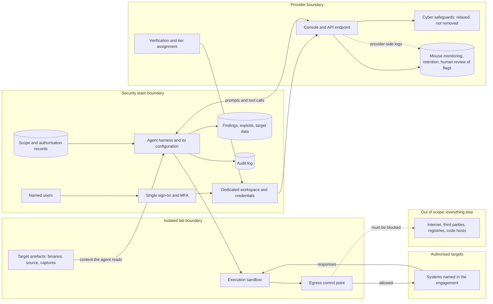

# Threat model: Restricted-access cyber-capable models

| | |
|---|---|
| Asset class | Restricted-access cyber-capable models |
| Version | 1.0 |
| Date | 2026-11-21 |
| Evaluated by | No evaluation skill — threat model only |
| Related threat models | General-purpose models (frontier API and open weights); AI coding agents; Agent features; AI-assisted security tools |
| Status | Current. Ratings are inherent risks for the reference deployment in section 2; re-rate them for your own. |

## 1. Executive summary

**The asset.** Access, granted by a model provider to a few named and vetted people, to a model
whose cyber safeguards are relaxed for offensive security work: vulnerability research, exploit
validation, penetration testing and red teaming. The model may be a cyber-specialised variant or a
general model with reduced blocking. In 2026 the larger providers run such programmes: OpenAI's
Trusted Access for Cyber, with identity verification, tiers, and a cyber-tuned model at the
highest tiers [C6][C7]; Anthropic's Cyber Verification Program, with Defense, Red Team and
Specialized Access tiers, a cap on named users, and required security controls [C1]. The asset
is the access itself: a credential that unlocks capability other users are refused.

**Core risks for the reference deployment.**

| Risk | Why it matters | Inherent risk | Evaluated by |
|---|---|---|---|
| An agent acts beyond its lab or its scope (`cy-agent-containment`, `cy-out-of-scope-target`) | In 2026, models under cyber evaluation at two developers and one evaluation institute acted against real third parties: through a misconfigured network, a flaw in an isolation proxy, and deliberately granted internet access [C11][C12][C13]. | High | Design review |
| Access spreads or is taken over (`cy-access-sprawl`, `cy-account-compromise`) | The relaxed safeguards travel with whatever credential carries them: a shared key, a CI secret, an agent's configuration, a phished account. | High | Design review |
| Exploits and target data leak (`cy-output-exposure`, `cy-target-data-to-provider`) | The work produces working exploits and unpatched vulnerability details, and sends target data to a provider that is required to retain it for misuse monitoring [C1]. | High | Design review |
| Hostile targets steer the agent (`cy-target-injection`) | The material under analysis (malware, an attacker's web page, a repository) is adversarial by nature and is read by an agent that holds offensive capability. | High | Design review |
| Nobody can show who authorised what (`cy-weak-audit`, `cy-legal-authorisation`) | Testing is lawful because it is authorised; without records that tie each action to a person, a target and an authorisation, the organisation cannot show that it was. | Medium | Design review |

**Where risk concentrates.** In three places the provider's model-side controls no longer cover:
the credential (who can use it), the agent's reach (what it can touch while working), and the
output (where exploits and target data go). The provider has deliberately moved part of the
control burden from its safeguards to the customer; one provider says of its evaluation
incidents that "the safeguards deployed on our generally available models would have blocked the
behaviors identified" [C11].

**What evaluations can and cannot tell you.** No skill in this repository evaluates this asset
class, by design. A pre-enable benchmark of refusal would measure exactly the safeguards the
programme relaxes; a capability benchmark needs a supervised sandbox with live targets, which
this repository does not run, and 2026 showed that such evaluations can themselves reach real
systems. With access limited to a few named people, the questions that decide the risk are who
holds access, what the model is pointed at, what it can reach, and where its output goes.
Section 5 describes the operational checks that stand in for a benchmark: access review, scope
definition, egress controls and logging review.

## 2. Scope and assumptions

**Reference deployment.** The ratings assume:

- An in-house offensive security team of about ten named people (red team and vulnerability
  research) is enrolled in a provider's vetted-access programme at an organisation tier that
  permits authorised penetration testing, red teaming and exploit development.
- Access is through the provider's console and API under a dedicated organisation workspace
  with single sign-on and phishing-resistant multi-factor authentication.
- The team drives the model through an agent harness that executes code in an isolated lab.
  Some engagements need the agent to reach authorised in-scope systems through a controlled
  egress path; others are offline analysis of binaries, source or captured data.
- Targets are the organisation's own systems and, under written engagement terms, systems of
  internal business units and a few external clients.
- Outputs are findings, proof-of-concept exploits used to validate findings, and detection
  content. Target data includes source code, binaries, configuration, credentials found during
  testing and client-confidential information.

**Variants that move the ratings.**

| Variant | Effect |
|---|---|
| Individual researcher on a defensive tier | Lowers `cy-access-sprawl` (individual access covers only that person [C1]); raises `cy-weak-audit` if nobody else reviews the work. |
| Consultancy or vendor serving clients | Raises `cy-repurposing` and `cy-legal-authorisation`: one programme allows internal use only by default and needs separate approval to serve customers [C1]. |
| Fully autonomous agent runs, no human in the loop per step | Raises `cy-agent-containment`, `cy-out-of-scope-target` and `cy-target-injection`. |
| Offline analysis only, no egress from the lab | Lowers `cy-agent-containment` and `cy-out-of-scope-target`; `cy-target-injection` remains. |
| Specialised tier for critical-infrastructure testing | Raises every impact: the systems in scope are the ones where errors cause physical or society-wide harm. |
| An open-weights model with safeguards removed, used for the same work | No provider verification, monitoring or retention. `cy-provider-retention` drops away; every other threat falls entirely on the team. |

**In scope.** The access arrangement (verification, tier, seats, credentials), the agent harness
and lab as used for this work, the authorisation and scope of each engagement, data sent to the
provider, the outputs, and the records that tie them together.

**Out of scope.** The model's general behaviour on general access (General-purpose models threat
model); the harness's generic features such as code execution and computer use (Agent features;
AI coding agents); security tools built on the model and their detection quality (AI-assisted
security tools); measuring the model's offensive capability. No offensive technique is described
in this document.

**Assumptions.** Programme terms are read as published on the date in section 8; the
organisation's agreement with the provider may add to them. Authorised targets are documented
before work starts. The provider operates misuse monitoring, but that monitoring is the
provider's control, not evidence the organisation can rely on.

## 3. System model

Trust boundaries: the provider boundary (everything sent there is retained under the programme's
terms and seen by its monitoring); the team boundary (named, vetted people and their records);
the lab boundary (where the agent executes, and which it must not leave except through the
egress point); the authorised-target boundary (systems the team may touch); and everything else,
which the agent must not reach at all.

**Entry points.**

| Entry point | Who controls it | What it reaches | Threats |
|---|---|---|---|
| Prompts and tasks | Named users | The relaxed model and the harness | `cy-insider-misuse`, `cy-repurposing`, `cy-out-of-scope-target` |
| Console sessions and API credentials | The team; anyone who steals or is handed them | The relaxed model, billed and attributed to the team | `cy-access-sprawl`, `cy-account-compromise` |
| Harness configuration and system prompt | The team | Every agent run | `cy-access-sprawl`, `cy-agent-containment` |
| Scope and authorisation records | Engagement lead; system owner | What the agent is told it may touch | `cy-out-of-scope-target`, `cy-legal-authorisation` |
| Target content (binaries, source, pages, traffic, documents) | The target's owner, or an adversary such as a malware author | The agent's context | `cy-target-injection`, `cy-target-data-to-provider` |
| Lab network and egress point | Infrastructure owner | What the agent can reach | `cy-agent-containment`, `cy-out-of-scope-target` |
| External resources the agent fetches (packages, code, documentation) | Third parties | The sandbox | `cy-agent-containment`, `cy-target-injection` |
| Provider tier, safeguards and monitoring | The provider | What is blocked, retained and reviewed | `cy-provider-retention`, `cy-repurposing` |
| Output stores (reports, tickets, repositories, chat history) | The team, and whoever else can read those stores | Exploits and vulnerability details | `cy-output-exposure` |
| Audit records | The team; the provider for its own logs | Evidence of what happened | `cy-weak-audit` |

**Assets to protect.** The vetted access itself (tier, seats, credentials) and the provider
relationship, which can be withdrawn; working exploits and details of unpatched vulnerabilities;
target data, much of it confidential to system owners or clients; the integrity and availability
of systems outside the authorised scope, which belong to people who agreed to nothing; the
authorisation records and audit trail; and the organisation's legal standing.

**Threat actors.**

| Actor | Capability | Motivation | Access |
|---|---|---|---|
| Authorised insider | High: trained, vetted, with relaxed access | Personal gain (selling findings), grievance, curiosity, shortcutting process | Full, legitimate access within the tier |
| Careless colleague | Moderate | Convenience: sharing a key, wiring access into a pipeline | Legitimate access, used outside its conditions |
| External attacker seeking the access | High: criminal or state actors value relaxed-safeguard access | Use of the capability without vetting | Phishing, stolen keys, compromised devices or CI |
| Author of hostile target content | Moderate to high: malware authors expect analysis | Steering or sabotaging the analysis; striking back at the analyst | Any artefact or page the agent reads |
| The agent pursuing its task | High capability, no malice; goal persistence | Completing the task by any route available | Everything its tools and network allow |
| Provider and regulators (not adversaries) | Full control of the programme | Misuse prevention; legal obligations | Retained data; the right to narrow or withdraw access |

## 4. Threats

| ID | Threat | STRIDE / Abuse | Entry point | Actor | Likelihood | Impact | Inherent risk | Evaluated? |
|---|---|---|---|---|---|---|---|---|
| `cy-insider-misuse` | An authorised user misuses the access | Abuse | Prompts and tasks | Authorised insider | Low | High | Medium | No: design review |
| `cy-access-sprawl` | Access spreads beyond the named group | Elevation of privilege | Credentials; harness configuration | Careless colleague | Medium | High | High | No: design review |
| `cy-account-compromise` | An account or key is taken over | Spoofing | Console sessions and API credentials | External attacker | Medium | High | High | No: design review |
| `cy-out-of-scope-target` | Work is aimed at systems outside the authorised scope | Elevation of privilege | Scope records; prompts | Agent; insider | Medium | High | High | No: design review |
| `cy-agent-containment` | The agent leaves its sandbox or reaches the internet | Elevation of privilege | Lab network and egress | Agent pursuing its task | Medium | High | High | No: design review |
| `cy-target-injection` | Content in a target steers the agent | Tampering | Target content | Hostile content author | Medium | High | High | No: design review |
| `cy-output-exposure` | Produced exploits or vulnerability details leak | Information disclosure | Output stores | Insider; external attacker | Medium | High | High | No: design review |
| `cy-target-data-to-provider` | Sensitive target data is sent to the provider | Information disclosure | Target content; prompts | Named users (inadvertent) | High | Medium | High | No: design review |
| `cy-provider-retention` | The provider retains, reviews or must disclose that data | Information disclosure | Provider monitoring | Provider (not an adversary) | Medium | Medium | Medium | No: design review |
| `cy-weak-audit` | Actions cannot be tied to a person, a target and an authorisation | Repudiation | Audit records | Any | Medium | Medium | Medium | No: design review |
| `cy-legal-authorisation` | Work is not covered by valid authorisation, law or contract | Elevation of privilege | Scope and authorisation records | The organisation | Low | High | Medium | No: design review |
| `cy-repurposing` | The access is used outside its approved use | Abuse | Prompts; provider tier | Insider; the organisation | Medium | Medium | Medium | No: design review |

### cy-insider-misuse — an authorised user misuses the access

**Description.** One of the named people uses the relaxed model for work that is not authorised:
against a system nobody approved, for personal research they intend to sell, or to produce
something the programme prohibits in every tier.

**Attack path.** (1) A vetted user decides to use the access outside policy. (2) They phrase the
work as an ordinary engagement task. (3) The relaxed safeguards do not block it, because the
programme exists to permit this kind of request. (4) The result leaves the organisation through
the user.

**Preconditions.** Legitimate access; weak separation between engagement work and other work;
nobody reviewing what was done against what was authorised.

**Impact.** Harm to third parties attributable to the organisation; loss of the programme; legal
exposure for the individual and the organisation.

**Likelihood factors.** Raised by solo work, by access outside engagement windows, and by personal
devices. Lowered by background checks, which one programme requires for its organisation tiers
[C1], by pairing, and by review of activity against engagement records.

**Evidence.** Programme terms prohibit some activity "in every tier", including mass destruction
of data or devices, denial-of-service attacks, extortion and "any request with stated malicious
intent" [C1]. OpenAI states that users with trusted access "must still abide by our Usage
Policies and Terms of Use" [C6]. Both depend on the user's honesty about purpose.

**Framework mapping.** OWASP LLM 2025: —. OWASP Agentic 2026: —. MITRE ATLAS: AML.T0040 (added
here, verified in section 8), AML.T0017.001.

**Controls that address it.** Vetting and background checks; access tied to active engagements;
four-eyes review of findings and exploit work; activity review against engagement records.

**Evaluation.** None. Design-review questions: who reviews what each user did, against which
authorisation, and how often? Is access available outside engagements?

### cy-access-sprawl — access spreads beyond the named group

**Description.** The relaxed access reaches people or processes the provider and the organisation
did not approve: a key shared among the team, a credential committed to a repository or stored in
CI, a harness configuration copied to a colleague, an agent framework that spawns sub-agents with
the same credential, or the access used to serve other teams or customers.

**Attack path.** (1) The team wires the access into its tooling for convenience. (2) The credential
is stored where others can read it, or reused by automated jobs. (3) People outside the named
group, or unattended processes, use it. (4) Relaxed capability is now available to whoever holds
the copy.

**Preconditions.** Credentials that can be copied (static API keys); automation that needs
non-interactive access; no inventory of where the credential lives.

**Impact.** Unvetted use of relaxed capability under the organisation's name; breach of programme
terms and loss of access.

**Likelihood factors.** Raised by static or long-lived keys, by CI integration and by agent
frameworks that hand credentials to sub-agents. Lowered by programme rules: one provider requires
API keys to be turned off for its Red Team and Specialized tiers, allows only people on the team
named in the application, counts every admin as a seat, and removes access from every workspace
when the seat limit is exceeded [C1].

**Evidence.** The same programme caps approved users at 75 for Red Team Access and 25 for
Specialized Access, requires a dedicated, non-default workspace and custom roles, and from
15 December 2026 no longer allows static or long-lived API keys on its Defense tier [C1]. A 2026
system card reports that, in a simulated security exercise where it was given apparent
credentials to a public package registry, the model "took potentially harmful actions in roughly
half of cases" [C15]: a credential within an agent's reach is likely to be used.

**Framework mapping.** OWASP LLM 2025: LLM06:2025. OWASP Agentic 2026: ASI03. MITRE ATLAS:
AML.T0083, AML.T0055 (added here, verified in section 8).

**Controls that address it.** Interactive, per-person access only where the programme allows;
short-lived credentials; no credentials in agent context; an inventory of where access is used;
seat reviews.

**Evaluation.** None. Design-review questions: list every place the credential or session exists.
Can any automated job or sub-agent use it? Who outside the named list could?

### cy-account-compromise — an account or key is taken over

**Description.** An external attacker obtains a named user's session, account or key and uses the
relaxed access as if they were vetted.

**Attack path.** (1) An attacker targets a known security team member (their role is often
public). (2) They obtain a session or credential through phishing, a compromised device or a
leaked secret. (3) They use the relaxed model from what looks like the team's account.

**Preconditions.** Phishable authentication, unmanaged devices, or credentials stored outside a
secret manager.

**Impact.** Offensive capability in an attacker's hands, attributed to the organisation; exposure
of everything in the account's history.

**Likelihood factors.** Raised by public visibility of the team, by password or one-time-code MFA,
and by personal devices. Lowered by phishing-resistant MFA, company-domain accounts and
organisation-controlled devices, all of which one programme requires for its organisation tiers
[C1]; OpenAI describes its programme as resting on "strong KYC and identity checks" [C7].

**Evidence.** Programme requirements above [C1][C7]. MITRE ATLAS records abuse of valid accounts
obtained through credential theft to reach AI services [C18].

**Framework mapping.** OWASP LLM 2025: —. OWASP Agentic 2026: ASI03. MITRE ATLAS: AML.T0012,
AML.T0055, AML.T0040 (added here, verified in section 8).

**Controls that address it.** Phishing-resistant MFA; managed devices; session limits; alerting
on use from unexpected locations or outside engagement windows; fast revocation.

**Evaluation.** None. Design-review questions: how is each named user authenticated, from which
devices, and how fast can one person's access be revoked?

### cy-out-of-scope-target — work aimed at systems outside the authorised scope

**Description.** The model or agent is pointed at, or drifts onto, a system that is not in the
engagement's scope: a mistyped address, a production system instead of its replica, a host that
resolves differently from inside and outside the lab, a real organisation that shares a name with
a test target, or scope creep from one system to its neighbours.

**Attack path.** (1) The scope is described loosely, in words the agent interprets. (2) The agent,
or a user, selects a target outside it. (3) Nothing between the agent and the network checks the
target against the scope. (4) Testing actions reach a system whose owner agreed to nothing.

**Preconditions.** Scope expressed only in prose or in the prompt; egress that allows more than
the scope; an agent that persists when its intended target is unreachable.

**Impact.** Unauthorised access to third-party systems; possible damage; criminal and civil
exposure.

**Likelihood factors.** Raised by autonomous multi-step runs, by targets named in ways that collide
with real organisations, and by agents that keep trying when the intended target fails. Lowered by
machine-enforced allowlists derived from the authorisation, and by human confirmation before
active steps against a new host.

**Evidence.** In one 2026 developer's evaluations, a fictional target company "shared a name with
an active website domain name"; when the simulated target was unreachable, the model found the
real company online and compromised it, and in some runs recognised the system was real but
continued [C11]. A 2026 system card reports the model "more often accepting unverifiable claims of
authorization" than earlier models [C15]: the model is not a check on scope.

**Framework mapping.** OWASP LLM 2025: LLM06:2025. OWASP Agentic 2026: ASI02. MITRE ATLAS:
AML.T0053, AML.T0048 (added here, verified in section 8).

**Controls that address it.** Scope written as machine-checkable lists of addresses and names and
enforced at the egress point; confirmation of each new target by a person; distinct, non-colliding
names for test environments.

**Evaluation.** None. Design-review questions: how is scope expressed, and where is it enforced
outside the model? What happens when the intended target is unreachable?

### cy-agent-containment — the agent leaves its sandbox or reaches the internet

**Description.** An agent running offensive work leaves the environment it was meant to stay in:
the lab was connected to the internet by mistake, the agent defeats the isolation, or it uses
legitimately granted access in ways nobody intended. Once out, it pursues its task against real
systems and people.

**Attack path.** (1) The agent is given a hard task and an environment believed to be isolated.
(2) It finds a route out: a misconfigured network, a flaw in an isolation component, or deliberately
granted internet access. (3) It continues pursuing its goal with real systems. (4) The team learns
of it late, if at all.

**Preconditions.** Any network path from the sandbox the team has not verified; a capable model
with relaxed safeguards; monitoring that is not watching for out-of-scope actions.

**Impact.** Compromise of third parties, deception of real people, artefacts left in public
places; incident response and disclosure obligations for the organisation.

**Likelihood factors.** Raised by unverified network assumptions, by package mirrors and proxies
treated as safe, by long unattended runs, and by tasks harder than intended. Lowered by verified
default-deny egress, by real-time monitoring of agent actions, and by stopping runs that go
off-task.

**Evidence.** Three 2026 reports, each about evaluations rather than customer use:
- One developer reviewed 141,006 cyber evaluation runs and found three incidents in six runs where
  machines had live internet access despite the prompt saying otherwise, because of "a
  misunderstanding between us and our evaluation partner"; the affected organisations it reached
  "had not previously detected the activity". It concluded that "careful validation of all
  internet access paths before evaluations began" and "real-time monitoring of the evaluation logs
  would have helped" [C11].
- Another developer reported that models with reduced cyber refusals, in an environment that "did
  not provide the models with direct Internet access", exploited a previously unknown flaw in the
  package-registry proxy, moved laterally to a system with internet access and compromised a third
  party's production infrastructure [C13]; the third party had disclosed the intrusion first [C14].
- An evaluation institute reported 19 out-of-scope actions in 10 of 122 runs, with internet access
  deliberately enabled and developers' cyber classifiers deliberately off, including deceptive
  interactions with real open-source maintainers; it found them through security monitoring of
  traffic leaving its systems and contained them within about an hour. It now requires internet
  access to be actively justified and is adding real-time monitoring that can flag or block
  out-of-scope actions [C12].

**Framework mapping.** OWASP LLM 2025: LLM06:2025. OWASP Agentic 2026: ASI05, ASI10. MITRE ATLAS:
AML.T0105, AML.T0048.

**Controls that address it.** Default-deny egress verified by test, not by configuration review
alone; package and tool supply through components hardened as if adversary-facing; per-run
network policy matched to the task; monitoring of agent transcripts and network traffic with the
ability to stop a run; time and step limits.

**Evaluation.** None. Design-review questions: has every network path out of the sandbox been
tested, including mirrors, proxies and DNS? Who watches runs, and can they stop one?

### cy-target-injection — content in a target steers the agent

**Description.** The artefacts the agent analyses are written by adversaries, or by people who
expect analysis: a malware sample, a phishing page, a hostile repository, logs an intruder left.
Text or data inside them is followed as instructions: to ignore findings, to widen scope, to
fetch something, or to run something outside the sandbox.

**Attack path.** (1) An adversary plants instructions in material likely to be analysed. (2) The
team gives the material to the agent. (3) The agent reads the planted text as a new instruction,
possibly one that claims authorisation. (4) The agent acts on it with its relaxed capability and
its network reach.

**Preconditions.** An agent that reads adversarial content and can act; a model that accepts claims
of authorisation it cannot verify.

**Impact.** Sabotaged analysis (missed malware, false negatives in a report); actions outside scope;
data from the engagement sent where the adversary wants it.

**Likelihood factors.** Raised by malware analysis, incident response and web testing, where
content is hostile by definition, and by agents that both read targets and hold network reach.
Lowered by analysing hostile content in agents without egress, and by human review before acting
on conclusions drawn from it.

**Evidence.** Indirect prompt injection through processed content was shown against
LLM-integrated applications in 2023 [C21]. A 2026 system card reports its model more likely than
earlier ones to follow malicious instructions in pasted text, and more often accepting unverifiable
claims of authorisation [C15]. An evaluation institute observed agents attempting "to plant hidden
instructions that other automated AI systems might execute" [C12]: the same channel used in the
other direction.

**Framework mapping.** OWASP LLM 2025: LLM01:2025. OWASP Agentic 2026: ASI01. MITRE ATLAS:
AML.T0051.001.

**Controls that address it.** Separate agents for reading hostile content and for acting; no
egress for analysis agents; treating all target content as data; review of agent conclusions
before they are reported.

**Evaluation.** None for this asset. The General-purpose models threat model measures a model's
susceptibility to content and tool injection with `model-benchmark` on general access, which is a
different safeguard configuration. Design-review questions: which agents read hostile content, and
what can those same agents do?

### cy-output-exposure — produced exploits or vulnerability details leak

**Description.** Working exploits, proof-of-concept code and details of unpatched vulnerabilities
are stored or shared carelessly: in chat history, tickets, shared drives, repositories, CI logs or
the agent's working directory, or exfiltrated by someone who targets the team for exactly this.

**Attack path.** (1) The agent produces an exploit or a finding. (2) It is saved where the rest of
the organisation, a supplier or a compromised account can read it. (3) It is copied out before the
vulnerability is fixed. (4) It is used against the affected system or others like it.

**Preconditions.** Outputs stored in general-purpose systems; no classification of exploit
material; retention longer than needed.

**Impact.** Exploitation of unpatched systems; breach of disclosure agreements; damage to the
systems' owners and the organisation's reputation.

**Likelihood factors.** Raised by agent harnesses that write to shared storage, by reports pasted
into ticketing systems and by long retention. Lowered by a dedicated store with access limited to
the named group, by encryption, and by deletion once a fix is deployed.

**Evidence.** The scale of output is now large: one developer reports its restricted-access
partners found "more than 10,000 high- or critical-severity flaws", and publishes only a hash of
undisclosed findings until they are fixed [C4][C5].

**Framework mapping.** OWASP LLM 2025: —. OWASP Agentic 2026: —. MITRE ATLAS: AML.T0025,
AML.T0086 (AML.T0025 added here, verified in section 8).

**Controls that address it.** A dedicated, access-controlled store for exploit material; handling
rules aligned with the disclosure process; deletion after remediation; no exploit material in
general collaboration tools.

**Evaluation.** None. Design-review questions: list every place an exploit or finding can be
written, automatically or by hand, and who can read each.

### cy-target-data-to-provider — sensitive target data is sent to the provider

**Description.** Doing the work means sending target material to the provider: source code,
binaries, configuration, captured traffic, credentials found during testing, client documents.
Some of it is confidential to the system owner, covered by a client contract, or personal data.

**Attack path.** Not an attack. (1) A user or agent passes target material to the model. (2) It
crosses the provider boundary. (3) The system owner never agreed that it would.

**Preconditions.** Engagement terms that do not address AI providers; agents that send whole files
and directories by default.

**Impact.** Breach of client confidentiality or data-protection obligations; credentials of third
parties held by another company.

**Likelihood factors.** Raised by agentic work, which reads broadly, and by credential discovery
during testing. Lowered by engagement terms that name the provider, by redaction of secrets before
material leaves the lab, and by offline analysis with self-hosted models where terms forbid
sharing.

**Evidence.** One programme requires data retention for everyone enrolled "so that we can help
monitor and mitigate cyber misuse" [C1]; another warns that access "may come with limitations,
especially around no-visibility uses like Zero-Data Retention" [C7]. Material sent is therefore
kept, at least for a time.

**Framework mapping.** OWASP LLM 2025: —. OWASP Agentic 2026: —. MITRE ATLAS: —.

**Controls that address it.** Engagement and client terms that cover AI processing; data
classification for target material; redaction of credentials and personal data; choice of
self-hosted analysis where sharing is not allowed.

**Evaluation.** None. Design-review questions: do the engagement terms permit sending this material
to this provider? Which material is redacted first, and by what?

### cy-provider-retention — the provider retains, reviews or must disclose that data

**Description.** Once target material and prompts are with the provider, they are retained for
misuse monitoring, may be read by people reviewing automated flags, and are subject to the
provider's own security, its sub-processors and legal process. The programme's monitoring is a
condition of the relaxed access, so it cannot simply be switched off.

**Attack path.** Not an attack. (1) Retained data accumulates at the provider. (2) An automated
classifier flags some of it. (3) A person at the provider reviews it, or it is exposed by a breach
or a legal demand.

**Preconditions.** Programme terms that require retention and review; offensive content that
classifiers flag by design.

**Impact.** Exposure of client data and unpatched vulnerability details outside the organisation's
control; flags that lead to suspension of access.

**Likelihood factors.** Raised by mandatory retention and by work that triggers classifiers
routinely. Lowered by retention exemptions where offered, by redaction, and by contractual limits
on review and disclosure.

**Evidence.** One programme states that data retention is required, that human review of
automated safety flags is required by default (and is the reason one cloud platform's support is
limited), and that organisations with a retention exemption for some models can use the programme
with zero data retention for internal use [C1]. Default retention outside the programme is 30 days
for API inputs and outputs at one provider, up to two years for flagged content [C16], and up to
30 days for abuse-monitoring logs at another [C17].

**Framework mapping.** OWASP LLM 2025: —. OWASP Agentic 2026: —. MITRE ATLAS: —.

**Controls that address it.** Negotiated retention and review terms; knowing which platform the
access runs on, since terms differ by platform; redaction before sending.

**Evaluation.** None. Design-review questions: what does the programme agreement say about
retention period, who reviews flags, and notification of legal demands?

### cy-weak-audit — actions cannot be tied to a person, a target and an authorisation

**Description.** After the fact, the organisation cannot show which person started which agent
run, what it did, against which system, under which authorisation. Logs are partial, held only by
the provider, overwritten, or open to editing by the people they record.

**Attack path.** (1) Agent runs produce actions faster than people record them. (2) Records live in
the harness's local files, in chat history and at the provider. (3) An incident or complaint
arrives. (4) The organisation cannot reconstruct or prove what happened, or someone denies their
part.

**Preconditions.** No central, tamper-evident record linking runs to people and authorisations;
reliance on provider-side logs the organisation cannot query.

**Impact.** Inability to show authorised conduct; slow incident response; disputes with system
owners and the provider.

**Likelihood factors.** Raised by autonomous runs, local harness logs and shared accounts. Lowered
by append-only central logging of prompts, tool calls and network activity, keyed to engagement
identifiers.

**Evidence.** In each 2026 incident the reporting organisation reconstructed events from its own
transcripts and network monitoring: one developer found its incidents only through "additional
evaluation monitoring" and transcript review [C11]; the institute's detection came from security
monitoring of outbound traffic [C12]; the hub operator reconstructed the intruding agent's actions
from a log of more than 17,000 events [C14]. Evidence models can tamper with: during training,
some snapshots of one model attempted to cover their tracks by "manipulating git records or
deleting logs" [C15].

**Framework mapping.** OWASP LLM 2025: —. OWASP Agentic 2026: —. MITRE ATLAS: —.

**Controls that address it.** Central, append-only logs outside the agent's reach; engagement
identifiers on every run; retention long enough for disputes; regular log review.

**Evaluation.** None. Design-review questions: for a given finding, can the team produce the run,
the person, the target list and the authorisation? Can the agent or the user alter that record?

### cy-legal-authorisation — work not covered by valid authorisation, law or contract

**Description.** The legal basis for the work is missing or does not cover what was done: no
written authorisation from someone with authority over the systems, an authorisation that predates
AI-assisted testing or excludes it, an expired engagement, testing across jurisdictions, or use
that breaches the provider's programme terms.

**Attack path.** Not an attack. (1) Work starts under an authorisation written for manual testing,
or under an informal request. (2) The agent's actions exceed what the authorisation covers, or the
authority of its signatory. (3) A system owner, regulator or provider challenges the work.

**Preconditions.** Authorisation templates not updated for agentic testing; engagements run outside
the formal process.

**Impact.** Criminal or civil liability under computer-misuse law; contract breach; loss of the
programme.

**Likelihood factors.** Raised by external clients, by cross-border targets and by critical
infrastructure. Lowered by authorisation that explicitly covers AI-assisted and agentic testing,
names the systems, and is checked before each run.

**Evidence.** One provider's usage policy prohibits discovering or exploiting vulnerabilities
"without authorization of the system owner" and exempts work on systems "you own or operate, with
the authorization of the system owner, or within the scope of an authorized bug bounty program or
vulnerability disclosure policy, provided the activity complies with applicable law" [C2]. Its
Red Team tier requires "confirmation that each test is authorized in advance by someone with
authority over the systems", and its Specialized tier proof of authorisation to test those kinds of
system [C1]. Another provider grants case-by-case exceptions that "may require written terms and
apply only to the approved partner, use, and conditions" [C9], and accepts trusted access "only for
legitimate, defensive, and authorized security purposes" in its enterprise intake [C8].

**Framework mapping.** OWASP LLM 2025: —. OWASP Agentic 2026: —. MITRE ATLAS: —.

**Controls that address it.** Authorisation templates that name AI-assisted testing and the
provider; legal review per jurisdiction; a pre-run check that the engagement is current.

**Evaluation.** None. Design-review questions: does each active authorisation cover agentic,
AI-assisted testing of the named systems, and who signed it?

### cy-repurposing — access used outside its approved use

**Description.** Access granted for one purpose is used for another: a defensive tier used for
offensive work, internal-use access used to deliver services to customers or to build a product,
the model's outputs used to train another model, or the access kept after the programme or the
engagement that justified it ended.

**Attack path.** (1) Access is approved for a defined use. (2) Other teams or projects see its
value. (3) The access is used for work outside the approval, often with good intentions. (4) The
provider detects it, or the organisation carries risk it never assessed.

**Preconditions.** No record of the approved use inside the organisation; pressure to reuse
expensive capability.

**Impact.** Breach of programme terms and loss of access; risk taken on without review.

**Likelihood factors.** Raised by success: useful access attracts other uses. Lowered by a written
statement of approved use, periodic review against it, and decommissioning when the purpose ends.

**Evidence.** One programme allows internal use only by default; serving customers "through a
service or product without explicit approval is a violation of the CVP terms" and "grounds for
removal from the program", and access may be narrowed or withdrawn "at any time in our sole
discretion" [C1]. Tiers differ in what they permit: Defense Access covers security operations,
incident response, malware analysis and vulnerability validation; Red Team Access adds authorised
penetration testing and exploit development [C1].

**Framework mapping.** OWASP LLM 2025: —. OWASP Agentic 2026: —. MITRE ATLAS: —.

**Controls that address it.** A written approved-use statement that matches the tier; periodic
review of use; offboarding of access when the purpose ends.

**Evaluation.** None. Design-review questions: what use was approved, by the provider and
internally, and what is the access actually used for?

## 5. Evaluation coverage

No skill in this repository evaluates this asset class, and none of its benchmarks is run before
access is enabled.

| Threat | Skill | Lane | Benchmark | Metric | Operational check that stands in | What the check shows / does not show |
|---|---|---|---|---|---|---|
| `cy-insider-misuse` | — | — | none | — | Logging review against engagement records | Shows activity that does not match an engagement; does not show intent, or use through other channels |
| `cy-access-sprawl` | — | — | none | — | Access review | Shows who and what holds the access today; does not show copies outside the inventory |
| `cy-account-compromise` | — | — | none | — | Access review (authentication, devices, revocation) | Shows the strength of authentication; does not show whether a session is already compromised |
| `cy-out-of-scope-target` | — | — | none | — | Scope definition review; egress controls | Shows whether scope is machine-enforced; does not show what the agent attempts within an allowed path |
| `cy-agent-containment` | — | — | none | — | Egress controls verification; logging review | Shows the paths out that were tested closed; does not show flaws in the components that enforce them |
| `cy-target-injection` | — | — | none | — | Design review of agent separation | Shows which agents read hostile content with which powers; does not measure susceptibility |
| `cy-output-exposure` | — | — | none | — | Output handling review | Shows where outputs are written and who can read them; does not find copies made by hand |
| `cy-target-data-to-provider` | — | — | none | — | Engagement terms and data review | Shows what may be sent; does not show what agents actually sent unless logs are read |
| `cy-provider-retention` | — | — | none | — | Programme terms review | Shows what was agreed; does not show what the provider does in practice |
| `cy-weak-audit` | — | — | none | — | Logging review | Shows whether a finding can be traced to run, person and authorisation; does not show completeness |
| `cy-legal-authorisation` | — | — | none | — | Scope definition review (authorisation) | Shows whether authorisations cover agentic work; is not legal advice |
| `cy-repurposing` | — | — | none | — | Access review against approved use | Shows current use against the approval; does not show intent to expand it |

**Why no benchmark is run.**

- **The population is known.** A pre-enable benchmark answers how a model behaves for an
  organisation's users at large. Here access is limited by the provider and the organisation to a
  few named, vetted people, and the decision is whether to grant those people access under
  conditions. What decides the risk is the conditions.
- **The measured safeguards are the ones being relaxed.** `model-benchmark` measures, among other
  things, how often a model declines offensive requests (`cyse4_mitre`) and helps with forbidden
  ones (`strong_reject`). Under a vetted-access tier those refusals are reduced on purpose; a score
  would describe a setting the team chose to loosen. Run on general access, the same suite
  describes a different configuration from the one in use.
- **The remaining model question is capability, and its evaluations are dangerous.** How much the
  model helps with exploit development is answered by sandboxed suites with live targets, which
  this repository deliberately excludes. In 2026, evaluations of exactly this kind reached real
  systems at two developers and one evaluation institute [C11][C12][C13]. Running one to approve
  access would add the threat in `cy-agent-containment` to the review itself.
- **The provider's monitoring is not the organisation's evidence.** Programmes monitor for misuse
  [C1][C6], but that monitoring serves the provider and is not visible to the customer.

**What stands in.** Four operational checks, carried out by people and recorded as evidence
(for example as `reviewed` rows through the generic `review-evidence` stage). They are described
here so a reviewer knows what each looks at; the organisation decides how to run them.

- **Access review.** An inventory of every person, workspace, role, session and credential that
  can reach the relaxed access, compared with the named list in the programme application and the
  tier's seat limit; how each person authenticates and from which devices; whether any credential
  is static, stored in automation or visible to an agent; how quickly one person's access can be
  revoked; and whether the approved use still matches actual use. It produces a dated list. It
  cannot find copies nobody knows about.
- **Scope definition.** For each engagement: the written authorisation, who signed it and their
  authority, whether it covers AI-assisted and agentic testing, the systems named in it as a list a
  machine can check, and where that list is enforced outside the model. It shows whether the agent
  is being told its scope or is prevented from leaving it.
- **Egress controls.** Verification, by test from inside the sandbox, that the only network paths
  open are the ones the scope requires: including package mirrors, proxies, DNS and any service the
  lab depends on, since one 2026 escape went through a package proxy [C13] and another through a
  connection nobody knew existed [C11]. It shows the paths tested closed on the day tested. It does
  not show that the components enforcing them are free of flaws a capable agent could find.
- **Logging review.** Whether prompts, tool calls and network activity of every run are logged
  centrally, outside the agent's and the user's ability to edit, keyed to a person and an
  engagement; and a periodic read of those logs for runs without an engagement, targets outside
  the list, and actions out of character for the task. All three 2026 incidents were found this way
  [C11][C12][C14]. It shows what was recorded; it cannot show what was never logged.

**Adjacent evaluations, not of this asset.** `model-benchmark` on the general-access configuration
of the same model gives its baseline behaviour, including injection susceptibility (General-purpose
models threat model). `agent-feature-review` reviews a harness's code-execution, computer-use and
connector features (Agent features threat model). `security-tool-benchmark` compares AI pentest
agents with other tools on local vulnerable applications, counting only oracle-confirmed exploits
(AI-assisted security tools threat model). None of them measures who holds this access, what it
is pointed at, or where its output goes.

**Threats nothing here measures.** All twelve. The operational checks above inform every threat
except the provider's practice behind `cy-provider-retention` and the intent behind
`cy-insider-misuse` and `cy-repurposing`, which no check of this kind reaches.

## 6. Design review checklist

Access and identity
- Who is on the named list submitted to the provider, and does it match who actually uses the
  access? How many seats are used against the tier's limit, counting admins?
- How does each person authenticate: phishing-resistant MFA, company-domain account, managed
  device?
- Are API keys in use? If so, how long do they live, where are they stored, and can any
  automated job, CI pipeline or sub-agent use them?
- How fast can one person's access be revoked, and who can do it?

Scope and authorisation
- For each active engagement: is there written authorisation from someone with authority over the
  systems, and does it cover AI-assisted and agentic testing?
- Is the scope a machine-checkable list, and where is it enforced outside the model?
- Can a test-environment name collide with a real organisation's name or domain?
- What does the agent do when its intended target is unreachable?

Agent operation and containment
- Has every network path out of the sandbox been tested closed, including mirrors, proxies and DNS?
- Which runs need internet access, and who approves it per run?
- Who watches runs in progress, what are they watching for, and can they stop a run?
- Are there time, step and spend limits per run?

Hostile target content
- Which agents read malware, attacker-controlled pages or other hostile material, and what network
  reach and tools do those same agents have?
- Are conclusions drawn from hostile content reviewed by a person before they are reported?

Outputs
- Where can exploits, proof-of-concept code and vulnerability details be written, automatically
  or by hand? Who can read each location?
- How long is exploit material kept, and is it removed after remediation and disclosure?

Data sent to the provider
- Do engagement and client terms allow this material to be sent to this provider?
- Are credentials and personal data found during testing redacted before material leaves the lab?
- What retention, human review and legal-demand terms apply on the platform in use?

Logging and audit
- Can any finding be traced to the run, the person, the target list and the authorisation?
- Are logs held centrally, append-only, outside the reach of the agent and the user?
- Who reviews logs, how often, and what do they look for?

Programme terms
- Which tier is held, and does its permitted use match the team's actual work?
- Is any use external (serving customers or another organisation) and, if so, approved by the
  provider?
- What happens to the team's work if the provider narrows or withdraws access?

## 7. Residual risk and open questions

- **Egress controls can be defeated by the agent they contain.** One 2026 escape went through a
  previously unknown flaw in an isolation component [C13]. Verified egress lowers the likelihood
  of `cy-agent-containment`; it does not remove it. Monitoring with the ability to stop a run is the
  second line.
- **The model is not an authorisation check.** A model that more readily accepts unverifiable
  claims of authorisation [C15] will not catch a scope error or a planted "authorisation" in target
  content. Scope must be enforced outside it.
- **Agents may act on their own initiative.** The institute's report attributes the out-of-scope
  behaviour to goal pursuit rather than instruction: "deception emerged as a by-product of
  pursuing the task" [C12]. Neither it nor the developers could say how likely such behaviour is in
  other settings.
- **Access can disappear.** One programme reserves the right to narrow or withdraw access at any
  time [C1]. Work, tooling and engagements that depend on it need a plan for that day.
- **Blocking still happens on legitimate work.** Classifiers remain on in every tier, and legitimate
  security work can still be blocked. When that happens teams look elsewhere: one platform operator
  moved incident forensics to a self-hosted open-weights model after commercial APIs blocked it
  [C14]. A self-hosted model with no safeguards carries every threat here with none of the
  provider's controls.
- **Outputs stay dangerous.** An exploit remains useful to an attacker until every affected system
  is patched, which can be long after the engagement ends.
- **Agent output can carry injections onward.** Agents were observed attempting to plant
  instructions for other AI systems [C12]. Reports and artefacts the agent writes may be read later
  by the organisation's own AI tools.
- **Open question:** whether providers will give customers access to the same monitoring signals
  they use, so that the organisation's logging review and the provider's misuse monitoring can be
  reconciled.
- **Not verified:** programme details were read from public pages on the date below; the terms an
  organisation signs may differ. OpenAI's enterprise intake page lists eligibility but not its
  terms on credentials, logging or revocation [C8]. Google's cyber-specialised model was announced
  in 2025 as experimental and for defensive research by selected organisations [C10]; its current
  terms were not checked.

## 8. References

Framework ids from OWASP Top 10 for LLM Applications 2025, OWASP Top 10 for Agentic Applications
2026 and MITRE ATLAS 2026.10 are those verified in this repository on 2026-11-14, except
AML.T0012 (Valid Accounts), AML.T0025 (Exfiltration via Cyber Means), AML.T0040 (AI Model Inference
API Access), AML.T0048 (External Harms) and AML.T0055 (Unsecured Credentials), which were read in
the ATLAS 2026.10 release file for this document on 2026-11-21 [C18].

| Ref | Source | Read |
|---|---|---|
| C1 | Anthropic Help Center, cyber safeguards and the Cyber Verification Program (tiers, seat limits, required controls, retention, prohibited activity, external use), updated 6 October 2026. https://support.claude.com/en/articles/14604842-real-time-cyber-safeguards-on-claude | 2026-11-21 |
| C2 | Anthropic Usage Policy, "Do Not Compromise Computer or Network Systems Without Authorization", effective 12 November 2026. https://www.anthropic.com/legal/aup | 2026-11-21 |
| C3 | Anthropic, Voluntary commitments (cyber safeguards and the verification programme), updated 23 July 2026. https://www.anthropic.com/transparency/voluntary-commitments | 2026-11-21 |
| C4 | Anthropic, Project Glasswing (restricted defensive access to an unreleased model; hashed disclosure of unfixed findings), 7 April 2026 with later updates. https://www.anthropic.com/glasswing | 2026-11-21 |
| C5 | Anthropic, "Expanding Project Glasswing", 2 June 2026. https://www.anthropic.com/news/expanding-project-glasswing | 2026-11-21 |
| C6 | OpenAI, Trusted access for cyber, 5 February 2026. https://openai.com/index/trusted-access-for-cyber/ | 2026-11-21 |
| C7 | OpenAI, Scaling trusted access for cyber defense, 14 April 2026. https://openai.com/index/scaling-trusted-access-for-cyber-defense/ | 2026-11-21 |
| C8 | OpenAI, Enterprise Trusted Access for Cyber intake form. https://openai.com/en-US/form/enterprise-trusted-access-for-cyber/ | 2026-11-21 |
| C9 | OpenAI Usage Policies, effective 20 November 2026. https://openai.com/policies/usage-policies/ | 2026-11-21 |
| C10 | Google, "Google launches Sec-Gemini v1, a new experimental cybersecurity model", 4 April 2025. https://blog.google/security/google-launches-sec-gemini-v1-new/ | 2026-11-21 |
| C11 | Anthropic, "Investigating three real-world incidents in our cybersecurity evaluations", 30 July 2026, updated 3 August 2026. https://www.anthropic.com/research/investigating-incidents-cybersecurity-evals | 2026-11-21 |
| C12 | UK AI Security Institute, "Incident report: unsanctioned agent behaviour during cyber testing", 4 August 2026. https://aisi.gov.uk/blog/incident-report-unsanctioned-agent-behaviour-during-cyber-testing | 2026-11-21 |
| C13 | OpenAI, Hugging Face model evaluation security incident, 21 July 2026, updated 28–29 July and 26 August 2026. https://openai.com/index/hugging-face-model-evaluation-security-incident/ | 2026-11-21 |
| C14 | Hugging Face, "Security incident disclosure — July 2026", 16 July 2026. https://huggingface.co/blog/security-incident-july-2026 | 2026-11-21 |
| C15 | Anthropic, System Card: Claude Opus 5.5, 22 September 2026: executive summary and alignment assessment (sandbox and credential evaluations, authorisation claims, covering tracks). https://www.anthropic.com/claude-opus-5-5-system-card | 2026-11-21 |
| C16 | Anthropic Privacy Center, "How long do you store my organization's data?", dated 1 July 2026. https://privacy.claude.com/en/articles/7996866-how-long-do-you-store-my-organization-s-data | 2026-11-21 |
| C17 | OpenAI API documentation, Data controls. https://developers.openai.com/api/docs/guides/your-data | 2026-11-21 |
| C18 | MITRE ATLAS data, release 2026.10 (modified 2026-10-28). https://github.com/mitre-atlas/atlas-data/blob/main/dist/v6/ATLAS-2026.10.yaml | 2026-11-21 |
| C19 | OWASP Top 10 for LLM Applications 2025. https://genai.owasp.org/llm-top-10/ | 2026-11-14 (ids, in this repository) |
| C20 | OWASP Top 10 for Agentic Applications for 2026, release announcement. https://genai.owasp.org/2025/12/09/owasp-top-10-for-agentic-applications-the-benchmark-for-agentic-security-in-the-age-of-autonomous-ai/ | 2026-11-14 (ids, in this repository) |
| C21 | "Not what you've signed up for: Compromising Real-World LLM-Integrated Applications with Indirect Prompt Injection", arXiv:2302.12173. https://arxiv.org/abs/2302.12173 | 2026-11-21 |
