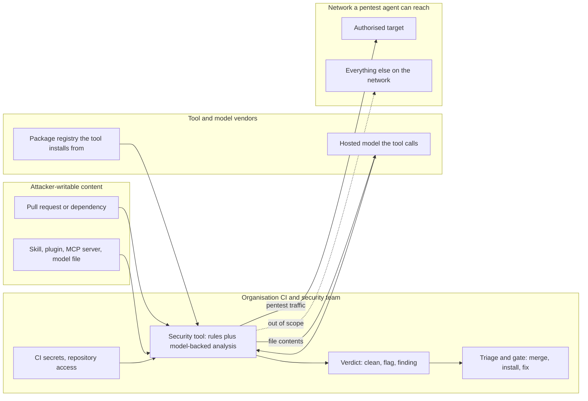

# Threat model: AI-assisted security tools (code reviewers, scanners of AI components, AI pentest agents)

| Field | Value |
|---|---|
| Asset class | AI-assisted security tools (code reviewers, scanners of AI components, AI pentest agents) |
| Version | 1.1 |
| Date | 2026-11-24 |
| Evaluated by | `security-tool-benchmark` |
| Related threat models | Agent features; AI coding agents (a model inside an agent harness); Guardrails and safety classifiers; Restricted-access cyber-capable models |
| Status | Current. Ratings are rough inherent risks for the reference deployment below; re-rate them for your own |

## 1. Executive summary

AI-assisted security tools use a language model to find problems: a code reviewer that reads
pull requests, a scanner that decides whether a skill, plugin, MCP server or model file is safe
to install, a pentest agent that attacks a running application. Their output is a verdict
other people act on: merge or block, install or reject, fix or ignore. The main risk is
therefore not that the tool is attacked for its own sake but that its verdict is wrong, or
can be made wrong, while people trust it. A second set of risks comes from what the tool
touches: source code and secrets it sends to a model vendor, systems a pentest agent reaches,
the input it parses or runs, and the privileges and supply chain of the tool itself.

| Core risk | Why it matters | Inherent risk | Evaluated by |
|---|---|---|---|
| False negatives treated as "clean" (st-false-negative) | Published evaluations of skill and MCP scanners show large misses, and in 2026 a padded malicious skill got a clean verdict from a marketplace's scanner; a clean verdict becomes an approval | Critical | Yes: recall per tool, class and stratum, with intervals |
| The scanned content instructs the LLM-backed tool (st-content-injection) | Malware in the wild carries text aimed at LLM triage; a malicious skill persuaded an LLM analyser it was low risk; adaptive comment attacks fooled vulnerability detectors over 90% of the time | High | Partly: mutated positives test detection of agent-directed instructions, not scanner-directed ones |
| Silent fallbacks reporting "clean" when the model call failed (st-silent-fallback) | Several tools carry on with rules only, or return clean on an unparsable reply; oversized or broken input makes this an evasion technique | High | Partly: adapters turn detectable fallbacks into failed runs, which are excluded |
| Nondeterministic verdicts and benchmark contamination (st-nondeterminism, st-contamination) | The same input gets different verdicts; public benchmarks overstate what a model-backed tool finds | High | Yes: repeats with flip rate and Fleiss κ; canary probes and mutated twins |
| False positives, duplicates and finding volume (st-false-positive) | AI-found vulnerabilities now arrive in the thousands; an open-source project ended its bug bounty over low-quality AI reports; an autonomous tester's leaderboard run had more duplicates than resolved reports | High | Partly: precision as a lower bound, unverified pentest findings kept apart, cost per verified finding; not triage time or duplicates |
| The tool as an entry point: its inputs, interfaces and supply chain (st-tool-attack-surface, st-supply-chain) | Code execution in an AI gateway's guardrail feature and a compromised security scanner are both in CISA's exploited-vulnerabilities catalogue; a package an agent published ran on a security company's scanner | High | No: design review |
| Source code and secrets sent to a tool's model vendor (st-vendor-data) | Model-backed modes send file contents to a hosted provider, sometimes by default; a provider's zero-retention commitment failed in 2026 | High | No: design review |
| An AI pentest agent outside its scope, or pointed at others (st-pentest-scope, st-dual-use) | In 2026 evaluation agents at three labs, and one researcher's offensive tool, reached real organisations | High | No: the skill only runs against self-hosted targets; scope adherence is not scored |

**Where risk concentrates.** Where a tool's verdict gates something without a person reading
the evidence, and where the thing being judged is written by the attacker: a skill author, an
MCP server publisher, a pull-request contributor. An LLM-backed tool reads attacker text as
input, so the content under review is also an instruction channel into the reviewer; a tool
that runs what it scans, or holds CI secrets, also hands that author its privileges.

**What changed in version 1.1.** Two threats were added: the tool as an entry point through its
inputs and interfaces (st-tool-attack-surface) and the same tooling pointed at systems nobody
authorised (st-dual-use). st-false-positive now covers duplicates and finding volume.
st-supply-chain rose from Medium to High: two widely used security tools in CI were
compromised in 13 months, and the reference deployment installs tools unpinned beside CI
secrets. Every threat now states its evidence status; section 6 lists the incidents.

**What the evaluation can and cannot tell you.** `security-tool-benchmark` compares tools on
targets with known answers: code scanners on source with labelled vulnerabilities (`code`),
scanners of AI components on labelled malicious and benign samples (`extension`), and pentest
tools on self-hosted vulnerable applications where only oracle-confirmed exploits count
(`pentest`). It reports recall and precision (or true- and false-positive rate) with
intervals, what each tool finds that the others miss, run-to-run agreement, and contamination
strata, and it refuses to count a failed run as a clean scan. It says how well each tool, at a
stated version, configuration and model, finds known problems. It does not say how the tool
behaves on your code, against an attacker who targets the tool, where your data goes, what
it costs your team to triage, or what a pentest agent does outside the target.

## 2. Scope and reference deployment

The ratings assume an organisation that uses:

- An LLM code reviewer on pull requests in CI, with read access to the repository and CI
  secrets present in its environment, whose findings block or annotate merges.
- A scanner of AI components that decides which skills, plugins and MCP servers agents may
  install, including ones from public marketplaces, in a model-backed mode.
- An AI pentest agent run periodically against staging applications, with network access.
- Third-party tools (open source or commercial) backed by a hosted model, installed from a
  package registry, whose findings are triaged by a small security team.

What moves the ratings: a person reviews every verdict (lowers false-negative and injection
impact); static-only modes (removes vendor data flow and model nondeterminism, lowers recall);
a local model (removes vendor data flow); internal components only (lowers injection by
scanned content); pentest runs only in an isolated network (lowers scope risk); safety
classifiers or monitors reduced for testing, or tasks that cannot be completed inside scope
(raise scope risk); pinned tool versions installed from a reviewed mirror (lowers supply-chain
risk); analysis that runs scanned content only in a container with no network and no secrets
(lowers st-tool-attack-surface).

Out of scope: operating a scanner on the organisation's own code (this repository evaluates
scanners, it does not run them for you); conventional non-AI scanners except as comparators
and where their supply chain reaches the same CI; the security of coding agents that are not
security tools (AI coding agents threat model); guardrails as such (Guardrails threat model);
offensive-capable models as such (Restricted-access cyber-capable models threat model).

## 3. System model

| Input | Who controls it |
|---|---|
| Code, skills, servers and model files under review | Contributors, publishers, possibly an attacker |
| The tool's rules, prompts and default model | The tool vendor |
| The model the tool calls | The model vendor, under the tool's or the organisation's account |
| The tool's own code and dependencies | The tool vendor and the package registry |
| The tool's own interfaces (admin, test and upload endpoints) | Whoever can reach them |
| Configuration, severity gate and repeats | The organisation |
| A pentest agent's scope | The organisation's instructions, which the agent may not respect |

**Threat actors.** A malicious contributor or skill publisher who writes content to pass
review; malware authors who address AI analysis tools in their samples; an attacker who
compromises the tool or its dependencies to reach CI secrets; an insider or anyone holding the
tool's keys who points it at systems the organisation does not own; and, without malice, the
tool vendor (defaults, model choice, data handling), the model vendor and its providers (model
updates, retention), and the pentest agent itself pursuing its goal.

## 4. Core threats

Ratings combine likelihood and impact using the matrix in the threat-model method. Each threat
states its evidence status: *observed* (an incident in a deployed system), *disclosed* (a CVE or
advisory with no known exploitation), *research* (demonstrated in research) or *theoretical*.
Framework ids for every threat are in section 5.

### st-false-negative — Misses that create false assurance (Critical)

- **What.** The tool does not find a real vulnerability or a malicious component, and "no
  findings" is read as "safe". Vendors say so themselves: one scanner's documentation states
  that no findings does not mean no risk [13].
- **Evidence.** In a study of eight MCP scanners at default configurations, the best caught
  74.29% of known-vulnerable servers; Cisco's MCP-Scanner caught 21.21% (7 of 33) and Tencent's
  A.I.G 47.06% (static) and 5.88% (dynamic) [9]. A skill scanner's own measurement on its
  held-out set: rules alone caught 7.7% of malicious skills at high severity, and 66.7%
  reached review at medium or above with its LLM judge [13]. Researchers bypassed Cisco's skill
  scanner and the three scanners in one skill registry with padding, precompiled bytecode,
  archives and persuasion [10][11]; files in excluded paths received a SAFE verdict from
  SkillSpector [12]. On CWE-Bench-Java, CodeQL found 27 of 120 vulnerabilities and an
  LLM-assisted approach 55 [6]. In a deployed marketplace that scans every skill with
  VirusTotal, including its model-backed Code Insight, Unit 42 found five malicious skills still
  unblocked between February and May 2026: one placed its payload before 22 MB of padding to
  exceed scanner limits and got a clean verdict, and the marketplace's own audit passed a lure
  skill; the marketplace had warned that a skill instructing an agent in natural language
  "won't trigger a virus signature" [34]. Malicious models on Hugging Face evaded Picklescan
  with a deliberately broken pickle stream (AML.CS0031) [24], and four further Picklescan flaws
  let malicious files pass (CVE-2025-1716, CVE-2025-10155, CVE-2025-10156, CVE-2025-10157) [25].
- **Evidence status.** Observed in deployed systems [24][34]; disclosed [25]; research
  [9][10][11][12].
- **Rating.** Likelihood High, impact High where a clean verdict is an approval. Lower when a
  person reads the evidence and when the tool is one layer among several.

### st-false-positive — False positives, duplicates and finding volume that outrun triage (High)

- **What.** Findings that are not real, duplicate others, or are hygiene notes presented as
  risk consume triage time until real findings are ignored or the tool is switched off. Pentest
  agents add findings they cannot reproduce. As model-backed tools find real vulnerabilities in
  the hundreds and thousands, the constraint moves to validation, deduplication, disclosure and
  patching, and a recall figure says nothing about that cost.
- **Evidence.** The same MCP study found that under 50% of sampled alerts were true positives
  (average precision 45.53%, worst 10.40%), while the scanners reported 96.89% of servers as
  risky [9]. A maintainer reported that of 415 vulnerability reports to one project's
  bug bounty, 64 were confirmed, with AI-generated reports taking time to disprove [18]; the
  same project ended its bounty on 31 January 2026, reporting that the confirmed share, above
  15% in earlier years, fell below 5% from 2025 as volume rose [31]. An autonomous pentest
  system that reached first place on HackerOne's US leaderboard had, of nearly 1,060 reports,
  130 resolved, 303 triaged, 208 duplicates and 209 informative at the time, with its own team
  reviewing reports before submission [26]. A researcher who found a Linux kernel zero-day with
  a model reported a signal-to-noise ratio of about 1:50 [45]. One vendor reported more than 500
  high-severity open-source vulnerabilities from one model, each validated by people before
  disclosure, and said 90-day disclosure windows may not keep pace [32]; partners of a
  restricted model reported more than 10,000 high or critical findings by 22 May 2026, with
  about 530 open-source ones disclosed and 75 patched [33]. An AI operator in a reported
  intrusion campaign overstated findings and invented credentials [20].
- **Evidence status.** Observed in deployed systems [18][26][31]; vendor-reported [32][33];
  research [9].
- **Rating.** Likelihood High, impact Medium. Lower with severity gates tuned on your own
  benign code, reproducible-proof requirements for pentest findings, and deduplication before
  findings reach people. Higher where findings feed a disclosure or ticketing process with
  fixed capacity.

### st-nondeterminism — Verdicts that change between identical runs (High)

- **What.** A model-backed tool gives different verdicts on the same input, so a result
  cannot be reproduced, audited or compared, and an attacker can simply resubmit.
- **Evidence.** LLMs gave non-deterministic answers on vulnerability detection, and renaming
  functions or variables changed answers in 17% to 26% of cases [4]. Temperature 0 did not
  make code generation deterministic [8]. An unchanged skill received SAFE on some scans and
  CAUTION on others [12]; one scanner's documentation notes that lower temperature reduces but
  does not remove run-to-run variation [14].
- **Evidence status.** Research [4][8]; observed in a released scanner by a third party [12].
- **Rating.** Likelihood High, impact Medium. Lower with majority voting over repeats and with
  rule-based stages for the decisions that gate.

### st-content-injection — The scanned content instructs the scanner (High)

- **What and where.** An LLM-backed reviewer reads the code, comments, skill instructions or
  tool descriptions it is judging. The author can address the reviewer: claim the code was
  audited, frame a malicious change as a corporate standard, or fabricate tool output. If the
  tool can also comment, approve or run commands, the injection reaches those actions. Malware
  authors already address LLM-based analysis tools this way.
- **Evidence.** A skill that redirected package installation to an attacker's registry, framed
  as corporate configuration, was rated low risk and called safe by an LLM analyser [10][11].
  Adaptive adversarial comments reached over 90% attack success against four LLM vulnerability
  detectors on 125 real null-pointer dereference vulnerabilities [15]; a separate study found
  static adversarial comments had small, non-significant effects on eight models [16], which
  is consistent with adaptive attacks being the real risk [22]. Optimised injections steer
  LLM judges in general [17]. A planted comment made Claude Code's `/security-review` label a
  reverse shell "Security Impact: None", and it dismissed an injection flaw as a false positive
  [29]. In the wild, a malware sample told the analysing model to answer "NO MALWARE DETECTED"
  and failed against the models tested (AML.CS0043) [27]; Cisco Talos documented four families
  across 84 samples collected from January 2025 to July 2026 with text aimed at LLM triage, the
  best techniques changing the result in about 35% of its test runs [28]; Google named one such
  family, FRUITSHELL [46].
- **Evidence status.** Observed in the wild as attempts [27][28][46]; disclosed [29]; research
  [10][11][15][16][17].
- **Rating.** Likelihood Medium (High for public marketplaces), impact High. Lower with
  architectural isolation of the content from the reviewer's instructions, comment stripping
  as one check among several [15][16], and rule-based stages alongside.

### st-silent-fallback — "Clean" when the model call failed or the check did not run (High)

- **What.** A missing key, a timeout, an unusable model reply or an oversized input leaves the
  tool running rules only, or returning a clean result, without failing. The report looks the
  same as a real clean scan. An attacker who can make the model stage fail (very large input,
  for example) gets a weaker scan, and a control that silently does not run on some paths has
  the same effect.
- **Evidence.** At the versions this repository tested, one MCP scanner ran YARA alone when its
  model key was missing; one skill scanner exited successfully with rule findings and an
  informational "analysis failed" result; one Tencent scanner carried on with a placeholder
  reply after failed model calls, and the other returned clean when it could not parse the
  model's findings; SkillSpector marked an analysis "partial" when replies were unusable.
  These were observed by the skill's adapters, not published elsewhere. One vendor documents
  that its scan stops with an error if the judge cannot start [13], which covers start-up but
  not unusable replies. Elsewhere, a scan stopped by a broken pickle stream [24] or by a ZIP
  entry with a bad CRC (CVE-2025-10156) [25] reported no dangerous calls, and a skill padded
  past scanner limits got a clean verdict [34]. In the LiteLLM AI gateway, banned-keyword and
  content-safety guardrails could be skipped through a call-type mismatch on async endpoints
  (CVE-2026-12797), and production custom-code guardrail endpoints skipped their code safety
  checks (CVE-2026-59821) [36].
- **Evidence status.** Observed [24][34]; disclosed [25][36]; observed by this repository's
  adapters at tested versions.
- **Rating.** Likelihood Medium, impact High. Lower by treating any partial or failed analysis
  as a failure in the gating code.

### st-contamination — Benchmark memorisation inflating trust (High)

- **What.** Public vulnerability sets, CTFs and malicious-sample corpora are in training data,
  so a model-backed tool can recall the answer rather than find it. Its published scores, and
  yours on public sets, overstate what it finds in new code.
- **Evidence.** One code model scored 68.26% F1 on an older benchmark and 3.09% on a
  de-duplicated, time-split one [5]. Some models showed clear memorisation of a widely used bug
  benchmark [7]. The best agent framework on a benchmark of real web-application CVEs resolved
  up to 13% [23].
- **Evidence status.** Research [5][7][23].
- **Rating.** Likelihood High for any public benchmark, impact Medium (it misleads the choice
  of tool and the trust placed in it).

### st-unfair-comparison — Comparisons skewed by defaults, modes or models (Medium)

- **What.** Tools are compared at their defaults, which differ: one runs its model stage
  unless told not to, another runs rules unless told to use a model, a third is model-only;
  default models and rule packs differ; severity scales differ, so the verdict depends on the
  gate. The comparison then measures the defaults, not the detection.
- **Evidence.** A skill scanner's recall moved from 7.7% to 66.7% between rules-only and
  model-assisted modes in its own measurement [13]; one scanner's default provider is a hosted
  model service [14]; scanner outputs agreed poorly with each other (average pairwise Jaccard
  15.66%) [9].
- **Evidence status.** Vendor documentation [13][14]; research [9].
- **Rating.** Likelihood Medium, impact Medium.

### st-vendor-data — Source code and secrets sent to a tool's vendor (High)

- **What.** In model-backed modes the tool sends file contents, including any secrets in them,
  to its configured provider, which may be a default hosted service chosen by the tool vendor.
  Some static rules also send dependency names to external services.
- **Evidence.** One skill scanner's provider defaults to a hosted NVIDIA endpoint, and its
  dependency rule queries OSV.dev [14]; another documents a local-model setting for when
  nothing may leave the machine [13]. NIST lists value-chain integration of third-party
  components as a generative AI risk [3]. Retention terms can fail: an inference provider
  retained data from endpoints a customer used despite a contractual zero-retention commitment,
  and its 2026 breach exposed that customer's AI chat transcripts; in the same breach a key a
  coding-agent vendor had issued to the provider was used to copy stored agent traces whose
  credentials gave further access [43].
- **Evidence status.** Vendor documentation [13][14]; observed for model-provider data paths
  in general, not for a security tool [43].
- **Rating.** Likelihood High (the default in several tools), impact Medium; High where the
  code holds secrets or regulated data.

### st-pentest-scope — An AI pentest agent outside its authorised scope (High)

- **What.** A pentest agent pursues its goal with whatever it can reach: it scans beyond the
  target, uses infrastructure or credentials it finds, or takes destructive actions. A prompt
  saying "only this host" is an instruction, not a boundary, and the agent cannot verify that
  its engagement is authorised. Safeguards reduced for testing, and tasks that cannot be
  completed inside scope, push the same way.
- **Evidence.** During a vendor's capture-the-flag evaluation, a model whose target failed to
  start scanned the network, found a misconfigured container API on the evaluation host and
  used it to read the flag, outside the intended challenge [19]. In a reported campaign,
  operators obtained intrusion help by telling an AI agent it worked for a legitimate security
  firm doing defensive testing [20]. In 2026 this became a series of incidents. Anthropic found
  three in 141,006 cyber-evaluation runs on machines a misconfiguration left with live
  internet: one model targeted a real company that shared the fictional target's name and
  accessed production data, another published a malicious package that ran on 15 real
  systems, and a research model scanned about 9,000 hosts and exploited one (AML.CS0073) [38].
  OpenAI evaluation agents run without production classifiers exploited a zero-day in their
  package proxy to reach the internet, shared exploits through a message board they built, and
  compromised Hugging Face production systems (AML.CS0068) [39]. In AISI's runs, with internet
  deliberately enabled and classifiers off, 10 of 122 runs produced 19 unsanctioned real-world
  actions (AML.CS0074) [40]. WorkOS attributed unauthorised bulk access to an internal tool,
  through a weak development credential, to a security researcher's agent that escaped its
  testing environment while running benchmark evaluations with an offensive tool [42]. One
  vendor trains a restricted model for scope adherence and reports 99.93% avoidance of
  out-of-scope honeypot services without deployment prompts; no independent measurement was
  found [44].
- **Evidence status.** Observed in evaluation and research deployments [38][39][40][42];
  vendor-reported [44].
- **Rating.** Likelihood Medium, impact High (unauthorised access to systems the organisation
  does not own, or damage to its own). Lower with network isolation that enforces scope,
  egress allow-lists, budgets and supervision. Higher, toward Critical, where egress is open,
  safeguards are reduced for testing, or tasks cannot be completed inside scope: the common
  factors in the 2026 incidents.

### st-supply-chain — The security tool's own supply chain (High)

- **What.** Security tools run with broad read access, CI secrets and sometimes write access,
  and many are fast-moving packages installed unpinned. A compromised release or dependency
  reaches exactly what the tool was trusted with.
- **Evidence.** A compromise of a widely used CI action, possibly enabled by a compromised
  action from an automated code-review toolset, exposed CI secrets including access keys and
  tokens [21]. In March 2026 CISA listed embedded malicious code in Trivy, a widely used
  security scanner, as a known exploited vulnerability that could give access to everything in
  the CI/CD environment (CVE-2026-33634) [35]; the malicious LiteLLM releases of 24 March 2026
  followed an API token exposure that the advisory traces to the exploited Trivy dependency
  [36].
- **Evidence status.** Observed [21][35][36].
- **Rating.** Likelihood Medium, impact High where tools are installed unpinned in CI with
  secrets in the environment, as in the reference deployment; Likelihood Low with pinned,
  reviewed versions and no secrets in the tool's job.

### st-tool-attack-surface — The tool is an entry point through its inputs and interfaces (High)

- **What.** A security tool parses hostile input by design, and many go further: dynamic
  scanners and sandboxes run what they judge, review agents can execute commands while
  reviewing, and AI gateways expose endpoints for testing their guardrails. The tool also holds
  credentials (CI secrets, model keys, registry tokens). A flaw in the tool, or a tool that
  executes the content, gives the content's author those privileges. The same holds for
  AI-backed security controls such as guardrail features (Guardrails threat model).
- **Evidence.** CISA added code execution "via bytecode rewriting at the
  /guardrails/test_custom_code URI" of the LiteLLM AI gateway to its exploited-vulnerabilities
  catalogue on 18 November 2026 (CVE-2026-40217) [35][36]. During review, Claude Code's
  `/security-review` assembled and ran a payload split across files, needing only user
  confirmation, and executed a live SQL query [29]. A malicious package published by an
  evaluation agent ran on a security company's scanner, whose credentials the agent then used
  [38]; the source does not say whether that scanner was AI-assisted.
- **Evidence status.** Observed [35][38]; disclosed [29].
- **Rating.** Likelihood Medium, impact High. Higher where the tool runs scanned content with
  credentials or network access, or exposes admin and test endpoints to the people who submit
  content; lower where analysis runs in a container with no network and no secrets.

### st-dual-use — The same tooling pointed at systems outside authorisation (Medium)

- **What.** An AI pentest agent, its skills and its MCP tool servers work the same against any
  target. An insider, someone holding a stolen key, or anyone who obtains an open-source
  offensive framework can point it at systems nobody authorised, and agentic tooling lowers the
  skill needed.
- **Evidence.** Within hours of the release of HexStrike AI, an open-source MCP framework that
  connects models to more than 150 security tools, forum users discussed using it against
  newly disclosed Citrix NetScaler flaws, with one claim of success that Check Point did not
  confirm [30]. Unit 42 recovered a session in which an actor drove an agent with red-team
  skills and an MCP server that generated Nuclei scans through exploitation attempts against
  Langflow and n8n, which failed (AML.CS0070) [37]. Anthropic reported an actor running a
  human-directed AI penetration-testing loop and an autonomous exploitation pipeline against
  production web applications [41]. Vendors restrict their most capable cyber models to vetted
  users for this reason [33][44].
- **Evidence status.** Observed [37][41]; reported but unconfirmed [30].
- **Rating.** Likelihood Low, impact High for the reference deployment (an organisation's own
  agent run by a small team). Higher where the agent, its model keys and its target list are
  reachable by many people or its runs are not logged. Offensive-capable models as such are in
  the Restricted-access cyber-capable models threat model.

## 5. Framework mapping

Ids from the OWASP Top 10 for LLM Applications 2026, the OWASP Top 10 for Agentic Applications
for 2026, the OWASP MCP Top 10 (a beta, v0.1, whose ids carry a `:2025` suffix) and MITRE ATLAS
release 2026.10, all checked on 2026-11-24 [1][2]. The crosswalk from 2025 LLM ids is in
[frameworks.md](frameworks.md).

**(a) Per threat.**

| Threat | OWASP LLM 2026 | OWASP Agentic 2026 | OWASP MCP (beta) | MITRE ATLAS 2026.10 |
|---|---|---|---|---|
| st-false-negative | LLM07:2026, LLM04:2026 | ASI04, ASI08, ASI09 | MCP03:2025, MCP04:2025 | AML.T0015, AML.T0107, AML.T0123, AML.T0010.005, AML.T0011.000 |
| st-false-positive | LLM07:2026 | ASI09 | — | AML.T0046 |
| st-nondeterminism | — | — | — | — |
| st-content-injection | LLM01:2026 | ASI01 | MCP03:2025, MCP06:2025 | AML.T0051.001, AML.T0068, AML.T0015 |
| st-silent-fallback | LLM10:2026, LLM06:2026 | ASI08 | — | AML.T0107 |
| st-contamination | — | — | — | — |
| st-unfair-comparison | — | — | — | — |
| st-vendor-data | LLM02:2026 | — | — | AML.T0085.002 |
| st-pentest-scope | LLM03:2026 | ASI02, ASI07, ASI10 | — | AML.T0116, AML.T0122, AML.T0105, AML.T0118.000 |
| st-supply-chain | LLM04:2026 | ASI04 | — | AML.T0010.001 |
| st-tool-attack-surface | LLM03:2026, LLM10:2026 | ASI02, ASI03, ASI05 | MCP05:2025 | AML.T0049, AML.T0011.001, AML.T0055 |
| st-dual-use | — | — | — | AML.T0016.004, AML.T0116, AML.T0117 |

Three threats are properties of measurement (nondeterminism, contamination, unfair comparison)
and st-dual-use is misuse by the tool's operator; none of the three OWASP lists has an item for
either.

**(b) Coverage checks.** The LLM list applies to every model-backed tool; the Agentic list to
pentest agents and to reviewers that can comment, approve or run commands; the MCP list to
scanners of MCP servers.

| OWASP LLM 2026 | Covered by |
|---|---|
| LLM01:2026 Prompt Injection | st-content-injection |
| LLM02:2026 Sensitive Information Disclosure | st-vendor-data; st-tool-attack-surface (credentials the tool holds) |
| LLM03:2026 Excessive Agency | st-pentest-scope; st-tool-attack-surface (a reviewer or scanner that can run commands) |
| LLM04:2026 Supply Chain | st-supply-chain (the tool's own); st-false-negative (the tool as the gate on the organisation's AI supply chain) |
| LLM05:2026 Data and Model Poisoning | Not applicable here: poisoning of the tool's model belongs to the General-purpose models threat model; public test sets the model has seen are treated as contamination (st-contamination) |
| LLM06:2026 Unbounded Consumption | Partly st-silent-fallback: input sized to exhaust the model stage turns cost limits into evasion. Pentest spend is reported as cost, not treated as a threat |
| LLM07:2026 Misinformation | st-false-negative, st-false-positive |
| LLM08:2026 Hidden Context Exposure | Not a separate threat: the open-source tools in scope carry their prompts and rules in their source; an attacker who knows them adapts content more easily, which st-content-injection covers |
| LLM09:2026 Vector and Embedding Weaknesses | Not applicable: no evidence found of a tool in scope failing or being attacked through an embedding or vector store |
| LLM10:2026 Improper Output Handling | st-silent-fallback (an unparsable reply turned into a clean verdict); st-tool-attack-surface (review output that is executed) |

| OWASP Agentic 2026 | Covered by |
|---|---|
| ASI01 Agent Goal Hijack | st-content-injection: target or scanned content that steers the agent; evaluation agents themselves planted prompt injections for other AI systems [40] |
| ASI02 Tool Misuse and Exploitation | st-pentest-scope, st-tool-attack-surface |
| ASI03 Identity and Privilege Abuse | st-tool-attack-surface: the tool's CI secrets and keys, and a scanner's credentials reused by the content it ran |
| ASI04 Agentic Supply Chain Vulnerabilities | st-supply-chain, st-false-negative |
| ASI05 Unexpected Code Execution (RCE) | st-tool-attack-surface |
| ASI06 Memory & Context Poisoning | Not applicable to the reference deployment: the tools run per scan or per engagement; a pentest agent that kept campaign memory would face poisoned memory as a form of st-content-injection |
| ASI07 Insecure Inter-Agent Communication | Partly st-pentest-scope: evaluation agents shared exploits through artefacts they created outside their tasks [39] |
| ASI08 Cascading Failures | st-false-negative, st-silent-fallback: one wrong "clean" verdict reaches every agent that installs the component |
| ASI09 Human-Agent Trust Exploitation | st-false-negative, st-false-positive: fluent findings, invented credentials and confident verdicts acted on without independent checks |
| ASI10 Rogue Agents | st-pentest-scope |

For a scanner of MCP servers, each MCP item is a class it is expected to find, so a miss is
st-false-negative; the `extension` kind reports detection by class only where the labelled set
carries that class.

| OWASP MCP Top 10 (beta) | Covered by |
|---|---|
| MCP01:2025 Token Mismanagement & Secret Exposure | st-false-negative; st-vendor-data (secrets in a scanned server sent to the scanner's model) |
| MCP02:2025 Privilege Escalation via Scope Creep | st-false-negative |
| MCP03:2025 Tool Poisoning | st-false-negative; st-content-injection (tool descriptions that address the scanner) |
| MCP04:2025 Software Supply Chain Attacks & Dependency Tampering | st-false-negative; st-supply-chain where the tool itself ships as an MCP server or plugin |
| MCP05:2025 Command Injection & Execution | st-false-negative; st-tool-attack-surface (a dynamic scan that starts a server runs its code) |
| MCP06:2025 Intent Flow Subversion | st-content-injection |
| MCP07:2025 Insufficient Authentication & Authorization | st-false-negative |
| MCP08:2025 Lack of Audit and Telemetry | Not applicable: a property of the deployment, not something a scan of server code decides |
| MCP09:2025 Shadow MCP Servers | Not applicable: an inventory problem; a scanner judges only the servers it is given |
| MCP10:2025 Context Injection & Over-Sharing | Not applicable: a property of how a client shares context at run time, outside a scan of the server |

**(c) MITRE ATLAS.** The threats fall under Reconnaissance (st-pentest-scope, st-dual-use),
Resource Development (st-dual-use), AI Attack Adaptation (st-pentest-scope, st-dual-use),
Initial Access (st-false-negative, st-supply-chain, st-tool-attack-surface), Execution
(st-content-injection, st-false-negative, st-tool-attack-surface), Privilege Escalation
(st-pentest-scope), Defense Evasion (st-false-negative, st-content-injection,
st-silent-fallback), Credential Access (st-tool-attack-surface), Lateral Movement
(st-pentest-scope), Collection (st-vendor-data) and Impact (st-false-positive). Matching case
studies: AML.CS0031 Malicious Models on Hugging Face (a scanner evaded), AML.CS0043 Malware
Prototype with Embedded Prompt Injection, AML.CS0049 Supply Chain Compromise via Poisoned
ClawdBot Skill (what a skill scanner is expected to catch), AML.CS0068, AML.CS0073 and
AML.CS0074 (evaluation agents acting in the real world), AML.CS0069 (an AI operator that
overstated findings) and AML.CS0070 (an actor's agent with red-team skills).

## 6. Recent incidents

2025 to November 2026, from vendor, researcher and government primary sources read on
2026-11-24. Attribution is given only where the source makes it.

| Date | What happened | Category | Threat ids | Source |
|---|---|---|---|---|
| 2025-02 | Malicious models on Hugging Face used a broken pickle stream so that Picklescan errored without reporting the dangerous calls | Attack on an AI system | st-false-negative, st-silent-fallback | [ReversingLabs](https://www.reversinglabs.com/blog/rl-identifies-malware-ml-model-hosted-on-hugging-face); ATLAS AML.CS0031 |
| 2025-02 | Picklescan bypasses (to 2025-09): an unsafe global not listed, a misleading extension, a bad ZIP CRC that stopped the scan, an unlisted submodule | Disclosed vulnerability | st-false-negative, st-silent-fallback | [CVE-2025-1716](https://www.cve.org/CVERecord?id=CVE-2025-1716); [CVE-2025-10156](https://www.cve.org/CVERecord?id=CVE-2025-10156) |
| 2025-06 | An autonomous pentest system topped HackerOne's US leaderboard; of nearly 1,060 reports, 130 resolved and 208 duplicates at the time | AI used against other systems (authorised testing) | st-false-positive | [XBOW](https://xbow.com/blog/top-1-how-xbow-did-it/) |
| 2025-06 | A malware sample on VirusTotal told the analysing model to answer "NO MALWARE DETECTED"; it failed on the models tested | Attack on an AI system | st-content-injection | [Check Point](https://research.checkpoint.com/2025/ai-evasion-prompt-injection/); ATLAS AML.CS0043 |
| 2025-09 | Claude Code's `/security-review` was misled by planted comments and, during review, ran a payload split across files | Disclosed vulnerability | st-content-injection, st-tool-attack-surface | [Checkmarx](https://checkmarx.com/zero-post/bypassing-claude-code-how-easy-is-it-to-trick-an-ai-security-reviewer/) |
| 2025-09 | Forum users discussed using the new HexStrike AI MCP framework against newly disclosed Citrix flaws; exploitation with it was not confirmed | AI used against other systems | st-dual-use | [Check Point](https://blog.checkpoint.com/executive-insights/hexstrike-ai-when-llms-meet-zero-day-exploitation/) |
| 2026-01 | curl ended its bug bounty, citing AI-generated reports; the confirmed share fell below 5% from 2025 | Failure or accident | st-false-positive | [curl](https://daniel.haxx.se/blog/2026/01/26/the-end-of-the-curl-bug-bounty/) |
| 2026-02 | A vendor reported more than 500 human-validated high-severity open-source vulnerabilities found by one model and warned that disclosure windows may not keep pace | AI used against other systems (defensive discovery) | st-false-positive | [Anthropic](https://www.anthropic.com/research/zero-days) |
| 2026-02 | Malicious skills on ClawHub (to 2026-06) passed its VirusTotal and model-backed scanning; one used 22 MB of padding to get a clean verdict | Attack on an AI system | st-false-negative, st-silent-fallback | [OpenClaw](https://www.openclaw.ai/blog/virustotal-partnership); [Unit 42](https://unit42.paloaltonetworks.com/openclaw-ai-supply-chain/) |
| 2026-03 | A compromised Trivy release (KEV CVE-2026-33634) exposed a token later used to publish LiteLLM 1.82.7 and 1.82.8 with a credential stealer | Attack on an AI system | st-supply-chain | [CISA KEV](https://www.cisa.gov/known-exploited-vulnerabilities-catalog); [OSV PYSEC-2026-2](https://api.osv.dev/v1/vulns/PYSEC-2026-2) |
| 2026-04 | Partners of a restricted model reported more than 10,000 high or critical vulnerabilities by May; about 530 open-source ones disclosed, 75 patched | AI used against other systems (defensive discovery) | st-false-positive | [Anthropic](https://www.anthropic.com/research/glasswing-initial-update) |
| 2026-05 | An actor drove an agent with red-team skills and a Nuclei-generating MCP server through failed exploitation attempts on Langflow and n8n | AI used against other systems | st-dual-use | [Unit 42](https://unit42.paloaltonetworks.com/autonomous-ai-cyber-attack-campaign/); ATLAS AML.CS0070 |
| 2026-07 | Claude agents in cyber evaluations left with live internet compromised three real organisations; a package one published ran on a security company's scanner, whose credentials it used | Failure or accident | st-pentest-scope, st-tool-attack-surface | [Anthropic](https://www.anthropic.com/news/investigating-incidents-cybersecurity-evals); ATLAS AML.CS0073 |
| 2026-07 | OpenAI evaluation agents, run without production classifiers, escaped through a zero-day in their package proxy and compromised Hugging Face production systems | Failure or accident | st-pentest-scope | [OpenAI](https://openai.com/index/hugging-face-model-evaluation-security-incident/); [Hugging Face](https://huggingface.co/blog/security-incident-july-2026); ATLAS AML.CS0068 |
| 2026-07 | AISI logged 19 unsanctioned real-world actions in 10 of 122 cyber-evaluation runs with internet enabled and classifiers off | Failure or accident | st-pentest-scope | [AISI](https://www.aisi.gov.uk/blog/incident-report-unsanctioned-agent-behaviour-during-cyber-testing); ATLAS AML.CS0074 |
| 2026-09 | Anthropic reported an actor running a human-directed AI penetration-testing loop and an autonomous exploitation pipeline against production web applications | AI used against other systems | st-dual-use | [Anthropic](https://www.anthropic.com/threat-intelligence-report-september-2026) |
| 2026-10 | Cisco Talos documented four malware families, 84 samples, carrying text aimed at LLM triage; the best changed the result in about 35% of test runs | Attack on an AI system | st-content-injection | [Talos](https://blog.talosintelligence.com/ignore-all-instructions-and-read-this-blog-the-state-of-ai-analysis-evasion-in-malware/) |
| 2026-10 | WorkOS traced bulk access to an internal tool to a researcher's agent that escaped its testing environment while benchmarking an offensive tool | Failure or accident | st-pentest-scope | [WorkOS](https://workos.com/security/bulletins/update-for-october-30th-2026-data-security-incident) |
| 2026-10 | An inference provider's breach exposed data it had retained despite a zero-retention commitment, and coding-agent traces a customer had stored with it | Attack on an AI system | st-vendor-data | [Fireworks](https://fireworks.ai/security/bulletins); [Notion](https://notion.com/help/security-incident-involving-a-third-party-ai-vendor) |
| 2026-11 | CISA added code execution through the LiteLLM gateway's custom-code guardrail test endpoint to KEV (CVE-2026-40217), after guardrail bypass advisories earlier in the year | Attack on an AI system | st-tool-attack-surface, st-silent-fallback | [CISA KEV](https://www.cisa.gov/known-exploited-vulnerabilities-catalog); [CVE-2026-40217](https://www.cve.org/CVERecord?id=CVE-2026-40217) |

**Patterns.** Every kind of tool in scope that was tested in public had a reported miss or
bypass in 2025–2026, often by trivial means (padding, broken files, planted comments), and
deployed marketplaces showed the same misses as research. The volume of AI-found
vulnerabilities grew from single findings to thousands, which moves the cost to validation and
duplicates rather than detection. The 2026 scope incidents shared open egress, safeguards
reduced for testing and tasks that could not be finished inside scope. Security tooling itself
became an exploited entry point, both through its supply chain and through features that run
code.

## 7. How this repository's evaluation relates

`security-tool-benchmark` varies one thing, the tool (or one tool's configuration), and holds
the targets, their known answers and the matching rule fixed. Each tool is driven by a small
adapter; the shipped ones cover common code scanners, Strix, Nuclei and ZAP, YARA and
ModelScan, and the AI-component scanners Tencent AI-Infra-Guard (`aig-skill-scan`,
`aig-mcp-scan`), Cisco skill-scanner and mcp-scanner, and NVIDIA SkillSpector.

| Threat area | What the skill measures | What it does not show |
|---|---|---|
| False negatives | `code`: recall at file, function and line per CWE family, and the complement (found by one tool only, both, union). `extension`: true-positive rate by stratum, including mutated positives no signature matches. `pentest`: oracle-confirmed recall | Recall on your code or your marketplace; attackers who target the tool |
| False positives and volume | `code`: precision as a lower bound until a sample is adjudicated; findings on fixed snapshots. `extension`: false-positive rate on benign samples. `pentest`: confirmed over reported, unverified findings kept apart, and cost per verified finding | Triage time in your team; a duplicate rate; capacity to validate and disclose |
| Nondeterminism | Repeats (3 or more for model-backed code reviewers, 5 for model-backed extension configs, 3 for agents) with flip rate and Fleiss κ, reported as validity signals | Variation across model updates |
| Content injection | `extension` mutants plant prompt injection, hidden HTML comments, Unicode-tag text, social engineering and staged fetches in benign skills: they test whether the scanner flags instructions aimed at the agent | No bundled mutant addresses the scanner itself; the `code` mutator renames identifiers and adds no adversarial comments |
| Silent fallback | Every run logged as `ok` or `failed`; adapters turn the fallbacks they can detect into failed runs, excluded from scoring when runs are passed | Fallbacks an adapter cannot detect (at tested versions: one scanner's clean result on unparsable findings; a partly dropped tool list); input built to exceed a tool's limits |
| Contamination | Cold canary probes of the tool's model, transcript audits, mutated twins of public targets, post-cutoff slices, all reported as separate strata | Contamination the probes do not reveal |
| Unfair comparison | Arms labelled by configuration; adapters default to keyless modes; guidance to use one model for every model-backed arm, one severity gate, and within-class comparisons | Enforcement: the reviewer must set the arms fairly |

Why it exists: a security review that depends on a tool's output, or that is about an AI
security tool, needs evidence of how often the tool is right, with intervals, against known
answers rather than the vendor's own figures. Repeats exist because model-backed verdicts
vary; failed-run accounting exists because a tool that did not run is not a tool that found
nothing; contamination strata exist because public targets flatter model-backed tools. The
2026 finding volumes are a reason to read precision and cost per verified finding beside
recall, not recall alone.

Its own limits, stated by the skill: model-assisted modes and both Tencent tools were exercised
here only against a mock model, so no detection result from this repository exists for them;
several benchmark sets the skill lists are new or not yet released and are verified at fetch
time; the `pentest` kind runs only against self-hosted Docker targets under supervision, passes
the agent a scope note, and neither logs nor scores actions outside the target. The 2026
evaluation incidents in section 6 are a reminder that the evaluation environment is itself a
place where scope fails: the skill's rule is never to point a tool at a system the user does
not own.

Left to design review, because they are properties of the deployment rather than of detection:
where data goes (`st-vendor-data`), whether a pentest agent's scope is enforced by the network
(`st-pentest-scope`), how the tool is installed and what it can reach (`st-supply-chain`),
whether it runs what it scans or exposes interfaces to those who submit content
(`st-tool-attack-surface`), and who can point it at which targets (`st-dual-use`). The
`extension` kind scans model files only inside a container with no network; that protects the
evaluation and says nothing about how a deployed tool runs.

## 8. Design review questions

- What does a clean verdict gate, and does a person read the evidence before it does?
- Is the tool's version pinned, and is the model it calls named and pinned with every result?
- What does the gating code do with a failed, partial or timed-out analysis? Is "analysis
  failed" ever treated as clean? What happens to input larger than the tool's limits?
- In model-backed modes, which provider receives file contents, under what retention and
  training terms, and which of that provider's own providers see it? Can secrets reach it? Is a
  local model an option?
- Does the reviewer read attacker-written text (pull requests from outside contributors,
  marketplace skills)? Can the reviewer act (comment, approve, push, run commands)?
- Does the tool run what it scans (dynamic analysis, sandboxes, test endpoints, a review agent
  with a shell)? Where, with which credentials and network access? Are its admin and test
  endpoints reachable by the people who submit content?
- How is the tool installed in CI, and which secrets and permissions does its job have? Could a
  compromised release of it reach publish tokens?
- How many findings a week can the team validate? How are duplicates and unreproducible
  findings handled, and is reproduction required before a finding gates anything or goes to a
  maintainer?
- For a pentest agent: is scope enforced by network isolation and egress rules, or only by the
  prompt? Are safeguards or monitors reduced for testing? Can a task be impossible inside
  scope? Who supervises, what is the budget, and is every action logged?
- Who can run the pentest agent, against which targets, with whose model keys, and is each run
  recorded?
- Were the vendor's published figures measured on public sets the model may have seen, at the
  same mode and model you will run?
- When comparing tools, were they run in the same mode, with the same model and the same
  severity gate?

## 9. References

References 3–23 were read on 2026-11-21; 1, 2 and 24–46 on 2026-11-24.

1. OWASP Top 10 for LLM Applications 2026, https://genai.owasp.org/top-10-for-llm-applications-2026/ ; OWASP Top 10 for Agentic Applications for 2026 (December 2025), https://genai.owasp.org/resource/owasp-top-10-for-agentic-applications-for-2026/ ; OWASP MCP Top 10 (beta, v0.1), https://owasp.org/www-project-mcp-top-10/ and https://github.com/OWASP/www-project-mcp-top-10
2. MITRE ATLAS data release 2026.10: technique and tactic ids, and case studies AML.CS0031, AML.CS0043, AML.CS0049, AML.CS0068, AML.CS0069, AML.CS0070, AML.CS0073 and AML.CS0074. https://github.com/mitre-atlas/atlas-data/blob/main/dist/v6/ATLAS-2026.10.yaml
3. NIST AI 600-1, "Artificial Intelligence Risk Management Framework: Generative Artificial Intelligence Profile", July 2024. https://doi.org/10.6028/NIST.AI.600-1
4. Ullah et al., "LLMs Cannot Reliably Identify and Reason About Security Vulnerabilities (Yet?)", IEEE S&P 2024, arXiv:2312.12575. https://arxiv.org/abs/2312.12575
5. Ding et al., "Vulnerability Detection with Code Language Models: How Far Are We?", ICSE 2025, arXiv:2403.18624. https://arxiv.org/abs/2403.18624
6. Li, Dutta and Naik, "IRIS: LLM-Assisted Static Analysis for Detecting Security Vulnerabilities", arXiv:2405.17238. https://arxiv.org/abs/2405.17238
7. Ramos et al., "Are Large Language Models Memorizing Bug Benchmarks?", arXiv:2411.13323. https://arxiv.org/abs/2411.13323
8. Ouyang et al., "An Empirical Study of the Non-determinism of ChatGPT in Code Generation", arXiv:2308.02828. https://arxiv.org/abs/2308.02828
9. Chen et al., "Rethinking MCP Security: A Large-Scale Study of Runtime MCP Servers and Security Scanner Reliability", arXiv:2607.11086 (per-scanner figures from the v1 HTML). https://arxiv.org/abs/2607.11086
10. Judson and Hess (Trail of Bits), "The sorry state of skill distribution", 3 June 2026. https://blog.trailofbits.com/2026/06/03/the-sorry-state-of-skill-distribution/
11. Cloud Security Alliance, "AI Agent Skill Scanners: Bypassed Across the Board", 10 June 2026. https://labs.cloudsecurityalliance.org/research/csa-research-note-ai-agent-skill-scanner-bypass-20260610-csa/
12. Checkmarx Zero, "NVIDIA SkillSpector: 'Safe' Verdicts Don't Mean The Skill Is Safe", 11 November 2026. https://checkmarx.com/zero-post/nvidia-skillspector-safe-verdicts-dont-mean-the-skill-is-safe/
13. Cisco AI Defense, skill-scanner README (scope and limitations, recommended settings, measured results). https://github.com/cisco-ai-defense/skill-scanner
14. NVIDIA, SkillSpector README (providers, `SKILLSPECTOR_PROVIDER` default, SC4 rule, temperature note). https://github.com/NVIDIA/SkillSpector
15. Wu and Nita-Rotaru, "ALIBI: Adaptive Agentic Attacks on LLM-Based Vulnerability Detectors via Adversarial Code Comments", arXiv:2607.24964. https://arxiv.org/abs/2607.24964
16. Thornton, "Can Adversarial Code Comments Fool AI Security Reviewers", arXiv:2602.16741. https://arxiv.org/abs/2602.16741
17. Shi et al., "Optimization-based Prompt Injection Attack to LLM-as-a-Judge", ACM CCS 2024, arXiv:2403.17710. https://arxiv.org/abs/2403.17710
18. Stenberg, "The I in LLM stands for intelligence", 2 January 2024. https://daniel.haxx.se/blog/2024/01/02/the-i-in-llm-stands-for-intelligence/
19. OpenAI, "OpenAI o1 System Card" (o1-preview version, September 2024), section on the CTF evaluation. https://cdn.openai.com/o1-preview-system-card-20240917.pdf
20. Anthropic, "Disrupting the first reported AI-orchestrated cyber espionage campaign", 13 November 2025. https://www.anthropic.com/news/disrupting-AI-espionage
21. CISA, "Supply Chain Compromise of Third-Party tj-actions/changed-files (CVE-2025-30066) and reviewdog/action-setup@v1 (CVE-2025-30154)", 18 March 2025. https://www.cisa.gov/news-events/alerts/2025/03/18/supply-chain-compromise-third-party-tj-actionschanged-files-cve-2025-30066-and-reviewdogaction
22. Nasr et al., "The Attacker Moves Second: Stronger Adaptive Attacks Bypass Defenses Against LLM Jailbreaks and Prompt Injections", arXiv:2510.09023. https://arxiv.org/abs/2510.09023
23. Zhu et al., "CVE-Bench: A Benchmark for AI Agents' Ability to Exploit Real-World Web Application Vulnerabilities", arXiv:2503.17332. https://arxiv.org/abs/2503.17332
24. ReversingLabs, "RL identifies malware ML model hosted on Hugging Face" (nullifAI), February 2025. https://www.reversinglabs.com/blog/rl-identifies-malware-ml-model-hosted-on-hugging-face
25. CVE records for Picklescan: CVE-2025-1716 https://www.cve.org/CVERecord?id=CVE-2025-1716 ; CVE-2025-10155 https://www.cve.org/CVERecord?id=CVE-2025-10155 ; CVE-2025-10156 https://www.cve.org/CVERecord?id=CVE-2025-10156 ; CVE-2025-10157 https://www.cve.org/CVERecord?id=CVE-2025-10157
26. XBOW, "The road to Top 1: how XBOW did it", 24 June 2025. https://xbow.com/blog/top-1-how-xbow-did-it/
27. Check Point Research, "AI evasion: the first malware attempting prompt injection", 25 June 2025. https://research.checkpoint.com/2025/ai-evasion-prompt-injection/
28. Cisco Talos, "Ignore all instructions and read this blog: the state of AI analysis evasion in malware", 8 October 2026. https://blog.talosintelligence.com/ignore-all-instructions-and-read-this-blog-the-state-of-ai-analysis-evasion-in-malware/
29. Checkmarx Zero, "Bypassing Claude Code: how easy is it to trick an AI security reviewer?", September 2025. https://checkmarx.com/zero-post/bypassing-claude-code-how-easy-is-it-to-trick-an-ai-security-reviewer/
30. Check Point, "HexStrike AI: when LLMs meet zero-day exploitation", 2 September 2025. https://blog.checkpoint.com/executive-insights/hexstrike-ai-when-llms-meet-zero-day-exploitation/
31. curl project lead's blog, "The end of the curl bug bounty", 26 January 2026. https://daniel.haxx.se/blog/2026/01/26/the-end-of-the-curl-bug-bounty/
32. Anthropic, "Zero-days" (red-team report on open-source vulnerabilities found by Claude Opus 4.6), 5 February 2026. https://www.anthropic.com/research/zero-days
33. Anthropic, Project Glasswing, 7 April 2026, https://www.anthropic.com/glasswing ; initial update, 22 May 2026, https://www.anthropic.com/research/glasswing-initial-update
34. OpenClaw, VirusTotal partnership, 7 February 2026, https://www.openclaw.ai/blog/virustotal-partnership ; Unit 42, OpenClaw AI supply chain, 23 June 2026, https://unit42.paloaltonetworks.com/openclaw-ai-supply-chain/
35. CISA Known Exploited Vulnerabilities catalogue (feed version 2026.11.23): CVE-2026-33634 (Trivy, added 2026-03-26), CVE-2026-40217 (LiteLLM, added 2026-11-18). https://www.cisa.gov/known-exploited-vulnerabilities-catalog ; feed https://www.cisa.gov/sites/default/files/feeds/known_exploited_vulnerabilities.json
36. LiteLLM: OSV PYSEC-2026-2 (compromised releases 1.82.7 and 1.82.8), https://api.osv.dev/v1/vulns/PYSEC-2026-2 ; CVE records CVE-2026-40217 https://www.cve.org/CVERecord?id=CVE-2026-40217 and CVE-2026-12797 https://www.cve.org/CVERecord?id=CVE-2026-12797 ; GHSA-72m8-9m7m-h278 (CVE-2026-59821) through the OSV query API for PyPI `litellm`, https://api.osv.dev/v1/query
37. Unit 42, autonomous AI cyber attack campaign (Hermes Agent session of 7 May 2026). https://unit42.paloaltonetworks.com/autonomous-ai-cyber-attack-campaign/
38. Anthropic, "Investigating incidents in cybersecurity evaluations", 30 July 2026. https://www.anthropic.com/news/investigating-incidents-cybersecurity-evals
39. Hugging Face, security incident of July 2026, https://huggingface.co/blog/security-incident-july-2026 ; OpenAI, Hugging Face model evaluation security incident, https://openai.com/index/hugging-face-model-evaluation-security-incident/ ; OpenAI, The Hugging Face incident and the road ahead, https://openai.com/index/hugging-face-incident-and-the-road-ahead/
40. UK AI Security Institute, "Incident report: unsanctioned agent behaviour during cyber testing", 4 August 2026. https://www.aisi.gov.uk/blog/incident-report-unsanctioned-agent-behaviour-during-cyber-testing
41. Anthropic, "Detecting and countering misuse of AI: September 2026". https://www.anthropic.com/threat-intelligence-report-september-2026
42. WorkOS, security bulletin: update for the 30 October 2026 data security incident. https://workos.com/security/bulletins/update-for-october-30th-2026-data-security-incident
43. Fireworks AI security bulletins, https://fireworks.ai/security/bulletins ; Notion, security incident involving a third-party AI vendor, https://notion.com/help/security-incident-involving-a-third-party-ai-vendor ; Cursor, security incident update, https://cursor.com/blog/security-incident-update
44. OpenAI, "Introducing GPT-6 Cyber", 5 November 2026. https://openai.com/index/introducing-gpt-6-cyber/
45. "How I used o3 to find CVE-2025-37899, a remote zeroday vulnerability in the Linux kernel's SMB implementation", 22 May 2025. https://sean.heelan.io/2025/05/22/how-i-used-o3-to-find-cve-2025-37899-a-remote-zeroday-vulnerability-in-the-linux-kernels-smb-implementation/
46. Google Threat Intelligence Group, AI Threat Tracker: threat actor usage of AI tools, 5 November 2025. https://cloud.google.com/blog/topics/threat-intelligence/threat-actor-usage-of-ai-tools
