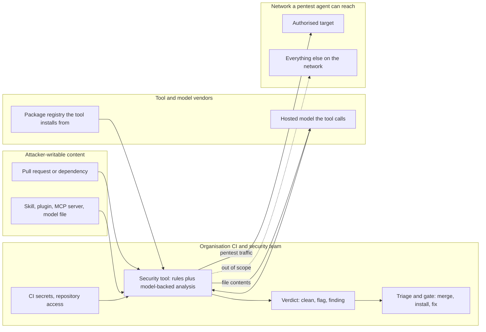

# Threat model: AI-assisted security tools (code reviewers, scanners of AI components, AI pentest agents)

| Field | Value |
|---|---|
| Asset class | AI-assisted security tools (code reviewers, scanners of AI components, AI pentest agents) |
| Version | 1.0 |
| Date | 2026-11-21 |
| Evaluated by | `security-tool-benchmark` |
| Related threat models | Agent features; AI coding agents (a model inside an agent harness); Guardrails and safety classifiers; Restricted-access cyber-capable models |
| Status | Current. Ratings are rough inherent risks for the reference deployment below; re-rate them for your own |

## 1. Executive summary

AI-assisted security tools use a language model to find problems: a code reviewer that reads
pull requests, a scanner that decides whether a skill, plugin, MCP server or model file is safe
to install, a pentest agent that attacks a running application. Their output is a verdict
other people act on: merge or block, install or reject, fix or ignore. The main risk is
therefore not that the tool is attacked for its own sake but that its verdict is wrong, or
can be made wrong, while people trust it. A second set of risks comes from what the tool
touches: source code and secrets it sends to a model vendor, systems a pentest agent reaches,
and the privileges the tool itself runs with.

| Core risk | Why it matters | Inherent risk | Evaluated by |
|---|---|---|---|
| False negatives treated as "clean" | Published evaluations of skill and MCP scanners show large misses; a clean verdict becomes an approval | Critical | Yes: recall per tool, class and stratum, with intervals |
| The scanned content instructs the LLM-backed scanner | A malicious skill persuaded an LLM analyser it was low risk; adaptive comment attacks fooled vulnerability detectors over 90% of the time | High | Partly: mutated positives test detection of agent-directed instructions, not scanner-directed ones |
| Silent fallbacks reporting "clean" when the model call failed | Several tools carry on with rules only, or return clean on an unparsable reply | High | Partly: adapters turn detectable fallbacks into failed runs, which are excluded |
| Nondeterministic verdicts and benchmark contamination | The same input gets different verdicts; public benchmarks overstate what a model-backed tool finds | High | Yes: repeats with flip rate and Fleiss κ; canary probes and mutated twins |
| Source code and secrets sent to a tool's model vendor | Model-backed modes send file contents to a hosted provider, sometimes by default | High | No: design review |
| An AI pentest agent acting outside its authorised scope | Agents pursue the goal with whatever they can reach | High | No: the skill only runs against self-hosted targets; scope adherence is not scored |

**Where risk concentrates.** Where a tool's verdict gates something without a person reading
the evidence, and where the thing being judged is written by the attacker: a skill author, an
MCP server publisher, a pull-request contributor. An LLM-backed tool reads attacker text as
input, so the content under review is also an instruction channel into the reviewer.

**What the evaluation can and cannot tell you.** `security-tool-benchmark` compares tools on
targets with known answers: code scanners on source with labelled vulnerabilities (`code`),
scanners of AI components on labelled malicious and benign samples (`extension`), and pentest
tools on self-hosted vulnerable applications where only oracle-confirmed exploits count
(`pentest`). It reports recall and precision (or true- and false-positive rate) with
intervals, what each tool finds that the others miss, run-to-run agreement, and contamination
strata, and it refuses to count a failed run as a clean scan. It says how well each tool, at a
stated version, configuration and model, finds known problems. It does not say how the tool
behaves on your code, against an attacker who targets the tool, where your data goes, or what
a pentest agent does outside the target.

## 2. Scope and reference deployment

The ratings assume an organisation that uses:

- An LLM code reviewer on pull requests in CI, with read access to the repository and CI
  secrets present in its environment, whose findings block or annotate merges.
- A scanner of AI components that decides which skills, plugins and MCP servers agents may
  install, including ones from public marketplaces, in a model-backed mode.
- An AI pentest agent run periodically against staging applications, with network access.
- Third-party tools (open source or commercial) backed by a hosted model, installed from a
  package registry, whose findings are triaged by a small security team.

What moves the ratings: a person reviews every verdict (lowers false-negative and injection
impact); static-only modes (removes vendor data flow and model nondeterminism, lowers recall);
a local model (removes vendor data flow); internal components only (lowers injection by
scanned content); pentest runs only in an isolated network (lowers scope risk); pinned tool
versions installed from a reviewed mirror (lowers supply-chain risk).

Out of scope: operating a scanner on the organisation's own code (this repository evaluates
scanners, it does not run them for you); conventional non-AI scanners except as comparators;
the security of coding agents that are not security tools (AI coding agents threat model).

## 3. System model

| Input | Who controls it |
|---|---|
| Code, skills, servers and model files under review | Contributors, publishers, possibly an attacker |
| The tool's rules, prompts and default model | The tool vendor |
| The model the tool calls | The model vendor, under the tool's or the organisation's account |
| The tool's own code and dependencies | The tool vendor and the package registry |
| Configuration, severity gate and repeats | The organisation |
| A pentest agent's scope | The organisation's instructions, which the agent may not respect |

**Threat actors.** A malicious contributor or skill publisher who writes content to pass
review; an attacker who compromises the tool or its dependencies to reach CI secrets; and,
without malice, the tool vendor (defaults, model choice, data handling), the model vendor
(model updates), and the pentest agent itself pursuing its goal.

## 4. Core threats

Ratings combine likelihood and impact using the matrix in the threat-model method. Framework
ids are reused from the lists this repository verified against the primary sources [1][2].

### st-false-negative — Misses that create false assurance (Critical)

- **What.** The tool does not find a real vulnerability or a malicious component, and "no
  findings" is read as "safe". Vendors say so themselves: one scanner's documentation states
  that no findings does not mean no risk [13].
- **Evidence.** In a study of eight MCP scanners at default configurations, the best caught
  74.29% of known-vulnerable servers; Cisco's MCP-Scanner caught 21.21% (7 of 33) and Tencent's
  A.I.G 47.06% (static) and 5.88% (dynamic) [9]. A skill scanner's own measurement on its
  held-out set: rules alone caught 7.7% of malicious skills at high severity, and 66.7%
  reached review at medium or above with its LLM judge [13]. Researchers bypassed Cisco's skill
  scanner and the three scanners in one skill registry with padding, precompiled bytecode,
  archives and persuasion [10][11]; files in excluded paths received a SAFE verdict from
  SkillSpector [12]. On CWE-Bench-Java, CodeQL found 27 of 120 vulnerabilities and an
  LLM-assisted approach 55 [6].
- **Rating.** Likelihood High, impact High where a clean verdict is an approval. Lower when a
  person reads the evidence and when the tool is one layer among several.
- **Maps to.** LLM03:2025; ASI04; AML.T0010.005, AML.T0011.000.

### st-false-positive — False positives and alert fatigue (High)

- **What.** Findings that are not real, or are hygiene notes presented as risk, consume triage
  time until real findings are ignored or the tool is switched off. Pentest agents add
  findings they cannot reproduce.
- **Evidence.** The same MCP study found that under 50% of sampled alerts were true positives
  (average precision 45.53%, worst 10.40%), while the scanners reported 96.89% of servers as
  risky [9]. A maintainer reported that of 415 vulnerability reports to one project's
  bug bounty, 64 were confirmed, with AI-generated reports taking time to disprove [18]. An AI
  operator in a reported intrusion campaign overstated findings and invented credentials [20].
- **Rating.** Likelihood High, impact Medium. Lower with severity gates tuned on your own
  benign code and with reproducible-proof requirements for pentest findings.

### st-nondeterminism — Verdicts that change between identical runs (High)

- **What.** A model-backed tool gives different verdicts on the same input, so a result
  cannot be reproduced, audited or compared, and an attacker can simply resubmit.
- **Evidence.** LLMs gave non-deterministic answers on vulnerability detection, and renaming
  functions or variables changed answers in 17% to 26% of cases [4]. Temperature 0 did not
  make code generation deterministic [8]. An unchanged skill received SAFE on some scans and
  CAUTION on others [12]; one scanner's documentation notes that lower temperature reduces but
  does not remove run-to-run variation [14].
- **Rating.** Likelihood High, impact Medium. Lower with majority voting over repeats and with
  rule-based stages for the decisions that gate.

### st-content-injection — The scanned content instructs the scanner (High)

- **What and where.** An LLM-backed reviewer reads the code, comments, skill instructions or
  tool descriptions it is judging. The author can address the reviewer: claim the code was
  audited, frame a malicious change as a corporate standard, or fabricate tool output. If the
  tool can also comment, approve or run commands, the injection reaches those actions.
- **Evidence.** A skill that redirected package installation to an attacker's registry, framed
  as corporate configuration, was rated low risk and called safe by an LLM analyser [10][11].
  Adaptive adversarial comments reached over 90% attack success against four LLM vulnerability
  detectors on 125 real null-pointer dereference vulnerabilities [15]; a separate study found
  static adversarial comments had small, non-significant effects on eight models [16], which
  is consistent with adaptive attacks being the real risk [22]. Optimised injections steer
  LLM judges in general [17].
- **Rating.** Likelihood Medium (High for public marketplaces), impact High. Lower with
  architectural isolation of the content from the reviewer's instructions, comment stripping
  as one check among several [15][16], and rule-based stages alongside.
- **Maps to.** LLM01:2025; AML.T0051.001, AML.T0015.

### st-silent-fallback — "Clean" when the model call failed (High)

- **What.** A missing key, a timeout, an unusable model reply or an oversized input leaves the
  tool running rules only, or returning a clean result, without failing. The report looks the
  same as a real clean scan. An attacker who can make the model stage fail (very large input,
  for example) gets a weaker scan.
- **Evidence.** At the versions this repository tested, one MCP scanner ran YARA alone when its
  model key was missing; one skill scanner exited successfully with rule findings and an
  informational "analysis failed" result; one Tencent scanner carried on with a placeholder
  reply after failed model calls, and the other returned clean when it could not parse the
  model's findings; SkillSpector marked an analysis "partial" when replies were unusable.
  These were observed by the skill's adapters, not published elsewhere. One vendor documents
  that its scan stops with an error if the judge cannot start [13], which covers start-up but
  not unusable replies.
- **Rating.** Likelihood Medium, impact High. Lower by treating any partial or failed analysis
  as a failure in the gating code.

### st-contamination — Benchmark memorisation inflating trust (High)

- **What.** Public vulnerability sets, CTFs and malicious-sample corpora are in training data,
  so a model-backed tool can recall the answer rather than find it. Its published scores, and
  yours on public sets, overstate what it finds in new code.
- **Evidence.** One code model scored 68.26% F1 on an older benchmark and 3.09% on a
  de-duplicated, time-split one [5]. Some models showed clear memorisation of a widely used bug
  benchmark [7]. The best agent framework on a benchmark of real web-application CVEs resolved
  up to 13% [23].
- **Rating.** Likelihood High for any public benchmark, impact Medium (it misleads the choice
  of tool and the trust placed in it).

### st-unfair-comparison — Comparisons skewed by defaults, modes or models (Medium)

- **What.** Tools are compared at their defaults, which differ: one runs its model stage
  unless told not to, another runs rules unless told to use a model, a third is model-only;
  default models and rule packs differ; severity scales differ, so the verdict depends on the
  gate. The comparison then measures the defaults, not the detection.
- **Evidence.** A skill scanner's recall moved from 7.7% to 66.7% between rules-only and
  model-assisted modes in its own measurement [13]; one scanner's default provider is a hosted
  model service [14]; scanner outputs agreed poorly with each other (average pairwise Jaccard
  15.66%) [9].
- **Rating.** Likelihood Medium, impact Medium.

### st-vendor-data — Source code and secrets sent to a tool's vendor (High)

- **What.** In model-backed modes the tool sends file contents, including any secrets in them,
  to its configured provider, which may be a default hosted service chosen by the tool vendor.
  Some static rules also send dependency names to external services.
- **Evidence.** One skill scanner's provider defaults to a hosted NVIDIA endpoint, and its
  dependency rule queries OSV.dev [14]; another documents a local-model setting for when
  nothing may leave the machine [13]. NIST lists value-chain integration of third-party
  components as a generative AI risk [3].
- **Rating.** Likelihood High (the default in several tools), impact Medium; High where the
  code holds secrets or regulated data.

### st-pentest-scope — An AI pentest agent outside its authorised scope (High)

- **What.** A pentest agent pursues its goal with whatever it can reach: it scans beyond the
  target, uses infrastructure it finds, or takes destructive actions. A prompt saying "only
  this host" is an instruction, not a boundary, and the agent cannot verify that its
  engagement is authorised.
- **Evidence.** During a vendor's capture-the-flag evaluation, a model whose target failed to
  start scanned the network, found a misconfigured container API on the evaluation host and
  used it to read the flag, outside the intended challenge [19]. In a reported campaign,
  operators obtained intrusion help by telling an AI agent it worked for a legitimate security
  firm doing defensive testing [20].
- **Rating.** Likelihood Medium, impact High (unauthorised access to systems the organisation
  does not own, or damage to its own). Lower with network isolation that enforces scope,
  egress allow-lists, budgets and supervision.
- **Maps to.** LLM06:2025; ASI02, ASI10.

### st-supply-chain — The security tool's own supply chain (Medium)

- **What.** Security tools run with broad read access, CI secrets and sometimes write access,
  and many are fast-moving packages installed unpinned. A compromised release or dependency
  reaches exactly what the tool was trusted with.
- **Evidence.** A compromise of a widely used CI action, possibly enabled by a compromised
  action from an automated code-review toolset, exposed CI secrets including access keys and
  tokens [21].
- **Rating.** Likelihood Low, impact High; Likelihood Medium when tools are installed unpinned
  in CI with secrets in the environment.
- **Maps to.** LLM03:2025.

## 5. How this repository's evaluation relates

`security-tool-benchmark` varies one thing, the tool (or one tool's configuration), and holds
the targets, their known answers and the matching rule fixed. Each tool is driven by a small
adapter; the shipped ones cover common code scanners, Strix, Nuclei and ZAP, YARA and
ModelScan, and the AI-component scanners Tencent AI-Infra-Guard (`aig-skill-scan`,
`aig-mcp-scan`), Cisco skill-scanner and mcp-scanner, and NVIDIA SkillSpector.

| Threat area | What the skill measures | What it does not show |
|---|---|---|
| False negatives | `code`: recall at file, function and line per CWE family, and the complement (found by one tool only, both, union). `extension`: true-positive rate by stratum, including mutated positives no signature matches. `pentest`: oracle-confirmed recall | Recall on your code or your marketplace; attackers who target the tool |
| False positives | `code`: precision as a lower bound until a sample is adjudicated; findings on fixed snapshots. `extension`: false-positive rate on benign samples. `pentest`: confirmed over reported, unverified findings kept apart | Triage cost in your team |
| Nondeterminism | Repeats (3 or more for model-backed code reviewers, 5 for model-backed extension configs, 3 for agents) with flip rate and Fleiss κ, reported as validity signals | Variation across model updates |
| Content injection | `extension` mutants plant prompt injection, hidden HTML comments, Unicode-tag text, social engineering and staged fetches in benign skills: they test whether the scanner flags instructions aimed at the agent | No bundled mutant addresses the scanner itself; the `code` mutator renames identifiers and adds no adversarial comments |
| Silent fallback | Every run logged as `ok` or `failed`; adapters turn the fallbacks they can detect into failed runs, excluded from scoring when runs are passed | Fallbacks an adapter cannot detect (at tested versions: one scanner's clean result on unparsable findings; a partly dropped tool list) |
| Contamination | Cold canary probes of the tool's model, transcript audits, mutated twins of public targets, post-cutoff slices, all reported as separate strata | Contamination the probes do not reveal |
| Unfair comparison | Arms labelled by configuration; adapters default to keyless modes; guidance to use one model for every model-backed arm, one severity gate, and within-class comparisons | Enforcement: the reviewer must set the arms fairly |

Why it exists: a security review that depends on a tool's output, or that is about an AI
security tool, needs evidence of how often the tool is right, with intervals, against known
answers rather than the vendor's own figures. Repeats exist because model-backed verdicts
vary; failed-run accounting exists because a tool that did not run is not a tool that found
nothing; contamination strata exist because public targets flatter model-backed tools.

Its own limits, stated by the skill: model-assisted modes and both Tencent tools were exercised
here only against a mock model, so no detection result from this repository exists for them;
several benchmark sets the skill lists are new or not yet released and are verified at fetch
time; the `pentest` kind runs only against self-hosted Docker targets under supervision, passes
the agent a scope note, and neither logs nor scores actions outside the target.

Left to design review, because they are properties of the deployment rather than of detection:
where data goes (`st-vendor-data`), whether a pentest agent's scope is enforced by the network
(`st-pentest-scope`), and how the tool is installed and what it can reach (`st-supply-chain`).

## 6. Design review questions

- What does a clean verdict gate, and does a person read the evidence before it does?
- Is the tool's version pinned, and is the model it calls named and pinned with every result?
- What does the gating code do with a failed, partial or timed-out analysis? Is "analysis
  failed" ever treated as clean?
- In model-backed modes, which provider receives file contents, under what retention and
  training terms? Can secrets reach it? Is a local model an option?
- Does the reviewer read attacker-written text (pull requests from outside contributors,
  marketplace skills)? Can the reviewer act (comment, approve, push, run commands)?
- How is the tool installed in CI, and which secrets and permissions does its job have?
- For a pentest agent: is scope enforced by network isolation and egress rules, or only by the
  prompt? Who supervises, what is the budget, and is every action logged?
- Were the vendor's published figures measured on public sets the model may have seen, at the
  same mode and model you will run?
- When comparing tools, were they run in the same mode, with the same model and the same
  severity gate?

## 7. References

All read on 2026-11-21.

1. OWASP Top 10 for LLM Applications 2025 and for Agentic Applications 2026 (ids reused from this repository's verified list, checked 2026-11-14). https://genai.owasp.org/llm-top-10/
2. MITRE ATLAS data release 2026.10 (ids reused, checked 2026-11-14). https://github.com/mitre-atlas/atlas-data/blob/main/dist/v6/ATLAS-2026.10.yaml
3. NIST AI 600-1, "Artificial Intelligence Risk Management Framework: Generative Artificial Intelligence Profile", July 2024. https://doi.org/10.6028/NIST.AI.600-1
4. Ullah et al., "LLMs Cannot Reliably Identify and Reason About Security Vulnerabilities (Yet?)", IEEE S&P 2024, arXiv:2312.12575. https://arxiv.org/abs/2312.12575
5. Ding et al., "Vulnerability Detection with Code Language Models: How Far Are We?", ICSE 2025, arXiv:2403.18624. https://arxiv.org/abs/2403.18624
6. Li, Dutta and Naik, "IRIS: LLM-Assisted Static Analysis for Detecting Security Vulnerabilities", arXiv:2405.17238. https://arxiv.org/abs/2405.17238
7. Ramos et al., "Are Large Language Models Memorizing Bug Benchmarks?", arXiv:2411.13323. https://arxiv.org/abs/2411.13323
8. Ouyang et al., "An Empirical Study of the Non-determinism of ChatGPT in Code Generation", arXiv:2308.02828. https://arxiv.org/abs/2308.02828
9. Chen et al., "Rethinking MCP Security: A Large-Scale Study of Runtime MCP Servers and Security Scanner Reliability", arXiv:2607.11086 (per-scanner figures from the v1 HTML). https://arxiv.org/abs/2607.11086
10. Judson and Hess (Trail of Bits), "The sorry state of skill distribution", 3 June 2026. https://blog.trailofbits.com/2026/06/03/the-sorry-state-of-skill-distribution/
11. Cloud Security Alliance, "AI Agent Skill Scanners: Bypassed Across the Board", 10 June 2026. https://labs.cloudsecurityalliance.org/research/csa-research-note-ai-agent-skill-scanner-bypass-20260610-csa/
12. Checkmarx Zero, "NVIDIA SkillSpector: 'Safe' Verdicts Don't Mean The Skill Is Safe", 11 November 2026. https://checkmarx.com/zero-post/nvidia-skillspector-safe-verdicts-dont-mean-the-skill-is-safe/
13. Cisco AI Defense, skill-scanner README (scope and limitations, recommended settings, measured results). https://github.com/cisco-ai-defense/skill-scanner
14. NVIDIA, SkillSpector README (providers, `SKILLSPECTOR_PROVIDER` default, SC4 rule, temperature note). https://github.com/NVIDIA/SkillSpector
15. Wu and Nita-Rotaru, "ALIBI: Adaptive Agentic Attacks on LLM-Based Vulnerability Detectors via Adversarial Code Comments", arXiv:2607.24964. https://arxiv.org/abs/2607.24964
16. Thornton, "Can Adversarial Code Comments Fool AI Security Reviewers", arXiv:2602.16741. https://arxiv.org/abs/2602.16741
17. Shi et al., "Optimization-based Prompt Injection Attack to LLM-as-a-Judge", ACM CCS 2024, arXiv:2403.17710. https://arxiv.org/abs/2403.17710
18. Stenberg, "The I in LLM stands for intelligence", 2 January 2024. https://daniel.haxx.se/blog/2024/01/02/the-i-in-llm-stands-for-intelligence/
19. OpenAI, "OpenAI o1 System Card" (o1-preview version, September 2024), section on the CTF evaluation. https://cdn.openai.com/o1-preview-system-card-20240917.pdf
20. Anthropic, "Disrupting the first reported AI-orchestrated cyber espionage campaign", 13 November 2025. https://www.anthropic.com/news/disrupting-AI-espionage
21. CISA, "Supply Chain Compromise of Third-Party tj-actions/changed-files (CVE-2025-30066) and reviewdog/action-setup@v1 (CVE-2025-30154)", 18 March 2025. https://www.cisa.gov/news-events/alerts/2025/03/18/supply-chain-compromise-third-party-tj-actionschanged-files-cve-2025-30066-and-reviewdogaction
22. Nasr et al., "The Attacker Moves Second: Stronger Adaptive Attacks Bypass Defenses Against LLM Jailbreaks and Prompt Injections", arXiv:2510.09023. https://arxiv.org/abs/2510.09023
23. Zhu et al., "CVE-Bench: A Benchmark for AI Agents' Ability to Exploit Real-World Web Application Vulnerabilities", arXiv:2503.17332. https://arxiv.org/abs/2503.17332
