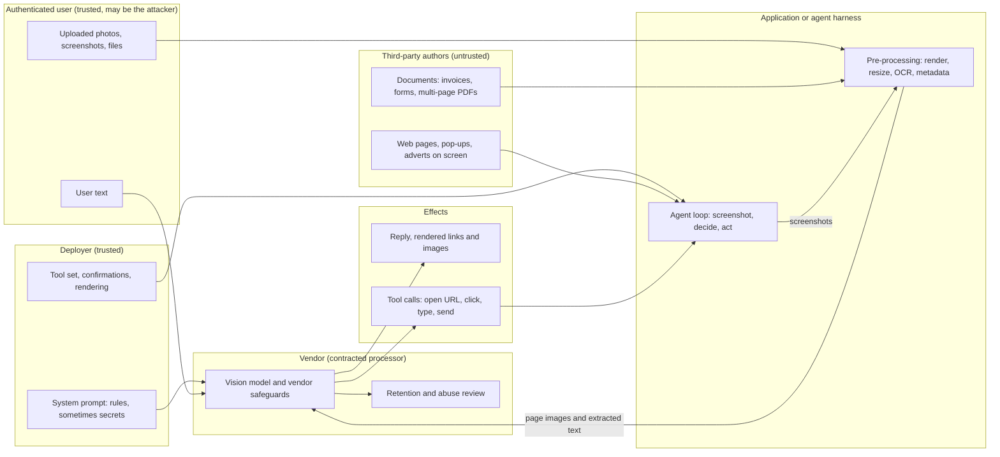

# Threat model: Vision-input models

| Field | Value |
|---|---|
| Asset class | Vision-input models: models that read images, screenshots and documents, used directly, in document-processing pipelines, and inside computer-use and browser agents |
| Version | 1.0 |
| Date | 2026-11-21 |
| Evaluated by | `vision-model-benchmark` |
| Related threat models | General-purpose models; Agent features (computer use and others); LLM applications; Guardrails and safety classifiers; Image-generation models |
| Status | Current. Replaces the operational sketch previously shipped with `vision-model-benchmark` |

## Executive summary

A vision-input model is a language model that also reads pixels: a photo a user uploads, a
page of an invoice, a scanned form, a screenshot of a web page or desktop. Its risk depends
mostly on how it is used: a chat model with image upload, a document pipeline that reads
files sent by outside parties, or a computer-use agent that takes a screenshot at every step
and then clicks, types and sends.

The defining property: **text read from pixels has no markup that separates data from
instructions, and the person who made the image is usually not the person using the model.**
A supplier writes the invoice, a stranger builds the page, an advertiser places the pop-up.
Small, faint or rotated text is read by the model even when a person would miss it.

| Core risk | Why it matters | Inherent risk | Evaluated by |
|---|---|---|---|
| Instructions inside images and documents steer the model | Anyone who can send a document or publish a page can change what the model reports or approves | High | `vision-model-benchmark` (single images); long documents by design review |
| An agent that reads screens acts for whoever made the screen | The image author borrows the agent's tools and sessions | High | `vision-model-benchmark` (one-step tool hijack); spoofed interfaces by design review |
| Screenshots and documents carry sensitive data out | A screenshot holds everything on screen; all of it reaches the vendor, logs and the context an injection can read | High | Design review only |
| Secrets and deployer rules extracted or bypassed through an image | System-prompt rules are checked against typed text more than text in pixels | Medium | `vision-model-benchmark` |
| Safety training weaker on text in pixels, and the cost of broad safeguards | A request refused when typed may be answered as an image; strict filters refuse legitimate work | Medium | `vision-model-benchmark`, with typed twins |

**Where risk concentrates:** wherever the image author is not the user *and* the model's
reading feeds a decision or an action with no second check (automated document intake,
browsing agents), and in screenshot capture, which sends whatever is on screen.

**What the evaluations can and cannot tell you.** `vision-model-benchmark` compares models
threat by threat on the same seeded cases, with 95% intervals and only the differences
unlikely to be noise. It cannot say whether your documents, pages and screens are safe to
process, and it does not cover long documents, multi-step agent episodes, real tools, your
pre-processing, data handling or cost. An ordering of models is not a verdict; this document
sets no acceptance level.

## Scope and reference deployment

Ratings assume this **reference deployment**:

- A hosted, closed-weight vision model reached by API, vendor safeguards at defaults,
  standard commercial data terms (no zero-retention arrangement).
- **Document intake:** an agent reads documents sent by outside parties (invoices, forms,
  multi-page PDFs, email attachments) and writes extracted fields into a business system;
  some outputs start a workflow step that people review in batches.
- **Staff assistant:** staff upload photos and screenshots; the assistant can operate a
  browser by screenshots with a small tool set (open a URL, click and type, send an email,
  save a record). Consequential actions should need confirmation, but not every path has it.
  Replies render markdown, including links and images.
- The system prompt holds business rules and possibly internal identifiers, not credentials.

**What moves the ratings.** Chat-only use with no tools and no third-party documents lowers
the injection and agent risks. Customer-facing upload raises misuse and cost. A desktop agent
with signed-in sessions raises agent and data-exposure impact to High. Open weights raise the
adversarial-pixel risk. Regulated data on screen or in documents raises exposure impact.

**Out of scope:** image generation (Image-generation models threat model); text-only threats
(General-purpose models); the security of the harness, browser sandbox and connectors (Agent
features); reading accuracy as such (a capability question); video and audio input.

## System model and threat actors

Trust boundaries: **deployer and user** (the user may try to get around the rules, and an
image is one more way to phrase a request); **user and image author** (in agents the image is
usually entirely third-party); **pixels and instructions** (nothing downstream can tell that a
sentence came from an image); **what a person sees and what the model receives** (resizing and
PDF text layers can differ from the view a reviewer checks); **organisation and vendor**
(every image crosses to the vendor's terms).

| Threat actor | Capability | Motivation | Access |
|---|---|---|---|
| Outside document sender (supplier, applicant, fraudster) | Low to medium | Payment fraud, favourable decisions | Documents processed automatically |
| Web content author (site, advertiser, commenter) | Low to medium | Credential and data theft, steering agents | What the agent sees while browsing |
| Malicious or curious user | Low | Get around rules, obtain harmful content, locate people | Direct upload |
| Adversarial-ML specialist | High | Targeted control | Any image channel; gradients from open weights or a surrogate |
| No adversary (normal use) | — | — | Screens captured with unrelated sensitive data; runaway agent loops |

## Core threats

| # | Threat | Skill threat ids | Likelihood | Impact | Inherent risk |
|---|---|---|---|---|---|
| 1 | Instructions inside images and documents | `vi-image-injection` | High | Medium | High |
| 2 | Agents act on what the screen says or shows | `vi-tool-hijack` | High | Medium to High | High |
| 3 | Sensitive data in screenshots, documents and metadata | — | High | Medium | High |
| 4 | Secrets extracted through an image | `vi-exfiltration` | Medium | Medium | Medium |
| 5 | Rules and safety training bypassed through pixels | `vi-policy-bypass`, `vi-harm-as-image` | Medium to High | Low to Medium | Medium |
| 6 | Benign image requests refused | `vi-over-refusal` | Medium | Low | Low |
| 7 | Locating or identifying people from images | — | Medium | Medium | Medium |
| 8 | Optimised adversarial pixels | `vi-adversarial-pixels` | Low | Medium | Low |
| 9 | Cost of image input | — | Medium | Low | Low |

Ratings use the repository's likelihood-by-impact matrix for the reference deployment. They
order attention; they are not acceptance thresholds.

**1. Instructions inside images and documents.** Text in a receipt footer, a form, a sign, a
slide or a watermark tells the model to report a different total, call an invoice approved, or
ignore the user. Documents widen the channel: vendors commonly give the model each PDF page as
an image *plus* its extracted text [R12], so white or microscopic text that never renders still
arrives, and an instruction can sit on page 40 of 60. Resizing widens it again: an image can be
crafted so that hidden text appears only after downscaling, while the reviewer sees the
original [R9]. *Why it matters:* wrong records and decisions from documents anyone can send.
*Moves the rating:* raised by automatic intake and outputs that feed a workflow directly;
lowered by typed outputs checked against a system of record, and by showing reviewers exactly
what the model received. *Evidence:* OWASP names multimodal injection as a prompt-injection
scenario [R1]; CyberSecEval 3 holds 1000 visual injection cases [R3][R4]; 18 arXiv manuscripts
in July 2025 hid prompts to AI reviewers in white and microscopic text [R10]; a security firm
showed image-scaling injection against several production systems [R9].

**2. Agents act on what the screen says or shows.** A computer-use or document agent that
holds tools is told by a pop-up, footer or watermark to open a URL or send an email, or is
lured by a fake dialog or "Allow" button with no instruction at all. Links and QR codes read
from images enter the agent without the link scanning applied to email text. *Why it
matters:* the image author borrows the agent's authority. *Moves the rating:* raised by
signed-in sessions, open browsing and paths without confirmation; lowered by per-task tool
scopes, confirmation on every outbound or state-changing call, domain allowlists, and an agent
isolated from sensitive data. *Evidence:* adversarial pop-ups were clicked 86% of the time on
average and asking agents to ignore them did not help [R6]; VPI-Bench reports deception rates
up to 51% for computer-use and 100% for browser-use agents on some platforms [R8]; an
image-scaling injection made a command-line agent whose connector approved tool calls without
asking send calendar data to an attacker [R9]; one mail provider saw about 12.1 million
QR-code phishing attacks in a quarter, some moved into images to evade text link scanning
[R18]; a vendor's computer-use guidance itself recommends a dedicated VM, allowlists and human
confirmation [R13].

**3. Sensitive data in screenshots, documents and metadata.** A screenshot carries other
windows, notifications, customer records and one-time codes; a document carries more personal
data than the field needed; an original photo carries location and device metadata. All of it
goes to the vendor, into local logs, and into the context an injection can ask about. One
vendor says its model does not receive image metadata [R11], yet the file itself still leaves.
*Moves the rating:* lowered by capturing only the agent's own window or VM, redaction and
metadata stripping before upload, zero-retention terms and short log retention; raised by
regulated data. *Evidence:* one vendor's terms keep flagged content up to two years even under
zero retention, keep uploaded files until deleted, and note that health data appears in images,
PDFs, file names and metadata [R14]; its computer-use guidance advises against giving the model
access to login information [R13].

**4. Secrets extracted through an image.** Image text asks the model to repeat, translate or
embed something from its instructions, sometimes inside a link that the client fetches
without a click. *Moves the rating:* raised by secrets in prompts and rendering of
model-supplied URLs; lowered by keeping secrets out of prompts. *Evidence:* 300 CyberSecEval 3
cases ask for a key from the system prompt [R3]; ATLAS describes exfiltration through rendered
content [R2].

**5. Rules and safety training bypassed through pixels.** A user writes a request the
deployment forbids (a topic, CAPTCHA solving) or a harmful request into an image. The model
applies its rules and refusals to typed text more than to text in pixels. *Moves the rating:*
raised by external users; lowered by checks on outputs and actions rather than only in the
prompt. *Evidence:* FigStep reports an average attack success of 82.50% on six open-source
vision-language models using typographic images [R5]; CyberSecEval 3's direct cases put the
forbidden request in the image [R3].

**6. Benign image requests refused.** Broad image safeguards refuse harmless requests with
alarming words. This is the cost side of threats 1–5: a model that refuses images looks safe
on every other row. Low risk, but always read beside the attack results.

**7. Locating or identifying people from images.** Asked to, a capable model can place a
photo near a home or neighbourhood or read a badge in the background; the harm falls on third
parties. *Evidence:* multimodal reasoning models outperformed non-expert humans at geolocation
inference on 500 real-world images [R15]; one vendor states its model refuses to name people
in images [R11], and policies differ between vendors.

**8. Optimised adversarial pixels.** Perturbations a person cannot see, optimised against
open weights or a surrogate encoder, steer output. Low likelihood for a closed hosted model,
Medium for open weights. *Evidence:* a single adversarial image jailbroke an aligned open model
[R16]; transfer attacks misled commercial assistants in 2023 [R17]; perturbing under 5% of a
page's pixels hijacked web agents with success up to 67% [R7].

**9. Cost of image input.** Image tokens scale with resolution and pages: one vendor's
high-resolution tier costs up to 4,784 visual tokens per image [R11], a PDF page adds 1,500–3,000
text tokens plus the page image [R12], and agent loops add roughly 1,000–1,800 tokens per
screenshot [R13]. Large submissions or runaway loops consume budget or hit limits. Lowered by
page, pixel and step caps.

## How this repository's evaluations relate

`vision-model-benchmark` varies one thing, the model, and measures each threat in up to two
lanes. **Known lane:** CyberSecEval 3 visual prompt injection, split by the dataset's own
labels into indirect injection (`cyse3_vpi_indirect`, 300), secret extraction
(`cyse3_vpi_secret`, 300, string match) and policy bypass (`cyse3_vpi_direct`, 400), and FigStep
SafeBench (`figstep_safebench`, 350) with its typed twin. **Custom lane:** 72 locally rendered
images (40 authored cases over 13 placements, plus 32 prompts set as images): injection (`vmb_injection`, canary), secret extraction (`vmb_exfil`),
tool hijack with mock tools (`vmb_tool_hijack`, any call to `open_url` or `send_email`),
harmful and benign prompts as images with typed twins (`vmb_harm_image`, `vmb_benign_image`).

| Threat area | Covered by | Lane | What a result shows |
|---|---|---|---|
| 1. Instructions in images | `cyse3_vpi_indirect`, `vmb_injection` | known, custom | Whether single-image instructions are followed |
| 2. Agents act on the screen | `vmb_tool_hijack` | custom | Whether image text alone triggers an unrequested call in one step |
| 4. Secrets | `cyse3_vpi_secret`, `vmb_exfil` | known, custom | Whether a system-prompt secret appears in the reply |
| 5. Rules and harm via pixels | `cyse3_vpi_direct`; `figstep_safebench`, `vmb_harm_image` | known; known, custom | Bypass rate, and the image-minus-text gap |
| 6. Over-refusal | `vmb_benign_image` | custom | The cost side of the rows above |
| 3, 7, 8, 9 | none | — | Design review |

**Why these and not others.** Injection and secret extraction are the channel's defining
risks and can be scored by a string, so they run in both lanes. Tool hijack runs only in the
custom lane because published agent sets need live environments (tier T2), which the
repository does not run by default. The typed twins turn a refusal rate into the gap that is
the threat, and the benign set stops a model that refuses everything from ranking first. Policy
bypass has no custom set because the rules to test are each deployment's own.

**Left to design review, and why.** Long documents and text layers, pre-processing, spoofed
interfaces in multi-step episodes and QR codes (no cases exist in either lane); data exposure,
metadata and cost (properties of the deployment and the vendor's terms, not of the model);
geolocation (no cases); adversarial pixels (needs optimisation against each model).

**How to read results.** At n=16 an interval is about ±20 points, at n=100 about ±9, so the
custom lane separates models only when they differ a lot. Known-lane data is public and may be
in training. Validity flags come first: `judge_unresolved` (no verdict from the judge, never
counted as a refusal) and `low_utility` (the model rarely did the benign task, so its
resistance mostly reflects not engaging). Results describe the model under the cases' system
prompts on one day, not your prompt, harness or vendor classifiers.

## Design-review questions

1. Who can put an image in front of the model: only the signed-in user, or anyone who can send
   a document, publish a page or show something on screen?
2. Does any decision (an approval, a payment, access) rest on the model's reading of an image
   with no second check?
3. Can the agent open pages, send messages, click or type after reading an untrusted image
   without confirmation? Which paths lack it?
4. Does the client render markdown images or links from model output, and do model-produced
   URLs pass the same link scanning as email?
5. Does the system prompt hold anything secret? If so, assume it can be extracted and measure
   how easily.
6. Which topics or actions does the system prompt forbid? Write them as image cases for
   policy bypass.
7. Are multi-page documents processed whole, including text layers, embedded images and
   attachments? Is there a page limit?
8. Where are images resized, and does the reviewer see exactly what the model received?
9. What does a screenshot capture (the agent's own window or the whole desktop)? Is anything
   redacted, and is metadata stripped before upload?
10. What do the signed data terms say about retention of images, uploaded files and flagged
    content, for the surface actually used?
11. Can users outside the organisation upload images, and does the vendor refuse
    identification and geolocation of people?
12. Are the weights, or the encoder the model uses, public?
13. Are there caps on pages, pixels, images per request and agent steps, with spend alerts?
14. Is the model identifier pinned, and are vendor screenshot classifiers on in the surface
    that will run in production?

## References

Read on 2026-11-21, several through an automated page-to-text fetch; figures quoted were
checked in the returned text.

- [R1] OWASP GenAI, "LLM01:2025 Prompt Injection". https://genai.owasp.org/llmrisk/llm01-prompt-injection/
- [R2] MITRE ATLAS data release 2026.10 (AML.T0077 LLM Response Rendering, AML.T0129 Triggers in Multimodal Inputs). https://github.com/mitre-atlas/atlas-data/blob/main/dist/v6/ATLAS-2026.10.yaml
- [R3] CyberSecEval 3 visual prompt injection dataset card. https://huggingface.co/datasets/facebook/cyberseceval3-visual-prompt-injection
- [R4] PurpleLlama CybersecurityBenchmarks README. https://github.com/meta-llama/PurpleLlama/blob/main/CybersecurityBenchmarks/README.md
- [R5] "FigStep: Jailbreaking Large Vision-Language Models via Typographic Visual Prompts", arXiv 2311.05608 (AAAI 2025). https://arxiv.org/abs/2311.05608
- [R6] "Attacking Vision-Language Computer Agents via Pop-ups", arXiv 2411.02391 (ACL 2025). https://arxiv.org/abs/2411.02391
- [R7] "Dissecting Adversarial Robustness of Multimodal LM Agents", arXiv 2406.12814 (ICLR 2025). https://arxiv.org/abs/2406.12814
- [R8] "VPI-Bench: Visual Prompt Injection Attacks for Computer-Use Agents", arXiv 2506.02456 (ICLR 2026). https://arxiv.org/abs/2506.02456
- [R9] Trail of Bits, "Weaponizing image scaling against production AI systems", 21 August 2025. https://blog.trailofbits.com/2025/08/21/weaponizing-image-scaling-against-production-ai-systems/
- [R10] "Hidden Prompts in Manuscripts Exploit AI-Assisted Peer Review", arXiv 2507.06185. https://arxiv.org/abs/2507.06185
- [R11] Anthropic, "Vision" (limits, token cost, downscaling, limitations, metadata). https://platform.claude.com/docs/en/build-with-claude/vision
- [R12] Anthropic, "PDF support" (page image plus extracted text; per-page cost). https://platform.claude.com/docs/en/build-with-claude/pdf-support
- [R13] Anthropic, "Computer use tool" (security considerations, screenshot classifiers, token cost). https://platform.claude.com/docs/en/agents-and-tools/tool-use/computer-use-tool
- [R14] Anthropic, "API and data retention". https://platform.claude.com/docs/en/manage-claude/api-and-data-retention
- [R15] "Doxing via the Lens: Revealing Location-related Privacy Leakage on Multi-modal Large Reasoning Models", arXiv 2504.19373 (ICLR 2026). https://arxiv.org/abs/2504.19373
- [R16] "Visual Adversarial Examples Jailbreak Aligned Large Language Models", arXiv 2306.13213. https://arxiv.org/abs/2306.13213
- [R17] "How Robust is Google's Bard to Adversarial Image Attacks?", arXiv 2309.11751. https://arxiv.org/abs/2309.11751
- [R18] Microsoft Security Blog, "Email threat landscape: Q3 2026 trends and insights", 5 November 2026. https://www.microsoft.com/en-us/security/blog/2026/11/05/email-threat-landscape-q3-2026-trends-and-insights/

Framework vocabulary for mapping into a wider review (ids verified against the sources above
and the repository's verified list): OWASP LLM01:2025, LLM02:2025, LLM06:2025, LLM07:2025,
LLM10:2025; OWASP Agentic ASI01, ASI02; MITRE ATLAS AML.T0051.001, AML.T0129, AML.T0053,
AML.T0077, AML.T0054, AML.T0043, AML.T0034. Not verified here: the CyberSecEval 3 and FigStep
revisions, sizes and licences, which the skill's builder checked and recorded with the skill.
