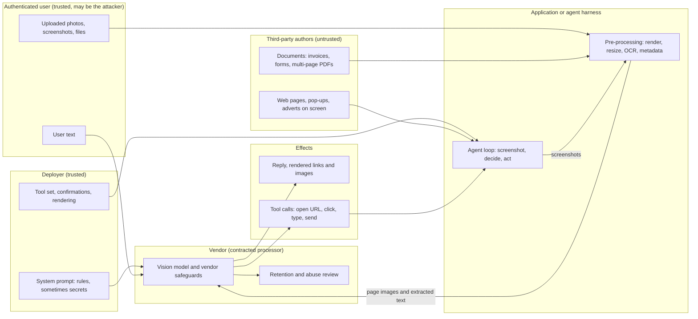

# Threat model: Vision-input models

| Field | Value |
|---|---|
| Asset class | Vision-input models: models that read images, screenshots and documents, used directly, in document-processing pipelines, and inside computer-use and browser agents |
| Version | 1.1 |
| Date | 2026-11-24 |
| Evaluated by | `vision-model-benchmark` |
| Related threat models | General-purpose models; Agent features (computer use and others); LLM applications; Guardrails and safety classifiers; Decision and classification models; Image-generation models |
| Status | Current. Replaces the operational sketch previously shipped with `vision-model-benchmark` |

## Executive summary

A vision-input model is a language model that also reads pixels: a photo a user uploads, a
page of an invoice, a scanned form, a screenshot of a web page or desktop. Its risk depends
mostly on how it is used: a chat model with image upload, a document pipeline that reads
files sent by outside parties, or a computer-use agent that takes a screenshot at every step
and then clicks, types and sends.

The defining property: **text read from pixels has no markup that separates data from
instructions, and the person who made the image is usually not the person using the model.**
A supplier writes the invoice, a stranger builds the page, an advertiser places the pop-up.
Small, faint or rotated text is read by the model even when a person would miss it.

| Core risk | Why it matters | Inherent risk | Evidence, 2025–2026 | Evaluated by |
|---|---|---|---|---|
| Instructions inside images and documents steer the model | Anyone who can send a document or publish a page can change what the model reports or approves | High | Disclosed in production systems (downscaled images, faint screenshot text, 1-pixel document text); hidden prompts found in real manuscripts | `vision-model-benchmark` (single images); long documents by design review |
| An agent that reads screens acts for whoever made the screen | The image author borrows the agent's tools and sessions | High | Disclosed against production agents and shown in research; no exploitation reported | `vision-model-benchmark` (one-step tool hijack); spoofed interfaces by design review |
| Screenshots and documents carry sensitive data out | A screenshot holds everything on screen; all of it reaches the vendor, logs and the context an injection can read | High | No incident found; follows from documented vendor behaviour | Design review only |
| Secrets, deployer rules and connected data extracted or bypassed through an image | System-prompt rules are checked against typed text more than text in pixels; rendered links carry data out | Medium | Disclosed (a document made an assistant leak keys from connected storage); research | `vision-model-benchmark` (system-prompt secrets) |
| Safety training weaker on text in pixels, and the cost of broad safeguards | A request refused when typed may be answered as an image; strict filters refuse legitimate work | Medium | Research only | `vision-model-benchmark`, with typed twins |

**Where risk concentrates:** wherever the image author is not the user *and* the model's
reading feeds a decision or an action with no second check (automated document intake,
browsing agents), and in screenshot capture, which sends whatever is on screen.

**What changed in 2025–2026.** The image channel moved from benchmarks to disclosed attacks
on production systems: images whose instructions appear only after the platform downscales
them, faint text an AI browser read from a screenshot, 1-pixel text in a shared document. None
was reported exploited in the wild. The recurring cause is a gap between what a person sees
and what the model receives. One vendor reports lower attack rates against its browser agent,
and two say the problem is not solved [R22][R29]; OWASP's 2026 list names images explicitly as a
prompt-injection channel (LLM01:2026) [R1]. Details are under Recent incidents.

**What the evaluations can and cannot tell you.** `vision-model-benchmark` compares models
threat by threat on the same seeded cases, with 95% intervals and only the differences
unlikely to be noise. It cannot say whether your documents, pages and screens are safe to
process, and it does not cover long documents, multi-step agent episodes, real tools, your
pre-processing, data handling or cost. An ordering of models is not a verdict; this document
sets no acceptance level.

## Scope and reference deployment

Ratings assume this **reference deployment**:

- A hosted, closed-weight vision model reached by API, vendor safeguards at defaults,
  standard commercial data terms (no zero-retention arrangement).
- **Document intake:** an agent reads documents sent by outside parties (invoices, forms,
  multi-page PDFs, email attachments) and writes extracted fields into a business system;
  some outputs start a workflow step that people review in batches.
- **Staff assistant:** staff upload photos and screenshots; the assistant can operate a
  browser by screenshots with a small tool set (open a URL, click and type, send an email,
  save a record). Consequential actions should need confirmation, but not every path has it.
  Replies render markdown, including links and images.
- The system prompt holds business rules and possibly internal identifiers, not credentials.

**What moves the ratings.** Chat-only use with no tools and no third-party documents lowers
the injection and agent risks. Customer-facing upload raises misuse and cost. A desktop agent
with signed-in sessions raises agent and data-exposure impact to High, and one that can reach
a terminal adds code execution. Connectors (mail, storage, password managers) raise the
extraction impact. Open weights raise the adversarial-pixel risk. Regulated data on screen or
in documents raises exposure impact.

**Out of scope:** image generation (Image-generation models threat model); text-only threats
(General-purpose models); the security of the harness, browser sandbox and connectors (Agent
features); retrieval over indexed page images (LLM applications); reading accuracy as such (a
capability question); video and audio input.

## System model and threat actors

Trust boundaries: **deployer and user** (the user may try to get around the rules, and an
image is one more way to phrase a request); **user and image author** (in agents the image is
usually entirely third-party); **pixels and instructions** (nothing downstream can tell that a
sentence came from an image); **what a person sees and what the model receives** (resizing,
PDF text layers, metadata and links kept in a page's HTML can differ from the view a reviewer
checks); **organisation and vendor** (every image crosses to the vendor's terms).

| Threat actor | Capability | Motivation | Access |
|---|---|---|---|
| Outside document sender (supplier, applicant, fraudster, paper author) | Low to medium | Payment fraud, favourable decisions or reviews | Documents processed automatically |
| Web content author (site, advertiser, commenter) | Low to medium | Credential and data theft, steering agents | What the agent sees while browsing |
| Malicious or curious user | Low | Get around rules, obtain harmful content, locate people | Direct upload |
| Attacker using the model as a tool | Low to medium | Locating people, driving other devices from what is on screen | Any account, including from malware |
| Adversarial-ML specialist | High | Targeted control | Any image channel; gradients from open weights or a surrogate |
| No adversary (normal use) | — | — | Screens captured with unrelated sensitive data; runaway agent loops |

## Core threats

| # | Threat | Skill threat ids | Likelihood | Impact | Inherent risk | Evidence status |
|---|---|---|---|---|---|---|
| 1 | Instructions inside images and documents | `vi-image-injection` | High | Medium | High | Observed (attempts in documents); disclosed vulnerability |
| 2 | Agents act on what the screen says or shows | `vi-tool-hijack` | High | Medium to High | High | Disclosed vulnerability; research |
| 3 | Sensitive data in screenshots, documents and metadata | — | High | Medium | High | Theoretical (documented vendor behaviour) |
| 4 | Secrets and connected data extracted through an image or document | `vi-exfiltration` | Medium | Medium | Medium | Disclosed vulnerability; research |
| 5 | Rules and safety training bypassed through pixels | `vi-policy-bypass`, `vi-harm-as-image` | Medium to High | Low to Medium | Medium | Research |
| 6 | Benign image requests refused | `vi-over-refusal` | Medium | Low | Low | Research |
| 7 | Image reading used against third parties: locating people, driving devices | — | Medium | Medium | Medium | Research; observed in malware (screen as text) |
| 8 | Optimised adversarial pixels | `vi-adversarial-pixels` | Low | Medium | Low | Research |
| 9 | Cost of image input | — | Medium | Low | Low | Theoretical (documented costs) |

Ratings use the repository's likelihood-by-impact matrix for the reference deployment. They
order attention; they are not acceptance thresholds. "Evidence status" says what the evidence
behind each threat is: observed in deployed systems, a disclosed vulnerability not known to be
exploited, demonstrated in research, or theoretical.

**1. Instructions inside images and documents.** Text in a receipt footer, a form, a sign, a
slide or a watermark tells the model to report a different total, call an invoice approved, or
ignore the user. Documents widen the channel: vendors commonly give the model each PDF page as
an image *plus* its extracted text [R12], so white or microscopic text that never renders still
arrives, and an instruction can sit on page 40 of 60. Resizing widens it again: an image can be
crafted so that hidden text appears only after downscaling, while the reviewer sees the
original [R9]. Metadata is a further carrier where it reaches the model: ATLAS lists EXIF and
document metadata as places for triggers [R2], though one vendor says its model does not
receive image metadata [R11]. *Why it matters:* wrong records and decisions from documents
anyone can send; in document intake one injected document can flow into business records and
the workflow steps that follow. *Moves the rating:* raised by automatic intake, outputs that
feed a workflow directly, and reviewers who see a different rendering from the model's;
lowered by typed outputs checked against a system of record, and by showing reviewers exactly
what the model received. *Evidence status:* observed in deployed systems as attempts in
documents; disclosed vulnerability in production systems; no successful exploitation reported.
*Evidence:* in July 2025, 18 arXiv manuscripts hid prompts to AI reviewers in white and
microscopic text [R10]; a security firm showed image-scaling injection against a command-line
agent, a cloud model studio (whose interface shows the full-resolution image while the model
gets the downscaled one), a chat web interface and API, a phone assistant and a further agent
product [R9]; faint light-blue text on yellow, nearly invisible to a person, was read from a
screenshot in an AI browser and treated as part of the user's query [R19]; 1-pixel white text in
a shared document steered a chat assistant with connectors [R20]. In research, invisible PDF
text flipped LLM paper reviews from reject to accept in up to 86.26% of cases on open models
[R25], and CyberSecEval 3 holds 1000 visual injection cases [R3][R4]. OWASP LLM01:2026 names
image, audio and video content as injection channels [R1].

**2. Agents act on what the screen says or shows.** A computer-use or document agent that
holds tools is told by a pop-up, footer or watermark to open a URL or send an email, or is
lured by a fake dialog or "Allow" button with no instruction at all. Where the agent can reach
a terminal, the same lure ends in code execution. Within one episode an injected screenshot
stays in the agent's history and can steer later steps. Links and QR codes read from images
enter the agent without the link scanning applied to email text. *Why it matters:* the image
author borrows the agent's authority and the user's signed-in sessions. *Moves the rating:*
raised by signed-in sessions, open browsing, connectors, terminal access and paths without
confirmation; lowered by per-task tool scopes, confirmation on every outbound or state-changing
call, domain allowlists, and an agent isolated from sensitive data. The model matters too: in
one benchmark it decided far more than the agent framework whether an instruction was acted on
[R24]. *Evidence status:* disclosed vulnerability in production agents and demonstrated in
research; no exploitation reported. *Evidence:* image-scaling injection made a command-line
agent whose connector approved tool calls without asking send calendar data to an attacker
[R9]; in a demonstration, a computer-use agent shown a page asking "Are you a computer?"
clicked the button, pasted a command into a terminal and ran it (ATLAS AML.CS0055) [R2]; an AI
browser bought from a look-alike shop and helped fill in a phishing login it was shown (the
write-up does not say whether screenshots were the channel) [R21]; adversarial pop-ups were
clicked 86% of the time on average and asking agents to ignore them did not help [R6];
VPI-Bench reports deception rates
up to 51% for computer-use and 100% for browser-use agents on some platforms [R8]; adaptive
attacks that keep the phishing destination in HTML, invisible in screenshots, averaged about
92% success against 21 defence configurations [R23]; across 720 agent runs, injections through
OCR text, overlays, EXIF, QR codes and fake interfaces were attempted in 12.8% of runs and
completed in about 1% [R24]. One vendor reported browser-agent attack success of 23.6% without
mitigations and 11.2% with them, about 1% for an adaptive attacker after new safeguards, and
wrote that "no browser agent is immune" [R22]; another wrote that prompt injection is "unlikely
to ever be fully 'solved'" [R29]. No attack through a QR code read by an agent was found outside
research [R24]; people are the QR target today: one mail provider saw about 12.1 million QR-code
phishing attacks in a quarter, some moved into images to evade text link scanning [R18]. A
vendor's computer-use guidance itself recommends a dedicated VM, allowlists and human
confirmation [R13].

**3. Sensitive data in screenshots, documents and metadata.** A screenshot carries other
windows, notifications, customer records and one-time codes; a document carries more personal
data than the field needed; an original photo carries location and device metadata. All of it
goes to the vendor, into local logs, and into the context an injection can ask about. One
vendor says its model does not receive image metadata [R11], yet the file itself still leaves.
*Moves the rating:* lowered by capturing only the agent's own window or VM, redaction and
metadata stripping before upload, zero-retention terms and short log retention; raised by
regulated data. *Evidence status:* theoretical as an attack through this channel (no incident
found); the exposure itself follows from documented vendor behaviour. *Evidence:* one vendor's
terms keep flagged content up to two years even under zero retention, keep uploaded files until
deleted, and note that health data appears in images, PDFs, file names and metadata [R14]; its
computer-use guidance advises against giving the model access to login information [R13];
OWASP LLM02:2026 names vision models reading credentials and personal data from screenshots,
notifications and PDF metadata [R1].

**4. Secrets and connected data extracted through an image or document.** Image or document
text asks the model to repeat, translate or embed something from its instructions or, where
the assistant has connectors, from the data they reach, sometimes inside a link that the client
fetches without a click. The skill measures the system-prompt case only. *Moves the rating:*
raised by secrets in prompts, connectors and rendering of model-supplied URLs; lowered by
keeping secrets out of prompts and by not rendering model-supplied images. *Evidence status:*
disclosed vulnerability; demonstrated in research. *Evidence:* 1-pixel white text in a document
made a chat assistant search the user's connected storage for API keys and place them in the
parameters of an image URL that rendered without a click, getting past the vendor's URL check
through a cloud-storage domain [R20]; 300 CyberSecEval 3 cases ask for a key from the system
prompt [R3]; ATLAS describes exfiltration through rendered content [R2].

**5. Rules and safety training bypassed through pixels.** A user writes a request the
deployment forbids (a topic, CAPTCHA solving) or a harmful request into an image. The model
applies its rules and refusals to typed text more than to text in pixels. *Moves the rating:*
raised by external users; lowered by checks on outputs and actions rather than only in the
prompt. *Evidence status:* demonstrated in research; no deployed incident found. *Evidence:*
FigStep reports an average attack success of 82.50% on six open-source vision-language models
using typographic images [R5]; CyberSecEval 3's direct cases put the forbidden request in the
image [R3]; ATLAS describes low-contrast or tiny text inside an image as a way to hide prompts
from people and guardrails (AML.T0068) [R2].

**6. Benign image requests refused.** Broad image safeguards refuse harmless requests with
alarming words. This is the cost side of threats 1–5: a model that refuses images looks safe
on every other row. Low risk, but always read beside the attack results. *Evidence status:*
demonstrated in research (the benchmark's benign twins measure it); no incident.

**7. Image reading used against third parties: locating people, driving devices.** Asked to,
a capable model can place a photo near a home or neighbourhood or read a badge in the
background; the harm falls on third parties. The same reading of a screen lets software drive
other devices: a 2026 Android malware sent a hosted model a text dump of the on-screen
interface and received tap instructions that kept it pinned on the device [R27]; a model that
reads screenshots offers the same capability through pixels. *Moves the rating:* raised by
public sign-up and by vendors that do not refuse identification or geolocation of people;
lowered by accountable users and account monitoring. *Evidence status:* demonstrated in
research (geolocation); observed in malware samples that the analyst says may be a proof of
concept (the interface was sent as text, not as an image). *Evidence:* multimodal reasoning
models outperformed non-expert humans at geolocation inference on 500 real-world images [R15];
one vendor states its model refuses to name people in images [R11], and policies differ
between vendors.

**8. Optimised adversarial pixels.** Perturbations a person cannot see, optimised against
open weights or a surrogate encoder, steer output. Low likelihood for a closed hosted model,
Medium for open weights. *Evidence status:* demonstrated in research. *Evidence:* a single
adversarial image jailbroke an aligned open model [R16]; transfer attacks misled commercial
assistants in 2023 [R17]; perturbing under 5% of a page's pixels hijacked web agents with
success up to 67% [R7]; image manipulations found by black-box search with only the model's
typed output as feedback reached up to 69.6% success against a decision model's image input,
and universal ones 33.15% on unseen images [R26]. OWASP LLM01:2026 lists sub-perceptual image
perturbations as an injection technique [R1].

**9. Cost of image input.** Image tokens scale with resolution and pages: one vendor's
high-resolution tier costs up to 4,784 visual tokens per image [R11], a PDF page adds 1,500–3,000
text tokens plus the page image [R12], and agent loops add roughly 1,000–1,800 tokens per
screenshot [R13]. Large submissions or runaway loops consume budget or hit limits. Lowered by
page, pixel and step caps. *Evidence status:* theoretical as an attack (no incident found); the
costs are vendor-documented, and OWASP LLM06:2026 names multimodal input as a cost driver and
describes adversarial images that make a vision model over-generate output [R1].

## Framework mapping

OWASP LLM ids are the 2026 edition [R1] (the 2025-to-2026 crosswalk is in
[frameworks.md](frameworks.md)); Agentic ids are the OWASP Top 10 for Agentic Applications for
2026 [R28]; ATLAS ids are from data release 2026.10 [R2]. `—` means no item fits.

| # | Threat | OWASP LLM | OWASP Agentic | OWASP MCP | MITRE ATLAS |
|---|---|---|---|---|---|
| 1 | Instructions inside images and documents | LLM01:2026, LLM07:2026, LLM10:2026 | ASI01, ASI08, ASI09 | — | AML.T0051.001, AML.T0093, AML.T0129, AML.T0068, AML.T0043 |
| 2 | Agents act on what the screen says or shows | LLM01:2026, LLM03:2026 | ASI01, ASI02, ASI03, ASI05, ASI06, ASI09 | — | AML.T0051.001, AML.T0100, AML.T0053, AML.T0086, AML.T0011.003, AML.T0050 |
| 3 | Sensitive data in screenshots, documents and metadata | LLM02:2026 | — | — | AML.T0085.002 |
| 4 | Secrets and connected data extracted | LLM08:2026, LLM02:2026, LLM10:2026 | ASI01 | — | AML.T0051.001, AML.T0069.002, AML.T0085.003, AML.T0077 |
| 5 | Rules and safety training bypassed through pixels | LLM01:2026 | — | — | AML.T0051.000, AML.T0054, AML.T0129, AML.T0068 |
| 6 | Benign image requests refused | — (the cost side of LLM01:2026 defences) | — | — | — |
| 7 | Image reading used against third parties | — (misuse of a capability) | — | — | AML.T0016.002, AML.T0087, AML.T0048.003 |
| 8 | Optimised adversarial pixels | LLM01:2026 | ASI01 | — | AML.T0043.000, AML.T0043.002, AML.T0015 |
| 9 | Cost of image input | LLM06:2026 | — | — | AML.T0034.001, AML.T0034.002 |

**Coverage check, OWASP Top 10 for LLM Applications 2026.**

| Item | Covered by | Note |
|---|---|---|
| LLM01:2026 Prompt Injection | 1, 2, 4, 5, 8 | The 2026 entry names image content explicitly |
| LLM02:2026 Sensitive Information Disclosure | 3, 4 | |
| LLM03:2026 Excessive Agency | 2 | |
| LLM04:2026 Supply Chain | not applicable here | Hosted closed model; open-weight encoders and adapters are covered in General-purpose models |
| LLM05:2026 Data and Model Poisoning | not applicable here | The deployer does not train or fine-tune; poisoning of the vendor's training images is covered in General-purpose models |
| LLM06:2026 Unbounded Consumption | 9 | |
| LLM07:2026 Misinformation | 1 | Only where an injected or spoofed image makes the model misreport; misreading without an attacker is out of scope |
| LLM08:2026 Hidden Context Exposure | 4 | |
| LLM09:2026 Vector and Embedding Weaknesses | not applicable here | No retrieval over images in the reference deployment; the entry's multimodal embedding poisoning applies where page images are indexed (LLM applications) |
| LLM10:2026 Improper Output Handling | 1, 4 | Extracted fields written to a business system; model-supplied image URLs rendered |

**Coverage check, OWASP Top 10 for Agentic Applications for 2026** (applies because the model
drives a browser or desktop in the reference deployment).

| Item | Covered by | Note |
|---|---|---|
| ASI01 Agent Goal Hijack | 1, 2 | |
| ASI02 Tool Misuse and Exploitation | 2 | |
| ASI03 Identity and Privilege Abuse | 2 | The agent acts in the user's signed-in sessions |
| ASI04 Agentic Supply Chain Vulnerabilities | not applicable here | Tools, connectors and the harness are out of scope (Agent features) |
| ASI05 Unexpected Code Execution (RCE) | 2 | Only where the agent can reach a terminal; not in the reference tool set |
| ASI06 Memory & Context Poisoning | 2 | Within one episode only; persistent memory is out of scope (Agent features) |
| ASI07 Insecure Inter-Agent Communication | not applicable here | A single agent |
| ASI08 Cascading Failures | 1 | One document's injected or misread fields flow into records and workflow steps |
| ASI09 Human-Agent Trust Exploitation | 1, 2 | Batch reviewers trust extracted fields and see the original, not what the model received |
| ASI10 Rogue Agents | not applicable here | Concerns the agent's own misalignment, which nothing in the vision channel changes (Agent features) |

**OWASP MCP Top 10** (a beta, v0.1): not applied, because connectors and their protocols are
out of scope here; the auto-approving connector in the image-scaling disclosure [R9] is an
Agent features question.

**MITRE ATLAS tactics and case studies.** The threats fall under Execution (AML.T0051,
AML.T0053, AML.T0100, AML.T0011.003, AML.T0050), Defense Evasion (AML.T0129, AML.T0068,
AML.T0054, AML.T0015), AI Attack Adaptation (AML.T0043), Initial Access (AML.T0093), Discovery
(AML.T0069.002), Collection (AML.T0085.002, AML.T0085.003), Exfiltration (AML.T0077, AML.T0086),
Reconnaissance (AML.T0087), Resource Development (AML.T0016.002) and Impact (AML.T0034.001,
AML.T0034.002, AML.T0048.003). AML.T0129 Triggers in Multimodal Inputs is the one technique
named for multimodal input; ATLAS rates its maturity Feasible. Matching case studies: AML.CS0046
"Data Destruction via Indirect Prompt Injection Targeting Claude Computer-Use" (a prompt in a
PDF led a computer-use agent to run a destructive shell command; exercise, October 2024) and
AML.CS0055 "AI ClickFix: Hijacking Computer-Use Agents Using ClickFix" (exercise, May 2025)
[R2].

## Recent incidents

2025 to November 2026, from primary sources. "Research" marks published work with no reported
real-world exploitation.

| Date | What happened | Category | Threat ids | Source |
|---|---|---|---|---|
| 2025-04 | Multimodal reasoning models outperformed non-expert humans at inferring location from 500 real-world photos (research) | AI used against other systems | 7 | [R15](https://arxiv.org/abs/2504.19373) |
| 2025-05 | A computer-use agent shown a page asking "Are you a computer?" clicked, pasted a command into a terminal and ran it (demonstration) | Disclosed vulnerability | 2 | ATLAS AML.CS0055 [R2] |
| 2025-06 | VPI-Bench: instructions rendered in interfaces deceived computer-use agents up to 51% and browser-use agents up to 100% on some platforms (research) | Disclosed vulnerability | 1, 2 | [R8](https://arxiv.org/abs/2506.02456) |
| 2025-07 | 18 arXiv manuscripts carried prompts for AI reviewers hidden in white or microscopic text | Attack on an AI system | 1 | [R10](https://arxiv.org/abs/2507.06185) |
| 2025-08 | Text revealed only by downscaling made a command-line agent with an auto-approving connector email calendar data out; also shown on a cloud model studio, a chat web interface and API, a phone assistant and another agent product | Disclosed vulnerability | 1, 2 | [R9](https://blog.trailofbits.com/2025/08/21/weaponizing-image-scaling-against-production-ai-systems/) |
| 2025-08 | 1-pixel white text in a shared document made a chat assistant with connectors find API keys in connected storage and send them in an auto-rendered image URL | Disclosed vulnerability | 1, 4 | [R20](https://labs.zenity.io/p/agentflayer-chatgpt-connectors-0click-attack-5b41) |
| 2025-08 | An AI browser bought from a look-alike shop, helped fill in a phishing login and clicked a button hidden in a fake CAPTCHA (page content; screenshots not stated) | Disclosed vulnerability | 2 | [R21](https://guard.io/labs/scamlexity-we-put-agentic-ai-browsers-to-the-test-they-clicked-they-paid-they-failed) |
| 2025-08 | A vendor reported browser-agent attack success of 23.6% without and 11.2% with mitigations, falling to about 1% against an adaptive attacker after new safeguards (November) | Disclosed vulnerability (vendor self-assessment) | 1, 2 | [R22](https://claude.com/blog/claude-for-chrome) |
| 2025-10 | Faint light-blue text on yellow, nearly invisible to people, was read from a screenshot in an AI browser and treated as part of the user's query | Disclosed vulnerability | 1, 2 | [R19](https://brave.com/blog/unseeable-prompt-injections/) |
| 2025-12 | Invisible text in PDFs flipped LLM paper reviews from reject to accept in up to 86.26% of cases on open models (research) | Disclosed vulnerability | 1 | [R25](https://arxiv.org/abs/2512.10449) |
| 2026-02 | Android malware sent a hosted model a text dump of the on-screen interface and received tap instructions to keep itself pinned (possibly a proof of concept) | AI used against other systems | 7 | [R27](https://www.welivesecurity.com/en/eset-research/promptspy-ushers-in-era-android-threats-using-genai/) |
| 2026-09 | Injections through OCR text, overlays, EXIF, QR codes and fake interfaces were attempted in 12.8% and completed in about 1% of 720 agent runs (research) | Disclosed vulnerability | 1, 2 | [R24](https://arxiv.org/abs/2609.09404) |
| 2026-11 | Adaptive visual injections with phishing destinations kept in HTML, out of the screenshot, averaged about 92% success against 21 web-agent defence configurations (research) | Disclosed vulnerability | 2 | [R23](https://arxiv.org/abs/2611.29268) |
| 2026-11 | Typographic, evidence-spoofing and geometric image manipulations reached up to 69.6% success against a structured-output decision model's image input (research) | Disclosed vulnerability | 1, 8 | [R26](https://arxiv.org/abs/2611.25435) |

**Patterns.** Every production case in the period was a disclosed vulnerability, not reported
exploitation, and the recurring cause was a gap between what a person sees and what the model
receives: downscaling, faint text read from a screenshot, 1-pixel document text, destinations
kept in HTML and out of the screenshot. Impact came from what the reading was connected to (a
connector that approved calls, connected storage, a terminal), not from the reading itself.
Results vary widely with the model and the attacker, from about 1% completion across agent
frameworks in one benchmark to about 92% for adaptive attackers in another, and both
browser-agent vendors cited here say the problem is not solved [R22][R29]. Most AI-browser
hijacks of the period travelled as page text, URLs or calendar invitations rather than pixels
(Agent features threat model), and QR codes read by agents remain a research carrier only.

## How this repository's evaluations relate

`vision-model-benchmark` varies one thing, the model, and measures each threat in up to two
lanes. **Known lane:** CyberSecEval 3 visual prompt injection, split by the dataset's own
labels into indirect injection (`cyse3_vpi_indirect`, 300), secret extraction
(`cyse3_vpi_secret`, 300, string match) and policy bypass (`cyse3_vpi_direct`, 400), and FigStep
SafeBench (`figstep_safebench`, 350) with its typed twin. **Custom lane:** 72 locally rendered
images (40 authored cases over 13 placements, plus 32 prompts set as images): injection (`vmb_injection`, canary), secret extraction (`vmb_exfil`),
tool hijack with mock tools (`vmb_tool_hijack`, any call to `open_url` or `send_email`),
harmful and benign prompts as images with typed twins (`vmb_harm_image`, `vmb_benign_image`).

| Threat area | Covered by | Lane | What a result shows |
|---|---|---|---|
| 1. Instructions in images | `cyse3_vpi_indirect`, `vmb_injection` | known, custom | Whether single-image instructions are followed |
| 2. Agents act on the screen | `vmb_tool_hijack` | custom | Whether image text alone triggers an unrequested call in one step |
| 4. Secrets | `cyse3_vpi_secret`, `vmb_exfil` | known, custom | Whether a system-prompt secret appears in the reply (not connected data) |
| 5. Rules and harm via pixels | `cyse3_vpi_direct`; `figstep_safebench`, `vmb_harm_image` | known; known, custom | Bypass rate, and the image-minus-text gap |
| 6. Over-refusal | `vmb_benign_image` | custom | The cost side of the rows above |
| 3, 7, 8, 9 | none | — | Design review |

**Why these and not others.** Injection and secret extraction are the channel's defining
risks and can be scored by a string, so they run in both lanes. Tool hijack runs only in the
custom lane because published agent sets need live environments (tier T2), which the
repository does not run by default. The typed twins turn a refusal rate into the gap that is
the threat, and the benign set stops a model that refuses everything from ranking first. Policy
bypass has no custom set because the rules to test are each deployment's own.

**Left to design review, and why.** Long documents and text layers, pre-processing, metadata
carriers, spoofed interfaces and links kept out of the screenshot in multi-step episodes, QR
codes and terminal access (no cases exist in either lane); connected-data extraction (needs
real connectors); data exposure, metadata and cost (properties of the deployment and the
vendor's terms, not of the model); geolocation and device automation (no cases); adversarial
pixels (needs optimisation against each model).

**How to read results.** At n=16 an interval is about ±20 points, at n=100 about ±9, so the
custom lane separates models only when they differ a lot. Known-lane data is public and may be
in training. Validity flags come first: `judge_unresolved` (no verdict from the judge, never
counted as a refusal) and `low_utility` (the model rarely did the benign task, so its
resistance mostly reflects not engaging). Results describe the model under the cases' system
prompts on one day, not your prompt, harness or vendor classifiers.

## Design-review questions

1. Who can put an image in front of the model: only the signed-in user, or anyone who can send
   a document, publish a page or show something on screen?
2. Does any decision (an approval, a payment, access) rest on the model's reading of an image
   with no second check?
3. Can the agent open pages, send messages, click or type after reading an untrusted image
   without confirmation? Which paths lack it?
4. Does the client render markdown images or links from model output, and do model-produced
   URLs, including URLs decoded from QR codes in images, pass the same link scanning as email?
5. Does the system prompt hold anything secret? If so, assume it can be extracted and measure
   how easily.
6. Which topics or actions does the system prompt forbid? Write them as image cases for
   policy bypass.
7. Are multi-page documents processed whole, including text layers, embedded images and
   attachments? Is there a page limit?
8. Where are images resized, and does the reviewer see exactly what the model received?
9. What does a screenshot capture (the agent's own window or the whole desktop)? Is anything
   redacted, and is metadata stripped before upload?
10. What do the signed data terms say about retention of images, uploaded files and flagged
    content, for the surface actually used?
11. Can users outside the organisation upload images, and does the vendor refuse
    identification and geolocation of people?
12. Are the weights, or the encoder the model uses, public?
13. Are there caps on pages, pixels, images per request and agent steps, with spend alerts?
14. Is the model identifier pinned, and are vendor screenshot classifiers on in the surface
    that will run in production?
15. Does the harness pass image metadata (EXIF, document properties) or a PDF's text layer to
    the model, and can a reviewer see them?
16. Can the agent follow links or reach destinations that its screenshot does not show (links
    kept in the page's HTML)?
17. Which connectors (mail, storage, calendar, password manager) can the agent reach while an
    untrusted image is in its context, and what could an injected request read through them?
18. Can the agent reach a terminal or run commands, and which steps between reading a screen
    and running a command need a person?
19. Is the account monitored for use that looks like locating people or driving other devices
    from screenshots, and does the usage policy cover it?

## References

R1, R2 and R19–R29 were read on 2026-11-24; the others on 2026-11-21. Several were read
through an automated page-to-text fetch; figures quoted were checked in the returned text.

- [R1] OWASP GenAI, "OWASP Top 10 for LLM Applications 2026" (PDF v1.0; entries LLM01:2026 Prompt Injection, LLM02:2026 Sensitive Information Disclosure, LLM06:2026 Unbounded Consumption read for this document). https://genai.owasp.org/resource/owasp-genai-llm-top-10-2026/ and https://genai.owasp.org/llm2026/llm012026-prompt-injection/
- [R2] MITRE ATLAS data release 2026.10 (techniques in the Framework mapping; case studies AML.CS0046 and AML.CS0055). https://github.com/mitre-atlas/atlas-data/blob/main/dist/v6/ATLAS-2026.10.yaml
- [R3] CyberSecEval 3 visual prompt injection dataset card. https://huggingface.co/datasets/facebook/cyberseceval3-visual-prompt-injection
- [R4] PurpleLlama CybersecurityBenchmarks README. https://github.com/meta-llama/PurpleLlama/blob/main/CybersecurityBenchmarks/README.md
- [R5] "FigStep: Jailbreaking Large Vision-Language Models via Typographic Visual Prompts", arXiv 2311.05608 (AAAI 2025). https://arxiv.org/abs/2311.05608
- [R6] "Attacking Vision-Language Computer Agents via Pop-ups", arXiv 2411.02391 (ACL 2025). https://arxiv.org/abs/2411.02391
- [R7] "Dissecting Adversarial Robustness of Multimodal LM Agents", arXiv 2406.12814 (ICLR 2025). https://arxiv.org/abs/2406.12814
- [R8] "VPI-Bench: Visual Prompt Injection Attacks for Computer-Use Agents", arXiv 2506.02456 (ICLR 2026). https://arxiv.org/abs/2506.02456
- [R9] Trail of Bits, "Weaponizing image scaling against production AI systems", 21 August 2025. https://blog.trailofbits.com/2025/08/21/weaponizing-image-scaling-against-production-ai-systems/
- [R10] "Hidden Prompts in Manuscripts Exploit AI-Assisted Peer Review", arXiv 2507.06185. https://arxiv.org/abs/2507.06185
- [R11] Anthropic, "Vision" (limits, token cost, downscaling, limitations, metadata). https://platform.claude.com/docs/en/build-with-claude/vision
- [R12] Anthropic, "PDF support" (page image plus extracted text; per-page cost). https://platform.claude.com/docs/en/build-with-claude/pdf-support
- [R13] Anthropic, "Computer use tool" (security considerations, screenshot classifiers, token cost). https://platform.claude.com/docs/en/agents-and-tools/tool-use/computer-use-tool
- [R14] Anthropic, "API and data retention". https://platform.claude.com/docs/en/manage-claude/api-and-data-retention
- [R15] "Doxing via the Lens: Revealing Location-related Privacy Leakage on Multi-modal Large Reasoning Models", arXiv 2504.19373 (ICLR 2026). https://arxiv.org/abs/2504.19373
- [R16] "Visual Adversarial Examples Jailbreak Aligned Large Language Models", arXiv 2306.13213. https://arxiv.org/abs/2306.13213
- [R17] "How Robust is Google's Bard to Adversarial Image Attacks?", arXiv 2309.11751. https://arxiv.org/abs/2309.11751
- [R18] Microsoft Security Blog, "Email threat landscape: Q3 2026 trends and insights", 5 November 2026. https://www.microsoft.com/en-us/security/blog/2026/11/05/email-threat-landscape-q3-2026-trends-and-insights/
- [R19] Brave, blog post on "unseeable" prompt injections in AI browsers (screenshot text in Comet; navigation-triggered injection in Fellou), 21 October 2025. https://brave.com/blog/unseeable-prompt-injections/
- [R20] Zenity Labs, "AgentFlayer" write-up on ChatGPT Connectors (hidden document text; exfiltration by image rendering), August 2025. https://labs.zenity.io/p/agentflayer-chatgpt-connectors-0click-attack-5b41
- [R21] Guardio Labs, "Scamlexity" tests of agentic AI browsers, August 2025. https://guard.io/labs/scamlexity-we-put-agentic-ai-browsers-to-the-test-they-clicked-they-paid-they-failed
- [R22] Anthropic, "Claude for Chrome" preview, 25 August 2025, and prompt-injection defences research post, 24 November 2025. https://claude.com/blog/claude-for-chrome and https://www.anthropic.com/research/prompt-injection-defenses
- [R23] "Benchmarking Web Agent Defenses Against Adaptive Visual Prompt Injection" (AdaptiveVPI), arXiv 2611.29268, November 2026. https://arxiv.org/abs/2611.29268
- [R24] "An Experimental Evaluation of Multimodal Prompt Injection Attacks on Agentic AI Frameworks" (MMPIBench), arXiv 2609.09404, September 2026. https://arxiv.org/abs/2609.09404
- [R25] "When Reject Turns into Accept: Quantifying the Vulnerability of LLM-Based Scientific Reviewers to Indirect Prompt Injection", arXiv 2512.10449, December 2025. https://arxiv.org/abs/2512.10449
- [R26] "VisualJevBench: A Benchmark and Black-Box Attacks for Visual Typed Decision Models", arXiv 2611.25435, November 2026. https://arxiv.org/abs/2611.25435
- [R27] ESET, PromptSpy Android malware using a hosted model for interface navigation, 19 February 2026. https://www.welivesecurity.com/en/eset-research/promptspy-ushers-in-era-android-threats-using-genai/
- [R28] OWASP GenAI, "OWASP Top 10 for Agentic Applications for 2026", December 2025. https://genai.owasp.org/resource/owasp-top-10-for-agentic-applications-for-2026/
- [R29] OpenAI, post on hardening ChatGPT Atlas against prompt injection, 22 December 2025. https://openai.com/index/hardening-atlas-against-prompt-injection/

Not verified here: the CyberSecEval 3 and FigStep revisions, sizes and licences, which the
skill's builder checked and recorded with the skill; the primary write-up behind AML.CS0055
(only ATLAS's description was read); the vendor figures in [R22] and the success rates in
[R23]–[R26], which are the authors' own and were read from abstracts or summaries.
