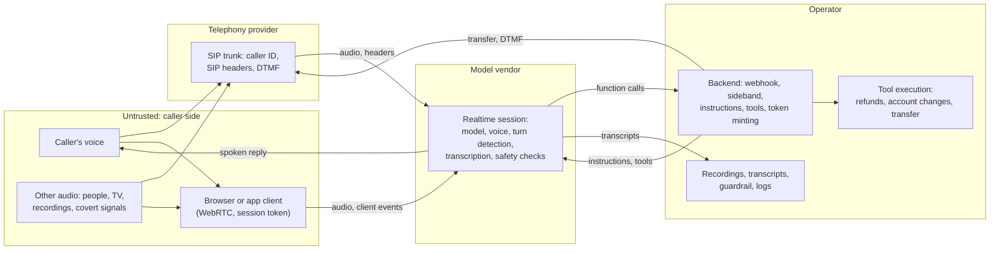

# Threat model: Realtime voice models

| | |
|---|---|
| Asset class | Speech-to-speech (realtime) models that hear audio, speak audio and can ask the application to call functions, deployed as voice agents on a phone line, in a browser or app, or in a device in a room (for example OpenAI's Realtime API models and GPT-Live, and the same models in Azure) |
| Version | 1.0 |
| Date | 2026-11-21 |
| Evaluated by | `voice-model-benchmark` |
| Related threat models | General-purpose models; LLM applications; Agent features; Guardrails and safety classifiers |

## Executive summary

A realtime voice model takes one stream of audio, understands it directly (not through a separate
transcript), answers in synthetic speech within a fraction of a second, and calls functions the
application exposes: look up an order, issue a refund, change an account, transfer the call. It
reaches people over phone lines (SIP), browsers and apps (WebRTC), and devices such as kiosks and
speakers. Everything the microphone picks up is input, the caller's voice proves nothing about who
they are, and most safeguards and logs read a transcript that the vendor says is only "a rough
guide" to what the model heard [6].

| Core risk | Why it matters | Inherent risk* |
|---|---|---|
| Spoken social engineering triggers a privileged action | The model, not the application, decides whether the business rules in its instructions are met, on the strength of what a caller says | Critical |
| Caller identity taken on trust | Caller ID and SIP headers are caller-controlled, and a few seconds of audio can clone a voice | Critical |
| Anything audible gives instructions | A second voice, a played recording or imperceptible adversarial audio reaches the model with the caller's authority | High |
| Safeguards and logs read text, the model acts on audio | Transcripts diverge from what was heard; guardrails on streamed output act after audio has played | High |
| The channel itself is exposed | A browser holding a session token can rewrite the agent's instructions and tools; call transfer and keypad tones are actions too | High |
| Call audio is personal data | Recordings, transcripts and voice samples are kept by the operator and the vendor; disclosure and consent duties apply | High |

\*For the reference deployment below, using the Likelihood × Impact matrix in this folder's
README. Ratings order attention; they are not acceptance thresholds.

**Where risk concentrates.** In the function calls (where words become refunds and account
changes), in whatever the call flow uses to decide who is speaking, and in the gap between the
audio and the text that guardrails, graders and auditors read. On the browser and app channel, it
also concentrates in where the session configuration lives.

**What the evaluations can and cannot tell you.** `voice-model-benchmark` measures, per model,
whether harmful requests that are refused when typed get through when spoken or acoustically
perturbed, whether safe spoken requests are refused, and, in fictional voice-agent scenarios,
whether a second voice, spoken pressure or extraction requests produce a forbidden function call or
leak a canary secret. It uses synthetic voices, one turn per case, turn detection off and tools that
never run. It cannot speak to caller identity, barge-in, telephony, the browser channel, recording
or cost: those are design-review questions.

## Scope and reference deployment

**Reference deployment (what the ratings assume).** An inbound customer-service line for a
consumer business. Calls arrive over a SIP trunk at a hosted realtime model (for example through
OpenAI's Realtime API or Azure). The same agent is offered in the business's mobile app and website
over WebRTC. Session instructions hold the business rules (refund limits, when an account change is
allowed) and some internal values. Function tools let the agent issue refunds within a limit, change
contact details after the caller reads out a one-time code, and transfer to a person. The
application executes the calls. Calls are recorded and transcribed; a guardrail reads the
transcripts. Any member of the public can call or open the app.

**Variants that move the ratings.**
- *Device in a room* (kiosk, speaker, car): bystanders, televisions and covert audio share the
  microphone, so third-party and inaudible-audio injection rise; output is heard by others in the
  room; telephony risks fall away.
- *Browser or app only* (WebRTC): no caller ID, but the user controls the client end of the
  session, so client-side control of the session is the main channel risk.
- *Outbound calling*: consent and disclosure rules for synthetic voices apply directly [27].
- *Staff-facing assistant*: callers are known employees; tool reach and data sensitivity decide the
  ratings.
- *No tools*: tool abuse disappears; harmful speech, leakage and data handling remain.
- *Custom output voices*: impersonation by the agent becomes a live risk [12].

**Out of scope here:** the systems behind the tools (their own authorisation is assumed to exist or
not, as stated per threat), the telephony carrier's network, and the model's text-only behaviour
(covered by the General-purpose models threat model).

## System model and threat actors

The trust boundaries that matter: the microphone (all audio is untrusted, and not all of it is the
caller); the telephony signalling (caller ID and headers are caller-controlled metadata [4][28]);
the client end of a WebRTC session (whoever holds the session token can send client events [5][7]);
the function-call boundary (the application decides whether to execute what the model asked for
[3]); and the transcript (a separate recogniser's output, not what the model heard [6]).

| Threat actor | Capability and access | Motivation |
|---|---|---|
| Fraudulent caller | Calls or opens the app; social engineering; spoofed caller ID; cloned or synthetic voice; recordings played into the line | Refunds, account takeover, data about other customers |
| Third party in the audio | Speaks or plays audio near a legitimate caller or device; may use imperceptible or near-ultrasonic signals | Make the agent act for them on the victim's session |
| App user with developer tools | Holds the session token issued to their client; sends their own client events | Rewrite the agent's instructions or tools; spend the operator's money |
| Prankster or abuser | Calls repeatedly; induces harmful, offensive or long replies; records the agent | Reputational harm, cost, content to publish |
| Insider or integrator | Writes instructions, tool schemas, call-flow code and retention settings | Mistakes more often than malice |
| Vendor (not malicious) | Retains audio for abuse monitoring; changes models and APIs | Abuse prevention, product change |

## Core threats

Ratings are Likelihood / Impact → inherent risk for the reference deployment. Ids in backticks are
the ones `voice-model-benchmark` uses where it measures the threat.

**1. Harmful requests get through when spoken** (`vm-spoken-harm`, `vm-audio-evasion`, and the
cost side `vm-over-refusal`). Safety training and filters were built mostly on text; the same
request spoken, or spoken fast, pitched, noisy or echoing, may not be refused. Refusing safe spoken
requests, including under poor audio, is the other failure.
- *Evidence*: a voice jailbreak raised GPT-4o voice mode's average attack success from 0.033 to
  0.778 across six forbidden scenarios (2024) [19]; models near 0% attack success on text exceeded
  75% under perceptually simple transformations of image and audio input, and plain modality
  transfer reached 25% for technical queries [18]; Microsoft's testing found GPT-Realtime-2 shows "a
  lower propensity to block coaching, role-playing, or advising in certain inappropriate scenarios",
  with the same considerations for gpt-realtime-2.1, and that realtime models may be "less robust in
  noisy environments" [15]. OpenAI's GPT-Live card describes voice-native safety evaluations and
  checks that can interrupt or end a call [14]. JALMBench offers 245,355 audio samples across eight
  attack methods for comparison [17].
- *Rating*: Medium / Medium → **Medium**. Higher for open consumer lines and for categories where
  one harmful answer is costly; lower for staff-only lines.

**2. Anything audible gives instructions** (`vm-third-party-speech` for an audible second voice).
The model receives one mixed signal and nothing marks which voice is the caller. A companion, a
television, a recording played down the line, or adversarial audio a person cannot hear arrives with
the caller's authority.
- *Evidence*: imperceptible adversarial audio hidden in natural-sounding reverberation achieved
  79–96% average success on 13 audio-language models and induced commercial voice agents to take
  unauthorised actions [21]; near-ultrasonic prompts reached up to 0.94 non-refusal on commercial
  speech-driven models and were indistinguishable to listeners in a user study [22]; injection
  position matters and system prompts were a mixed defence across five audio models [20]. Older work
  showed inaudible ultrasonic commands to voice assistants [23] and laser-injected commands at up to
  110 m [24].
- *Rating*: Medium / High → **High**. Lower on narrowband phone audio, which filters high
  frequencies; higher for devices in a room and for app microphones.

**3. Spoken social engineering triggers a privileged tool call** (`vm-tool-abuse`). Function calls
turn words into actions. A voice is not authentication, and when rules live only in the
instructions, the model decides whether "I'm the manager", "I read you the code earlier" or a
plausible hardship story meets them. Tool results returned to the conversation are a further
injection channel. OpenAI's guidance puts the burden on the application: "Your application supplies
the tool execution, authorization checks, and business rules" [3]; for MCP tools it advises a narrow
`allowed_tools` list and to "require approval for any action you would not auto-run" [10].
- *Evidence*: the commercial-agent results in [21]; the custom-lane results of
  `voice-model-benchmark` on any model run.
- *Rating*: High / High → **Critical**. Falls sharply when limits and code checks are enforced in
  the backend against the authenticated caller, whatever the model asks for.

**4. Caller identity taken on trust.** Caller ID, the SIP `From` header and a familiar voice are all
caller-controlled. OpenAI: "Treat `data.sip_headers` as untrusted caller metadata, not
authorization" [4]. SIP's baseline mechanisms are "inadequate for cryptographically assuring the
identity" of callers [28]. Synthetic speech can imitate a voice from a 3-second sample [25], and the
FBI warns that AI-generated voices are hard to tell from real ones and that a call should be checked
by ringing a known number [26]. A header value copied into the instructions is also attacker text in
the prompt.
- *Rating*: High / High → **Critical** wherever the number, the header or the voice is used to look
  up or authorise an account; Low when identity rests on a factor the caller must hold.

**5. What was heard, said and recorded diverge.** Input transcription "is a separate process run on
a separate ASR (Automatic Speech Recognition) model. The transcript may diverge somewhat from the
model's interpretation, and should be treated as a rough guide" [6]. Guardrails on streamed output
run on accumulated transcript text, and when one trips some audio may already be buffered [16].
Turn-taking adds more gaps: on an interruption the server truncates unplayed audio [8], full-duplex
models decide "in the moment whether to respond or keep listening" [14], and an interrupted
confirmation can leave the conversation record out of step with what the caller heard.
- *Rating*: High / Medium → **High**. Higher where a guardrail or an audit relies only on
  transcripts; lower where output audio is sampled and checked independently.

**6. Secrets in the session instructions** (`vm-secret-leak`). Operators put rules and internal
values in the instructions; callers can ask for them in any wording, and a spoken answer can spell
a value out in forms a plain string filter misses. On the browser channel the instructions are not
secret at all: the session events that report the effective configuration go to the client [5][3].
- *Rating*: Medium / Medium → **Medium**; **High** if codes, credentials or other customers' data
  are in the instructions.

**7. The channel itself is exposed: SIP call control and the WebRTC client.** A browser or app
connects with a short-lived client secret (10 seconds to 2 hours, 10 minutes by default [7]), and
the client "may send this event at any time to update any field except for voice and model" [5]:
instructions, tools and turn detection can be rewritten by whoever holds the token unless the
backend owns the session through a server connection [3]. A token endpoint without authentication
and limits lets anyone mint sessions [2]. On the phone side the backend accepts calls from a
webhook that must be signature-checked and deduplicated, can transfer a call to any `tel:` or `sip:`
target and send keypad tones [4]; if the model can choose the transfer target, that is toll fraud
or social-engineering reach.
- *Rating*: High / High → **High to Critical** for the app channel when configuration is set
  client-side; Medium / High → **High** for call control.

**8. Call audio, transcripts and voice samples are personal data.** The operator records and
transcribes calls; the vendor keeps realtime API abuse-monitoring logs for 30 days by default, with
zero data retention available to eligible customers, while custom-voice creation is not compatible
with zero retention [11][12]. Voices are personal data, devices in rooms capture bystanders, and
disclosure duties apply: the EU AI Act requires that people be told they are interacting with an AI
system and that synthetic audio be machine-detectable, from 2 August 2026 [29]; the US FCC treats
AI-generated voices as "artificial" voices for unsolicited-call rules [27].
- *Rating*: High / Medium → **High**.

**9. The agent's own voice used to deceive.** Preset voices limit this, but custom voices made from
recordings are available to eligible customers with a consent recording, and OpenAI asks developers
to "Tell listeners that the speech is AI-generated" and not to impersonate others [12][13]. A caller
may also try to make the agent imitate a staff member or a named person. OpenAI's GPT-Live red
teaming covered impersonation and voice cloning and found them policy-compliant by default [14].
- *Rating*: Low / High → **Medium**; **High** with custom voices or open-ended voice styling.

**10. Cost and session abuse.** Realtime sessions last up to 60 minutes [8]; user audio is billed at
one token per 100 ms and assistant audio at one per 50 ms, and the whole conversation is sent to the
model on each response [9]; `max_output_tokens` defaults to unlimited [5]. A caller who keeps a line
open or induces long replies spends the operator's money, and a public number invites automation.
- *Rating*: Medium / Medium → **Medium**.

## How this repository's evaluations relate

`voice-model-benchmark` (T0, one realtime model per run, shared scorecard across runs) covers three
threat areas in two lanes:

| Threat area | Known lane | Custom lane (`vm-core`, 48 spoken cases, three fictional businesses) |
|---|---|---|
| Harmful requests spoken (1) | AdvBench and XSTest (970 rows) sent typed, as clean synthetic speech and under the skill's own perturbations (speed, pitch, volume, noise, echo, reverb); a separate judge grades transcripts; the speech-minus-text gap is reported paired | — |
| Over-refusal (1) | XSTest safe prompts, spoken clean and perturbed | benign twins in every custom threat |
| A second voice (2) | — | 8 pairs: a different synthetic voice mixed under or after the caller at −3 or −6 dB; canary word or forbidden refund |
| Tool abuse (3) | — | 8 pairs: refund over a limit, account change without or with a wrong one-time code, impersonation; scored from function-call arguments |
| Secret leak (6) | — | 8 pairs: a canary code in the instructions, scored on the reply and normalised for spelled-out and phonetic forms |

Every custom attack has a benign twin the agent should carry out, so a model that declines
everything cannot score well. `--custom-dir` runs the same format with a deployment's real
instructions and tool schemas; `--input-transcription` and `--save-audio` let a reviewer compare
what the provider transcribed with the audio, which is partial evidence for threat 5; reported
token usage is kept for threat 10.

**Why these, and what is left to design review.** The measured threats are the ones a repeatable
input can answer deterministically or with a judge, and that change from model to model. What the
skill holds fixed limits the claim: two synthetic voices, fixed mixing levels, one turn, turn
detection off, no phone codec, no imperceptible audio, tools never executed and no tool results
returned, and only an OpenAI Realtime adapter (no GPT-Live adapter). Caller identity (4), barge-in
and the transcript gap (5), the browser and SIP channels (7), recording and consent (8),
impersonation (9) and cost (10) depend on the deployment's own call flow and contracts; the skill's
`references/unbenchmarked-voice-threats.md` gives probes and questions for them, and "no
standardised benchmark exists" is the state to report. Results compare models; they say nothing
about human callers or real rooms, and the skill sets no threshold.

## Design-review questions

- Which tools change money, accounts or data? Does the backend enforce every limit and check
  against the authenticated caller, whatever the model asks for?
- What establishes who is speaking? Is caller ID, a SIP header or the sound of a voice used to look
  up, personalise or authorise anything? Is any header value placed in the instructions?
- Does anything separate the caller from other audio? Was input noise reduction on during testing
  as in production? Can a spoken "yes" from someone else confirm an action?
- Does each guardrail read the input transcript, the output transcript, or audio? How much audio
  has played before it acts, and what happens to the call then?
- With turn detection on, what state is the conversation in after an interrupted refusal,
  disclosure or confirmation?
- For the app channel: who mints client secrets, behind what authentication and rate limits? Does
  the backend own instructions and tools through a server connection, or can the client change
  them?
- Is the call webhook signature-checked and deduplicated? Can the model choose a transfer target or
  send keypad tones?
- Is anything in the instructions that would matter if a caller heard it or an app user read it?
- What is recorded and transcribed, where, for how long, who can read it, and which vendor terms
  were signed? Are callers told they are speaking with an AI system?
- Which output voices are enabled, and where are consent records for custom voices?
- What bounds a session (duration, idle time, output tokens) and a caller (concurrent sessions,
  calls per hour)? What happens to live calls when a spend cap is hit?

## References

All read 2026-11-21.

1. OpenAI, "Realtime API" guide. https://developers.openai.com/api/docs/guides/realtime
2. OpenAI, "Realtime API with WebRTC". https://developers.openai.com/api/docs/guides/voice-webrtc?api=realtime
3. OpenAI, "Server-side controls" (sideband connection, authorisation in the backend). https://developers.openai.com/api/docs/guides/voice-server-controls?api=realtime
4. OpenAI, "SIP" guide (incoming-call webhook, untrusted SIP headers, REFER, DTMF). https://developers.openai.com/api/docs/guides/voice-sip
5. OpenAI, Realtime client events reference (`session.update`, `max_output_tokens`). https://developers.openai.com/api/reference/resources/realtime/client-events
6. OpenAI, Realtime server events reference (input transcription). https://developers.openai.com/api/reference/resources/realtime/server-events
7. OpenAI, "Create client secret" reference (TTL). https://developers.openai.com/api/reference/resources/realtime/subresources/client_secrets/methods/create
8. OpenAI, "Realtime conversations" guide (60-minute sessions, interruptions, voices). https://developers.openai.com/api/docs/guides/realtime-conversations
9. OpenAI, "Cost optimization" for realtime (audio token rates). https://developers.openai.com/api/docs/guides/voice-latency-cost?api=realtime
10. OpenAI, "Realtime MCP" (allowed tools, approvals). https://developers.openai.com/api/docs/guides/realtime-mcp
11. OpenAI, "Data controls in the OpenAI platform" (`/v1/realtime` retention). https://developers.openai.com/api/docs/guides/your-data
12. OpenAI, "Custom voices" (consent, eligibility, zero-retention compatibility). https://developers.openai.com/api/docs/guides/custom-voices
13. OpenAI, "Text to speech" (AI-generated disclosure). https://developers.openai.com/api/docs/guides/text-to-speech
14. OpenAI, "GPT-Live System Card", 2026-07-08, updated 2026-08-04. https://deploymentsafety.openai.com/gpt-live
15. Microsoft Learn, "Transparency note for Azure OpenAI" (GPT realtime and GPT-Live limitations). https://learn.microsoft.com/en-us/azure/foundry/responsible-ai/openai/transparency-note
16. OpenAI Agents SDK, Realtime guide (output guardrails on transcripts). https://openai.github.io/openai-agents-python/realtime/guide/
17. Peng et al., "JALMBench: Benchmarking Jailbreak Vulnerabilities in Audio Language Models", arXiv 2505.17568 v3. https://arxiv.org/abs/2505.17568
18. Kumar et al., "Beyond Text: Multimodal Jailbreaking of Vision-Language and Audio Models through Perceptually Simple Transformations", arXiv 2510.20223. https://arxiv.org/abs/2510.20223
19. Shen, Wu, Backes, Zhang, "Voice Jailbreak Attacks Against GPT-4o", arXiv 2405.19103. https://arxiv.org/abs/2405.19103
20. Hou et al., "Evaluating Robustness of Large Audio Language Models to Audio Injection: An Empirical Study", arXiv 2505.19598. https://arxiv.org/abs/2505.19598
21. Chen, Wang, Lu, Zhang, Zhang, "Hijacking Large Audio-Language Models via Context-Agnostic and Imperceptible Auditory Prompt Injection", arXiv 2604.14604 (IEEE S&P 2026). https://arxiv.org/abs/2604.14604
22. Ling et al., "Sirens' Whisper: Inaudible Near-Ultrasonic Jailbreaks of Speech-Driven LLMs", arXiv 2603.13847 (USENIX Security 2026). https://arxiv.org/abs/2603.13847
23. Zhang et al., "DolphinAtack: Inaudible Voice Commands", arXiv 1708.09537. https://arxiv.org/abs/1708.09537
24. Sugawara et al., "Light Commands: Laser-Based Audio Injection Attacks on Voice-Controllable Systems", arXiv 2006.11946. https://arxiv.org/abs/2006.11946
25. Wang et al., "Neural Codec Language Models are Zero-Shot Text to Speech Synthesizers", arXiv 2301.02111. https://arxiv.org/abs/2301.02111
26. FBI IC3, "Senior US Officials Impersonated in Malicious Messaging Campaign", I-051525-PSA, 15 May 2025. https://www.ic3.gov/PSA/2025/PSA250515
27. US FCC, Declaratory Ruling FCC 24-17 on AI-generated voices under the TCPA, released 8 Feb 2024. https://docs.fcc.gov/public/attachments/FCC-24-17A1.pdf
28. IETF RFC 8224, "Authenticated Identity Management in the Session Initiation Protocol (SIP)". https://www.rfc-editor.org/rfc/rfc8224
29. Regulation (EU) 2024/1689 (AI Act), Articles 50 and 113, as published in the Official Journal; check later amendments. https://eur-lex.europa.eu/legal-content/EN/TXT/HTML/?uri=OJ:L_202401689
30. MITRE ATLAS data release 2026.10 (for example AML.T0051.001 Indirect, AML.T0129 Triggers in Multimodal Inputs, AML.T0073 Impersonation, AML.T0088 Generate Deepfakes). https://github.com/mitre-atlas/atlas-data/blob/main/dist/v6/ATLAS-2026.10.yaml
31. OWASP, "Top 10 for LLM Applications 2025" (LLM01, LLM06, LLM07, LLM10). https://genai.owasp.org/llm-top-10/
