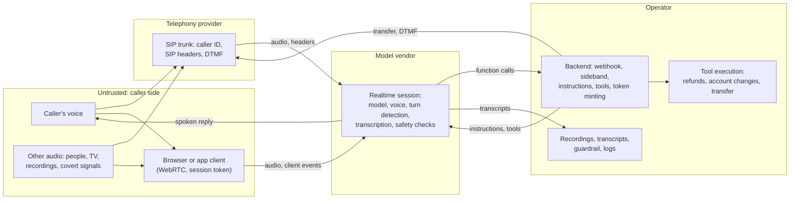

# Threat model: Realtime voice models

| | |
|---|---|
| Asset class | Speech-to-speech (realtime) models that hear audio, speak audio and can ask the application to call functions, deployed as voice agents on a phone line, in a browser or app, or in a device in a room (for example OpenAI's Realtime API models and GPT-Live, and the same models in Azure) |
| Version | 1.1 |
| Date | 2026-11-24 |
| Evaluated by | `voice-model-benchmark` |
| Related threat models | General-purpose models; LLM applications; Agent features; Guardrails and safety classifiers; Image-generation models (deepfake video) |

## Executive summary

A realtime voice model takes one stream of audio, understands it directly (not through a separate
transcript), answers in synthetic speech within a fraction of a second, and calls functions the
application exposes: look up an order, issue a refund, change an account, transfer the call. It
reaches people over phone lines (SIP), browsers and apps (WebRTC), and devices such as kiosks and
speakers. Everything the microphone picks up is input, the caller's voice proves nothing about who
they are, and most safeguards and logs read a transcript that the vendor says is only "a rough
guide" to what the model heard [6].

| Core risk | Why it matters | Inherent risk* |
|---|---|---|
| Spoken social engineering triggers a privileged action | The model, not the application, decides whether the business rules in its instructions are met, on the strength of what a caller says | Critical |
| Caller identity taken on trust | Caller ID and SIP headers are caller-controlled, a few seconds of audio can clone a voice, and the FBI and police document repeated fraud with cloned voices and deepfaked meetings of officials and executives | Critical |
| Anything audible gives instructions | A second voice, a played recording or imperceptible adversarial audio reaches the model with the caller's authority; in research this has made commercial voice agents take unauthorised actions | High |
| Safeguards and logs read text, the model acts on audio | Transcripts diverge from what was heard; guardrails on streamed output act after audio has played | High |
| The channel itself is exposed | A browser holding a session token can rewrite the agent's instructions and tools; call transfer and keypad tones are actions too | High |
| Call audio is personal data | Recordings, transcripts and voice samples are kept by the operator and the vendor; disclosure and consent duties apply | High |

\*For the reference deployment below, using the Likelihood × Impact matrix in this folder's
README. Ratings order attention; they are not acceptance thresholds.

**Where risk concentrates.** In the function calls (where words become refunds and account
changes), in whatever the call flow uses to decide who is speaking, and in the gap between the
audio and the text that guardrails, graders and auditors read. On the browser and app channel, it
also concentrates in where the session configuration lives.

**What the public evidence shows (to November 2026).** The harm observed in deployed systems is
fraud against people and human-run processes with cloned or synthetic voices and deepfaked
meetings: FBI warnings about AI-generated voice messages impersonating senior US officials, and
Singapore cases in which deepfaked executives and officials on video calls led to transfers of
USD 499,000 and at least SGD 4.9 million. Attacks on voice models themselves are research: hidden,
ambient or concurrent audio has made commercial voice agents and an AI phone take unauthorised
actions in studies. No CVE or advisory for a voice-agent platform, and no voice-model system card
reporting tests of audio injection or tool misuse, was found. That is a gap in public evidence,
not evidence that the risk is absent.

**What the evaluations can and cannot tell you.** `voice-model-benchmark` measures, per model,
whether harmful requests that are refused when typed get through when spoken or acoustically
perturbed, whether safe spoken requests are refused, and, in fictional voice-agent scenarios,
whether a second voice, spoken pressure or extraction requests produce a forbidden function call or
leak a canary secret. It uses synthetic voices, one turn per case, turn detection off and tools that
never run. It cannot speak to caller identity, barge-in, telephony, the browser channel, recording,
voice misuse or cost: those are design-review questions.

## Scope and reference deployment

**Reference deployment (what the ratings assume).** An inbound customer-service line for a
consumer business. Calls arrive over a SIP trunk at a hosted realtime model (for example through
OpenAI's Realtime API or Azure). The same agent is offered in the business's mobile app and website
over WebRTC. Session instructions hold the business rules (refund limits, when an account change is
allowed) and some internal values. Function tools let the agent issue refunds within a limit, change
contact details after the caller reads out a one-time code, and transfer to a person. The
application executes the calls. Calls are recorded and transcribed; a guardrail reads the
transcripts. Any member of the public can call or open the app.

**Variants that move the ratings.**
- *Device in a room* (kiosk, speaker, car): bystanders, televisions and covert audio share the
  microphone, so third-party and inaudible-audio injection rise; output is heard by others in the
  room; telephony risks fall away.
- *Browser or app only* (WebRTC): no caller ID, but the user controls the client end of the
  session, so client-side control of the session is the main channel risk.
- *Outbound calling*: consent and disclosure rules for synthetic voices apply directly [27], and the
  account becomes worth stealing to run calls (threats 9 and 10).
- *Staff-facing, or no tools*: known callers or no actions lower threats 3 and 4; the rest remain.
- *Tools that read outside content* (calendar, email, web, remote MCP servers [10]): tool results
  become a further injection channel for threat 3.
- *Custom output voices*: impersonation by the agent becomes a live risk [12].

**Out of scope:** the carrier's network, the systems behind the tools, and text-only model
behaviour (see the General-purpose models threat model). Deepfake fraud against the organisation's
staff that never touches the voice agent is context here, not a threat to the asset.

## System model and threat actors

Browsers and apps connect over WebRTC, servers over WebSocket, phone calls over SIP [1][4]. The
trust boundaries that matter: the microphone (all audio is untrusted, and not all of it is the
caller); the telephony signalling (caller ID and headers are caller-controlled metadata [4][28]);
the client end of a WebRTC session (whoever holds the session token can send client events [5][7]);
the function-call boundary (the application decides whether to execute what the model asked for
[3]); and the transcript (a separate recogniser's output, not what the model heard [6]).

| Threat actor | Capability and access | Motivation |
|---|---|---|
| Fraudulent caller | Calls or opens the app; social engineering; spoofed caller ID; cloned or synthetic voice of a customer or executive made from public audio; recordings played into the line | Refunds, account takeover, data about other customers |
| Third party in the audio | Speaks or plays audio near a legitimate caller or device; may use imperceptible, near-ultrasonic or reverberation-borne signals | Make the agent act for them on the victim's session |
| App user with developer tools | Holds the session token issued to their client; sends their own client events | Rewrite the agent's instructions or tools; spend the operator's money |
| Holder of a stolen API key or client secret | Runs sessions, or outbound calls, on the operator's account | Free compute, fraud at the operator's expense |
| Prankster or abuser | Calls repeatedly; induces harmful, offensive or long replies; records the agent | Reputational harm, cost, content to publish |
| Insider or integrator | Writes instructions, tool schemas, call-flow code and retention settings | Mistakes more often than malice |
| Vendor (not malicious) | Retains audio for abuse monitoring; changes models and APIs | Abuse prevention, product change |

## Core threats

Ratings are Likelihood / Impact → inherent risk for the reference deployment. Ids in backticks are
the ones `voice-model-benchmark` uses where it measures the threat. Each *Evidence* line opens with
the strongest evidence status found: observed in deployed systems (an incident), disclosed
vulnerability (an advisory or vendor-acknowledged weakness, not known exploited), demonstrated in
research, or theoretical. Framework ids are in the Framework mapping section.

**1. Harmful requests get through when spoken** (`vm-spoken-harm`, `vm-audio-evasion`, and the
cost side `vm-over-refusal`). Safety training and filters were built mostly on text; the same
request spoken, or spoken fast, pitched, noisy or echoing, may not be refused. Refusing safe spoken
requests, including under poor audio, is the other failure.
- *Evidence* (demonstrated in research; documented by vendors): a voice jailbreak raised GPT-4o
  voice mode's average attack success from 0.033 to 0.778 across six forbidden scenarios (2024)
  [19]; models near 0% attack success on text exceeded 75% under perceptually simple
  transformations of image and audio input, and plain modality transfer reached 25% for technical
  queries [18]; universal jailbreak audio that works over the air and need not align with the
  user's speech jailbroke GPT-4o-Audio and got past Meta's Llama-Guard-3 safeguard [42], and
  perturbations hidden in benign audio reached 60–78% on five models [43]. Microsoft's testing
  found GPT-Realtime-2 shows "a lower propensity to block coaching, role-playing, or advising in
  certain inappropriate scenarios", with the same considerations for gpt-realtime-2.1, and that
  realtime models may be "less robust in noisy environments" [15]. OpenAI's GPT-Live card
  describes voice-native safety evaluations, red teaming that included audio-specific
  perturbations, and checks that can interrupt or end a call [14].
- *Rating*: Medium / Medium → **Medium**. Higher for open consumer lines and for categories where
  one harmful answer is costly; lower for staff-only lines.

**2. Anything audible gives instructions** (`vm-third-party-speech` for an audible second voice).
The model receives one mixed signal and nothing marks which voice is the caller. A companion, a
television, a recording played down the line, or adversarial audio a person cannot hear arrives with
the caller's authority.
- *Evidence* (demonstrated in research, including against commercial voice agents and an AI
  phone): imperceptible adversarial audio hidden in natural-sounding reverberation achieved 79–96%
  average success on 13 audio-language models and induced commercial voice agents from Mistral AI
  and Microsoft Azure to take unauthorised actions [21]; instructions overlaid on the user's own
  speech reached 69.10% average success against Gemini 3 Pro and worked with volunteers on a
  Doubao AI smartphone [44]; where agent frameworks passed audio through, audio injections completed
  in 49% of cells [45]; near-ultrasonic prompts reached up to 0.94 non-refusal on commercial
  speech-driven models and were indistinguishable to listeners in a user study [22]; injection
  position matters and system prompts were a mixed defence across five audio models [20]. Older work
  showed inaudible ultrasonic commands to voice assistants [23] and laser-injected commands at up to
  110 m [24]. No report of audio-borne injection against a deployed voice agent outside research
  was found.
- *Rating*: Medium / High → **High**. Audible, reverberation-borne and overlaid injection apply on
  every channel; near-ultrasonic attacks need a microphone in the room, so devices and app
  microphones are more exposed than a phone line.

**3. Spoken social engineering triggers a privileged tool call** (`vm-tool-abuse`). Function calls
turn words into actions. A voice is not authentication, and when rules live only in the
instructions, the model decides whether "I'm the manager", "I read you the code earlier" or a
plausible hardship story meets them. Tool results returned to the conversation are a further
injection channel. OpenAI's guidance puts the burden on the application: "Your application supplies
the tool execution, authorization checks, and business rules" [3]; for MCP tools it advises a narrow
`allowed_tools` list and to "require approval for any action you would not auto-run" [10].
- *Evidence* (demonstrated in research against commercial agents; disclosed vulnerability in a
  voice assistant's tools): the commercial-agent results in [21] and [44]; calendar invitations and
  emails carrying indirect prompt injection made Gemini's web and mobile apps and Google Assistant
  phish, exfiltrate data and control home-automation devices, and Google deployed mitigations
  [46]; the custom-lane results of `voice-model-benchmark` on any model run. No CVE or advisory for
  a voice-agent platform was found.
- *Rating*: High / High → **Critical**. Falls sharply when limits and code checks are enforced in
  the backend against the authenticated caller, whatever the model asks for.

**4. Caller identity taken on trust: spoofed numbers, cloned voices, deepfaked meetings.** Caller
ID, the SIP `From` header and a familiar voice are all caller-controlled. OpenAI: "Treat
`data.sip_headers` as untrusted caller metadata, not authorization" [4]. SIP's baseline mechanisms
are "inadequate for cryptographically assuring the identity" of callers [28]. Synthetic speech can
imitate a voice from a 3-second sample [25]. A header value copied into the instructions is also
attacker text in the prompt. When a call is transferred, whatever the agent concluded about who is
calling travels with it to the person who picks up.
- *Evidence* (observed in deployed systems, against people and human-run processes): the FBI warned
  of texts and AI-generated voice messages claiming to come from senior US officials, sent since
  April 2025 to build rapport and gain account access, advising that a call be checked by ringing a
  known number [26]; its December 2025 update dates the activity to 2023 and lists requests for
  authentication codes, passport copies and overseas wire transfers [32], and a July 2026 notice
  describes AI video in live chats impersonating executives or law enforcement [33]. In Singapore a
  finance director on a Zoom call with a deepfaked CEO transferred over USD 499,000 (traced and
  withheld) [34][35], and in May 2026 a staged call purporting to include national leaders, partly
  deepfaked, led one victim to transfer at least SGD 4.9 million; police noted lips out of sync with
  speech and all audio coming from one account [36]. Deepfakes of company leaders in a fake meeting
  were used to deliver malware [38]; Microsoft reports deepfake voices in fraud and tech-support
  scams [40] and voice changers used by North Korean IT workers [39]. No case of a cloned voice
  passing a voice agent's own identity check was found.
- *Rating*: High / High → **Critical** wherever the number, the header or the voice is used to look
  up or authorise an account; Low when identity rests on a factor the caller must hold.

**5. What was heard, said and recorded diverge.** Input transcription "is a separate process run on
a separate ASR (Automatic Speech Recognition) model. The transcript may diverge somewhat from the
model's interpretation, and should be treated as a rough guide" [6]. Guardrails on streamed output
run on accumulated transcript text, and when one trips some audio may already be buffered [16].
Turn-taking adds more gaps: on an interruption the server truncates unplayed audio [8], full-duplex
models decide "in the moment whether to respond or keep listening" [14], and an interrupted
confirmation can leave the conversation record out of step with what the caller heard.
- *Evidence* (documented by vendors): the statements above. No study measuring the gap in a
  deployed voice agent's guardrail or audit trail was found.
- *Rating*: High / Medium → **High**. Higher where a guardrail or an audit relies only on
  transcripts; lower where output audio is sampled and checked independently.

**6. Secrets in the session instructions** (`vm-secret-leak`). Operators put rules and internal
values in the instructions; callers can ask for them in any wording, and a spoken answer can spell
a value out in forms a plain string filter misses. On the browser channel the instructions may not
be secret at all: session events, which report the effective configuration, are delivered to the
client [3][5].
- *Evidence* (documented channel property; no voice-specific study or incident found): the
  session-event behaviour above; extraction from text models is covered in the LLM applications
  threat model.
- *Rating*: Medium / Medium → **Medium**; **High** if codes, credentials or other customers' data
  are in the instructions.

**7. The channel itself is exposed: SIP call control and the WebRTC client.** A browser or app
connects with a short-lived client secret (10 seconds to 2 hours, 10 minutes by default [7]), and
the client "may send this event at any time to update any field except for voice and model" [5]:
instructions, tools and turn detection can be rewritten by whoever holds the token unless the
backend owns the session through a server connection [3]. A token endpoint without authentication
and limits lets anyone mint sessions [2]. On the phone side the backend accepts calls from a
webhook that must be signature-checked and deduplicated, can transfer a call to any `tel:` or `sip:`
target and send keypad tones [4]; if the model can choose the transfer target, that is toll fraud
or social-engineering reach.
- *Evidence* (documented design property; no incident, CVE or advisory found for voice-agent
  platforms).
- *Rating*: High / High → **High to Critical** for the app channel when configuration is set
  client-side; Medium / High → **High** for call control.

**8. Call audio, transcripts and voice samples are personal data.** The operator records and
transcribes calls; the vendor keeps realtime API abuse-monitoring logs for 30 days by default, with
zero data retention available to eligible customers, while custom-voice creation is not compatible
with zero retention [11][12]. Voices are personal data, devices in rooms capture bystanders, and
disclosure duties apply: the EU AI Act requires that people be told they are interacting with an AI
system and that synthetic audio be machine-detectable, from 2 August 2026 [29]; the US FCC treats
AI-generated voices as "artificial" voices for unsolicited-call rules [27]. Stored recordings are
also raw material for cloning the voices in them (threat 4).
- *Evidence* (regulatory duties; no voice-agent recording breach among the incidents found).
- *Rating*: High / Medium → **High**.

**9. Synthetic voice used to deceive: the agent's own voice, and the model as a fraud tool.**
Preset voices limit impersonation by the agent, but custom voices made from recordings are
available to eligible customers with a consent recording, and OpenAI asks developers to "Tell
listeners that the speech is AI-generated" and not to impersonate others [12][13]. A caller may
also try to make the agent imitate a staff member or a named person. The same capability serves
fraud against others: a realtime model holds a responsive conversation in a natural voice, and a
deployment can connect it to outbound calls, which is the shape of interactive voice phishing. For
an operator this arrives through a stolen key or client secret (threat 10) or a custom voice made
without its speaker's consent.
- *Evidence* (observed: fraud with AI-generated voices, see threat 4; disclosed weakness in
  cloning products; none tied to a realtime API): Consumer Reports found that four of six
  voice-cloning products "fail to take basic steps to stop unauthorized voice cloning" [37];
  Europol's 2025 assessment names voice cloning and live video deepfakes as enabling new forms of
  fraud, extortion and identity theft [41]; OpenAI's GPT-Live red teaming covered impersonation,
  speaker identification and scams, and found voice cloning and impersonation policy-compliant by
  default [14]. The public sources do not name the tools behind the frauds.
- *Rating*: Low / High → **Medium**; **High** with custom voices, outbound calling, open-ended
  voice styling, or keys that others could use.

**10. Cost and session abuse.** Realtime sessions last up to 60 minutes [8]; user audio is billed at
one token per 100 ms and assistant audio at one per 50 ms, and the whole conversation is sent to the
model on each response [9]; `max_output_tokens` defaults to unlimited [5]. A caller who keeps a line
open or induces long replies spends the operator's money, and a public number invites automation.
A stolen API key or client secret lets someone else run sessions on the operator's account.
- *Evidence* (vendor-documented billing; key theft observed for AI services generally): Anthropic
  reports that stolen AI API keys and sessions are now targets in their own right [48].
- *Rating*: Medium / Medium → **Medium**.

## Framework mapping

Versions: OWASP Top 10 for LLM Applications 2026 [31]; OWASP Top 10 for Agentic Applications for
2026 [49], which applies because the voice agent calls tools; MITRE ATLAS data release 2026.10
[30]. LLM ids use the 2026 numbering; the 2025 to 2026 crosswalk is in
[frameworks.md](frameworks.md).

**(a) Per threat.**

| Threat | OWASP LLM | OWASP Agentic | OWASP MCP | MITRE ATLAS |
|---|---|---|---|---|
| 1 Harmful requests spoken | LLM01:2026 | — | — | AML.T0054, AML.T0043, AML.T0129 |
| 2 Anything audible gives instructions | LLM01:2026 | ASI01 | — | AML.T0051.001, AML.T0129, AML.T0043, AML.T0041 |
| 3 Spoken social engineering, privileged call | LLM03:2026, LLM01:2026 | ASI01, ASI02, ASI03 | MCP07:2025 (remote MCP tools) | AML.T0053, AML.T0051.000, AML.T0073 |
| 4 Caller identity taken on trust | — | ASI03, ASI09 | — | AML.T0088, AML.T0073, AML.T0052.001 |
| 5 Heard, said and recorded diverge | LLM01:2026, LLM10:2026 | — | — | AML.T0129 |
| 6 Secrets in the instructions | LLM08:2026, LLM02:2026 | — | — | AML.T0069.002, AML.T0085.003 |
| 7 Channel exposed (SIP, WebRTC) | LLM03:2026, LLM08:2026, LLM10:2026 | ASI02, ASI03 | — | AML.T0081, AML.T0091.000, AML.T0132 |
| 8 Call audio is personal data | LLM02:2026 | — | — | — |
| 9 Synthetic voice used to deceive | — | ASI09 | — | AML.T0088, AML.T0073, AML.T0052.001, AML.T0016.002, AML.T0048.000 |
| 10 Cost and session abuse | LLM06:2026 | — | — | AML.T0034.000, AML.T0034.001, AML.T0029, AML.T0012 |

**(b) Coverage check.** OWASP Top 10 for LLM Applications 2026:

| Item | Covered by | Note |
|---|---|---|
| LLM01:2026 Prompt Injection | 1, 2, 3, 5 | The 2026 entry explicitly covers instructions in an audio track |
| LLM02:2026 Sensitive Information Disclosure | 6, 8 | |
| LLM03:2026 Excessive Agency | 3, 7 | Refunds, account changes, call transfer and keypad tones |
| LLM04:2026 Supply Chain | Not a separate threat | Hosted model; telephony providers and any third-party voice-agent platform in the call path are dependencies. No CVE or advisory for a voice-agent platform was found, a gap in public evidence |
| LLM05:2026 Data and Model Poisoning | Not applicable here | No fine-tuning in the reference deployment; research shows a speaker's natural voice can be trained in as a backdoor trigger for fine-tuned speech recognisers whose transcripts then drive agents [47] |
| LLM06:2026 Unbounded Consumption | 10 | |
| LLM07:2026 Misinformation | Not a separate threat | Wrong answers are covered by the LLM applications threat model; the voice-specific part is that the caller hears them with no record of their own (threat 5) |
| LLM08:2026 Hidden Context Exposure | 6, 7 | |
| LLM09:2026 Vector and Embedding Weaknesses | Not applicable here | No retrieval or embedding layer in the reference deployment |
| LLM10:2026 Improper Output Handling | 5, 7 | Streamed audio plays before an output guardrail acts; a model-chosen transfer target or keypad tones go to telephony |

OWASP Top 10 for Agentic Applications (the voice agent calls tools):

| Item | Covered by | Note |
|---|---|---|
| ASI01 Agent Goal Hijack | 2, 3 | Audio-borne and tool-result injection |
| ASI02 Tool Misuse and Exploitation | 3, 7 | |
| ASI03 Identity and Privilege Abuse | 3, 4, 7 | A spoken claim, caller metadata or a client token treated as authority |
| ASI04 Agentic Supply Chain Vulnerabilities | Not covered here | Remote MCP servers attached to a session belong to the Agent features threat model |
| ASI05 Unexpected Code Execution (RCE) | Not applicable | The reference agent's tools do not run code |
| ASI06 Memory & Context Poisoning | Not applicable here | No memory across calls in the reference deployment; one that adds it takes this item on |
| ASI07 Insecure Inter-Agent Communication | Not applicable here | One agent per call; where a voice model delegates to other models, as GPT-Live does [14], that link is the vendor's |
| ASI08 Cascading Failures | Not a separate threat | A wrong action spreads through the agent's tools (3) and through a transfer to staff (4) |
| ASI09 Human-Agent Trust Exploitation | 4, 9 | Listeners trust a natural voice; staff may trust the agent's view of who is calling |
| ASI10 Rogue Agents | Not applicable here | No case of a voice agent acting outside its scope was found; its reach is bounded by its tools (3) |

OWASP MCP Top 10 (beta) [50]: not applied to the reference deployment, whose function tools run in
the operator's backend. Where a session attaches remote MCP servers [10], the list applies to those
servers through the Agent features threat model; the voice-specific part is threat 3 (MCP07:2025:
the server sees the agent's call, not who is speaking).

**(c) MITRE ATLAS.** Tactics, with the techniques above that fall under each: AI Model Access
(AML.TA0000: AML.T0041); AI Attack Adaptation (AML.TA0001: AML.T0043, AML.T0088); Resource
Development (AML.TA0003: AML.T0016.002); Initial Access (AML.TA0004: AML.T0052.001, AML.T0132,
AML.T0012); Execution (AML.TA0005: AML.T0051.000, AML.T0051.001, AML.T0053); Persistence
(AML.TA0006: AML.T0081); Privilege Escalation (AML.TA0012: AML.T0053, AML.T0054, AML.T0012);
Defense Evasion (AML.TA0007: AML.T0054, AML.T0073, AML.T0081, AML.T0129); Discovery (AML.TA0008:
AML.T0069.002); Collection (AML.TA0009: AML.T0085.003); Lateral Movement (AML.TA0015:
AML.T0052.001, AML.T0091.000); Impact (AML.TA0011: AML.T0029, AML.T0034.000, AML.T0034.001,
AML.T0048.000). No ATLAS case study involves a voice agent, audio-borne injection or voice-clone
fraud. The nearest are AML.CS0063 Prompt-Based Attacks Against Gemini via Calendar Invitations,
whose underlying research also covered Google Assistant (threat 3), and AML.CS0033 Live Deepfake
Image Injection to Evade Mobile KYC Verification and AML.CS0034 ProKYC: Deepfake Tool for Account
Fraud Attacks, which apply threat 4's pattern to face verification.

## Recent incidents

January 2025 to November 2026. "Research" marks a published attack with no reported real-world
exploitation.

| Date | What happened | Category | Threat(s) | Source |
|---|---|---|---|---|
| 2025-03 | Consumer Reports found four of six voice-cloning products lacked basic steps to stop cloning without consent | Disclosed vulnerability | 9 | [37] |
| 2025-03 | Singapore: a finance director on a Zoom call with a deepfaked CEO and others transferred over USD 499,000; police traced and withheld the funds | AI used against other systems | 4, 9 | [34][35] |
| 2025-05 | FBI: texts and AI-generated voice messages claiming to come from senior US officials, sent to officials and their contacts to gain account access | AI used against other systems | 4, 9 | [26] |
| 2025-05 | AudioJailbreak: universal jailbreak audio that works over the air jailbroke GPT-4o-Audio and bypassed Llama-Guard-3 (research) | Disclosed vulnerability | 1, 2 | [42] |
| 2025-06 | Huntress: deepfakes of company leaders in a fake Zoom call led an employee to install macOS malware; Huntress attributes it to TA444 (BlueNoroff) | AI used against other systems | 4 | [38] |
| 2025-06 | Microsoft: North Korean remote IT workers use AI face-swaps on identity documents and voice-changing software in employment fraud | AI used against other systems | 4 | [39] |
| 2025-08 | WhisperInject: harmful payloads hidden as perturbations in benign audio, 60–78% success on five models (research) | Disclosed vulnerability | 1 | [43] |
| 2025-08 | Calendar invitations and emails carrying prompt injection made Gemini apps and Google Assistant phish, exfiltrate data and control home devices; Google deployed mitigations | Disclosed vulnerability | 3 | [46] |
| 2025-10 | Microsoft Digital Defense Report: deepfake voices and video used in fraud and tech-support scams | AI used against other systems | 4, 9 | [40] |
| 2025-12 | FBI update: impersonation of officials dates to 2023; requests include authentication codes, passport copies and overseas wire transfers | AI used against other systems | 4, 9 | [32] |
| 2026-04 | AudioHijack: imperceptible audio in natural reverberation hijacked 13 audio-language models and made commercial voice agents from Mistral AI and Microsoft Azure take unauthorised actions (research) | Disclosed vulnerability | 2, 3 | [21] |
| 2026-05 | Singapore: a staged video call purporting to include national leaders and officials, partly deepfaked; one victim transferred at least SGD 4.9 million | AI used against other systems | 4, 9 | [36] |
| 2026-07 | FBI: AI-generated videos of a senior FBI leader steer scam victims to a spoofed IC3 site; AI video in live chats impersonates executives or law enforcement | AI used against other systems | 4, 9 | [33] |
| 2026-07 | Piggybacking on Perception: instructions overlaid on the user's speech reached 69.10% success against Gemini 3 Pro and worked with volunteers on an AI smartphone (research) | Disclosed vulnerability | 2, 3 | [44] |
| 2026-09 | MMPIBench: where agent frameworks passed audio through, audio injections completed in 49% of cells (research) | Disclosed vulnerability | 2 | [45] |

All harm observed in the period is fraud against people and human-run processes, with officials and
executives impersonated by cloned voices and deepfaked meetings to obtain payments, codes and
access; none was tied to a voice-agent API. Attacks on voice models moved in research from
jailbreaks (2025) to hijacking agents' actions through ambient or concurrent audio (2026),
including commercial voice agents, with no reported exploitation. No CVE or advisory for a
voice-agent platform, and no system card reporting security tests of audio injection or tool
misuse, was found: a gap in public evidence, not evidence of safety.

## How this repository's evaluations relate

`voice-model-benchmark` (T0, one realtime model per run, shared scorecard across runs) covers three
threat areas in two lanes:

| Threat area | Known lane | Custom lane (`vm-core`, 48 spoken cases, three fictional businesses) |
|---|---|---|
| Harmful requests spoken (1) | AdvBench and XSTest (970 rows) sent typed, as clean synthetic speech and under the skill's own perturbations (speed, pitch, volume, noise, echo, reverb); a separate judge grades transcripts; the speech-minus-text gap is reported paired | — |
| Over-refusal (1) | XSTest safe prompts, spoken clean and perturbed | benign twins in every custom threat |
| A second voice (2) | — | 8 pairs: a different synthetic voice mixed under or after the caller at −3 or −6 dB; canary word or forbidden refund |
| Tool abuse (3) | — | 8 pairs: refund over a limit, account change without or with a wrong one-time code, impersonation; scored from function-call arguments |
| Secret leak (6) | — | 8 pairs: a canary code in the instructions, scored on the reply and normalised for spelled-out and phonetic forms |

Every custom attack has a benign twin the agent should carry out, so a model that declines
everything cannot score well. Published audio (JALMBench [17]) can replace the synthetic AdvBench
speech. `--custom-dir` runs the same format with a deployment's real
instructions and tool schemas; `--input-transcription` and `--save-audio` let a reviewer compare
what the provider transcribed with the audio, which is partial evidence for threat 5; reported
token usage is kept for threat 10.

**Why these, and what is left to design review.** The measured threats are the ones a repeatable
input can answer deterministically or with a judge, and that change from model to model. What the
skill holds fixed limits the claim: two synthetic voices, fixed mixing levels, one turn, turn
detection off, no phone codec, no optimised adversarial audio (imperceptible, hidden in
reverberation or concealed in the caller's speech) and nothing played over the air, so none of the
2025–2026 research attacks above is reproduced (the second voice is plain, audible speech), tools
never executed and no tool results returned, and only an OpenAI Realtime adapter (no GPT-Live
adapter). Caller identity
(4), barge-in and the transcript gap (5), the browser and SIP channels (7), recording and consent
(8), impersonation and misuse of the voice (9) and cost and stolen keys (10) depend on the
deployment's own call flow and contracts; the skill's reference on unbenchmarked voice threats
gives probes and questions for them, and "no standardised benchmark exists" is the state to report.
Results compare models; they say nothing about human callers or real rooms, and the skill sets no
threshold.

## Design-review questions

- Which tools change money, accounts or data? Does the backend enforce every limit and check
  against the authenticated caller, whatever the model asks for?
- What establishes who is speaking? Is caller ID, a SIP header or the sound of a voice used to look
  up, personalise or authorise anything? Is any header value placed in the instructions?
- When the agent transfers a call, what does the person who picks up learn about who is calling,
  and is a familiar voice, a video presence or "the agent already verified them" ever enough for
  a payment, a credential reset or an authentication code?
- Does anything separate the caller from other audio? Can someone else's spoken "yes" confirm an
  action?
- Do any tools return text from outside parties (calendar, email, web pages, MCP servers) into the
  conversation, and could that text instruct the agent?
- Does each guardrail read the input transcript, the output transcript, or audio? How much audio
  has played before it acts, and what happens to the call then?
- With turn detection on, what state is the conversation in after an interrupted refusal,
  disclosure or confirmation?
- For the app channel: who mints client secrets, behind what authentication and rate limits? Does
  the backend own instructions and tools through a server connection, or can the client change
  them?
- Is the call webhook signature-checked and deduplicated? Can the model choose a transfer target?
- Would anything in the instructions matter if a caller heard it or an app user read it?
- What is recorded, where, for how long, who reads it, under which signed vendor terms? Are callers
  told they are speaking with an AI system? Which voices are enabled, with what consent records?
- Who can use the project's API keys and client secrets, is usage watched per key, and could
  someone else run inbound or outbound calls on the account?
- What bounds a session (duration, idle time, output tokens) and a caller (sessions, calls per
  hour)?

## References

Read 2026-11-21 unless marked otherwise.

1. OpenAI, "Realtime API" guide. https://developers.openai.com/api/docs/guides/realtime
2. OpenAI, "Realtime API with WebRTC". https://developers.openai.com/api/docs/guides/voice-webrtc?api=realtime
3. OpenAI, "Server-side controls" (sideband connection, authorisation in the backend). https://developers.openai.com/api/docs/guides/voice-server-controls?api=realtime
4. OpenAI, "SIP" guide (incoming-call webhook, untrusted SIP headers, REFER, DTMF). https://developers.openai.com/api/docs/guides/voice-sip
5. OpenAI, Realtime client events reference (`session.update`, `max_output_tokens`). https://developers.openai.com/api/reference/resources/realtime/client-events
6. OpenAI, Realtime server events reference (input transcription). https://developers.openai.com/api/reference/resources/realtime/server-events
7. OpenAI, "Create client secret" reference (TTL). https://developers.openai.com/api/reference/resources/realtime/subresources/client_secrets/methods/create
8. OpenAI, "Realtime conversations" guide (60-minute sessions, interruptions, voices). https://developers.openai.com/api/docs/guides/realtime-conversations
9. OpenAI, "Cost optimization" for realtime (audio token rates). https://developers.openai.com/api/docs/guides/voice-latency-cost?api=realtime
10. OpenAI, "Realtime MCP" (allowed tools, approvals). https://developers.openai.com/api/docs/guides/realtime-mcp
11. OpenAI, "Data controls in the OpenAI platform" (`/v1/realtime` retention). https://developers.openai.com/api/docs/guides/your-data
12. OpenAI, "Custom voices" (consent, eligibility, zero-retention compatibility). https://developers.openai.com/api/docs/guides/custom-voices
13. OpenAI, "Text to speech" (AI-generated disclosure). https://developers.openai.com/api/docs/guides/text-to-speech
14. OpenAI, "GPT-Live System Card", 2026-07-08, updated 2026-08-04; re-read 2026-11-24 (no evaluation of audio-borne injection or tool misuse reported). https://deploymentsafety.openai.com/gpt-live
15. Microsoft Learn, "Transparency note for Azure OpenAI" (GPT realtime and GPT-Live limitations). https://learn.microsoft.com/en-us/azure/foundry/responsible-ai/openai/transparency-note
16. OpenAI Agents SDK, Realtime guide (output guardrails on transcripts). https://openai.github.io/openai-agents-python/realtime/guide/
17. Peng et al., "JALMBench: Benchmarking Jailbreak Vulnerabilities in Audio Language Models", arXiv 2505.17568 v3. https://arxiv.org/abs/2505.17568
18. Kumar et al., "Beyond Text: Multimodal Jailbreaking of Vision-Language and Audio Models through Perceptually Simple Transformations", arXiv 2510.20223. https://arxiv.org/abs/2510.20223
19. Shen, Wu, Backes, Zhang, "Voice Jailbreak Attacks Against GPT-4o", arXiv 2405.19103. https://arxiv.org/abs/2405.19103
20. Hou et al., "Evaluating Robustness of Large Audio Language Models to Audio Injection: An Empirical Study", arXiv 2505.19598. https://arxiv.org/abs/2505.19598
21. Chen, Wang, Lu, Zhang, Zhang, "Hijacking Large Audio-Language Models via Context-Agnostic and Imperceptible Auditory Prompt Injection" (AudioHijack), arXiv 2604.14604 (IEEE S&P 2026). https://arxiv.org/abs/2604.14604
22. Ling et al., "Sirens' Whisper: Inaudible Near-Ultrasonic Jailbreaks of Speech-Driven LLMs", arXiv 2603.13847 (USENIX Security 2026). https://arxiv.org/abs/2603.13847
23. Zhang et al., "DolphinAtack: Inaudible Voice Commands", arXiv 1708.09537. https://arxiv.org/abs/1708.09537
24. Sugawara et al., "Light Commands: Laser-Based Audio Injection Attacks on Voice-Controllable Systems", arXiv 2006.11946. https://arxiv.org/abs/2006.11946
25. Wang et al., "Neural Codec Language Models are Zero-Shot Text to Speech Synthesizers", arXiv 2301.02111. https://arxiv.org/abs/2301.02111
26. FBI IC3, "Senior US Officials Impersonated in Malicious Messaging Campaign", I-051525-PSA, 15 May 2025. https://www.ic3.gov/PSA/2025/PSA250515
27. US FCC, Declaratory Ruling FCC 24-17 on AI-generated voices under the TCPA, released 8 Feb 2024. https://docs.fcc.gov/public/attachments/FCC-24-17A1.pdf
28. IETF RFC 8224, "Authenticated Identity Management in the Session Initiation Protocol (SIP)". https://www.rfc-editor.org/rfc/rfc8224
29. Regulation (EU) 2024/1689 (AI Act), Articles 50 and 113, as published in the Official Journal; check later amendments. https://eur-lex.europa.eu/legal-content/EN/TXT/HTML/?uri=OJ:L_202401689
30. MITRE ATLAS data release 2026.10 (released 2026-10-28), techniques and case studies as named above; AML.T0012 checked against the data file on 2026-11-24. https://github.com/mitre-atlas/atlas-data/blob/main/dist/v6/ATLAS-2026.10.yaml
31. OWASP, "Top 10 for LLM Applications 2026" (OWASP-GenAI-LLM-Top-10-2026-v1.0), read 2026-11-24. https://genai.owasp.org/top-10-for-llm-applications-2026/ and https://genai.owasp.org/resource/owasp-genai-llm-top-10-2026/
32. FBI IC3, public service announcement I-121925-PSA (update on impersonation of senior US officials), 19 Dec 2025, read 2026-11-24. https://www.ic3.gov/PSA/2025/PSA251219
33. FBI IC3, public service announcement I-072026-PSA (AI-generated video impersonating FBI leadership and executives), 20 Jul 2026, read 2026-11-24. https://www.ic3.gov/PSA/2026/PSA260720
34. Singapore Police Force, MAS and CSA, joint advisory on scams involving digital manipulation, 12 Mar 2025, read 2026-11-24. https://www.police.gov.sg/media-hub/news/2025/03/20250312_joint_advisory_on_scams_involving_digital_manipulation
35. Singapore Police Force, Singapore and Hong Kong police recover funds in a deepfake video-call scam, 7 Apr 2025, read 2026-11-24. https://www.police.gov.sg/media-hub/news/2025/04/20250407_singapore_and_hong_kong_police_force_recover_over_$670000_in_a_scam
36. Singapore Police Force, advisory on scams impersonating senior government officials (14 May 2026) and footage from the staged video conference (16 May 2026), read 2026-11-24. https://www.police.gov.sg/media-hub/news/2026/05/20260514_advisory_on_scams_involving_impersonation_of_snr_govt_officials_incl_secy_cabinet and https://www.police.gov.sg/media-hub/news/2026/05/20260516_footage_from_zoom_video_conference_involving_impersonation_of_senior_government_officials
37. Consumer Reports, assessment of six AI voice-cloning products, 10 Mar 2025, read 2026-11-24. https://innovation.consumerreports.org/new-report-do-these-6-ai-voice-cloning-companies-do-enough-to-prevent-misuse/
38. Huntress, analysis of a BlueNoroff Web3 intrusion using a deepfake Zoom call, 18 Jun 2025, read 2026-11-24. https://www.huntress.com/blog/inside-bluenoroff-web3-intrusion-analysis
39. Microsoft Threat Intelligence, Jasper Sleet: North Korean remote IT workers' evolving tactics, 30 Jun 2025, read 2026-11-24. https://www.microsoft.com/en-us/security/blog/2025/06/30/jasper-sleet-north-korean-remote-it-workers-evolving-tactics-to-infiltrate-organizations/
40. Microsoft, "Microsoft Digital Defense Report 2025", 16 Oct 2025, read 2026-11-24. https://blogs.microsoft.com/on-the-issues/2025/10/16/mddr-2025/
41. Europol, EU Serious and Organised Crime Threat Assessment 2025, "The changing DNA of serious and organised crime", read 2026-11-24. https://www.europol.europa.eu/publication-events/main-reports/changing-dna-of-serious-and-organised-crime
42. Chen, Song, Zhao et al., "AudioJailbreak: Jailbreak Attacks against End-to-End Large Audio-Language Models", arXiv 2505.14103, read 2026-11-24. https://arxiv.org/abs/2505.14103
43. Dingeto, Kwon, Choi et al., "When Good Sounds Go Adversarial: Jailbreaking Audio-Language Models with Benign Inputs" (WhisperInject), arXiv 2508.03365, read 2026-11-24. https://arxiv.org/abs/2508.03365
44. Liu, Li, Zhao et al., "Piggybacking on Perception: Stealthy Concurrent Audio Prompt Injections against Multimodal LLM Agents", arXiv 2607.28165, read 2026-11-24. https://arxiv.org/abs/2607.28165
45. Nguyen, Husain, "An Experimental Evaluation of Multimodal Prompt Injection Attacks on Agentic AI Frameworks" (MMPIBench), arXiv 2609.09404, read 2026-11-24. https://arxiv.org/abs/2609.09404
46. Nassi, Cohen, Yair, "Invitation Is All You Need! Promptware Attacks Against LLM-Powered Assistants in Production Are Practical and Dangerous", arXiv 2508.12175 (ATLAS AML.CS0063), read 2026-11-24. https://arxiv.org/abs/2508.12175
47. Krčo, Dodd, Romov et al., "You Are the Trigger: Speaker-Activated Backdoors", arXiv 2610.27210 (research), read 2026-11-24. https://arxiv.org/abs/2610.27210
48. Anthropic, "Detecting and countering misuse of AI: September 2026", read 2026-11-24. https://www.anthropic.com/threat-intelligence-report-september-2026
49. OWASP, "Top 10 for Agentic Applications for 2026" (December 2025), read 2026-11-24. https://genai.owasp.org/resource/owasp-top-10-for-agentic-applications-for-2026/
50. OWASP, "MCP Top 10" (beta, v0.1), read 2026-11-24. https://owasp.org/www-project-mcp-top-10/
